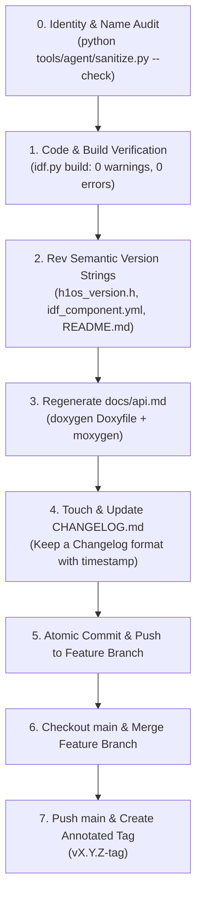

# Pre-Merge to Main Governance & Release Invariants

This rule governs the mandatory release and merge checklist required before ANY branch, feature, or bug fix is merged into the `main` branch of **H1OS**.

---

## 1. The Pre-Merge Contract ("No Dirty Main")

The `main` branch represents production-grade, verifiable, and historical stability. Direct commits to `main` without completing the pre-merge checklist are strictly prohibited.

Before executing a merge into `main`, the developer or autonomous agent **MUST** satisfy all four invariants in the following order:



---

## 2. Invariant 1: Semantic Version Synchronization

Version strings must never drift across documentation, packaging metadata, and compiled binaries. Whenever merging to `main`, the version must be revved synchronously across all four canonical locations:

1. **Firmware C Header (`components/h1os/include/h1os/h1os_version.h`):**
   ```c
   #define H1OS_VERSION_MAJOR   2
   #define H1OS_VERSION_MINOR   3
   #define H1OS_VERSION_PATCH   3
   #define H1OS_VERSION_TAG     "dev"
   #define H1OS_VERSION_STRING  "2.3.3-dev"
   ```
2. **Component Registry Manifest (`components/h1os/idf_component.yml`):**
   ```yaml
   version: "2.3.3-dev"
   ```
3. **Repository Readme Badge (`README.md`):**
   ```markdown
   [](components/h1os/include/h1os/h1os.h)
   ```
4. **Changelog Release Heading (`CHANGELOG.md`):**
   ```markdown
   ## [2.3.3-dev] - 2026-10-24
   ```

---

## 3. Invariant 2: API Documentation Regeneration (`docs/api.md`)

Whenever public headers in `components/h1os/include/h1os/` or internal subsystem interfaces are modified:
- Automated API markdown documentation **MUST** be regenerated from source Doxygen annotations.
- The generated `docs/api.md` must be committed in the same pre-merge commit.
- Intermediate Doxygen artifacts (`docs/doxygen/`) must remain excluded from Git via `.gitignore`.

**Generation Command:**
```powershell
doxygen Doxyfile; if ($LASTEXITCODE -eq 0 -or $?) { moxygen --flavor github -a -o docs/api.md docs/doxygen/xml }
```

---

## 4. Invariant 3: Living Changelog Discipline (`CHANGELOG.md`)

Every merge to `main` must touch `CHANGELOG.md` adhering to the [Keep a Changelog](https://keepachangelog.com/en/1.0.0/) standard:

1. Add a new dated section at the top of the ledger:
   ```markdown
   ## [X.Y.Z-tag] - YYYY-MM-DD
   ```
2. Group changes under standard descriptive subheadings:
   - `### 🚀 Added` for new features, drivers, or capabilities.
   - `### 🔄 Changed` for architectural refactors or behavioral changes.
   - `### 🛡️ Fixed & Hardened` for bug fixes, safety invariant patches, or memory reliefs.
   - `### 🗑️ Removed` for deprecated code or pruned orphans.
3. Explicitly reference modified source files (`components/...`) and architectural rationale.

---

## 5. Invariant 4: Verified Clean Build & Memory Profiling

Before merging:
1. Compile using the canonical ESP-IDF v6.1 profile script:
   ```powershell
   & "C:\Espressif\tools\Microsoft.v6.1.PowerShell_profile.ps1"; idf.py -B build_dev build
   ```
2. Build must exit with code 0 and ZERO warnings or `-Werror` breaks.
3. Verify memory budgets using `murdock_memory_budget` to confirm DIRAM, RTC Slow, and Flash app partition headroom remain within design limits.

---

## 6. Invariant 5: Identity & Workstation Hygiene Audit

Before committing or merging:
1. Run the identity & name sanitizer:
   ```powershell
   python tools/agent/sanitize.py --check
   ```
2. The audit must exit with code 0 (ZERO personal names, workstation paths, or archive ownership leaks).
3. If leaks are detected, resolve with `python tools/agent/sanitize.py --fix` and re-verify.

---

## 7. Git Branching & Tagging Lifecycle

1. **Commit to Feature Branch:** Commit all staged code, updated version strings, regenerated `docs/api.md`, and `CHANGELOG.md`.
2. **Push Feature Branch:** Push to `origin/<branch_name>`.
3. **Merge into Main:** Checkout `main`, execute `git merge <branch_name> -m "Merge branch '<branch_name>' into main (vX.Y.Z-tag)"`, and push `origin/main`.
4. **Annotated Tagging:** Create an annotated release tag:
   ```bash
   git tag -a vX.Y.Z-tag -m "Release vX.Y.Z-tag: <Summary of changes>"
   git push origin vX.Y.Z-tag
   ```
5. **Branch Hygiene:** Return active working branch back to the development branch.
