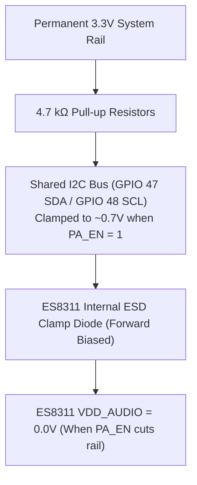

# Hardware Errata, Silicon Nuances & PCB Rev B Redesign Guide

> **Target Hardware:** Waveshare ESP32-S3 ePaper 1.54" V2 (`ESP32-S3-PICO-1-N8R8`, Non-Touch)  
> **Applicable Firmware:** H1OS (E-Class Environmental Operating System)  
> **Purpose:** Document physical PCB layout defects, electrical hazards, and architectural limitations discovered during driver bring-up, and provide engineering schematics/layout guidelines for a hardware **Rev B** redesign.

---

## 1. Executive Summary & Hardware Flaw Index

During low-level driver development and metrological evaluation of H1OS, several physical hardware defects, power distribution anomalies, and pin multiplexing conflicts were identified on the Waveshare ESP32-S3 ePaper 1.54" V2 development board. Note that this hardware target is strictly a **non-touch** 200x200 monochrome display appliance; no touch controller is present or supported by H1OS.

While H1OS implements software mitigations across Layers 1–3, these defects introduce parasitic power draw, restrict autonomous coprocessor operation, and induce thermal biases that require hardware correction in **Rev B**.

| ID | Hardware Subsystem | Defect Description | Rev B Proposed Solution |
| :--- | :--- | :--- | :--- |
| **E1** | SHTC3 Environmental Sensor | Inadequate thermal relief & PCB heat conduction | Deep U-slot tongue, necked traces, no copper planes |
| **E2** | MicroSD Storage Socket | Missing Card Detect (CD) & unswitched power rail | Mechanical CD pin on RTC; high-side P-MOSFET gate |
| **E3** | ULP-RISC-V Coprocessor | I2C/SPI routed to digital pins (not RTC GPIOs) | Route sensor I2C to RTC GPIOs (e.g. `GPIO 1/2`) |
| **E4** | Audio Codec & Amp (ES8311) | Power gating clamps I2C bus to ~0.7V via ESD diode | Dedicated I2C isolator or gate amplifier only |
| **E5** | Battery ADC Voltage Divider | Continuous ~10.5 µA bleed across 200kΩ/200kΩ divider | N-channel MOSFET switch on ground leg of divider |
| **E6** | System Power Latch | Fragile software latch on `GPIO 17` (`BAT_CTRL`) | Hardware push-button IC (e.g., LTC2954 / MAX16054) |
| **E7** | Tactile Buttons (`BOOT`/`PWR`) | External 10 kΩ pull-up resistors without RC filtering | Standard 10 kΩ pull-ups with 100 nF RC filter |
| **E8** | SSD1681 E-Paper Display | Shared `MOSI/SDA` line for glass thermistor read `0x1B` | Dedicated `MISO` trace or discrete bezel thermistor |

---

## 2. In-Depth Technical Errata & Engineering Analysis

### Errata E1: SHTC3 Cavity Self-Heating & Copper Bridge Conduction

#### 1. Physical Layout Analysis
The Sensirion SHTC3 relative humidity and temperature sensor is situated along the outer board edge and benefits from a perimeter milling slot for physical isolation from the main board area.
1. **Edge Placement & Milling Slot:** The sensor is located along the board edge and separated by a PCB milling slot, which provides spatial separation from direct mechanical contact with hot components.
2. **Copper Trace Thermal Conduction:** However, ground and power traces traversing the narrow bridge neck to the sensor are copper. Copper has a high thermal conductivity ($k_{\text{Cu}} \approx 385\,\text{W/(m}\cdot\text{K)}$ compared to FR4 at $k_{\text{FR4}} \approx 0.25\,\text{W/(m}\cdot\text{K)}$). Over extended active sessions (sustained 240 MHz operation, prolonged display compositing, or RF transmissions), heat slowly conducts across the bridge copper.
3. **Thermal Profile:** During initial boot or brief headless sensor sample bursts, the sensor remains thermally decoupled. Sustained active sessions can exhibit localized temperature rises of $+0.5^\circ\text{C}\dots +1.5^\circ\text{C}$.

#### 2. Metrological Impact
Relative Humidity ($RH$) is an exponential function of temperature according to the Clausius-Clapeyron relation:

$$
RH = \frac{e}{e_s(T)} \times 100\%
$$

Where saturation vapor pressure $e_s(T) \approx 6.112 \times \exp\left(\frac{17.67 \cdot T}{T + 243.5}\right)\,\text{hPa}$.

A thermal bias of $+1.0^\circ\text{C}$ at $22^\circ\text{C}$ / $50\%$ RH artificially depresses the reported relative humidity by approximately $-3.1\%$ RH. Rapid headless sample bursts minimize MCU on-time so internal silicon heat cannot conduct across the PCB before the reading completes.

#### 3. Current H1OS Firmware Mitigations
- **Headless Sensor Sample Burst:** On periodic timer wakes, the Xtensa processor executes an isolated normal-power SHTC3 sample and returns immediately to deep sleep without booting the display or secondary core, preventing internal silicon heat from conducting across the PCB.
- **Thermal Lockout MUX:** Telemetry samples taken during active display refresh or button interaction are flagged as thermally contaminated and locked out from the ambient history ring buffer.
- **Thermodynamic Invariants:** Calculates actual vapor pressure ($e$) and dew point ($T_{\text{dew}}$), which remain invariant even if the sensor package experiences minor self-heating.

#### 4. Rev B Hardware Redesign Recommendations
- **Cantilevered PCB Tongue:** Route a deep U-shaped slot (minimum $2.0\,\text{mm}$ width, $\ge 15\,\text{mm}$ depth) to place the SHTC3 on an isolated peninsula / cantilevered tab.
- **Necked-Down Traces:** Route all 4 connections (VDD, GND, SDA, SCL) across the bridge using minimum-width traces ($0.1\,\text{mm}$ / $4\,\text{mil}$) with meandering serpentine routing to maximize thermal resistance ($R_{\text{th}} = \frac{L}{k \cdot A}$).
- **Copper Pour Exclusion:** Strictly prohibit solid ground or power copper planes on the sensor peninsula. Use a local $100\,\text{nF}$ decoupling capacitor whose ground return is a single thin trace.
- **Component Placement:** Move the sensor peninsula to the extreme corner of the board, as far as physically possible from the ESP32-S3, power LDO, and battery charger.

---

### Errata E2: MicroSD Socket: Missing Card Detect & Unswitched Power Rail

#### 1. Physical Defect Analysis
The onboard MicroSD card socket is connected to the ESP32-S3 via a 1-bit SDMMC bus (`GPIO 39` CLK, `GPIO 41` CMD, `GPIO 40` D0).
1. **Missing Mechanical Card Detect (CD):** The socket's mechanical card detect switch is left unconnected (`SDMMC_SLOT_NO_CD`).
2. **Permanently Powered Rail ($V_{\text{DD}}$):** The MicroSD card power pin ($V_{\text{DD}}$) is wired directly to the main system 3.3V rail without any high-side power switch or gating transistor.

#### 2. Firmware & Battery Life Impact
1. **Quiescent Current Drain:** Most standard commercial MicroSD cards (even when idle or in SDMMC standby mode) draw between **$100\,\mu\text{A}$ and $1.5\,\text{mA}$** continuous quiescent current per manufacturer specifications, draining a $500\,\text{mAh}$ LiPo battery in weeks rather than months.
2. **Blind Initialization & Bus Timeouts:** Without a physical CD pin, the firmware cannot know if a card is physically present. Attempting to mount (`esp_vfs_fat_sdmmc_mount()`) sends clock trains (`CMD0`, `CMD8`), causing bus timeouts and polluting UART logs with error warnings.
3. **No Hardware Power Cycling:** If a card enters a locked, brownout, or undefined state during a low-battery event, firmware has no mechanism to cycle power ($0\,\text{V}$) to force a clean Power-On-Reset (POR).

#### 3. Current H1OS Firmware Mitigations
- Reduced SDMMC driver logging levels during mount attempts in `sub_sdcard.c` to prevent console spam.
- Tristated SDMMC bus pins upon mount failure.

#### 4. Rev B Hardware Redesign Recommendations
- **Mechanical Card Detect:** Connect the MicroSD socket's CD switch to an RTC GPIO (e.g. `GPIO 2` or `GPIO 7`) with a $100\,\text{k}\Omega$ pull-up resistor to 3.3V. This allows both the main CPU and the ULP coprocessor to instantly check card presence without bus probing.
- **High-Side Load Switch:** Insert a dedicated P-channel MOSFET (e.g., DMG2305UX) or ultra-low-$R_{\text{ON}}$ load switch with discharge (e.g., TI TPS22918 or SGM2553) on the SD card $V_{\text{DD}}$ supply pin, controlled by an MCU GPIO (`SD_PWR_EN`). When no card is mounted or the system is in deep sleep, $V_{\text{DD}}$ is pulled to $0.0\,\text{V}$, eliminating card standby leakage.

---

### Errata E3: ULP-RISC-V Coprocessor Blindness (Non-RTC Bus Routing)

#### 1. Physical Defect Analysis
The ESP32-S3 SoC incorporates an integrated ultra-low-power RISC-V coprocessor (ULP-RISC-V) running from the RTC power domain. The ULP can execute autonomous firmware while the main dual-core Xtensa CPU, high-speed clocks, and digital power domains are completely unpowered in deep sleep.

However, the ULP-RISC-V hardware peripherals (and its GPIO bit-bang capabilities) are strictly limited to **RTC IOs** (`RTC_GPIO 0` through `RTC_GPIO 21`).

On the Waveshare v2 board:
- **I2C Bus (SHTC3 & PCF85063A):** Routed to `GPIO 47` (SDA) and `GPIO 48` (SCL).
- **SPI Bus (SSD1681):** Routed to `GPIO 11`, `GPIO 12`, `GPIO 13`.
- `GPIO 47` and `GPIO 48` are digital-only IOs connected to the digital matrix; **they are NOT RTC GPIOs**.

#### 2. Architectural Impact
Because `GPIO 47/48` cannot be controlled from the RTC domain:
1. The ULP-RISC-V coprocessor is **completely blind** to the primary environmental sensor (SHTC3) and calendar RTC (PCF85063A) during deep sleep.
2. The system cannot perform true autonomous coprocessor sensor sampling.
3. Every sensor reading requires waking the primary dual-core Xtensa processor (powering up the high-voltage LDO, PLL, and clock trees).

#### 3. Current H1OS Firmware Mitigations
- Implemented the **RTC Fast Wake Stub** (`orch_wake_stub.c`): When waking for sensor sample bursts, the CPU executes directly from RTC Fast SRAM at low frequency, bypassing the secondary bootloader, flash cache, and FreeRTOS kernel to complete the SHTC3 normal-power measurement and return directly to sleep.
- Reserved the ULP-RISC-V coprocessor for ADC battery threshold monitoring (`ADC1_CH3` on `GPIO 4`), button debounce (`GPIO 0/18`), and RTC interrupt clearing (`GPIO 5`), which are on RTC GPIOs.

#### 4. Rev B Hardware Redesign Recommendations
- **Route I2C to RTC GPIOs:** Reassign the primary I2C bus to pins within `GPIO 0`–`GPIO 21`. Specifically:
  - `RTC_GPIO 1` (GPIO 1) $\rightarrow$ I2C SDA
  - `RTC_GPIO 2` (GPIO 2) $\rightarrow$ I2C SCL
- **Enable Autonomous Telemetry:** This reassignment enables the ULP-RISC-V to utilize its built-in hardware RTC I2C controller to autonomously read SHTC3 temperature and humidity without waking the main Xtensa processor until a display refresh is required or an environmental threshold is breached.

---

### Errata E4: Audio Codec Power Gating Clamps Shared I2C Bus to ~0.7V

#### 1. Physical Defect Analysis & Root Cause
The Everest Semi ES8311 audio codec and NS4168 Class-D mono speaker amplifier share the primary I2C bus (`GPIO 47/48`) with the Sensirion SHTC3 and NXP PCF85063A.

The Waveshare board includes a dedicated power rail gate for the audio subsystem controlled by `PA_EN` (`GPIO 42`, active LOW).

**The Electrical Hazard:**
1. The ES8311 I2C inputs (`SDA`, `SCL`) include internal electrostatic discharge (ESD) protection clamp diodes connected between the IO pins and the codec's internal $V_{\text{DD}}$ supply rail:

   $$
   D_{\text{clamp}}: \text{I2C Pin} \longrightarrow V_{\text{DD\_AUDIO}}
   $$

2. When firmware de-asserts `PA_EN` (`GPIO 42 = 1`) to cut power to the audio section, $V_{\text{DD\_AUDIO}}$ collapses to $0.0\,\text{V}$.
3. The external $4.7\,\text{k}\Omega$ pull-up resistors on `GPIO 47` and `GPIO 48` are connected to the permanent system $3.3\,\text{V}$ rail.
4. Current flows from $3.3\,\text{V} \rightarrow R_{\text{pullup}} \rightarrow D_{\text{clamp}} \rightarrow V_{\text{DD\_AUDIO}}$ ($0\,\text{V}$).
5. The forward voltage drop across the ESD diodes ($V_F \approx 0.65\dots 0.70\,\text{V}$) **clamps the entire I2C bus voltage down to $\sim 0.7\,\text{V}$**!

#### 2. Firmware Impact
Whenever `PA_EN` was turned OFF to save power, the SHTC3 and PCF85063A could no longer communicate. The I2C bus held permanently low, resulting in FreeRTOS task timeouts, device hangs, and failed wake cycles.

#### 3. Current H1OS Firmware Mitigations
- **Bootloader & Runtime Rail Power Hold:** `PA_EN` is asserted LOW (`GPIO 42 = 0`) and held via pad hold in both the 2nd-stage bootloader (`h1os_boot_hook.c`) and runtime HAL (`hal_io.c`) across all active and deep sleep states.
- **Register-Level Standby:** Instead of cutting rail power, the ES8311 is placed into a software deep standby register sequence (`0x0D=0xFC, 0x0E=0x6A, 0x12=0x02, 0x00=0x1F`), and the NS4168 amplifier is muted via `PA_CTRL` (`GPIO 46 = 0`). This places the audio codec into silicon standby without forward-biasing the ESD diodes.

#### 4. Rev B Hardware Redesign Recommendations
- **Option 1 (Hardware Bus Isolation):** Place a bidirectional I2C level translator / bus buffer with power-down isolation (e.g., NXP PCA9306 or TI TCA9517) between the main I2C bus and the ES8311. When the audio domain is unpowered, the buffer enters high-Z mode, completely isolating the codec from the bus.
- **Option 2 (Gate Amplifier Only):** Keep the ES8311 codec permanently powered on the clean 3.3V rail (using its software standby register mode), and use `PA_EN` strictly to gate the power supply to the NS4168 Class-D amplifier.
- **Option 3 (Secondary I2C Port):** Route the audio codec to a dedicated secondary I2C port or software bit-bang pins, keeping the critical sensor/RTC bus completely unencumbered.

---

### Errata E5: Battery ADC Divider Continuous Quiescent Bleed

#### 1. Physical Defect Analysis
To measure LiPo battery voltage ($3.0\,\text{V}\dots 4.2\,\text{V}$), the board uses a discrete 1:2 resistive voltage divider connected to `GPIO 4` (ADC1 Channel 3):
- High-side resistor: $R_1 = 200\,\text{k}\Omega$ (tied to $V_{\text{BAT}}$).
- Low-side resistor: $R_2 = 200\,\text{k}\Omega$ (tied to GND).
- Ratio: $V_{\text{ADC}} = V_{\text{BAT}} \times \frac{200\text{k}}{200\text{k} + 200\text{k}} = 0.5 \times V_{\text{BAT}}$.

The divider is **hardwired permanently** between $V_{\text{BAT}}$ and GND with no switching transistor.

#### 2. Battery Drain Impact
Total series resistance is $R_{\text{total}} = 400\,\text{k}\Omega$.
At a nominal battery voltage of $4.0\,\text{V}$:

$$
I_{\text{leakage}} = \frac{4.0\,\text{V}}{400\,\text{k}\Omega} = 10.0\,\mu\text{A}
$$

At full charge ($4.2\,\text{V}$):

$$
I_{\text{leakage}} = \frac{4.2\,\text{V}}{400\,\text{k}\Omega} = 10.5\,\mu\text{A}
$$

This continuous $10.5\,\mu\text{A}$ bleed occurs **24 hours a day, 365 days a year**, even when the device is completely powered down or in deep sleep. Over one year, this passive divider drains:

$$
10.5\,\mu\text{A} \times 24\,\text{h} \times 365\,\text{days} \approx 92\,\text{mAh}
$$

For a typical $500\,\text{mAh}$ LiPo battery, this single resistor pair consumes nearly **20% of the battery capacity** over a year while idle.

#### 3. Current H1OS Firmware Mitigations
- In software, nothing can stop a passive resistor divider from conducting. H1OS mitigates measurement noise by taking fast 16-sample trimmed mean bursts and entering sleep immediately.

#### 4. Rev B Hardware Redesign Recommendations
- **Gated Low-Side MOSFET:** Add a small N-channel MOSFET (e.g., 2N7002, BSS138, or DMN2075U) on the bottom leg of the divider, driven by an MCU GPIO (`BAT_ADC_EN`):
  - When measuring: Assert `BAT_ADC_EN = 1` for $2\,\text{ms}$, sample ADC, then drop `BAT_ADC_EN = 0`.
  - When sleeping: `BAT_ADC_EN = 0` completely opens the circuit, eliminating passive divider bleed.
- **Alternative (High-Side Load Switch):** Gate the high-side resistor using a P-MOSFET to avoid small ground-offset voltage errors across the N-MOSFET $R_{\text{DS(on)}}$.

---

### Errata E6: Fragile Software-Latched System Power (`BAT_CTRL` on GPIO 17)

#### 1. Physical Defect Analysis
System battery power distribution is controlled by `GPIO 17` (`BAT_CTRL`).
- When the user presses the tactile POWER button, it physically bridges the battery gate to enable the main 3.3V LDO.
- Once the ESP32-S3 boots, software must drive `GPIO 17 = 1` to "latch" the LDO on before the user releases their finger.
- In deep sleep, firmware must enable RTC pad hold (`gpio_hold_en(GPIO_NUM_17)` / `gpio_deep_sleep_hold_en()`) and maintain the RTC peripheral power domain (`ESP_PD_DOMAIN_RTC_PERIPH`).

#### 2. Failure Modes & Fragility
1. **Short-Press Boot Abort:** If the user presses the power button for less than the bootloader execution time, the LDO loses gate drive before `GPIO 17` is asserted, and the board powers down immediately.
2. **Brownout / Crash Latch Drop:** If firmware experiences an unexpected kernel panic, watchdog timeout, or brownout reset that resets the RTC IO controller, the pad hold drops, immediately cutting power to the device and preventing post-mortem crash logging.
3. **No Hardware Power-On Debounce:** Bouncing contacts on the power switch can cause rapid on/off transients across the main power rails.

#### 3. Current H1OS Firmware Mitigations
- **Strict 2nd-Stage Bootloader Latching:** `h1os_boot_hook.c` (`bootloader_before_init()`) asserts `GPIO 17 = 1` and locks the pad hold immediately upon entering the 2nd-stage bootloader before application decompression.
- Enforced `esp_sleep_pd_config(ESP_PD_DOMAIN_RTC_PERIPH, ESP_PD_OPTION_ON)` across all sleep calls to guarantee the latch remains energized in deep sleep.

#### 4. Rev B Hardware Redesign Recommendations
- **Dedicated Push-Button Controller IC:** Replace the discrete software GPIO latch with an industry-standard push-button on/off management controller:
  - **LTC2954 / LTC2950:** Hardware debounce, configurable power-on press duration (e.g. 500 ms), hardware power-down interrupt, and clean kill pin (`KILL#`).
  - **MAX16054:** Push-button on/off controller with debounced latching output and clear input.
- **Benefits:** Guaranteed clean startup, hardware-debounced power cycling, zero-power standby when turned off, and immunity to software resets.

---

### Errata E7: Tactile Button Pull-Up Resistors & Noise Sensitivity
 
#### 1. Physical Layout Analysis
The tactile buttons (`BOOT` on `GPIO 0` and `POWER` on `GPIO 18`) utilize external $10\,\text{k}\Omega$ pull-up resistors to the 3.3V rail.
 
#### 2. Electrical & Timing Impact
1. **Pull-Up Value:** At $10\,\text{k}\Omega$, static pull-up strength is standard and avoids excessive idle current while maintaining reasonable edge rise time.
2. **Noise Coupling & Debounce:** Due to trace routing length across the board, switch contacts remain susceptible to mechanical bounce and localized RF noise transients from the ESP32-S3 and Class-D audio amplifier if not filtered in hardware.
 
#### 3. Current H1OS Firmware Mitigations
- In `hal_io.c`, the SoC internal pull-ups ($\sim 45\,\text{k}\Omega$) are enabled in parallel with the external $10\,\text{k}\Omega$ pull-ups (and RTC pull-ups are enabled during deep sleep) to stiffen the line.
- Hardware debouncing and glitch filtering ($\ge 30\,\text{ms}$) are handled at the ULP coprocessor monitor (in sleep) and via LVGL keypad indev debouncing (in active wake).
 
#### 4. Rev B Hardware Redesign Recommendations
- Maintain $10\,\text{k}\Omega$ ($1\%$) pull-up resistors.
- Place a **$100\,\text{nF}$** ceramic capacitor in parallel with each switch's contacts (forming a passive hardware low-pass RC filter with $\tau = 1\,\text{ms}$ to absorb mechanical contact bounce).
- Add an ESD protection diode array (e.g., USBLC6-2SC6) directly at the tactile switch terminals to protect the SoC from electrostatic discharge through the user-accessible buttons.

---

### Errata E8: SSD1681 Single-Line Half-Duplex Display Read (No MISO)

#### 1. Physical Defect Analysis
The SSD1681 electrophoretic display driver is interfaced over 4-wire SPI. It features an onboard integrated silicon temperature sensor accessible via register `0x1B`.

However, the Waveshare v2 board does not route a discrete MISO line back to the ESP32-S3. Instead, the bidirectional `MOSI/SDA` line (`GPIO 13`) must be shared for both command/data writes and temperature register reads.

#### 2. Firmware Impact
Standard ESP-IDF full-duplex SPI master drivers (which utilize hardware DMA) cannot read bidirectional single-line buses on the fly without breaking DMA descriptors.

#### 3. Current H1OS Firmware Mitigations
- In `hal_spi.c`, an extra dedicated SPI device handle is registered with flags:
  `SPI_DEVICE_HALFDUPLEX | SPI_DEVICE_3WIRE` operating at a reduced clock rate ($2\,\text{MHz}$).
- Manual GPIO CS assertion is required to keep chip-select asserted continuously while switching bus directions to avoid resetting the SSD1681 internal read pointer.

#### 4. Rev B Hardware Redesign Recommendations
- **Break out Dedicated MISO:** Connect the SSD1681 `SDA/DOUT` pin through a buffer or separate trace to a dedicated ESP32-S3 MISO pin.
- **Dedicated Bezel Thermistor:** Since the SSD1681 internal thermistor is on the display glass substrate and has low measurement resolution ($\pm 2.0^\circ\text{C}$), Rev B should incorporate an ultra-precise discrete negative-temperature-coefficient (NTC) thermistor or digital temperature sensor (e.g., TI TMP117 / TMP102) mounted directly behind the front glass bezel.

---

## 3. Summary of Rev B BOM & Schematic Modifications

| Component Type | Part Number / Spec | Reference Designator | Purpose |
| :--- | :--- | :--- | :--- |
| **Push-Button IC** | Analog Devices LTC2954 | `U_PWR_CTRL` | Hardware on/off & debounce latch |
| **P-Channel MOSFET** | Diodes Inc. DMG2305UX | `Q_SD_PWR` | MicroSD rail power cut |
| **N-Channel MOSFET** | Diodes Inc. 2N7002 | `Q_ADC_GATE` | Battery 200kΩ/200kΩ divider zero-leakage gate |
| **I2C Bus Buffer** | NXP PCA9306 | `U_I2C_ISO` | Codec isolation (eliminates ~0.7V clamp) |
| **Button Pull-ups** | 10 kΩ 0402 1% Resistors | `R_BTN1`, `R_BTN2` | Pull-up termination |
| **Button Filters** | 100 nF 0402 16V X7R Caps | `C_BTN1`, `C_BTN2` | Hardware RC contact debounce |
| **ESD Suppressors** | STMicroelectronics USBLC6-2 | `D_ESD1`, `D_ESD2` | Button & MicroSD ESD protection |
| **Slot Milling** | 2.0 mm PCB Routing Path | `MECHANICAL` | SHTC3 cantilevered thermal isolation tab |
