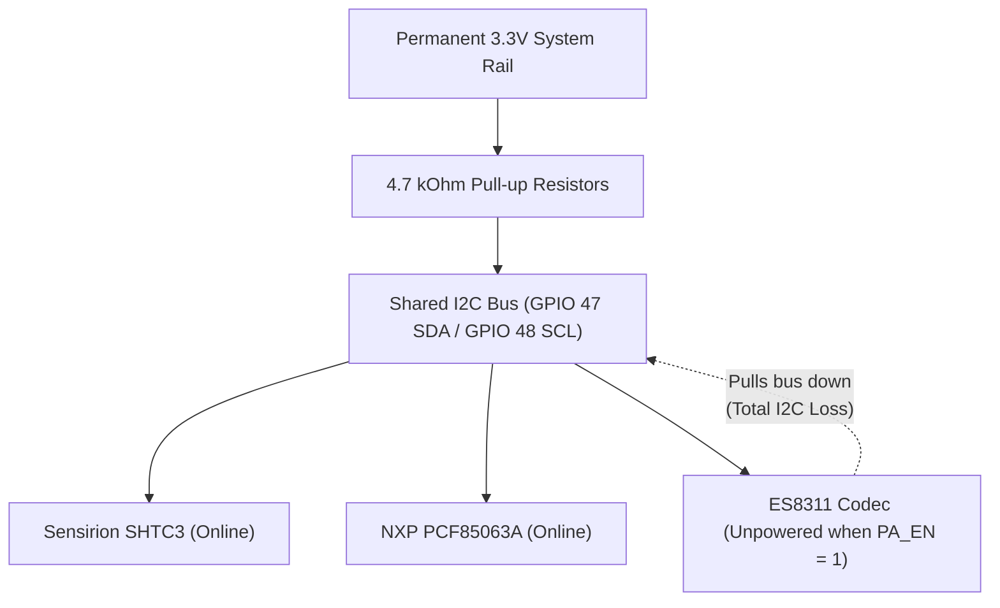

# Hardware Errata, Silicon Nuances & PCB Rev B Redesign Guide

> **Target Hardware:** Waveshare ESP32-S3 ePaper 1.54" V2 (`ESP32-S3-PICO-1-N8R8`, Non-Touch)
>
> **Applicable Firmware:** H1OS `v2.4.0-dev` (E-Class Environmental Operating System)
>
> **Purpose:** Document physical PCB layout defects, electrical hazards, and architectural limitations discovered during driver bring-up, and provide engineering schematics/layout guidelines for a hardware **Rev B** redesign.

## 1. Executive Summary & Hardware Flaw Index

During low-level driver development and metrological evaluation of H1OS, several physical hardware defects, power distribution anomalies, and pin multiplexing conflicts were identified on the Waveshare ESP32-S3 ePaper 1.54" V2 development board. Note that this hardware target is strictly a **non-touch** 200x200 monochrome display appliance; no touch controller is present or supported by H1OS.

While H1OS implements software mitigations across Layers 1–3, these defects introduce parasitic power draw, restrict autonomous coprocessor operation, and induce thermal biases that require hardware correction in **Rev B**.

> [!IMPORTANT] **ULP RISC-V Silicon Invariant Empirically Proven (ERR-S1):** Rigorous empirical testing on ESP32-S3 silicon (`examples/riscv_test`) confirmed that the internal ULP sleep timer (`RTC_CNTL_ULP_CP_SLP_TIMER_EN = 1`) **completely masks and suppresses external RTC GPIO comparator wakeups** from releasing ULP clock gating during deep sleep. With both bits armed (`0xA0000000`, `TIMER_EN=1, GPIO_ENA=1, CLR=0`), tactile button presses on GPIO 18 registered `0` ULP wakeups while the 15-second timer countdown was active. When `TIMER_EN=0` (`0x20000000`), the exact same pin woke the ULP instantly in 1.3 seconds. Therefore, the H1OS architecture of **Pure Event Mode** (`ULP_RISCV_WAKEUP_SOURCE_GPIO`) with periodic intervals offloaded to the external PCF85063A RTC on `GPIO 5` is an absolute silicon mandate.

| ID | Hardware Subsystem | Defect Description | Rev B Proposed Solution | 
| ----- | ----- | ----- | ----- | 
| **E1** | SHTC3 Environmental Sensor | Inadequate thermal relief & PCB heat conduction | Deep U-slot tongue, necked traces, no copper planes | 
| **E2** | MicroSD Storage Socket | Missing Card Detect (CD) & unswitched power rail | Mechanical CD pin on RTC; high-side P-MOSFET gate | 
| **E3** | ULP-RISC-V Coprocessor | I2C/SPI routed to digital pins (not RTC GPIOs) | Route sensor I2C to RTC GPIOs (e.g. `GPIO 1/2`) | 
| **E4** | Audio Codec & Amp (ES8311) | Power gating unpowered codec brings down shared I2C bus; vendor datasheet lacks ESD specs, pull-up guidance, and CSM S0-S7 state definitions | Dedicated I2C isolator or gate amplifier only | 
| **E5** | Battery ADC Voltage Divider | Continuous \~10.5 µA bleed across 200kΩ/200kΩ divider | N-channel MOSFET switch on ground leg of divider | 
| **E6** | System Power Latch | Fragile software latch on `GPIO 17` (`BAT_CTRL`) | Hardware push-button IC (e.g., LTC2954 / MAX16054) | 
| **E7** | Tactile Buttons (`BOOT`/`PWR`) | External 10 kΩ pull-up resistors without RC filtering | Standard 10 kΩ pull-ups with 100 nF RC filter | 
| **E8** | SSD1681 E-Paper Display | Shared `MOSI/SDA` line for glass thermistor read `0x1B` | Dedicated `MISO` trace or discrete bezel thermistor | 
| **E9** | Slow Clock Domain | Missing 32.768 kHz crystal; pins 15/16 multiplexed to I2S | Dedicated 32.768 kHz crystal on XTAL32K pads (route I2S elsewhere) | 
| **E10** | USB VBUS / Charger Detection | Missing dedicated VBUS/VUSB voltage monitor pin | Resistor divider from 5V VBUS to RTC GPIO for hardware USB detect | 
| **E11** | 5-Pin LiPo Charger (STAT & ISET) | STAT pin only wired to LED (not MCU IO); ISET fixed with static resistor | Route STAT to RTC GPIO with pull-up; connect ISET to I2C digipot for programmable charge rates | 
| **E12** | LiPo Battery Thermal Protection | Missing battery thermistor (NTC); 2-pin socket lacks cell temperature sense | 3-pin JST-PH connector (`BAT+`, `BAT-`, `NTC`) or PCB cradle 10k NTC to RTC ADC | 
| **E13** | Enclosure & Form Factor Packaging | Protruding rear IO headers waste enclosure volume that should house a larger battery | Eliminate rear headers; planar rear battery landing zone accommodating high-capacity pouch | 
| **E14** | Board Identity & Calibration Storage | Missing board-level silicon UID / EEPROM; identity coupled to MCU eFuse MAC | Microchip 24AA02UID / AT24CS02 SOT-23 on I2C bus for factory serial number & cal storage | 
| **E15** | USB-C Charge Receptacle | Mechanical wear, shell ingress aperture & cable torque on portable enclosure | 3-pin symmetrical magnetic pogo-pin charge interface (`[GND] [VBUS +5V Center-Hot] [GND]`) | 

## 2. In-Depth Technical Errata & Engineering Analysis

### Errata E1: SHTC3 Cavity Self-Heating & Copper Bridge Conduction

#### 1. Physical Layout Analysis

The Sensirion SHTC3 relative humidity and temperature sensor is situated along the outer board edge and benefits from a perimeter milling slot for physical isolation from the main board area.

1. **Edge Placement & Milling Slot:** The sensor is located along the board edge and separated by a PCB milling slot, which provides spatial separation from direct mechanical contact with hot components.

2. **Copper Trace Thermal Conduction:** However, ground and power traces traversing the narrow bridge neck to the sensor are copper. Copper has a high thermal conductivity ($k_{\text{Cu}} \approx 385\,\text{W/(m}\cdot\text{K)}$ compared to FR4 at $k_{\text{FR4}} \approx 0.25\,\text{W/(m}\cdot\text{K)}$). Over extended active sessions (sustained 240 MHz operation, prolonged display compositing, or RF transmissions), heat slowly conducts across the bridge copper.

3. **Thermal Profile:** During initial boot or brief headless sensor sample bursts, the sensor remains thermally decoupled. Sustained active sessions can exhibit localized temperature rises of $+0.5^\circ\text{C}\dots +1.5^\circ\text{C}$.

#### 2. Metrological Impact

Relative Humidity ($RH$) is an exponential function of temperature according to the Clausius-Clapeyron relation:

$$
RH = \frac{e}{e_s(T)} \times 100\%
$$

Where saturation vapor pressure $e_s(T) \approx 6.112 \times \exp\left(\frac{17.67 \cdot T}{T + 243.5}\right)\,\text{hPa}$.

A thermal bias of $+1.0^\circ\text{C}$ at $22^\circ\text{C}$ / $50\%$ RH artificially depresses the reported relative humidity by approximately $-3.1\%$ RH. Rapid headless sample bursts minimize MCU on-time so internal silicon heat cannot conduct across the PCB before the reading completes.

#### 3. Current H1OS Firmware Mitigations

* **Headless Sensor Sample Burst:** On periodic timer wakes, the Xtensa processor executes an isolated normal-power SHTC3 sample and returns immediately to deep sleep without booting the display or secondary core, preventing internal silicon heat from conducting across the PCB.

* **Thermal Lockout MUX:** Telemetry samples taken during active display refresh or button interaction are flagged as thermally contaminated and locked out from the ambient history ring buffer.

* **Thermodynamic Invariants:** Calculates actual vapor pressure ($e$) and dew point ($T_{\text{dew}}$), which remain invariant even if the sensor package experiences minor self-heating.

#### 4. Rev B Hardware Redesign Recommendations

* **Cantilevered PCB Tongue:** Route a deep U-shaped slot (minimum $2.0\,\text{mm}$ width, $\ge 15\,\text{mm}$ depth) to place the SHTC3 on an isolated peninsula / cantilevered tab.

* **Necked-Down Traces:** Route all 4 connections (VDD, GND, SDA, SCL) across the bridge using minimum-width traces ($0.1\,\text{mm}$ / $4\,\text{mil}$) with meandering serpentine routing to maximize thermal resistance ($R_{\text{th}} = \frac{L}{k \cdot A}$).

* **Copper Pour Exclusion:** Strictly prohibit solid ground or power copper planes on the sensor peninsula. Use a local $100\,\text{nF}$ decoupling capacitor whose ground return is a single thin trace.

* **Component Placement:** Move the sensor peninsula to the extreme corner of the board, as far as physically possible from the ESP32-S3, power LDO, and battery charger.

### Errata E2: MicroSD Socket: Missing Card Detect & Unswitched Power Rail

#### 1. Physical Defect Analysis

The onboard MicroSD card socket is connected to the ESP32-S3 via a 1-bit SDMMC bus (`GPIO 39` CLK, `GPIO 41` CMD, `GPIO 40` D0).

1. **Missing Mechanical Card Detect (CD):** The socket's mechanical card detect switch is left unconnected (`SDMMC_SLOT_NO_CD`).

2. **Permanently Powered Rail (**$V_{\text{DD}}$**):** The MicroSD card power pin ($V_{\text{DD}}$) is wired directly to the main system 3.3V rail without any high-side power switch or gating transistor.

#### 2. Firmware & Battery Life Impact

1. **Quiescent Current Drain:** Most standard commercial MicroSD cards (even when idle or in SDMMC standby mode) draw between $100\,\mu\text{A}$ **and** $1.5\,\text{mA}$ continuous quiescent current per manufacturer specifications, draining a $500\,\text{mAh}$ LiPo battery in weeks rather than months.

2. **Blind Initialization & Bus Timeouts:** Without a physical CD pin, the firmware cannot know if a card is physically present. Attempting to mount (`esp_vfs_fat_sdmmc_mount()`) sends clock trains (`CMD0`, `CMD8`), causing bus timeouts and polluting UART logs with error warnings.

3. **No Hardware Power Cycling:** If a card enters a locked, brownout, or undefined state during a low-battery event, firmware has no mechanism to cycle power ($0\,\text{V}$) to force a clean Power-On-Reset (POR).

#### 3. Current H1OS Firmware Mitigations

* Reduced SDMMC driver logging levels during mount attempts in `sub_sdcard.c` to prevent console spam.

* Tristated SDMMC bus pins upon mount failure.

#### 4. Rev B Hardware Redesign Recommendations

* **Mechanical Card Detect:** Connect the MicroSD socket's CD switch to an RTC GPIO (e.g. `GPIO 2` or `GPIO 7`) with a $100\,\text{k}\Omega$ pull-up resistor to 3.3V. This allows both the main CPU and the ULP coprocessor to instantly check card presence without bus probing.

* **High-Side Load Switch:** Insert a dedicated P-channel MOSFET (e.g., DMG2305UX) or ultra-low-$R_{\text{ON}}$ load switch with discharge (e.g., TI TPS22918 or SGM2553) on the SD card $V_{\text{DD}}$ supply pin, controlled by an MCU GPIO (`SD_PWR_EN`). When no card is mounted or the system is in deep sleep, $V_{\text{DD}}$ is pulled to $0.0\,\text{V}$, eliminating card standby leakage.

### Errata E3: ULP-RISC-V Coprocessor Blindness (Non-RTC Bus Routing)

#### 1. Physical Defect Analysis

The ESP32-S3 SoC incorporates an integrated ultra-low-power RISC-V coprocessor (ULP-RISC-V) running from the RTC power domain. The ULP can execute autonomous firmware while the main dual-core Xtensa CPU, high-speed clocks, and digital power domains are completely unpowered in deep sleep.

However, the ULP-RISC-V hardware peripherals (and its GPIO bit-bang capabilities) are strictly limited to **RTC IOs** (`RTC_GPIO 0` through `RTC_GPIO 21`).

On the Waveshare v2 board:

* **I2C Bus (SHTC3 & PCF85063A):** Routed to `GPIO 47` (SDA) and `GPIO 48` (SCL).

* **SPI Bus (SSD1681):** Routed to `GPIO 11`, `GPIO 12`, `GPIO 13`.

* `GPIO 47` and `GPIO 48` are digital-only IOs connected to the digital matrix; **they are NOT RTC GPIOs**.

#### 2. Architectural Impact

Because `GPIO 47/48` cannot be controlled from the RTC domain:

1. The ULP-RISC-V coprocessor is **completely blind** to the primary environmental sensor (SHTC3) and calendar RTC (PCF85063A) during deep sleep.

2. The system cannot perform true autonomous coprocessor sensor sampling.

3. Every sensor reading requires waking the primary dual-core Xtensa processor (powering up the high-voltage LDO, PLL, and clock trees).

#### 3. Current H1OS Firmware Mitigations

* Implemented the **RTC Fast Wake Stub** (`orch_wake_stub.c`): When waking for sensor sample bursts, the CPU executes directly from RTC Fast SRAM at low frequency, bypassing the secondary bootloader, flash cache, and FreeRTOS kernel to complete the SHTC3 normal-power measurement and return directly to sleep.

* Reserved the ULP-RISC-V coprocessor for ADC battery threshold monitoring (`ADC1_CH3` on `GPIO 4`), button debounce (`GPIO 0/18`), and RTC interrupt clearing (`GPIO 5`), which are on RTC GPIOs.

#### 4. Rev B Hardware Redesign Recommendations

* **Route I2C to RTC GPIOs:** Reassign the primary I2C bus to pins within `GPIO 0`–`GPIO 21`. Specifically:

  * `RTC_GPIO 1` (GPIO 1) $\rightarrow$ I2C SDA

  * `RTC_GPIO 2` (GPIO 2) $\rightarrow$ I2C SCL

* **Enable Autonomous Telemetry:** This reassignment enables the ULP-RISC-V to utilize its built-in hardware RTC I2C controller to autonomously read SHTC3 temperature and humidity without waking the main Xtensa processor until a display refresh is required or an environmental threshold is breached.

### Errata E4: Audio Codec Power Gating Disrupts Shared I2C Bus

#### 1. Empirical Hardware Observation & Defect Analysis

The Everest Semi ES8311 audio codec and NS4168 Class-D mono speaker amplifier share the primary I2C bus (`GPIO 47` SDA / `GPIO 48` SCL) with the Sensirion SHTC3 environmental sensor and NXP PCF85063A real-time clock.

The Waveshare development board incorporates a dedicated power rail gate for the audio subsystem controlled by `PA_EN` (`GPIO 42`, active LOW: `0 = Power ON`, `1 = Power OFF`).

**The Empirical Failure Mode:**
* Whenever firmware de-asserts `PA_EN` (`GPIO 42 = 1`) to gate power to the audio section, **I2C communication across the entire shared bus fails completely**.
* Peer devices on the bus (SHTC3 and PCF85063A) immediately cease responding, resulting in FreeRTOS I2C driver timeouts, device hangs, and failed wake/sleep cycles.
* **Empirical Fact vs. Voltage Assumptions:** The actual bus voltage during this failure was **never measured** with a voltmeter or oscilloscope during hardware testing; whether the bus lines drop to ~0.7V or all the way down to GND potential is unproven. What is empirically indisputable is that gating the codec power rail brings down the shared bus.

#### 2. Everest Semi ES8311 Documentation Gaps & Ambiguities

A thorough investigation of the vendor documentation (Everest Semiconductor ES8311 Datasheet & User Guide) reveals critical omissions that complicate hardware diagnosis:

1. **Zero Mention of ESD Protection:**
   * The datasheet makes **zero mention of electrostatic discharge (ESD) protection** anywhere in the document—no ESD ratings, no human-body model (HBM) tolerances, and no schematic or text referencing internal ESD clamp diodes connected between the I2C pins and the internal power rail.
   * Prior claims that the bus disruption was caused specifically by "forward-biased ESD clamp diodes" were speculative assumptions inferred from generic CMOS topologies rather than verified silicon facts.
2. **Missing I2C Pull-Up Specifications:**
   * The datasheet does not recommend external pull-up resistors on the I2C lines (`SDA`, `SCL`), nor does it mention internal pull-up or pull-down resistors.
3. **Undefined Chip/Clock State Machine (CSM):**
   * The documentation and register map (e.g. register `0x00`) list the Chip/Clock State Machine (CSM) states as `S0` through `S7`.
   * However, the vendor documentation **never explains what `S0`–`S7` mean**, what state transitions occur, or how to query what state the chip is currently in.
4. **DC Operating Characteristic (Page 12):**
   * Under *DC CHARACTERISTICS* (page 12), the only related specification is:
     $$V_{\text{IH}} = 0.7 \times P_{\text{VDD}}\,\text{V}$$
   * The $0.7 \times P_{\text{VDD}}$ threshold implies an internal PN junction or threshold drop. When $P_{\text{VDD}}$ collapses to $0\,\text{V}$ while external $4.7\,\text{k}\Omega$ pull-up resistors hold the bus lines towards $3.3\,\text{V}$, an unbuffered connection into the unpowered IC silicon pulls down the bus lines, extinguishing communication.



#### 3. Current H1OS Firmware Mitigations

* **Bootloader & Runtime Rail Power Hold:** `PA_EN` is asserted LOW (`GPIO 42 = 0`) and held via pad hold in both the 2nd-stage bootloader (`h1os_boot_hook.c`) and runtime HAL (`hal_io.c`) across all active and deep sleep states. The audio power rail is never cut during operation.
* **Register-Level Standby:** Instead of cutting rail power, the ES8311 is placed into a software deep standby register sequence (`0x0D = 0xFC, 0x0E = 0x6A, 0x12 = 0x02, 0x00 = 0x1E`), and the NS4168 amplifier is muted via `PA_CTRL` (`GPIO 46 = 0`). This places the audio subsystem into $<1.0\,\mu\text{A}$ standby without disturbing the shared I2C bus.

#### 4. Rev B Hardware Redesign Recommendations

* **Option 1 (Hardware Bus Isolation):** Place a bidirectional I2C level translator / bus buffer with power-down isolation (e.g., NXP PCA9306 or TI TCA9517) between the main I2C bus and the ES8311. When the audio domain is unpowered, the buffer enters high-Z mode, completely isolating the codec from the bus.
* **Option 2 (Gate Amplifier Only):** Keep the ES8311 codec permanently powered on the clean 3.3V rail (using its software standby register mode), and use `PA_EN` strictly to gate the power supply to the NS4168 Class-D amplifier.
* **Option 3 (Secondary I2C Port):** Route the audio codec to a dedicated secondary I2C port or software bit-bang pins, keeping the critical sensor/RTC bus completely unencumbered.

### Errata E5: Battery ADC Divider Continuous Quiescent Bleed

#### 1. Physical Defect Analysis

To measure LiPo battery voltage ($3.0\,\text{V}\dots 4.2\,\text{V}$), the board uses a discrete 1:2 resistive voltage divider connected to `GPIO 4` (ADC1 Channel 3):

* High-side resistor: $R_1 = 200\,\text{k}\Omega$ (tied to $V_{\text{BAT}}$).

* Low-side resistor: $R_2 = 200\,\text{k}\Omega$ (tied to GND).

* Ratio: $V_{\text{ADC}} = V_{\text{BAT}} \times \frac{200\text{k}}{200\text{k} + 200\text{k}} = 0.5 \times V_{\text{BAT}}$.

The divider is **hardwired permanently** between $V_{\text{BAT}}$ and GND with no switching transistor.

#### 2. Battery Drain Impact

Total series resistance is $R_{\text{total}} = 400\,\text{k}\Omega$.
At a nominal battery voltage of $4.0\,\text{V}$:

$$
I_{\text{leakage}} = \frac{4.0\,\text{V}}{400\,\text{k}\Omega} = 10.0\,\mu\text{A}
$$

At full charge ($4.2\,\text{V}$):

$$
I_{\text{leakage}} = \frac{4.2\,\text{V}}{400\,\text{k}\Omega} = 10.5\,\mu\text{A}
$$

This continuous $10.5\,\mu\text{A}$ bleed occurs **24 hours a day, 365 days a year**, even when the device is completely powered down or in deep sleep. Over one year, this passive divider drains:

$$
10.5\,\mu\text{A} \times 24\,\text{h} \times 365\,\text{days} \approx 92\,\text{mAh}
$$

For a typical $500\,\text{mAh}$ LiPo battery, this single resistor pair consumes nearly **20% of the battery capacity** over a year while idle.

#### 3. Current H1OS Firmware Mitigations

* In software, nothing can stop a passive resistor divider from conducting. H1OS mitigates measurement noise by sampling in quiet sleep via the ULP-RISC-V coprocessor.

#### 4. Rev B Hardware Redesign Recommendations

* **Gated Low-Side MOSFET:** Add a small N-channel MOSFET (e.g., 2N7002, BSS138, or DMN2075U) on the bottom leg of the divider, driven by an MCU GPIO (`BAT_ADC_EN`):

  * When measuring: Assert `BAT_ADC_EN = 1` for $2\,\text{ms}$, sample ADC, then drop `BAT_ADC_EN = 0`.

  * When sleeping: `BAT_ADC_EN = 0` completely opens the circuit, eliminating passive divider bleed.

* **Alternative (High-Side Load Switch):** Gate the high-side resistor using a P-MOSFET to avoid small ground-offset voltage errors across the N-MOSFET $R_{\text{DS(on)}}$.

### Errata E6: Fragile Software-Latched System Power (`BAT_CTRL` on GPIO 17)

#### 1. Physical Defect Analysis

System battery power distribution is controlled by `GPIO 17` (`BAT_CTRL`).

* When the user presses the tactile POWER button, it physically bridges the battery gate to enable the main 3.3V LDO.

* Once the ESP32-S3 boots, software must drive `GPIO 17 = 1` to "latch" the LDO on before the user releases their finger.

* In deep sleep, firmware must enable RTC pad hold (`gpio_hold_en(GPIO_NUM_17)` / `gpio_deep_sleep_hold_en()`) and maintain the RTC peripheral power domain (`ESP_PD_DOMAIN_RTC_PERIPH`).

#### 2. Failure Modes & Fragility

1. **Short-Press Boot Abort:** If the user presses the power button for less than the bootloader execution time, the LDO loses gate drive before `GPIO 17` is asserted, and the board powers down immediately.

2. **Brownout / Crash Latch Drop:** If firmware experiences an unexpected kernel panic, watchdog timeout, or brownout reset that resets the RTC IO controller, the pad hold drops, immediately cutting power to the device and preventing post-mortem crash logging.

3. **No Hardware Power-On Debounce:** Bouncing contacts on the power switch can cause rapid on/off transients across the main power rails.

#### 3. Current H1OS Firmware Mitigations

* **Strict 2nd-Stage Bootloader Latching:** `h1os_boot_hook.c` (`bootloader_before_init()`) asserts `GPIO 17 = 1` and locks the pad hold immediately upon entering the 2nd-stage bootloader before application decompression.

* Enforced `esp_sleep_pd_config(ESP_PD_DOMAIN_RTC_PERIPH, ESP_PD_OPTION_ON)` across all sleep calls to guarantee the latch remains energized in deep sleep.

#### 4. Rev B Hardware Redesign Recommendations

* **Dedicated Push-Button Controller IC:** Replace the discrete software GPIO latch with an industry-standard push-button on/off management controller:

  * **LTC2954 / LTC2950:** Hardware debounce, configurable power-on press duration (e.g. 500 ms), hardware power-down interrupt, and clean kill pin (`KILL#`).

  * **MAX16054:** Push-button on/off controller with debounced latching output and clear input.

* **Benefits:** Guaranteed clean startup, hardware-debounced power cycling, zero-power standby when turned off, and immunity to software resets.

### Errata E7: Tactile Button Pull-Up Resistors & Noise Sensitivity

#### 1. Physical Layout Analysis

The tactile buttons (`BOOT` on `GPIO 0` and `POWER` on `GPIO 18`) utilize external $10\,\text{k}\Omega$ pull-up resistors to the 3.3V rail.

#### 2. Electrical & Timing Impact

1. **Pull-Up Value:** At $10\,\text{k}\Omega$, static pull-up strength is standard and avoids excessive idle current while maintaining reasonable edge rise time.

2. **Noise Coupling & Debounce:** Due to trace routing length across the board, switch contacts remain susceptible to mechanical bounce and localized RF noise transients from the ESP32-S3 and Class-D audio amplifier if not filtered in hardware.

#### 3. Current H1OS Firmware Mitigations

* In `hal_io.c`, the SoC internal pull-ups on tactile buttons (`HAL_PIN_BUTTON_BOOT` on `GPIO 0` and `HAL_PIN_BUTTON_POWER` on `GPIO 18`) are explicitly disabled (`GPIO_PULLUP_DISABLE`), relying strictly on the external $10\,\text{k}\Omega$ pull-up resistors to maintain logic HIGH.

* Contact bounce and electrical noise are handled via software debouncing: a bounded $\ge 30\,\text{ms}$ debounce window with wake-on-release validation in the ULP coprocessor monitor during sleep, and LVGL indev debouncing during active wake.

#### 4. Rev B Hardware Redesign Recommendations

* Maintain $10\,\text{k}\Omega$ ($1\%$) pull-up resistors.

* Place a $100\,\text{nF}$ ceramic capacitor in parallel with each switch's contacts (forming a passive hardware low-pass RC filter with $\tau = 1\,\text{ms}$ to absorb mechanical contact bounce).

* Add an ESD protection diode array (e.g., USBLC6-2SC6) directly at the tactile switch terminals to protect the SoC from electrostatic discharge through the user-accessible buttons.

### Errata E8: SSD1681 Single-Line Half-Duplex Display Read (No MISO)

#### 1. Physical Defect Analysis

The SSD1681 electrophoretic display driver is interfaced over 4-wire SPI. It features an onboard integrated silicon temperature sensor accessible via register `0x1B`.

However, the Waveshare v2 board does not route a discrete MISO line back to the ESP32-S3. Instead, the bidirectional `MOSI/SDA` line (`GPIO 13`) must be shared for both command/data writes and temperature register reads.

#### 2. Firmware Impact

Standard ESP-IDF full-duplex SPI master drivers (which utilize hardware DMA) cannot read bidirectional single-line buses on the fly without breaking DMA descriptors.

#### 3. Current H1OS Firmware Mitigations

* In `hal_spi.c`, an extra dedicated SPI device handle is registered with flags:
  `SPI_DEVICE_HALFDUPLEX | SPI_DEVICE_3WIRE` operating at a reduced clock rate ($2\,\text{MHz}$).

* Manual GPIO CS assertion is required to keep chip-select asserted continuously while switching bus directions to avoid resetting the SSD1681 internal read pointer.

#### 4. Rev B Hardware Redesign Recommendations

* **Break out Dedicated MISO:** Connect the SSD1681 `SDA/DOUT` pin through a buffer or separate trace to a dedicated ESP32-S3 MISO pin.

* **Dedicated Bezel Thermistor:** Since the SSD1681 internal thermistor is on the display glass substrate and has low measurement resolution ($\pm 2.0^\circ\text{C}$), Rev B should incorporate an ultra-precise discrete negative-temperature-coefficient (NTC) thermistor or digital temperature sensor (e.g., TI TMP117 / TMP102) mounted directly behind the front glass bezel.

### Errata E9: Missing Physical 32.768 kHz RTC Crystal (XTAL32K Pin Multiplexing)

#### 1. Physical Defect Analysis

The ESP32-S3 SoC provides dedicated crystal oscillator pins on `GPIO 15` (`XTAL_32K_P`) and `GPIO 16` (`XTAL_32K_N`) to drive an external 32.768 kHz quartz crystal for high-precision, low-drift RTC timekeeping and deterministic slow-clock cycle timing.

On the Waveshare ESP32-S3 ePaper 1.54" V2 development board, **no external 32.768 kHz crystal is populated**. Instead, the PCB layout assigns `GPIO 15` to the ES8311 audio codec bit clock (`I2S_SCLK`) and `GPIO 16` to codec serial audio data in (`I2S_ASDOUT`).

#### 2. Firmware & Architectural Impact

1. **Mandatory Internal RC Clock:** The system cannot use `CONFIG_RTC_CLK_SRC_EXT_CRYS=y`. Attempting to enable external crystal causes boot-time clock initialization lockup or crash. Firmware must configure `CONFIG_RTC_CLK_SRC_INT_RC=y`.

2. **Frequency Drift:** The internal 136 kHz RC oscillator exhibits significant thermal drift ($\sim \pm 5\%$) compared to quartz crystals ($\pm 20\,\text{ppm}$), requiring dynamic hardware calibration via `esp_clk_slowclk_cal_get()` / `ulp_set_wakeup_period()`.

#### 3. Current H1OS Firmware Mitigations

* Configured `CONFIG_RTC_CLK_SRC_INT_RC=y` strictly across all build profiles.

* Relies on the external discrete calendar RTC (PCF85063A on `GPIO 47/48`, INT on `GPIO 5`) for metrological calendar timekeeping and long-interval wakeups.

* Configured ULP timer delays using microsecond-calibrated APIs (`ulp_set_wakeup_period()`).

#### 4. Rev B Hardware Redesign Recommendations

* **Preserve XTAL32K for Slow Clock:** Populate a high-precision $32.768\,\text{kHz}$ ($\pm 20\,\text{ppm}$, $6\,\text{pF}$ or $9\,\text{pF}$ load capacitance) crystal with matching tuning capacitors on `GPIO 15` and `GPIO 16`.

* **Relocate I2S Audio Bus:** Reassign `I2S_SCLK` and `I2S_ASDOUT` to available high-speed digital matrix pins (e.g., `GPIO 1/2` or `GPIO 7/21`).

### Errata E10: Missing Dedicated USB VBUS Hardware Voltage Monitor

#### 1. Physical Defect Analysis

The Waveshare ESP32-S3 ePaper 1.54" V2 development board routes external 5V power from the USB Type-C connector directly into the linear battery charger IC (ME4057 / TP4056) and onboard 3.3V LDO. However, **no voltage divider or digital sense line connects the 5V `VBUS` rail to any MCU GPIO**.

#### 2. Metrological & Firmware Impact

1. **Blindness to Standalone Wall Adapters (Dumb Chargers):** Software USB detection via `hal_check_usb_ll()` tests for USB 1.1/2.0 Start-of-Frame (SOF) packets on the ESP32-S3 USB-Serial-JTAG peripheral. When plugged into a host PC, SOF packets arrive every 1.0 ms and USB is detected. However, when connected to a standard 5V USB wall adapter or battery bank with no data negotiation, zero SOF packets arrive, and `hal_check_usb_ll()` reports `false`.

2. **Charging State Misclassification:** Because the MCU cannot sense `VBUS` directly on a wall charger, the charger raises the battery rail to 4.20V in CC/CV mode, which software risks misclassifying as an autonomous resting battery voltage.

3. **Charger Disconnect Latch Failure:** When unplugging from a wall adapter, software cannot rely on a hardware edge to immediately trigger battery discharge lap resets.

#### 3. Current H1OS Firmware Mitigations

* Combines low-level USB-Serial-JTAG frame activity checking with rate-of-rise $\Delta V$ voltage tracking across 2 sleep cycles (`lookback = (count >= 3) ? 2 : 1`).

* If $V_{\text{BAT}}$ rises by $\ge +15\text{ mV}$ between quiet sleep readings, the battery state machine latches `H1OS_BATTERY_CHARGING` regardless of USB host data presence.

* When $V_{\text{BAT}}$ stabilizes $\ge 4180\text{ mV}$ with $\le 5\text{ mV}$ delta, the state machine asserts `H1OS_BATTERY_CHARGED`.

#### 4. Rev B Hardware Redesign Recommendations

* **Route Dedicated VBUS Divider:** Tap the 5V `VBUS` rail with a high-impedance divider ($300\text{ k}\Omega / 200\text{ k}\Omega$, 1:2.5 scale down to 2.0V) routed to an available RTC GPIO (e.g. `GPIO 1` or `GPIO 2`).

* **RTC Edge Wakeup:** Enable active-high level/edge detection on the `VBUS` sense pin so the ULP and PMU instantly wake and record charger attach/detach events.

### Errata E11: 5-Pin LiPo Charger Architecture: Unrouted STAT Output & Fixed ISET Current Programming

#### 1. Physical Defect Analysis

The Waveshare ESP32-S3 ePaper 1.54" V2 development board incorporates a compact SOT-23-5 single-cell Li-Ion linear charger controller (e.g. MCP73831, ME4054, TP4054, or pin-compatible clone). In this 5-pin architecture (`VDD`, `VBAT`, `VSS`, `STAT`, and `ISET`/`PROG`), exactly two functional control pins exist:

* **`STAT` (Status Output):** Open-drain / tri-state indicator output (LOW = Charging active, High-Z = Charge termination standby or no input power). On the PCB, this pin is **wired strictly to a surface-mount LED** with a series resistor to $V_{\text{BUS}}$, with zero trace routing to any ESP32-S3 GPIO.

* **`ISET` / `PROG` (Charge Current Setting):** Program pin where charge current is inversely proportional to resistance to ground ($I_{\text{CHG}} \approx \frac{1000\text{V}}{R_{\text{ISET}}}$). On the PCB, this is tied to a static, unswitched surface-mount resistor to ground, locking the device into an immutable, hardwired charge current rate (nominally \~200 mA - 400 mA).

#### 2. Metrological & Firmware Impact

1. **Zero Direct Knowledge of Charge State:** Firmware has no digital feedback regarding whether the battery is actively receiving constant-current charge, sitting at float cutoff, or unpowered.

2. **Ambiguity on Wall Chargers:** Combined with Erratum **E10** (missing VBUS divider), the MCU is completely blind to charging events on non-data USB power bricks. Even when connected to 5V power, firmware cannot distinguish between active 400 mA constant-current charging and 0 mA standby float without continuously monitoring consecutive millivolt trends.

3. **Zero Software Charge Current Control:** Because `ISET` is hardwired to a static resistor rather than a programmable element (such as a digital potentiometer or MCU-gated dual-resistor network), firmware cannot:

   * Throttle charge current during high ambient temperature events (preventing cell self-heating and thermal degradation).

   * Comply with USB 2.0 unconfigured 100 mA host power limits versus 500 mA high-power ports.

   * Execute gentle low-current pre-conditioning for deeply discharged or cold battery cells.

#### 3. Current H1OS Firmware Mitigations

* In `sub_power.c`, H1OS infers operational state through a two-sample comparator on the 8-entry circular ring buffer `ulp_vbat_ring[8]`:

  * If USB host data packets are detected via `sub_power_connected_usb()`:

    * $V_{\text{BAT}} \ge 4180\text{ mV} \implies$ `H1OS_BATTERY_CHARGED`.

    * Else $\implies$ `H1OS_BATTERY_CHARGING`.

  * If standalone wall charger (no host data negotiation):

    * If $V_{\text{new}} \ge V_{\text{prev}} + 15\text{ mV} \implies$ `H1OS_BATTERY_CHARGING`.

    * If $V_{\text{new}} \ge 4180\text{ mV}$ and $|V_{\text{new}} - V_{\text{prev}}| \le 5\text{ mV} \implies$ `H1OS_BATTERY_CHARGED`.

    * Else $\implies$ `H1OS_BATTERY_DISCHARGING`.

#### 4. Rev B Hardware Redesign Recommendations

* **Route `STAT` to RTC GPIO:** Route the charger `STAT` pin through a $10\text{ k}\Omega$ pull-up resistor to the $V_{\text{DD\_3V3}}$ rail directly into an available RTC GPIO (e.g. `GPIO 1` or `GPIO 2`). This gives both the dual-core Xtensa CPU and the ULP-RISC-V coprocessor instantaneous single-cycle digital readback of charging status and enables falling-edge interrupts on charge completion.

* **Connect `ISET` to Digital Potentiometer:** Wire `ISET` to an I2C-controlled digital potentiometer (e.g., Microchip MCP4017 / Analog Devices AD5245) or an MCU-switched dual-resistor network:

  * **Trickle / USB 100 mA Mode:** Select higher resistance ($R_{\text{ISET}} \approx 10\text{ k}\Omega \implies 100\text{ mA}$) for low-power host ports or thermal foldback during warm ambient conditions.

  * **Fast Charge Mode:** Select lower resistance ($R_{\text{ISET}} \approx 2.5\text{ k}\Omega \implies 400\text{ mA}$) for rapid charging on dedicated AC wall adapters when thermals are cool.

### Errata E12: Missing Battery Cell Thermistor (NTC) & Thermal Runaway Protection

#### 1. Physical Defect Analysis

The Waveshare ESP32-S3 ePaper 1.54" V2 development board incorporates a standard 2-pin JST-PH 2.0 mm connector (and parallel solder pads) wired exclusively for `BAT+` and `BAT-` (GND).

* **No Third Sense Pin:** There is no third connector pin for an internal battery pack Negative Temperature Coefficient (NTC) thermistor.

* **No On-Board Battery Contact Thermistor:** No discrete NTC thermistor footprint exists on the PCB underside where the battery pouch typically rests.

* **Unqualified Charger IC:** The onboard 5-pin linear charger lacks a thermal qualification (`TS` / `TEMP`) input, meaning hardware charging continues unconditionally regardless of ambient or cell temperature.

#### 2. Metrological, Chemical & Safety Impact

1. **Lithium Plating Hazard (< 0°C Charging):** Charging a Lithium-Polymer cell at sub-zero temperatures ($\le 0^\circ\text{C}$) causes metallic lithium to electroplate onto the graphite anode rather than intercalating into the lattice. Over successive cycles, this forms irreversible microscopic lithium dendrites that pierce the internal polyolefin separator, resulting in permanent capacity loss, internal short circuits, and catastrophic thermal runaway.

2. **Thermal Breakdown & Gas Generation (> 45°C Charging):** Charging at elevated temperatures ($\ge 45^\circ\text{C}$) accelerates cathode transition metal dissolution, electrolyte oxidation, and pouch swelling / gas generation, presenting severe fire and safety hazards.

3. **Tri-Node Thermal Estimation Mismatch:** While H1OS monitors ambient temperature via the SHTC3, on-glass temperature via the SSD1681, and internal die temperature via MCU TSENS, none of these sensors represent the physical core temperature of the battery pouch when placed in an enclosure or subjected to external solar loading.

#### 3. Current H1OS Firmware Mitigations

* Firmware monitors the settled SHTC3 ambient temperature snapshot (`ambient_temp_c`) as a proxy safety envelope. However, because the SHTC3 is thermally isolated on its edge tab (Erratum **E1**) and the battery may retain heat or freeze independently, proxy ambient monitoring cannot replace direct cell contact thermometry.

#### 4. Rev B Hardware Redesign Recommendations

* **3-Pin JST-PH Battery Connector:** Upgrade the 2-pin socket to a standard 3-pin JST-PH connector:

  * `Pin 1:` `BAT+` (Battery Anode)

  * `Pin 2:` `NTC` / `TS` (10 kΩ NTC B=3950K Thermistor Sense Node)

  * `Pin 3:` `BAT-` (System Ground)

* **RTC ADC Sense Channel:** Bias the `NTC` pin with a precision $10.0\text{ k}\Omega$ 0.1% pull-up resistor to an RTC-switchable $V_{\text{REF}}$ or $V_{\text{DD\_3V3}}$ rail, routed directly to an available RTC ADC pin (e.g. `ADC1_CH2` / `GPIO 3`).

* **Surface Mount Cradle NTC Option:** Provide an unpopulated 0603 footprint for a surface-mount 10 kΩ NTC thermistor placed in the center of the PCB battery landing zone, thermally coupled to the cell via thermally conductive gap filler.

* **Hardware Charge Cutoff (JEITA Compliance):** In Rev B, select an upgraded charger IC with a dedicated `TS` (Temperature Sense) input (such as TI BQ24040, BQ24090, or Analog Devices LTC4065) configured for JEITA temperature profile compliance (automatic current reduction at $45^\circ\text{C}$ and full cutoff at $0^\circ\text{C}$ and $60^\circ\text{C}$).

### Errata E13: Protruding Rear IO Breakouts & Enclosure Volume Inefficiency (Wasted Battery Bay)

#### 1. Physical Layout Analysis

The Waveshare ESP32-S3 ePaper 1.54" V2 development board incorporates standard 2.54 mm pitch through-hole male pin header breakout rows extending perpendicularly out the rear (bottom) copper layer of the PCB.

1. **Vertical Clearance (Z-Height Inflation):** Standard 2.54 mm through-hole header pins extend $8.5\text{–}11.5\text{ mm}$ above the rear PCB surface. To enclose the board, an enclosure cavity must add $\ge 12\text{ mm}$ of dead air space just to clear unused pin tips, ballooning an otherwise slim 5 mm appliance into a clunky $>18\text{ mm}$ brick.

2. **Wasted Volume for Battery Expansion:** In an all-in-one appliance, the enclosure's interior volume is the primary limiting factor for battery runtime. The $\sim 12\text{ mm}$ clearance height and $40\times 15\text{ mm}$ footprint consumed by the rear through-hole headers represent prime internal bay volume that should be directly occupied by a significantly larger capacity LiPo battery pouch (e.g. 800–1200 mAh rather than a cramped 400 mAh cell), which would immediately double or triple autonomous operating duration.

3. **Ergonomic & Portability Breakdown:** Utilizing any pin from the rear breakout requires plugging in DuPont jumper cables or mating daughterboards that protrude backwards, making flush wall mounting, pocket carry, desktop resting, and sleek handheld use impossible.

#### 2. Architectural Impact on All-In-One Form Factor

* The core vision of H1OS is an autonomous, ultra-thin, all-in-one environmental monitoring appliance.

* Because essential peripherals (buttons, display, SHTC3 sensor, MicroSD, RTC, and battery charger) are already on the board, external header jumpers serve no runtime purpose in production deployment.

* Having unswitched, unbuffered general-purpose digital IO lines hanging out into free air on long traces creates parasitic antenna loops that increase radiated RF EMI and ESD vulnerability.

#### 3. Current H1OS Firmware Mitigations

* In firmware configuration, all unused rear digital breakout GPIOs are placed into low-power high-impedance (floating) or pull-down states upon deep sleep entry to minimize pin capacitance and leakage currents.

#### 4. Rev B Hardware Redesign Recommendations

* **Eliminate Through-Hole Header Footprints:** Completely remove all 2.54 mm through-hole header strips from the rear of the board.

* **Maximized Planar Battery Landing Zone:** Design the rear PCB copper surface as a completely smooth, planar landing zone devoid of through-hole component leads or tall SMT passives. This opens up the entire rear surface area of the enclosure to house an 800–1200 mAh high-capacity pouch battery directly adhered to the PCB, maximizing energy density per cubic millimeter.

* **Flush Test Pads (Pogo Targets):** If factory programming, automated flashing, or diagnostic access is required, place flush, round gold test pads ($\varnothing 1.0\text{ mm}$ circular ENIG pads) on the PCB periphery or under the battery for bed-of-nails / pogo-pin test fixtures.

* **Edge-Aligned Low-Profile Expansion (Optional):** If optional sensor expansion (e.g. external particulate PM2.5 or VOC sensor) is desired without compromising the all-in-one profile, route a single right-angle horizontal JST-SH 1.0 mm 4-pin connector (Qwiic / Stemma QT format, max height $<1.8\text{ mm}$) flush with the bottom board edge, or utilize castellated side edge pads.

### Errata E14: Missing Board-Level Unique Hardware Identity & Calibration EEPROM

#### 1. Physical Defect Analysis

The Waveshare ESP32-S3 ePaper 1.54" V2 development board contains no discrete non-volatile memory or unique silicon identity device on its I2C bus.

* **Coupled to ESP32 Module:** The physical board's serial identity is derived entirely from the ESP32-S3's internal factory-burned eFuse Block 0 base MAC address via `esp_read_mac()`.

* **No Board-Level Calibration Non-Volatile Storage:** Metrological calibration constants (such as SHTC3 temperature trimming, exact physical resistor divider ratios for battery ADC, and display factory batch data) have no permanent hardware residence on the PCB itself.

#### 2. Architectural & Manufacturing Impact

1. **Loss of Identity Across Module Replacement:** If an ESP32-S3 module fails or is reworked during manufacturing, the physical PCB appliance loses its identity, serial number, and calibration profile.

2. **Flash Wipe / NVS Vulnerability:** Storing calibration offsets in Flash NVS partitions is subject to accidental erasure during full-chip development reflashes (`esptool.py erase_flash`), partition table updates, or corrupted sector recovery.

3. **Automated Factory Production & Provisioning Friction:** Without an automated factory-programmed globally unique identifier in hardware, every manufactured PCB requires custom provisioning firmware to burn serial numbers into OTP eFuses or flash sectors.

#### 3. Current H1OS Firmware Mitigations

* Device identity is read dynamically from the ESP32-S3 hardware eFuse MAC address via `esp_efuse_mac_get_default()`.

* Calibration and telemetry history are mirrored to Flash NVS via `sub_nvs.c`, with runtime defaults if NVS is blank.

#### 4. Rev B Hardware Redesign Recommendations

* **Populate I2C Serial Number IC (24AA02UID / AT24CS02):** Place a tiny 5-pin SOT-23-5 I2C EEPROM with factory-programmed Globally Unique Identifier (such as Microchip `24AA02UID` or `AT24CS02`) on the main sensor I2C bus (`SDA`/`SCL`):

  * **Globally Unique 32-Bit / 48-Bit / 64-Bit Silicon Serial Number:** Factory write-protected at wafer fabrication; readable at I2C address `0x58` (or `0x50` upper bank).

  * **2 Kbit (256-Byte) Parameter EEPROM:** Provides permanent board-level storage for hardware revision (`Rev B.1`), manufacturing timestamp, factory ADC divider slope/offset trim, and sensor calibration offsets at I2C address `0x50`.

  * **Zero GPIO Overhead & Ultra-Low Power:** Connects directly to the existing I2C bus with zero additional MCU pins, consuming $<1\,\mu\text{A}$ standby current.

### Errata E15: USB Type-C Mechanical Wear & Cable Torque vs. 3-Pin Center-Hot Magnetic Pogo-Pin Charge Interface

#### 1. Physical Defect Analysis

The Waveshare ESP32-S3 ePaper 1.54" V2 relies exclusively on a mechanical 24-pin USB Type-C edge receptacle for external 5V charging.

1. **Mechanical Insertion Wear & Shell Aperture Ingress:** Repeated physical plug/unplug cycles wear down the miniature retention springs and PCB mount tabs of the USB-C shell. Furthermore, the open USB-C cavity creates a direct ingress path for dust, lint, condensation, and ambient moisture into the enclosure interior.

2. **Mechanical Cable Torque & Strain:** A standard jacketed USB-C cable exerts significant cantilever torque and drag weight on a featherweight ($\sim 35\text{ g}$) wall-mounted or desktop environmental instrument, pulling the unit off its mount or tipping it over during charging.

3. **Thermal Conduction via Heavy Shielded Cable:** A thick multi-conductor USB-C cable connected to a warm host or adapter acts as a thermal bridge directly into the PCB ground plane during bench operation.

#### 2. Rev B Hardware Redesign Recommendations — 3-Pin Symmetrical Center-Hot Magnetic Pogo Interface

Replace (or parallel for field charging) the exposed mechanical charging port with a flush, enclosure-mounted **3-Pin Magnetic Pogo-Pin Charge Connector** (`2.54 mm` or `2.20 mm` pitch) engineered with **Center-Hot (`[GND] [VBUS +5V] [GND]`) Geometric Reverse-Polarity Protection**:

```
graph LR;
    subgraph CABLE ["Magnetic Charge Cable (Spring Pogo Plungers)"]
        P1["Pin 1: GND"]
        P2["Pin 2 (Center): VBUS +5.0V HOT"]
        P3["Pin 3: GND"]
    end
    subgraph APPLIANCE ["Rev B Appliance Perimeter (Flush Gold Target Pads)"]
        T1["Pad 1 (Left): GND"]
        T2["Pad 2 (Center): VBUS +5.0V Input"]
        T3["Pad 3 (Right): GND"]
    end
    P1 --- T1
    P2 --- T2
    P3 --- T3

```

1. **100% Geometric Reverse-Polarity Immunity (Center-Hot Topology):**

   * **`Pin 1 (Outer Left):`** `GND` (System Ground)

   * **`Pin 2 (Center):`** `VBUS` (`+5.0V` Charge Supply Input — **Center Hot**)

   * **`Pin 3 (Outer Right):`** `GND` (System Ground)

   * Because the `+5.0V` supply resides strictly on the central axis and both outer flanking contacts are tied to `GND`, attaching the cable in **either** $0^\circ$ **or** $180^\circ$ **orientation** always connects `[GND]—[+5.0V]—[GND]` without any forward voltage drop from rectifier diodes.

2. **Dual-Defense Magnetic Polarity Keying:**

   * Flanking N52 neodymium magnets (`N-Pole Left` / `S-Pole Right` on the appliance, mated to `S-Pole Left` / `N-Pole Right` on the cable) provide automatic self-centering snap alignment and physically repel accidental off-axis bridging during attachment.

3. **Stationary Flush Gold Pads on the Appliance:**

   * Place the stationary, solid gold-plated (`30 µin` hard gold over nickel) target contacts flush with the appliance enclosure wall, while keeping the moving spring-loaded pogo plungers on the external cable. This eliminates mechanical moving parts on the instrument, allows an IP-rated perimeter gasket seal, and provides zero-force breakaway release if the charging cord is snagged.

4. **Transient Contact-Wipe Protection:**

   * Place a low-capacitance unidirectional TVS diode (e.g., Littelfuse `SP1003` or TI `TPD1E10B06`, $V_{\text{RWM}} = 5.5\text{V}$), a $100\text{ mA}/500\text{ mA}$ resettable PPTC polyfuse, and an input decoupling network ($4.7\,\mu\text{F}$ X7R + $100\text{ nF}$) directly behind `Pad 2 (Center VBUS)`.

   * Retain flush internal PCB pogo test pads (`D+`, `D-`, `GND`, `VBUS`) on the rear landing zone for factory USB-Serial-JTAG flashing and diagnostics.

## 3. Summary of Rev B BOM & Schematic Modifications

| Component Type | Part Number / Spec | Reference Designator | Purpose | 
| ----- | ----- | ----- | ----- | 
| **Push-Button IC** | Analog Devices LTC2954 | `U_PWR_CTRL` | Hardware on/off & debounce latch | 
| **P-Channel MOSFET** | Diodes Inc. DMG2305UX | `Q_SD_PWR` | MicroSD rail power cut | 
| **N-Channel MOSFET** | Diodes Inc. 2N7002 | `Q_ADC_GATE` | Battery 200kΩ/200kΩ divider zero-leakage gate | 
| **I2C Bus Buffer** | NXP PCA9306 | `U_I2C_ISO` | Codec isolation (eliminates \~0.7V clamp) | 
| **Button Pull-ups** | 10 kΩ 0402 1% Resistors | `R_BTN1`, `R_BTN2` | Pull-up termination | 
| **Button Filters** | 100 nF 0402 16V X7R Caps | `C_BTN1`, `C_BTN2` | Hardware RC contact debounce | 
| **ESD Suppressors** | STMicroelectronics USBLC6-2 | `D_ESD1`, `D_ESD2` | Button & MicroSD ESD protection | 
| **Slot Milling** | 2.0 mm PCB Routing Path | `MECHANICAL` | SHTC3 cantilevered thermal isolation tab | 
| **VBUS Divider** | 300 kΩ / 200 kΩ 0402 1% Resistors | `R_VBUS1`, `R_VBUS2` | 5V VBUS monitor divider to RTC GPIO | 
| **STAT Pull-up** | 10 kΩ 0402 1% Resistor | `R_STAT` | Pull-up on charger `STAT` pin routed to RTC GPIO | 
| **ISET Digipot** | Microchip MCP4017 (I2C) | `U_ISET_POT` | Software-programmable dynamic battery charge rate control | 
| **3-Pin Battery Socket** | JST B3B-PH-K-S (2.0 mm) | `J_BAT` | 3-pin connector with dedicated NTC cell thermistor pin | 
| **NTC Bias Resistor** | 10.0 kΩ 0402 0.1% Resistor | `R_NTC_BIAS` | Precision reference pull-up for battery NTC ADC channel | 
| **I2C UID EEPROM** | Microchip 24AA02UIDT-I/OT (SOT-23-5) | `U_UID_EEPROM` | Factory-programmed silicon unique serial number & 256-byte calibration storage | 
| **Magnetic Pogo Target** | 3-Pin 2.54 mm Flush Gold Magnetic Receptacle (`[GND][+5V][GND]`) | `J_MAG_CHG` | Center-hot reverse-polarity-immune magnetic charging interface | 
| **VBUS TVS & Polyfuse** | Littelfuse SP1003 + Bourns MF-FSMF050X | `D_TVS_VBUS`, `F_VBUS` | ESD & contact-wipe transient protection on center-hot pogo pin | 

## 4. Silicon & Peripheral Controller Nuances (ESP32-S3 & Codec)

### ERR-S1: ESP32-S3 PMU Hardware Timer Suppression of RTC GPIO Wakeup

* **Component:** ESP32-S3 Low-Power Controller (PMU / RTC Controller)

* **Subsystem:** ULP-RISC-V Coprocessor Wakeup Logic

* **Affects:** ESP32-S3-PICO-1-N8R8 (all silicon revisions)

* **Severity:** High (Architectural Invariant / Blocking if Unmitigated)

#### Description

In ESP-IDF and the ESP32-S3 Technical Reference Manual, the ULP-RISC-V coprocessor supports two primary wakeup sources controlled via `RTC_CNTL_ULP_CP_TIMER_REG`:

1. `RTC_CNTL_ULP_CP_SLP_TIMER_EN` (bit 31) — Periodic countdown timer in `RTC_SLOW_CLK` ticks.

2. `RTC_CNTL_ULP_CP_GPIO_WAKEUP_ENA` (bit 29) — External RTC GPIO comparator edge/level event.

Hardware characterization in `examples/riscv_test` using real-time register readback and slow-clock cycle counting proves that **the hardware sleep countdown timer overrides and completely suppresses RTC GPIO comparator wakeups from releasing ULP core clock gating**:

```
Stage 2 (Pure Event Mode):
  RTC_CNTL_ULP_CP_TIMER_REG = 0x20000000 (TIMER_EN=0, GPIO_ENA=1, CLR=0)
  Elapsed Ticks: 178,866 (~1.31s)
  ULP GPIO Wake Count: 1 (Instant tactile button wake)
  ULP Timer Wake Count: 0

Stage 3 (Dual Mode):
  RTC_CNTL_ULP_CP_TIMER_REG = 0xA0000000 (TIMER_EN=1, GPIO_ENA=1, CLR=0)
  Elapsed Ticks: 2,170,788 (~15.96s)
  ULP GPIO Wake Count: 0 (Ignored all tactile button presses!)
  ULP Timer Wake Count: 1 (Woke strictly upon 15s timer expiration)

```

#### Root Cause & Silicon RTL Arbitration

1. **Timer FSM Clock Gate Priority:** In the ESP32-S3 RTC controller state machine, asserting `RTC_CNTL_ULP_CP_SLP_TIMER_EN` places the ULP clock release logic under the control of the hardware countdown timer. While this countdown is active, transitions on external RTC GPIOs do not release the ULP core from halt.

2. **Debunking the "Stuck Clear" Hypothesis:** Register readback directly from the ULP core (`ULP_CP_TIMER_REG = 0xA0000000`) verified that `RTC_CNTL_ULP_CP_GPIO_WAKEUP_CLR` was strictly `0`, proving that the suppression is caused by silicon arbitration and not by an un-cleared reset latch.

3. **ESP-IDF Driver Corroboration:** Espressif's low-level driver explicitly models wakeup sources as a mutually exclusive enum (`ulp_riscv_wakeup_source_t`: `TIMER` or `GPIO`, never a union), and `ulp_riscv_config_and_run()` deliberately clears `RTC_CNTL_ULP_CP_SLP_TIMER_EN` before arming `GPIO_WAKEUP_ENA`.

#### Architectural Conclusions & Mandates

1. **Pure Event Mode Mandate:** The ULP coprocessor must be configured and operated exclusively in **Pure Event Mode** (`ULP_RISCV_WAKEUP_SOURCE_GPIO`) with `RTC_CNTL_ULP_CP_SLP_TIMER_EN = 0`.

2. **External Quartz Timebase:** All periodic timebases must be generated externally via the PCF85063A RTC on `GPIO 5`, ensuring periodic events enter as peer RTC GPIO transitions under `GPIO_WAKEUP_ENA`.

3. **Independent Safety Watchdog:** The host CPU sleep timer (`esp_sleep_enable_timer_wakeup()`) operates on a separate RTC hardware circuit and remains available as an independent watchdog timer.

### ERR-S2: ES8311 Register 0x37 Uncalibrated Digital EQ Filter Distortion

* **Component:** Everest Semiconductor ES8311 Audio Codec

* **Subsystem:** Audio DAC Signal Path

* **Severity:** Medium (severe audio buzzing, acoustic distortion, and phase clipping)

#### Description

The manufacturer datasheet states that the internal digital equalizer (EQ) block is disabled by default upon reset. In physical silicon, failing to write `0x08` to Register `0x37` leaves the hardware EQ filter active in the digital DAC path. Because no valid biquad coefficients are loaded, the uncalibrated filter stages severely distort and clip the output.

#### Mitigation & Architecture Mandate

During codec initialization in `sub_audio.c`:

1. Write `0x08` to Register `0x37` unconditionally to disable the digital volume fade ramp and bypass/disable the uncalibrated digital EQ filter block.

2. Program Register `0x0F` to `0x80` to configure Low-Power DAC mode, which provides substantial battery power savings with imperceptible audio impact through the NS4168 amplifier.

### ERR-S3: PCF85063A Open-Drain Pulse Duration Pre-Sleep Race

* **Component:** NXP / Nexperia PCF85063A Real-Time Clock

* **Subsystem:** Countdown Timer `/INT` Output on `GPIO 5`

* **Severity:** High (immediate false wakeups and missed edge transitions on sleep re-entry)

#### Description

When configured in pulsed timer mode (`TI_TP = 1` in Register `0x11`), the PCF85063A generates an active-low open-drain pulse on `/INT` (`GPIO 5`) with a fixed hardware duration of $1/64\text{ s} \approx 15.625\text{ ms}$. If a wake stub or ULP cycle attempts to re-arm level-low wakeups while the physical `/INT` line is still held LOW by the RTC chip ($t < 15.6\text{ ms}$) or before `TF` is cleared in `Control_2` (`0x01`), the RTC IO level comparator detects a continuous LOW state upon sleep arming, causing immediate false re-triggers.

#### Mitigation & Architecture Mandate

1. **Clear `Control_2` First & Dual-Sided Pulse Drain Barrier:**

   * **In Wake Stub (`orch_wake_stub.c`):** Clear `TF` in PCF85063A `Control_2` (`0x07`) first, then poll until `GPIO 5` releases HIGH before clearing `RTC_GPIO_STATUS_W1TC_REG` and re-arming `GPIO_WAKEUP_ENA`.

   * **In ULP (`ulp/main.c`):** Poll `ulp_riscv_gpio_get_level(GPIO_NUM_5) == 0` with a 50 ms timeout until the line returns HIGH before clearing latches.

   * **In Main CPU (`sub_power.c`):** In `sub_power_enter_deep_sleep_mode()`, wait until `GPIO 5`, `GPIO 0`, and `GPIO 18` read HIGH before arming `GPIO_WAKEUP_ENA`.

2. **Stuck-Line Fault Trap:** If `GPIO 5` fails to return HIGH within 50 ms, the ULP logs `rtc_int_stuck = 1`, bypasses `GPIO_WAKEUP_ENA` re-arming to prevent runaway infinite wake loops, and wakes the Main CPU to clear the stuck RTC flag over I2C.
