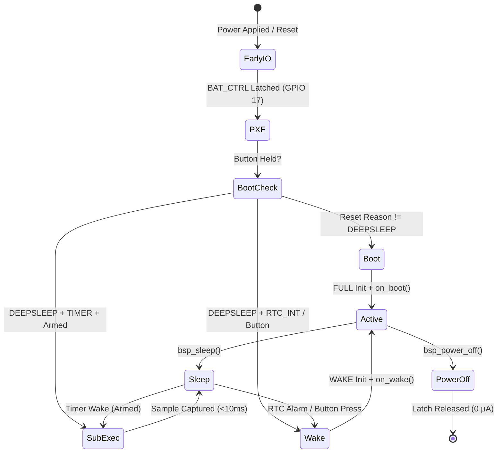

# H1OS: Class-E Environmental Operating System

[](https://idf.espressif.com/)
[](https://www.waveshare.com)
[](https://lvgl.io/)
[](components/esp32-s3_bsp/include/h1os/h1os.h)
[](docs/bsp_user_guide.md)
[](LICENSE)

Production-grade, event-driven ambient operating system and peripheral architecture turning the **Waveshare ESP32-S3 ePaper 1.54" V2** development board (**ESP32-S3-PICO-1-N8R8**) into an **instrument-grade Class-E hygrometer and luxury environmental telemetry appliance** under **ESP-IDF v5.1+, v5.3+, and v6.1**.

> 📘 **Looking for the developer reference manual?** See the full **[BSP Developer Reference Manual](docs/bsp_user_guide.md)**.

---

## 📑 Table of Contents

1. [Hardware Specifications](#-hardware-specifications)
2. [Dual-Core System Architecture](#-dual-core-system-architecture)
3. [BSP Architecture & Separation of Concerns](#-bsp-architecture--separation-of-concerns)
4. [Hardware Pinout & Power Rail Map](#-hardware-pinout--power-rail-map)
5. [Event-Driven Application Lifecycle Engine](#-event-driven-application-lifecycle-engine)
6. [Dynamic Hardware Initialization Profiles](#-dynamic-hardware-initialization-profiles)
7. [Autonomous Background Sub-Execution (<10ms Cadence)](#-autonomous-background-sub-execution-10ms-cadence)
8. [Dual-Plane E-Paper Persistence & Partial Refresh](#-dual-plane-e-paper-persistence--partial-refresh)
9. [Power Domain Scaling (PD_FULL) & Dynamic Frequency Scaling](#-power-domain-scaling-pd_full--dynamic-frequency-scaling)
10. [Acoustic Chime Synthesizer & Splash Screens](#-acoustic-chime-synthesizer--splash-screens)
11. [Time Synchronization & Hardware RTC Bridge](#-time-synchronization--hardware-rtc-bridge)
12. [BLE GATT Provisioning & HTTPS OTA](#-ble-gatt-provisioning--https-ota)
13. [ThingsBoard IoT Cloud Framework](#-thingsboard-iot-cloud-framework)
14. [Verification Test Suite & Sample Applications](#-verification-test-suite--sample-applications)
15. [Build Instructions & Profile Automation](#-build-instructions--profile-automation)
16. [License](#-license)

---

## ⚡ Hardware Specifications

The Waveshare ESP32-S3 ePaper 1.54" V2 is an integrated, battery-powered IoT hardware platform featuring:

- **Compute Module**: Espressif Systems ESP32-S3-PICO-1-N8R8 (Xtensa® dual-core 32-bit LX7 @ up to 240 MHz, 8 MB Quad SPI Flash, 8 MB Octal PSRAM).
- **Bi-Stable Display**: 1.54-inch 200×200 pixel monochrome e-Paper display (Solomon Systech SSD1681 driver, 188 DPI). Maintains image state indefinitely with **zero static current draw**.
- **Environmental Sensor**: Sensirion SHTC3 (I2C `0x70`) high-precision relative humidity and temperature sensor.
- **Calendar Real-Time Clock**: NXP PCF85063A ultra-low power calendar RTC (I2C `0x51`) with 32.768 kHz crystal backup, programmable countdown timer, alarms, and 8-bit NVRAM.
- **Audio Codec Subsystem**: Everest Semi ES8311 I2S codec + NS4168 Class-D mono power amplifier driving an onboard speaker.
- **Storage**: MicroSD card slot (SPI / 1-bit SDMMC mode) + Onboard Flash partitions (`nvs`, `epd_frame`, `ota_0`, `ota_1`).
- **Power Architecture**: Discrete LDO battery power hold latch (`GPIO 17`), calibrated battery voltage ADC divider (`GPIO 4`, ADC1 CH3), and user status LED (`GPIO 3`).

---

## 🧠 Dual-Core System Architecture

Execution is strictly partitioned across the two Xtensa cores to guarantee that TLS encryption, TCP handshakes, and cloud telemetry never stall the display SPI bus or UI animation frames:

```
┌─────────────────────────────────────────────────────────────────────────────────┐
│                                ESP32-S3 DUAL-CORE LX7                           │
├────────────────────────────────────────┬────────────────────────────────────────┤
│          CORE 0: NETWORKING & CLOUD    │           CORE 1: UI & SENSORS         │
├────────────────────────────────────────┼────────────────────────────────────────┤
│ • Wi-Fi Station (Fast Reconnect <400ms)│ • LVGL v9 Display Port Task (Pri 5)    │
│ • BLE GATT Provisioning (wifi_prov)    │ • SSD1681 1-bit Mono EPD Bit-Blit SPI  │
│ • SNTP Network Time Synchronization    │ • Tactile Button State Handlers        │
│ • ThingsBoard Secure MQTTS (Port 8883) │ • SHTC3 Sensor I2C Acquisition         │
│ • Remote Firmware HTTPS OTA Worker     │ • ES8311 Codec & NS4168 Audio Synth    │
│ • Low-Power Sleep & Power Transitions  │ • Zero-Copy Flash Asset Rendering      │
└────────────────────────────────────────┴────────────────────────────────────────┘
```

---

## 🛠️ BSP Architecture & Separation of Concerns

Every file in the BSP has a single, well-defined responsibility:

| Subsystem | Header | Implementation | Responsibility & Utility |
|---|---|---|---|
| **Master Header** | `bsp/bsp.h` | — | Consolidated master include header for all peripheral abstractions and lifecycle structures. |
| **Lifecycle Engine** | `bsp/bsp.h` | `bsp_common.c` | Event-driven lifecycle dispatcher (`boot`, `wake`, `sleep`, `power_off`), early IO bringup, and wake routing. |
| **Diagnostics & Errors** | `bsp/bsp_err.h` | `bsp_common.c` | Standardized `bsp_err_t` error codes, system diagnostics snapshot, silicon revision access. |
| **Power & Sleep** | `bsp/bsp_power.h` | `bsp_power.c` | BAT_CTRL latch (`GPIO 17`), battery ADC curve, `PD_FULL` performance locks, and hardware sleep execution. |
| **Shared I2C Bus** | `bsp/bsp_i2c.h` | `bsp_i2c.c` | Mutex-guarded I2C master bus at 400 kHz (`GPIO 47/48`) with bus recovery and bus lock prevention. |
| **Environmental** | `bsp/bsp_sensors.h` | `bsp_sensors.c` | SHTC3 NIST-traceable sampling, background sub-execution arming, and thermal lockout gatekeeper. |
| **Psychrometric Math**| `bsp/bsp_equ_math.h`| `bsp_equ_math.c` | Magnus equations, invariant water vapor pressure, true invariant dew point, and sliding window reduction. |
| **Telemetry History** | `bsp/bsp_env_telemetry.h`| — | 64-slot compact sample ring buffer and 64-bit clean slot mask stored in RTC Slow Memory. |
| **Calendar RTC** | `bsp/bsp_rtc.h` | `bsp_rtc.c` | PCF85063A external calendar RTC, countdown timer, alarms, and 8-bit NVRAM byte read/write. |
| **RTC Slow Memory** | `bsp/bsp_rtc_mem.h` | `bsp_rtc_mem.c` | ESP32-S3 internal RTC Slow SRAM persistent state engine (boot counters, flags, 32-byte scratchpad). |
| **EPD Display** | `bsp/bsp_display.h` | `bsp_display.cpp` | SSD1681 1.54" SPI e-Paper driver, dual-plane flash persistence (`0x24` & `0x26`), and deep sleep. |
| **LVGL v9 Port** | `bsp/bsp_lvgl.h` | `bsp_lvgl.cpp` | Pinned FreeRTOS rendering task with `bsp_lvgl_lock()` / `unlock()` thread safety. |
| **Audio Synthesizer** | `bsp/bsp_audio.h` | `bsp_audio.c` | ES8311 I2S codec & NS4168 amp power gating, DDS sine synthesis, and built-in acoustic chimes. |
| **Tactile Buttons** | `bsp/bsp_button.h` | `bsp_button.c` | Debounced interrupt handlers for BOOT (`GPIO 0`) & POWER (`GPIO 18`) with click/hold actions. |
| **MicroSD Storage** | `bsp/bsp_sdcard.h` | `bsp_sdcard.c` | FATFS file system mount/unmount manager over SDMMC / SPI. |
| **NVS Storage** | `bsp/bsp_nvs.h` | `bsp_nvs.c` | Thread-safe persistent key-value storage wrapper (`bsp_nvs` namespace). |
| **Wi-Fi Manager** | `bsp/bsp_wifi.h` | `bsp_wifi.c` | Station mode manager with RTC fast reconnect caching (<400ms). |
| **Time & SNTP** | `bsp/bsp_time.h` | `bsp_time.c` | SNTP network synchronization, POSIX timezone support, and formatted date/time strings. |
| **BLE Provisioning** | `bsp/bsp_prov.h` | `bsp_prov.c` | Unified BLE GATT provisioning with on-screen QR code and 8-char Base57 PoP. |
| **Seamless OTA** | `bsp/bsp_ota.h` | `bsp_ota.c` | Dual-partition background HTTPS OTA with auto-rollback. |
| **ThingsBoard IoT** | `bsp/bsp_tb.h` | `bsp_tb.c` | High-level MQTTS telemetry client (generic entries, attributes, RPC, claiming). |

---

## 📌 Hardware Pinout & Power Rail Map

| Signal Name | ESP32-S3 GPIO | Direction / Type | Electrical Characteristics & Function |
|---|---|---|---|
| **`BAT_CTRL`** | `GPIO 17` | Digital Output | Main LDO Power Hold Latch (**Active HIGH: 1 = Hold Power, 0 = Power Off**) |
| **`BAT_ADC`** | `GPIO 4` | ADC1 Channel 3 | Battery voltage divider sensing (R1=100k, R2=100k; 1:2 ratio) |
| **`LED_STATUS`**| `GPIO 3` | Digital Output | Status LED (Open-Drain, Active LOW: 0 = ON, 1 = OFF) |
| **`BTN_BOOT`** | `GPIO 0` | Digital Input | Boot button (Active LOW, internal pull-up enabled) |
| **`BTN_POWER`**| `GPIO 18` | Digital Input | Power button (Active LOW, internal pull-up enabled) |
| **`I2C_SDA`** | `GPIO 47` | I2C Open Drain | Shared I2C serial data line (SHTC3, PCF85063A, ES8311) |
| **`I2C_SCL`** | `GPIO 48` | I2C Open Drain | Shared I2C serial clock line (400 kHz Fast Mode) |
| **`RTC_INT`** | `GPIO 5` | Digital Input | PCF85063A RTC interrupt line (Active LOW, internal pull-up) |
| **`EPD_3V3_EN`**| `GPIO 6` | Digital Output | Display & Sensor 3.3V Power Rail Gate (**Active LOW: 0 = Rail ON, 1 = Rail OFF**) |
| **`EPD_BUSY`** | `GPIO 8` | Digital Input | E-Paper panel busy line (**Active HIGH: 1 = Drawing, 0 = Idle**) |
| **`EPD_RST`** | `GPIO 9` | Digital Output | E-Paper hardware reset (**Active LOW: 0 = Reset, 1 = Normal**) |
| **`EPD_DC`** | `GPIO 10` | Digital Output | E-Paper Data/Command control line (0 = Command, 1 = Data) |
| **`EPD_CS`** | `GPIO 11` | SPI Output | E-Paper SPI chip select (Active LOW) |
| **`EPD_SCK`** | `GPIO 12` | SPI Clock | E-Paper SPI clock line |
| **`EPD_MOSI`** | `GPIO 13` | SPI Output | E-Paper SPI MOSI line |
| **`I2S_MCLK`** | `GPIO 14` | I2S Output | ES8311 Audio Codec Master Clock |
| **`I2S_SCLK`** | `GPIO 15` | I2S Output | ES8311 Audio Codec Bit Clock |
| **`I2S_ASDOUT`**| `GPIO 16` | I2S Input | ES8311 Audio Codec ADC Serial Data |
| **`I2S_LRCK`** | `GPIO 38` | I2S Output | ES8311 Audio Codec Left/Right Word Select |
| **`I2S_DSDIN`** | `GPIO 45` | I2S Output | ES8311 Audio Codec DAC Serial Data |
| **`PA_EN`** | `GPIO 42` | Digital Output | Audio Power Domain Enable (**Active LOW: 0 = Domain ON, 1 = Domain OFF**) |
| **`PA_CTRL`** | `GPIO 46` | Digital Output | NS4168 Class-D Amp Control line (**Active HIGH: 1 = Active, 0 = Standby/Mute**) |
| **`SD_CLK`** | `GPIO 39` | SDMMC Clock | MicroSD clock line |
| **`SD_MISO`** | `GPIO 40` | SDMMC Data 0 | MicroSD data 0 line |
| **`SD_MOSI`** | `GPIO 41` | SDMMC CMD | MicroSD command line |

---

## 🔄 Event-Driven Application Lifecycle Engine

Applications register structured callbacks corresponding strictly to the four core system lifecycle states (`boot`, `wake`, `sleep`, `power_off`), plus `pxe` for early pre-execution button detection:

```c
#include "bsp/bsp.h"

static void app_on_pxe(bsp_button_mask_t btn_mask, void *user_data) {
    if (btn_mask & BSP_BUTTON_MASK_BOOT) {
        // BOOT button held during power-on -> trigger recovery or BLE provisioning
    }
}

static void app_on_boot(void *user_data) {
    // Initial boot from power-off or hardware reset: set up state and render initial UI
}

static void app_on_wake(const bsp_wake_context_t *ctx, void *user_data) {
    // Wake from sleep: perform differential UI update
}

static void app_on_sleep(bsp_sleep_mode_t mode, uint32_t duration_sec, void *user_data) {
    // Preparing for sleep: persist application state
}

static void app_on_power_off(void *user_data) {
    // Powering off: final cleanup before BAT_CTRL latch release
}

void app_main(void) {
    bsp_app_lifecycle_t lifecycle = {
        .on_pxe              = app_on_pxe,
        .on_boot             = app_on_boot,
        .on_wake             = app_on_wake,
        .on_sleep            = app_on_sleep,
        .on_power_off        = app_on_power_off,
        .default_chime_mask  = BSP_CHIME_MASK_BOOT | BSP_CHIME_MASK_POWER_OFF,
        .user_data           = NULL,
    };

    ESP_ERROR_CHECK(bsp_app_start(&lifecycle));
}
```



---

## ⚡ Dynamic Hardware Initialization Profiles

The initialization profile determines which peripheral subsystems are powered up on entry:

| Mode | Enumerator | Subsystems Initialized | Latency / Purpose |
|---|---|---|---|
| **Boot** | `BSP_INIT_MODE_BOOT` | Power, ADC, I2C, SHTC3, RTC, Buttons, Display OTP Clear, LVGL Task, Audio | Full system bringup on initial cold startup. |
| **Wake** | `BSP_INIT_MODE_WAKE` | Power, I2C, SHTC3, RTC, Buttons, Display Fast Differential Refresh, LVGL Task | Fast resume from sleep retaining existing screen buffers without screen clearing. |
| **Sub-Execution** | `BSP_INIT_MODE_SUB_EXEC`| I2C Master and SHTC3 Sensor Only | Scaled-back background telemetry read (<10ms). Bypasses display, audio, LVGL, buttons, and Wi-Fi. |

---

## 🔬 Autonomous Background Sub-Execution (<10ms Cadence)

### The Thermal Physics Problem
The Sensirion SHTC3 sensor shares the PCB copper ground plane with the ESP32-S3 SoC, onboard 3.3V LDO, and display boost circuitry. Running the MCU at 240 MHz or executing display updates causes localized board dissipation (+1.5°C to +3.0°C), artificially lowering relative humidity readings.

### The Sub-Execution Solution
When armed via `bsp_sensors_arm_sub_execution(interval_sec)`:
1. The MCU wakes from deep sleep at 80 MHz baseline frequency.
2. `bsp_app_start()` executes a minimal sub-execution (<10 ms total run time).
3. The raw 4-byte NIST sample is read over I2C before copper heating can develop.
4. The integer differential gate is evaluated and committed to the 64-slot ring buffer in RTC Slow Memory.
5. The device immediately returns to deep sleep without waking the display, LVGL, or main application logic.

```c
// Arm background telemetry sampling every 60 seconds:
bsp_sensors_arm_sub_execution(60);

// In the application wake callback, read mathematically reconstructed metrics without runtime I2C polling:
bsp_shtc3_data_t data;
bsp_sensors_read(&data, false);
// data.temperature_c, data.humidity_percent, data.dew_point_c, data.absolute_humidity_g
```

---

## 🖥️ Dual-Plane E-Paper Persistence & Partial Refresh

Monochrome SSD1681 e-Paper controllers require two physical RAM planes to perform differential partial updates:
- **`0x24` RAM**: New Image buffer.
- **`0x26` RAM**: Previous Image buffer.

The SSD1681 clears its internal RAM when entering deep sleep (<1 µA). To achieve **100% flicker-free wake refreshes**, the BSP persists both 5,000-byte framebuffers to a dedicated 16 KB flash partition (`epd_frame`):
- Before entering sleep: `bsp_display_save_state()` commits both RAM buffers to flash.
- Upon wake: `bsp_display_restore_state()` re-populates both controller planes over SPI, enabling immediate differential partial refresh without screen wiping or ghosting.

---

## 🚀 Power Domain Scaling (PD_FULL) & Dynamic Frequency Scaling

To maintain low thermal dissipation on the PCB while providing maximum compute performance during UI rendering and font blitting:
- **Baseline**: 80 MHz quiet CPU frequency.
- **`PD_FULL` Lock**: Accelerates Xtensa cores to 240 MHz for compute-heavy workloads.
- **Sensor Protection**: The BSP strictly blocks physical I2C sensor acquisitions while `bsp_pm_is_pd_full_active()` is asserted, preventing thermal corruption.

```c
// Acquire full 240 MHz performance lock for rendering:
bsp_pm_pd_full_acquire();
bsp_display_flush();
bsp_pm_pd_full_release(); // Drops core back to 80 MHz baseline
```

---

## 🔔 Acoustic Chime Synthesizer & Splash Screens

Acoustic notification cues and visual splash screens are configured declaratively in `bsp_app_lifecycle_t`:

```c
bsp_app_lifecycle_t lifecycle = {
    .on_boot_splash      = my_boot_splash_handler,
    .on_power_off_splash = my_power_off_splash_handler,
    .default_chime_mask  = BSP_CHIME_MASK_BOOT | BSP_CHIME_MASK_WAKE | BSP_CHIME_MASK_POWER_OFF,
};
```

### Acoustic Chime Types
- `BSP_CHIME_BOOT`: Ascending melodic arpeggio (C5 $\rightarrow$ E5 $\rightarrow$ G5 $\rightarrow$ C6)
- `BSP_CHIME_WAKE`: Rising wake cue (G5 $\rightarrow$ C6)
- `BSP_CHIME_SLEEP`: Descending stand-down cadence (C6 $\rightarrow$ G5 $\rightarrow$ E5)
- `BSP_CHIME_POWER_OFF`: Descending power-off tone (G5 $\rightarrow$ E5 $\rightarrow$ C5)
- `BSP_CHIME_ALARM`: High-urgency alternating warning warble (1760 Hz / 880 Hz)
- `BSP_CHIME_NOTIFY`: Dual-ping notification chirp (1046 Hz $\rightarrow$ 1318 Hz)
- `BSP_CHIME_EVENT`: Tactile click feedback blip (1200 Hz)

---

## ⏰ Time Synchronization & Hardware RTC Bridge

The `bsp_time` driver bridges ESP32-S3 POSIX high-resolution system time with the external NXP PCF85063A calendar RTC:
- Automatic SNTP synchronization with RTC hardware writeback.
- Standard POSIX timezone string parsing (e.g. `"EST5EDT,M3.2.0,M11.1.0"`).
- Standardized formatted time and date generators:
  - `bsp_time_get_formatted(BSP_TIME_FMT_24H_SEC, buf, len)` $\rightarrow$ `"14:35:08"`
  - `bsp_time_get_formatted(BSP_TIME_FMT_12H_MIN, buf, len)` $\rightarrow$ `"02:35 PM"`
  - `bsp_time_get_date_formatted(BSP_DATE_FMT_MM_DD_YY_DOW, buf, len)` $\rightarrow$ `"09/26/26 Saturday"`

---

## 📱 BLE GATT Provisioning & HTTPS OTA

- **BLE Provisioning (`bsp_prov`)**: Decoupled from GUI libraries. Generates an unambiguous 8-character Base57 Proof-of-Possession key (excluding `0`, `O`, `o`, `1`, `l`, `I`) and passes QR payloads to `bsp_lvgl_create_qr_code()`.
- **Seamless OTA (`bsp_ota`)**: Dual-slot HTTPS firmware update (`ota_0` / `ota_1`) with background downloading, SHA-256 validation, and automatic rollback on failure.

---

## ☁️ ThingsBoard IoT Cloud Framework

The `bsp_tb` subsystem connects to ThingsBoard cloud or on-premise instances over secure MQTTS (Port 8883):
- Generic telemetry key-value serialization (`float`, `int`, `bool`, `string`).
- Client-side and shared attribute synchronization.
- Server-side RPC request handling and response dispatching.

---

## 🧪 Verification Test Suite & Sample Applications

| Project | Location | Description |
|---|---|---|
| **Peripherals Test Suite** | [`examples/Peripherals_Test_Suite`](examples/Peripherals_Test_Suite) | Complete 15-test automated verification suite covering all hardware peripherals, staged sleep tests, and interactive button triggers. |
| **H1OS Instrument Station**| [`examples/H1OS`](examples/H1OS) | Flagship Class-E luxury hygrometer and telemetry instrument application featuring ULP-RISC-V sentinel, fast RTC wake stubs, and bi-stable electrophoretic UI. |
| **Boilerplate Application** | [`examples/boilerplate`](examples/boilerplate) | Minimal starter template for new production firmware projects. |
| **Splash & Chime Sample** | [`examples/bsp_samples/bsp_splash_example`](examples/bsp_samples/bsp_splash_example) | Demonstrates declarative splash screen and acoustic chime configurations. |

---

## 🛠️ Build Instructions & Profile Automation

The project provides three build profiles configured in `.vscode/tasks.json` and standard ESP-IDF commands:

```powershell
# Set IDF Target (first time setup)
idf.py set-target esp32s3

# Build Development Profile
idf.py -B build_dev build

# Flash and Monitor
idf.py -B build_dev -p COMx flash monitor
```

---

## 📄 License

This Board Support Package is open-source software licensed under the [MIT License](LICENSE).  
Copyright (c) 2026 Humidyne Labs.
