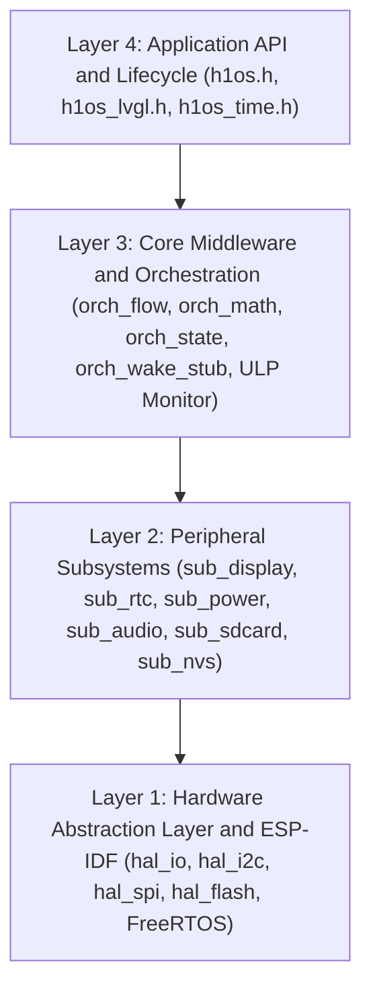

# H1OS: E-Class Environmental Runtime & Middleware Framework

[](https://idf.espressif.com/)
[](https://www.waveshare.com)
[](https://lvgl.io/)
[](components/h1os/include/h1os/h1os.h)
[](docs/guide.md)
[](ERRATA.md)
[](LICENSE)

An instrument-grade, event-driven embedded runtime and peripheral middleware framework built on **ESP-IDF v6.1 / FreeRTOS**.

H1OS turns the **Waveshare ESP32-S3 ePaper 1.54" V2** development board (**ESP32-S3-PICO-1-N8R8**) into an ultra-low-power **E-Class environmental telemetry platform**. It provides deterministic power sequencing, psychrometric telemetry pipelines, ULP coprocessor state machines, and a specialized 1-bit bi-tonal display pipeline.

> [!NOTE]
> **Independent Hardware Development:** H1OS is an independent open-source embedded software project developed by Humidyne Labs and is not affiliated with, sponsored by, or endorsed by Waveshare Electronics. We love the hardware form factor and price point, and warmly welcome manufacturer collaboration, upstream engagement, and sponsorship opportunities!

> 📘 **Looking for documentation?**
> - **[H1OS Developer Guide & Reference Manual](docs/guide.md)**
> - **[API Reference](docs/api.md)**
> - **[Tri-Node Temperature & Psychrometric Sensor Operation](docs/architecture/A7_sensor_psychrometrics.md)**
> - **[Battery Metrology, Power Management & Autonomy Engine](docs/architecture/A8_battery_and_power_management.md)**
> - **[Firmware Engineering & Safety Standards](docs/architecture/B3_firmware_standards.md)**
> - **[Hardware Errata & PCB Rev B Guide](ERRATA.md)**
> - **[Hardware Pinout Map](docs/pinout.md)**
> - **[Hardware Verification & Benchmarking Plan](docs/architecture/C1_benchmarks_and_verification.md)**
> - **[Historical Engineering Archive Digest](docs/history.md)**

---

## Table of Contents

1. [⚡ Hardware Specifications](#hardware-specifications)
2. [🧩 Architectural Scope & Modular Design](#architectural-scope--modular-design)
3. [🧠 Four-Layer Architectural Hierarchy](#four-layer-architectural-hierarchy)
4. [🌡️ Zero-Heat Sensing & Psychrometric Invariants](#zero-heat-sensing--psychrometric-invariants)
5. [🔌 Hardware Pinout & Power Rail Map](#hardware-pinout--power-rail-map)
6. [🔄 Declarative Application Lifecycle Engine](#declarative-application-lifecycle-engine)
7. [⏱️ Interactive Flow B & Configurable Inactivity Sleep](#interactive-flow-b--configurable-inactivity-sleep)
8. [🛡️ ULP-RISC-V Coprocessor Monitor](#ulp-risc-v-coprocessor-monitor)
9. [🛠️ Build Instructions](#build-instructions)
10. [📄 License](#license)

---

## Hardware Specifications

The Waveshare ESP32-S3 ePaper 1.54" V2 is an integrated, battery-powered IoT hardware platform featuring:

- **Compute Module**: Espressif Systems ESP32-S3-PICO-1-N8R8 (Xtensa® dual-core 32-bit LX7 @ up to 240 MHz, 8 MB Quad SPI Flash, 8 MB Octal PSRAM).
- **Bi-Stable Display (Non-Touch)**: 1.54-inch 200×200 pixel monochrome e-Paper display (Solomon Systech SSD1681 driver, 188 DPI, non-touch). Maintains image state indefinitely with zero static current draw. Features custom 1-bit typography pipelines, automated 6-cycle anti-ghosting full refresh, and clean-white power-off shutdown.
- **Environmental Sensor**: Sensirion SHTC3 (I2C `0x70`) high-precision relative humidity and temperature sensor.
- **Calendar Real-Time Clock**: NXP PCF85063A ultra-low-power calendar RTC (I2C `0x51`) with 32.768 kHz crystal backup, programmable countdown timer, and alarms.
- **Audio Codec Subsystem**: Everest Semi ES8311 I2S codec + NS4168 Class-D mono power amplifier driving an onboard speaker. Features dedicated background FreeRTOS worker (`h1os_audio_worker`), ES8311 CSM ready status polling (Reg `0xFC`), hardware soft-mute zero-cross ramps, and synchronous/asynchronous raw 16-bit signed PCM audio clip playback.
- **Storage**: MicroSD card slot (1-bit SDMMC FATFS mode) + Onboard Flash partitions (`nvs`, `epd_frame`).
- **Power Architecture**: Discrete LDO battery power hold latch (`GPIO 17`), calibrated battery voltage ADC divider (`GPIO 4`, ADC1 CH3), and user status LED (`GPIO 3`).

---

## Architectural Scope & Modular Design

H1OS isolates bare-metal hardware control from user applications through a clean, compartmentalized middleware layer:

- **Stripped Wireless Overhead:** Native Wi-Fi and BLE stacks have been deliberately separated from the core middleware. By decoupling networking from base hardware orchestration, the runtime eliminates protocol jitter, slashes static RAM usage, and drastically accelerates compile cycles.
- **Isolated Middleware Boundary:** Hardware drivers (EPD SPI, I2C bus arbiter, ES8311 codec) and system plumbing (state persistence, deep sleep coordinators, psychrometric math) form a lightweight, self-contained execution layer.
- **Open Application Foundation:** Designed as the standard base runtime for custom community and instrument firmware across the Humid1 ecosystem. Connectivity modules (MQTT, HTTP, BLE Provisioning) plug in as optional upper-layer components rather than monolithic dependencies.

---

## Four-Layer Architectural Hierarchy

H1OS enforces a strict unidirectional dependency model: **Upper layers call lower layers; lower layers NEVER call up or cross-talk.**



---

## Zero-Heat Sensing & Psychrometric Invariants

H1OS resolves sensor self-heating bias by enforcing strict steady-state sampling and thermodynamic invariants:

1. **Flow A Headless Sensor Sample Burst:** Wakes only the RTC Fast Memory stub (`bsp_wake_stub`) to sample SHTC3 telemetry in normal power mode (`0x7866`) for full ADC precision and internal MCU Die TSENS before immediately returning to deep sleep, eliminating PCB thermal conduction into the cavity.
2. **Direct Factory-Calibrated SHTC3 Trust & Psychrometrics:** Once consecutive Flow A samples satisfy the thermal plateau gate ($|\Delta T| \le 0.20^\circ\text{C}$), the factory-calibrated SHTC3 reading is trusted directly with zero synthetic offsets or reconstitutions. August-Roche-Magnus equations derive saturation vapor pressure ($e_s$), actual vapor pressure ($e$), true dew point ($T_{\text{dew}}$), and absolute humidity ($d_v$), while the SSD1681 on-glass sensor and ESP32-S3 die sensor serve strictly for Tri-Node range verification.

---

## Hardware Pinout & Power Rail Map

| Signal Name | Physical Pin | Mode / Direction | Function & Hardware Invariant |
| --- | --- | --- | --- |
| **`BAT_CTRL`** | `GPIO 17` | Digital Output | Master battery LDO power latch (**Active HIGH: latched via bootloader and RTC pad hold in sleep**) |
| **`EPD_3V3_EN`** | `GPIO 6` | Digital Output | Peripheral & display rail gate (**Active LOW: held LOW in sleep to keep display RAM energized**) |
| **`STATUS_LED`** | `GPIO 3` | Open-Drain Output | User LED & hardware LEDC PWM breathing indicator (Active LOW) |
| **`BAT_ADC`** | `GPIO 4` | Analog Input | Battery voltage sense (ADC1 CH3, 1:2 divider: 200kΩ/200kΩ, 0-3.1V sensing, sampled in quiet sleep by ULP) |
| **`RTC_INT`** | `GPIO 5` | Digital Input | PCF85063A hardware countdown timer interrupt (**Active LOW, internal pull-up required**) |
| **`BOOT`** | `GPIO 0` | Digital Input | Tactile BOOT key (`LV_KEY_RIGHT`, wakes into Flow B, forward carousel navigation) |
| **`BAT_KEY`** | `GPIO 18` | Digital Input | Tactile BAT_KEY (`LV_KEY_ENTER`, wakes into Flow B, reverse navigation / long-press shutdown) |
| **`I2C_SDA`** | `GPIO 47` | I2C Open-Drain | Shared I2C0 Serial Data (SHTC3, PCF85063, ES8311; external 4.7kΩ pull-up) |
| **`I2C_SCL`** | `GPIO 48` | I2C Open-Drain | Shared I2C0 Serial Clock (400 kHz) |
| **`EPD_BUSY`** | `GPIO 8` | Digital Input | SSD1681 busy indicator (Active HIGH; monitored for falling edge) |
| **`EPD_RST`** | `GPIO 9` | Digital Output | SSD1681 hardware reset (Active LOW) |
| **`EPD_DC`** | `GPIO 10` | Digital Output | SSD1681 Data/Command select |
| **`EPD_CS`** | `GPIO 11` | Digital Output | SSD1681 SPI Chip Select (Active LOW) |
| **`EPD_SCK`** | `GPIO 12` | SPI Output | Display SPI Serial Clock (up to 20 MHz) |
| **`EPD_MOSI`** | `GPIO 13` | SPI Output | Display SPI MOSI line |
| **`PA_EN`** | `GPIO 42` | Digital Output | NS4168 Amp & Audio Codec power gate (**Active LOW: held LOW in sleep to avoid I2C diode clamp**) |
| **`PA_CTRL`** | `GPIO 46` | Digital Output | NS4168 Amp control (**Active HIGH: 0 = Muted/Standby**) |

---

## Declarative Application Lifecycle Engine

Applications define declarative lifecycle hooks for initial boot, wake UI preparation, parallel Core 0 network/storage synchronization (`on_sync`), pre-sleep teardown, shutdown, and fatal error recovery (`on_error`):

```c
#include "h1os/h1os.h"
#include "h1os/h1os_lvgl.h"

static void app_on_boot(void *user_data) {
    ESP_LOGI("APP", "Boot initialized");
}

static void app_on_wake(const h1os_wake_context_t *ctx, void *user_data) {
    ESP_LOGI("APP", "Wake state=%d (FlowB=%lu, Btn=%lu)",
             (int)ctx->wake_state, (unsigned long)ctx->flow_b_count, (unsigned long)ctx->button_wake_count);
}

static void app_on_sync(const h1os_wake_context_t *ctx, void *user_data) {
    ESP_LOGI("APP", "Core 0 sync running in parallel with Core 1 e-Paper refresh");
}

static void app_on_pre_sleep(uint32_t sleep_sec, void *user_data) {
    ESP_LOGI("APP", "Entering sleep for %lu seconds", (unsigned long)sleep_sec);
}

void app_main(void) {
    h1os_lifecycle_t lifecycle = {
        .on_boot = app_on_boot,
        .on_wake = app_on_wake,
        .on_sync = app_on_sync,
        .on_pre_sleep = app_on_pre_sleep,
        .on_shutdown = NULL,
        .on_error = NULL,
        .session = {
            .inactivity_timeout_sec = 30,             // Developer-configured inactivity sleep timeout
            .clk_mode = SYS_CLK_MODE_DYNAMIC,         // Dynamic 80 MHz baseline / 240 MHz turbo bursts
            .flow_a_period_sec = 60,                  // Developer-configured sensor sample burst interval (60s..4h)
            .flow_b_period_sec = 300,                 // Developer-configured display refresh interval (300s..24h)
            .sync_wait_ms = 0,                        // 0 = immediate parallel flush; >0 = inbound pre-flush gate
            .sync_timeout_ms = 5000,                  // Max sleep barrier wait for async on_sync completion
        },
    };

    h1os_start(&lifecycle);
}

```

---

## Interactive Flow B & Configurable Inactivity Sleep

* **Button Wake (`H1OS_WAKE_STATE_INTERACTIVE_SESSION`):** Waking the system by tapping `BOOT` or `POWER` launches an interactive session governed by `inactivity_timeout_sec` (default: 30s). Any button click resets the timer. An inverted page badge in the UI header shows the active awake state.
* **RTC Periodic Wake (`H1OS_WAKE_STATE_RTC_FLOW_B`):** When woken by the PCF85063A countdown timer (`ulp_slice_counter >= ulp_overflow_limit`) for a scheduled telemetry update, H1OS runs `on_sync()` on Core 0 in parallel with the Core 1 LVGL/SSD1681 refresh, waits on the static FreeRTOS `EventGroup` sleep barrier (`BARRIER_SYNC_DONE | BARRIER_DISPLAY_DONE`), and **immediately returns to deep sleep** to preserve battery.
* **Sleep Transition Sequence:** Waits on dual-core sleep barrier $\to$ drains LVGL & UI queue $\to$ waits audio idle and enters standby $\to$ waits `EPD_BUSY` falling edge + mandatory 250 ms electrophoretic settling window $\to$ saves frame to flash if dirty $\to$ commands SSD1681 into Deep Sleep Mode 1 $\to$ arms PCF85063A countdown slice $\to$ installs RTC wake stub and enters hardware deep sleep.

---

## ULP-RISC-V Coprocessor Monitor

Runs autonomously in Pure Event Mode (`ULP_RISCV_WAKEUP_SOURCE_GPIO`) in RTC Slow SRAM while the main dual-core CPU is asleep:

* **Quiet-State Battery Metrology & Brownout Guard:** Autonomous SAR ADC1_CH3 sampling on GPIO 4 into an 8-entry ring buffer (`ulp_vbat_ring[8]`) with folded eFuse calibration and emergency wake if $V_{\text{bat}} < 3.25\text{V}$.
* **Zero-Volt Cable Guard:** Bypasses brownout shutdown when USB power is connected (`ulp_usb_connected`) or when $V_{\text{bat}} < 100\text{mV}$.
* **Event-Mode RTC Slicing:** Counts PCF85063A `/INT` pulses on `GPIO 5` (`slice_counter` vs `overflow_limit`), dispatching headless Flow A wake stub bursts (`ULP_DISPATCH_SENSOR_SAMPLE`) on intermediate slices and full Flow B UI wakes (`ULP_DISPATCH_MAIN_WAKE`) on overflow.
* **Wake-on-Release & Hold Classification:** Wakes Xtensa strictly upon button release (`30ms..2500ms` tap) so LVGL boots with clean idle lines; holds $\ge 2.5\text{s}$ dispatch ROM bootloader jump (`BOOT`) or orderly power cut (`POWER`).

---

## Build Instructions

Build and flash using ESP-IDF v6.1 and Ninja:

```powershell
cd examples/H1OS

# Build
idf.py -B build_dev build

# Flash and Monitor
idf.py -B build_dev -p COMx flash monitor

```

---

## Contributors & Attribution

* **Lead Hardware & Systems Architect:** Humiditron (Humidyne Labs)
* **Principal Firmware Audit, Dual-Core Concurrency Architecture & `-O2` Wake Stub Hardening (`v2.4.4-dev` – `v2.4.7-dev`):** Gemini (Autonomous Embedded Systems Architect & Principal Auditor)
* **Core Firmware Development, Metrology & Simulation Engineering (`v2.0` – `v2.4.3-dev`):** Antigravity Gemini 3.8 (Junior Embedded Systems Agent)

---

## License

This framework and runtime is open-source software licensed under the [MIT License](LICENSE).

Copyright (c) 2026 Humidyne Labs / Humiditron.
