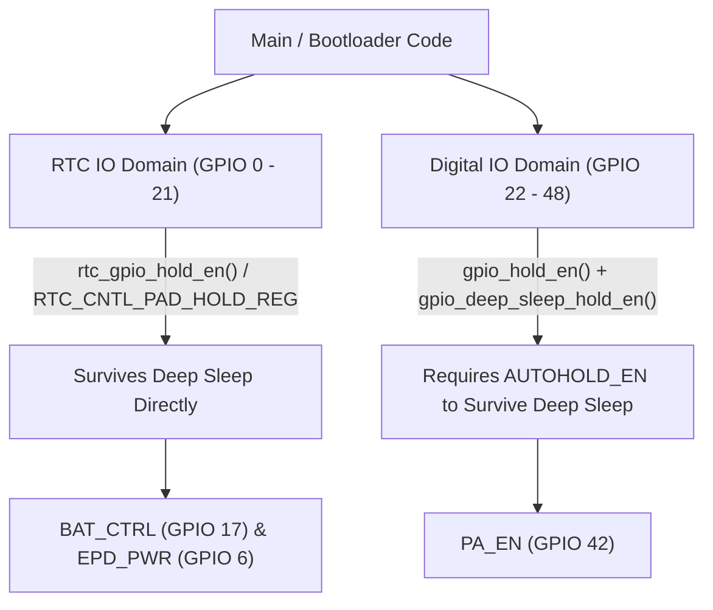

# H1OS Consolidated External Reference Guide (External_Ref.md)

This document synthesizes and consolidates all architectural notes, silicon errata analyses, and hardware design recipes previously stored across individual reference files in `docs/agent_notes/ext_ref_files/`. It serves as the unified engineering reference for the ESP32-S3 ULP-RISC-V coprocessor, low-power PMU sequencing, PCF85063A RTC, pad hold domains, and 1bpp display graphics blitting.

---

## 1. ESP32-S3 ULP-RISC-V & Low-Power PMU Architecture

### 1.1 Dual-Wake Capability & Eradication of Trap 0x1000
- **Mutual Exclusivity Disproven:** Early hypotheses suggested that internal PMU countdown timers (`RTC_CNTL_ULP_CP_SLP_TIMER_EN`) and RTC GPIO wakeup detectors (`RTC_CNTL_ULP_CP_GPIO_WAKEUP_ENA`) were mutually exclusive in hardware. Formal silicon characterization in `examples/riscv_test` disproved this: both wake sources can be armed concurrently without bus stalls or lockups.
- **Trap 0x1000 Root Cause:** Omission of `CONFIG_ULP_RISCV_INTERRUPT_ENABLE=y` in `sdkconfig` compiled out the coprocessor interrupt vector table at `irq_vector` (`0x10`). When an edge arrived on an RTC GPIO, the RISC-V core threw an unhandled trap (`0x1000` / `RTC_COCPU_TRAP_TRIG_EN`).
- **Invariant:** All firmware using ULP RTC GPIO interrupts must enable `CONFIG_ULP_RISCV_INTERRUPT_ENABLE=y`.

### 1.2 Clock Domain Crossing (CDC) Timing Rules
- **Clock Domain:** The target hardware has no external 32.768 kHz crystal (GPIOs 15 and 16 are reserved for the I2S audio bus). The slow domain operates strictly on the internal 136 kHz RC oscillator (`CONFIG_RTC_CLK_SRC_INT_RC=y`, period $T_{\text{cycle}} \approx 7.35\ \mu\text{s}$).
- **Synchronization Window:** The ESP32-S3 TRM mandates that cross-domain clear signals must remain asserted for **$\ge 3$ slow clock cycles** ($\ge 22.05\ \mu\text{s}$).
- **Standard CDC Delay:** Assert `RTC_CNTL_ULP_CP_GPIO_WAKEUP_CLR` for $\ge 120\ \mu\text{s}$ (`ulp_riscv_delay_us(120)` in ULP, `esp_rom_delay_us(120)` on Main CPU), guaranteeing $> 16$ slow clock cycles.

### 1.3 `WAKEUP_CLR` vs. `WAKEUP_ENA` Hardware Latching
- **Hardware Clearing:** Asserting `RTC_CNTL_ULP_CP_GPIO_WAKEUP_CLR` automatically clears `RTC_CNTL_ULP_CP_GPIO_WAKEUP_ENA` in hardware.
- **Rule:** Never leave `WAKEUP_CLR` continuously asserted. Always pulse it (`SET` $\to$ `delay 120µs` $\to$ `CLEAR`).
- If subsequent wake events are expected on the ULP without main CPU intervention, re-assert `RTC_CNTL_ULP_CP_GPIO_WAKEUP_ENA = 1` after pulsing the clear bit.

### 1.4 Handshake & Safe Wake Ordering
```c
/* Canonical ULP Execution Order */
// 1. Perform all measurement and acquisition work first
int32_t raw_vbat = ulp_riscv_adc_read_channel(ADC_UNIT_1, ADC_CHANNEL_3);

// 2. Publish to RTC Slow RAM shared variables
ulp_shared_data.vbat_raw = raw_vbat;
ulp_shared_data.completed = 1;
asm volatile("fence" ::: "memory");

// 3. Wait for Main CPU ready with bounded cycle timeout and idle check
uint32_t t0 = ULP_RISCV_GET_CCOUNT();
while (!REG_GET_FIELD(RTC_CNTL_LOW_POWER_ST_REG, RTC_CNTL_RDY_FOR_WAKEUP)) {
    if (REG_GET_FIELD(RTC_CNTL_LOW_POWER_ST_REG, RTC_CNTL_MAIN_STATE_IN_IDLE)
        || (ULP_RISCV_GET_CCOUNT() - t0) > 1000000) {
        ulp_shared_data.completed = 2; /* Woke while main CPU was awake */
        ulp_riscv_halt();
        return 0;
    }
}

// 4. Signal main processor wakeup
ulp_riscv_wakeup_main_processor();

// 5. Clear CDC wake latch
SET_PERI_REG_MASK(RTC_CNTL_ULP_CP_TIMER_REG, RTC_CNTL_ULP_CP_GPIO_WAKEUP_CLR);
ulp_riscv_delay_us(120);
CLEAR_PERI_REG_MASK(RTC_CNTL_ULP_CP_TIMER_REG, RTC_CNTL_ULP_CP_GPIO_WAKEUP_CLR);
REG_WRITE(RTC_GPIO_STATUS_W1TC_REG, RTC_GPIO_STATUS_INT_W1TC_M);

// 6. Halt coprocessor
ulp_riscv_halt();
```

---

## 2. Hardware Pad Holds, Isolation & Bootloader Hooks

### 2.1 The Two Distinct Pad Hold Domains on ESP32-S3



1. **RTC IO Pads (GPIO 0–21):**
   - Controlled by `RTC_CNTL_PAD_HOLD_REG` (indexed directly by GPIO number).
   - Holds survive deep sleep natively.
   - Used for `PIN_POWER_HOLD` (GPIO 17 / `BAT_CTRL`) and `PIN_EPD_PWR` (GPIO 6).
2. **Digital IO Pads (GPIO 22–48):**
   - Controlled by `RTC_CNTL_DIG_PAD_HOLD_REG` via `gpio_hold_en()`.
   - **Crucial Silicon Nuance:** A digital pad's hold does **NOT** survive deep sleep unless `gpio_deep_sleep_hold_en()` is also called (`RTC_CNTL_DIG_ISO_REG.AUTOHOLD_EN`).
   - Relevant for `PA_EN` (GPIO 42, audio amp power gate).

### 2.2 Pad Hold Rule on Wake Input Pins
- **NEVER** call `rtc_gpio_hold_en()` on pins configured as deep-sleep wakeup sources (GPIO 0, 5, 18).
- Calling `rtc_gpio_hold_en()` on an input pin freezes its internal pad read logic in sleep, preventing external logic-level transitions from reaching the RTC comparator.
- Always enforce `rtc_gpio_hold_dis()` on wakeup inputs before sleeping.

### 2.3 Glitch-Free Hold Release Protocol
When releasing a held output pad upon wake:
1. Re-configure the GPIO to output mode and drive the desired level **first**.
2. Only after the output buffer is active, call `gpio_hold_dis()` or `rtc_gpio_hold_dis()`.
3. Disabling hold before configuring output will cause the pad to momentarily glitch to its default input/floating state.

### 2.4 Bootloader Power Latch Hook (`power_hold_hook.c`)
- Located in `bootloader_components/power_hold_hook/power_hold_hook.c`.
- Automatically discovered by the ESP-IDF bootloader build system.
- Employs ROM-level functions (`esp_rom_gpio_pad_select_gpio`, `esp_rom_gpio_connect_out_signal`) inside `bootloader_before_init()` to assert `BAT_CTRL` (GPIO 17) HIGH in $<25\text{ ms}$ from cold power-on.

---

## 3. PCF85063A External RTC Engine & Interrupt Management

### 3.1 `Control_2` (`0x01`) Register Architecture
The $\overline{\text{INT}}$ pin is an open-drain output tied to flags inside register `0x01`:

| Bit | Name | Type | Reset | Function & Flag Behavior |
| :--- | :--- | :--- | :--- | :--- |
| **Bit 7** | `AIE` | R/W | 0 | **Alarm Interrupt Enable:** 1 = asserts $\overline{\text{INT}}$ on calendar match. |
| **Bit 6** | `AF` | R/W (AND) | 0 | **Alarm Flag:** Write 0 to clear; write 1 leaves unchanged. |
| **Bit 5** | `MI` | R/W | 0 | **Minute Interrupt Enable:** Periodic 1/64 s pulse every minute. |
| **Bit 4** | `HMI` | R/W | 0 | **Half-Minute Interrupt Enable:** Periodic 1/64 s pulse every 30 s. |
| **Bit 3** | `TF` | R/W (AND) | 0 | **Timer Flag:** Write 0 to clear; write 1 leaves unchanged. |
| **Bit 2:0** | `COF[2:0]` | R/W | 000 | **CLKOUT Control:** 111 = high-Z / off. |

#### Logic-AND Write Behavior
- Bits 6 (`AF`) and 3 (`TF`) implement hardware logic-AND filtering on writes:
  $$\text{New Flag State} = \text{Current Flag State} \ \text{AND} \ \text{Written Bit Value}$$
- Writing 0 clears the flag. Writing 1 leaves it unchanged.
- **Precaution:** Do NOT write raw `0x00` to `0x01`. Doing so clears flags but unintentionally resets `COF` to `000` (turning on 32.768 kHz CLKOUT and increasing quiescent current). Preserve bits 2:0 by masking: `ctrl2 &= ~(CTRL2_AF_MASK | CTRL2_TF_MASK);`.

### 3.2 Periodic Pulsed Mode (`TI_TP = 1`) vs. Level Mode (`TI_TP = 0`)
- **Pulsed Mode (`TI_TP = 1` in `0x11`):** The countdown timer reloads and runs continuously in an unbroken hardware loop. $\overline{\text{INT}}$ generates an automatic active-low pulse ($1/64\text{ s} \approx 15.625\text{ ms}$) and self-releases HIGH without requiring I2C transactions.
- **Level Mode (`TI_TP = 0` in `0x11`):** When the countdown reaches zero, $\overline{\text{INT}}$ clamps LOW permanently until cleared via I2C. If not cleared, the timer halts indefinitely.

### 3.3 Safe Timer Reconfiguration (Avoiding the Hot-Load Race)
Writing directly to `Timer_value` (`0x10`) while the counter is running in pulsed mode can cause intermediate bit corruption if the I2C transfer collides with the internal asynchronous clock tick.
- **Deterministic 3-Step Update Protocol:**
  1. Temporarily clear `TE` (bit 2) in `Timer_mode` (`0x11`): `i2c_write(0x11, mode & ~0x04);`
  2. Write new countdown duration to `Timer_value` (`0x10`): `i2c_write(0x10, new_ticks);`
  3. Re-enable `TE` (bit 2): `i2c_write(0x11, mode);`

### 3.4 Open-Drain Pulse Drain Loop
Because the pulsed interrupt pulse on `GPIO 5` persists for $\approx 15.625\text{ ms}$, fast sub-execution code (which executes in $< 3\text{ ms}$) must drain the line before returning to deep sleep:
```c
/* Bounded pulse drain loop before deep sleep */
uint32_t timeout = 25000;
while (gpio_get_level(HAL_PIN_RTC_INT) == 0 && --timeout > 0) {
    esp_rom_delay_us(10);
}
```
Failing to drain the pulse results in an immediate false re-trigger upon entering deep sleep.

---

## 4. ADC Oneshot Driver & Battery Voltage Monitoring

### 4.1 ULP ADC Configuration via `ulp_adc_init()`
To use the SAR ADC from the ULP coprocessor, initialize it on the Main CPU at boot using `ulp_adc_init()`:
```c
#include "ulp_adc.h"

ulp_adc_cfg_t adc_cfg = {
    .adc_n      = ADC_UNIT_1,
    .channel    = ADC_CHANNEL_3,   /* GPIO 4 on ESP32-S3 */
    .atten      = ADC_ATTEN_DB_12, /* Full ~3.1V attenuation */
    .width      = ADC_BITWIDTH_DEFAULT,
    .ulp_mode   = ADC_ULP_MODE_RISCV,
};
ESP_ERROR_CHECK(ulp_adc_init(&adc_cfg));
```

### 4.2 Why `ADC_ULP_MODE_RISCV` is Mandatory
1. Automatically sets `esp_sleep_sub_mode_config(ESP_SLEEP_USE_ADC_TSEN_MONITOR_MODE, true)`, maintaining the RTC voltage regulator at $\ge 0.9\text{ V}$ during deep sleep so the ADC peripheral remains operational.
2. Pre-loads hardware calibration registers and channel bitmasks into the RTC domain prior to power-gating the digital core.
3. **ADC1 Only:** ADC2 on ESP32-S3 is arbitrated by the Wi-Fi/BT sub-system and requires complex sleep multiplexer routing. Only ADC1 is supported reliably for ULP use.

---

## 5. Optimized 1-Bit Monochrome Framebuffer Blitting

### 5.1 Bottleneck Analysis in 1bpp Pixel Graphics
Processing 1bpp e-paper display updates pixel-by-pixel with coordinate divisions (`px / 8`), moduli (`px % 8`), and read-modify-write bit manipulations creates severe execution bottlenecks.

### 5.2 High-Performance `blit_1bpp()` Architecture
```c
#include <stdint.h>
#include <string.h>

void blit_1bpp(const uint8_t *src_buf, uint16_t src_stride,
               uint8_t *dest_buf, uint16_t x1, uint16_t y1,
               uint16_t area_w, uint16_t area_h,
               uint16_t epd_w, uint16_t epd_h)
{
    if (!dest_buf || !src_buf || area_w == 0 || area_h == 0) return;

    // Upfront Y bounds clipping
    if (y1 >= epd_h) return;
    if (y1 + area_h > epd_h) area_h = epd_h - y1;

    const uint32_t epd_stride = epd_w >> 3;

    // -------------------------------------------------------------------------
    // FAST PATH: Byte-aligned X coordinate and width (vectorized memcpy)
    // -------------------------------------------------------------------------
    if ((x1 & 7) == 0 && (area_w & 7) == 0) {
        uint16_t bytes_per_line = area_w >> 3;
        const uint8_t *src = src_buf;
        uint8_t *dst = dest_buf + (y1 * epd_stride) + (x1 >> 3);

        for (uint16_t y = 0; y < area_h; y++) {
            memcpy(dst, src, bytes_per_line);
            src += src_stride;
            dst += epd_stride;
        }
        return;
    }

    // -------------------------------------------------------------------------
    // OPTIMIZED FALLBACK: Byte-wise bit stream shifting (8 pixels/iteration)
    // -------------------------------------------------------------------------
    uint16_t x2 = x1 + area_w - 1;
    if (x1 >= epd_w) return;
    if (x2 >= epd_w) x2 = epd_w - 1;

    uint32_t first_byte = x1 >> 3;
    uint32_t last_byte  = x2 >> 3;
    uint8_t  shift      = x1 & 7;

    uint8_t left_mask  = 0xFF >> shift;
    uint8_t right_mask = 0xFF << (7 - (x2 & 7));

    for (uint16_t y = 0; y < area_h; y++) {
        const uint8_t *s = src_buf + (y * src_stride);
        uint8_t *d = dest_buf + ((y1 + y) * epd_stride) + first_byte;

        if (first_byte == last_byte) {
            uint8_t mask = left_mask & right_mask;
            uint8_t val  = (*s >> shift) & mask;
            *d = (*d & ~mask) | val;
            continue;
        }

        // Multi-byte span: stream carry and next byte
        uint8_t carry = *s;
        *d = (*d & ~left_mask) | ((carry >> shift) & left_mask);
        d++;

        for (uint32_t bx = first_byte + 1; bx < last_byte; bx++) {
            s++;
            uint8_t next = *s;
            *d++ = (carry << (8 - shift)) | (next >> shift);
            carry = next;
        }

        s++;
        uint8_t val = (carry << (8 - shift)) | (*s >> shift);
        *d = (*d & ~right_mask) | (val & right_mask);
    }
}
```

---

## 6. FreeRTOS Task Lifecycle & Synchronization

### 6.1 Direct-to-Task Startup Handshake
Querying `eTaskGetState()` to verify worker task initialization creates race conditions across dual Xtensa cores.
- **Recommended Zero-Heap Handshake:**
```c
/* In Worker Task */
void worker_task(void *pvParameters)
{
    TaskHandle_t parent = (TaskHandle_t)pvParameters;
    // Perform hardware / queue init...
    if (parent != NULL) {
        xTaskNotifyGive(parent);
    }
    while (1) { /* loop */ }
}

/* In Parent Init Function */
TaskHandle_t current = xTaskGetCurrentTaskHandle();
BaseType_t res = xTaskCreatePinnedToCore(worker_task, "worker", 4096, (void *)current, 6, &s_task_handle, 1);
if (res == pdPASS) {
    if (ulTaskNotifyTake(pdTRUE, pdMS_TO_TICKS(500)) == 0) {
        // Initialization timed out: clean up task
        vTaskDelete(s_task_handle);
        s_task_handle = NULL;
        return ESP_ERR_TIMEOUT;
    }
}
```

### 6.2 Spinlock Elimination
- Complex software spinlocks (e.g. Peterson's algorithm) between Xtensa and ULP are unstable: if the ULP traps with a lock flag asserted, the Main CPU spins indefinitely and triggers a `task_wdt` panic.
- Because the ULP runs **only while the Main CPU is in deep sleep**, cross-core shared variables are naturally mutually exclusive by architecture.
- Enforce synchronization using `volatile` and standard memory barriers (`asm volatile("memw" ::: "memory")` on Xtensa, `asm volatile("fence" ::: "memory")` on RISC-V).
