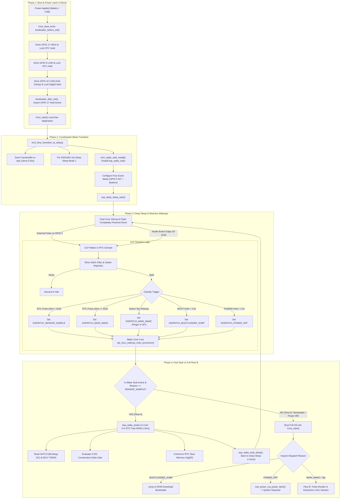

# Architectural Refinement & System Realignment Plan

**Document:** `architectural_refinement_plan.md`  
**Target Subsystems:** Entire `components/h1os` stack (HAL, Subsystems, Orchestrator, ULP Coprocessor, 2nd-Stage Bootloader, Application Lifecycle)  
**Governing Architectural Law:** `docs/architecture/00_system.md` through `13_gpio_hold_domains_and_sleep_architecture.md`, `errata.md`  
**Audit Baselines:** `docs/agent_notes/code_audit_plan.md` & `docs/agent_notes/ulp_bootloader_audit.md`  
**Git Working Branch:** `prune`

---

## 1. Executive Assessment: What Was Missing & Overlooked?

A rigorous cross-comparison between all 14 Architecture Specifications, the codebase implementation, and both audit documents demonstrates that **the hardware architecture and physical primitives are sound, but the system suffers from 5 critical omissions and "diabetic" pathologies** (bloat, layer bypasses, and split responsibilities):

### 1. What Did We Leave Out?
1. **Flow A Wake Stub Registration (`orch_wake_stub_install()`):**
   - The entire 416-line bare-metal RTC Fast wake stub (`orch_wake_stub.c`) was authored, optimized with bit-bang I2C and SAR TSENS, but was **never hooked up** in `sub_power_enter_deep_sleep_mode()`. Flow A was hijacked into booting the full dual-core FreeRTOS OS every 60 seconds.
2. **Wake-on-Release & Long-Press Button Classification in ULP:**
   - `05_ulp.md` Section 3.2.B explicitly mandated that tactile buttons wake the CPU **strictly upon release** (to boot LVGL with the finger up) and classify $>2.5\text{s}$ holds into ROM Bootloader jumps or clean shutdowns. In code, the ULP woke the CPU immediately on contact closure with zero timing.
3. **Mandatory 30 ms Glitch Filter on ULP Inputs:**
   - Neither tactile buttons nor RTC INT had glitch debouncing in `ulp/main.c`, leaving deep sleep vulnerable to switch bounce and transient spikes.
4. **Bootloader Power Latch Hardware Assertion & Diagnostic Telemetry:**
   - `h1os_boot_hook.c` latched power in `<25\text{ms}`, but its verification step in `bootloader_after_init()` read five registers into `__unused` dummy variables and cast them to `(void)` without ever checking if latching actually succeeded!
5. **eFuse Linear Battery Voltage Calibration in ULP:**
   - The ULP used an un-architected 17-point piecewise LUT in RTC Slow RAM instead of the calibrated eFuse linear equation mandated by `05_ulp.md` ($V = ((\text{raw} \times m)/4096) \times 2 + b$).

### 2. What Made the System "Diabetic" (Bloat & Metabolic Inefficiencies)?
- **Layer 4 Bypassing Layer 2:** `h1os_lifecycle.c` calling HAL directly on shutdown, orphaning `sub_power_cut_power_latch()`.
- **Duplicate Sensor Logic:** `orch_flow_execute_sensor_sample()` duplicated the SHTC3 math, CRC, and ring push that was already implemented in `orch_wake_stub.c`.
- **Dead Scaffolding:** Broken thermal lockout setters (`orch_flow_set_thermal_lockout`), unused synchronous audio playback APIs, speculative NVS getters, and commented trial loops cluttering production drivers.
- **Spec vs Silicon Inversion:** `13_gpio_hold_domains_and_sleep_architecture.md` Line 129 inverted `PA_EN` (claiming HIGH cuts power, whereas LOW energizes the rail to prevent ES8311 ESD clamping).

---

## 2. Pinpointed Key Areas & Refinement Strategies

### Area 1: Deep Sleep Flow A Execution (The Wake Stub Bridge)

#### Problem
Every 60s, the ULP raises `ULP_DISPATCH_SENSOR_SAMPLE`. Because `orch_wake_stub_install()` was never called, Core 0 skips the RTC Fast stub, loads the secondary bootloader from flash, boots FreeRTOS SMP, runs `orch_flow_execute_sensor_sample()` at 240 MHz Turbo, and logs UART messages.
- **CPU On-Time:** ~25 ms at 240 MHz (~80 mA).
- **Thermal Penalty:** Core 0 and Core 1 silicon dissipation conducts directly into the internal sensor cavity, corrupting cold ambient readings.

#### Refined Architecture & Better Alternative
1. In `sub_power.c` (`sub_power_enter_deep_sleep_mode`), invoke `orch_wake_stub_install()` immediately before `esp_deep_sleep_start()`.
2. Core 0 executes `bsp_wake_stub()` in RTC Fast IRAM:
   - SHTC3 normal mode wake/sample/sleep over GPIO 47/48 bit-bang I2C (<15 ms).
   - Read MCU die TSENS via SAR register (<100 µs).
   - Evaluate $\Delta T_{\text{step}} \le 0.20^\circ\text{C}$ successive-sample thermal gate.
   - Commit directly to RTC Slow RAM `ring[32]`.
   - Call `esp_wake_stub_sleep(&bsp_wake_stub)` to immediately re-enter deep sleep.
3. Remove redundant `orch_flow_execute_sensor_sample()` from OS runtime. OS runtime should only ever execute Flow B (UI / User Session).

---

### Area 2: ULP Coprocessor Reactive Monitor Realignment

#### Problem
- Wakes Main CPU immediately on button down-press.
- Zero debounce or glitch filtering (<30 ms).
- Double WAKEUP_CLR pulse order risks re-triggering under CDC slow-clock latency.
- 17-point LUT consumes 68 bytes of RTC Slow RAM.

#### Refined Architecture & Better Alternative
1. **Debounce & Glitch Filter:**
   - Sample input level across 30 ms. If it bounces back HIGH within 30 ms, discard as contact noise and return to sleep.
2. **Wake-on-Release & Classifier Loop:**
   - Track button duration ($T_{\text{hold}}$).
   - If `GPIO 0` held $>2.5\text{s}$: Set `ULP_DISPATCH_BOOTLOADER_JUMP` and wake CPU.
   - If `GPIO 18` held $>2.5\text{s}$: Set `ULP_DISPATCH_POWER_OFF` and wake CPU.
   - If released between $50\text{ms}$ and $800\text{ms}$: Set `ULP_DISPATCH_MAIN_WAKE` and wake CPU into Flow B with user finger already off the button!
3. **Clean CDC Wake Latch Sequence:**
   - Write `RTC_GPIO_STATUS_W1TC_REG` *first* to clear peripheral latch.
   - Pulse `RTC_CNTL_ULP_CP_GPIO_WAKEUP_CLR` for $\ge 120\mu\text{s}$ (3 slow-clock cycles).
   - Spin on `RTC_CNTL_RDY_FOR_WAKEUP`.
   - Call `ulp_riscv_wakeup_main_processor()`.
4. **eFuse Linear Battery Math:**
   - Replace `vbat_lut[17]` with `ulp_cal_scale` and `ulp_cal_offset`.
   - Compute $V = ((\text{raw} \times m)/4096) \times 2 + b$.

---

### Area 3: Early 2nd-Stage Bootloader Hook & Rail Verification

#### Problem
- `h1os_boot_hook.c` reads GPIO 17 and 42 into `__unused` variables that are cast to `(void)`.
- `13_gpio_hold_domains_and_sleep_architecture.md` Section 4.1 claims `PA_EN` is driven HIGH to cut power, directly contradicting `02_hal.md`, `08_lessons_learned.md`, and silicon requirements.

#### Refined Architecture & Better Alternative
1. **Active Assert in `bootloader_after_init()`:**
   - Inspect `REG_READ(RTC_CNTL_PAD_HOLD_REG) & BIT(H1OS_PIN_POWER_HOLD)`.
   - If hold failed or GPIO 17 output is LOW, trigger an immediate hardware abort or red error strobe rather than silently continuing into a floating-power crash.
   - Remove the dead `(void)` casts.
2. **Reconcile Architecture Documentation:**
   - Amend `13_gpio_hold_domains_and_sleep_architecture.md` Line 129:
   - State clearly that `HAL_PIN_PA_EN` is driven LOW (`0 = ON`) to energize the audio power rail and eliminate ES8311 ESD clamping, while mute is enforced via `HAL_PIN_PA_CTRL` (GPIO 46 = 0).

---

### Area 4: Layer Inversion & Architectural Pruning

#### Problem
- `h1os_lifecycle.c` (Layer 4) calls `hal_io_release_power_latch()` (Layer 1) directly, bypassing `sub_power_cut_power_latch()` (Layer 2).
- Dead functions: `orch_flow_set_thermal_lockout()`, unused synchronous audio methods, dead NVS getters/setters, commented debug scratchpads.

#### Refined Architecture & Better Alternative
1. **Restore Layer Integrity:**
   - Route `h1os_shutdown()` exclusively through `sub_power_cut_power_latch()`.
2. **Prune Dead Scaffolding:**
   - Remove `orch_flow_set_thermal_lockout()`.
   - Purge dead scaffolding and commented scratchpad blocks from `sub_audio.c` and `sub_sdcard.c`.
   - Streamline `sub_power_enter_deep_sleep_mode()` signatures to eliminate ignored dummy parameters.

---

## 3. High-Level System Realignment Flowchart

---

## 4. Itemized Implementation Roadmap (Branch `prune`)

### Step 1: Fix ULP Firmware (`components/h1os/ulp/main.c`)
- Implement 30 ms glitch filter.
- Implement wake-on-release and button hold classifier ($>2.5\text{s}$ detection).
- Reorder CDC latch clear sequence (`RTC_GPIO_STATUS_W1TC_REG` first, then 120 µs controller pulse).
- Replace 17-point LUT with calibrated eFuse linear math ($m, b$).
- Prune unused `entry_ccount` and `exit_ccount`.

### Step 2: Hook up RTC Fast Wake Stub (`components/h1os/src/sub_power.c`)
- Call `orch_wake_stub_install()` in `sub_power_enter_deep_sleep_mode()`.
- Ensure `bsp_wake_stub()` properly catches `ULP_DISPATCH_SENSOR_SAMPLE` and returns to sleep with `esp_wake_stub_sleep()`.
- Remove redundant execution of Flow A from `h1os_lifecycle.c`.

### Step 3: Refine 2nd-Stage Bootloader Hook (`h1os_boot_hook.c`)
- Add active validation of `GPIO_PIN17_HOLD` in `bootloader_after_init()`.
- Remove dead `(void)` casts on dummy readback variables.

### Step 4: Correct Architectural Specification (`13_gpio_hold_domains_and_sleep_architecture.md`)
- Update Section 4.1 Line 129: Clarify that `PA_EN` is active LOW (`0 = ON`) to energize the rail and prevent ES8311 ESD diode clamping.

### Step 5: Enforce Layer Boundaries & Prune Dead Scaffolding
- Route `h1os_shutdown()` through `sub_power_cut_power_latch()`.
- Remove `orch_flow_set_thermal_lockout()` and unused audio/NVS scaffolding.
- Clean up commented-out blocks and hesitant scratchpad notes across drivers.
