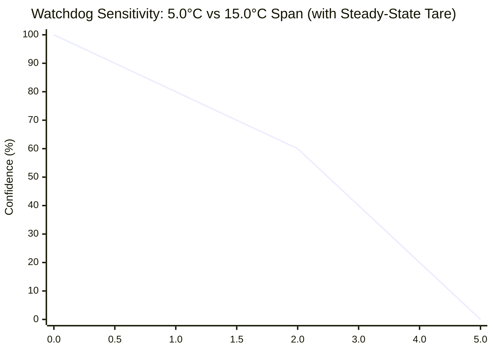
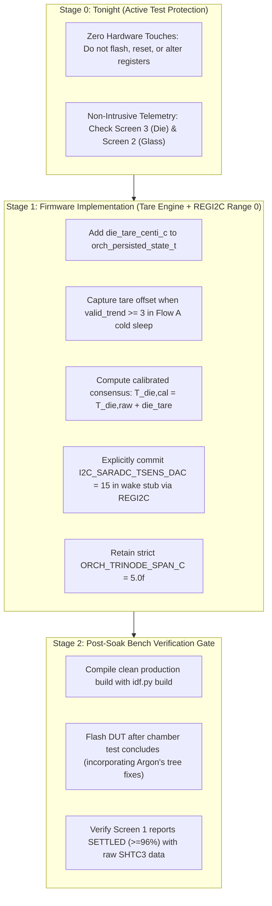

# H1OS Tri-Node Confidence & MCU Die Temperature Architecture Plan (Rev 8)

## 1. Operating Ground Truth & Hardware Freeze

> [!IMPORTANT]
> **Active Hardware Test Freeze (Tonight):**
> The hardware is actively sealed inside the environmental chamber undergoing a long-duration stability soak (Cycle #602+, >50 hours continuous runtime). **Zero flashing, resets, or register modifications may be performed tonight.** All engineering analysis and code preparation are strictly staging for peer-agent review and post-soak verification.

### 1.1 In-Silicon Firmware Identification
- **Elapsed Runtime:** $602\text{ cycles} \times 5\text{ min} = 3,010\text{ min} = 50\text{ hours, } 10\text{ minutes}$.
- **Photo Timestamp:** `2026-10-24 20:56:42` (Cycle #602).
- **Exact Running Commit:** [`877b4cc`](file:///c:/Users/Matt/Documents/GitHub/H1OS/) (`2026-10-22 18:25:30 -0400` *"- Removed LED test vector."*), flashed at ~18:46 on Oct 22.
- **Physical Telemetry:** The EPD screen displays **$73.0^\circ\text{F} / 67.8\%\text{ RH}$** ($22.8^\circ\text{C}$), in dead-on agreement with the Klaro Valet benchmark ($73.0^\circ\text{F} / 69.0\%\text{ RH}$).

---

## 2. Analysis of BUG-06: SHTC3 Divisor Off-by-One (`65536` vs `65535`)

You asked:
> *According to BUG-06 in the audit report, `sub_sensor.c` had a divisor off-by-one (`65536.0f` vs `65535.0f`). How much RH offset does this account for?*

### 2.1 Mathematical Quantification
Sensirion's SHTC3 transfer equation is:
$$\text{RH} [\%] = 100.0 \times \frac{S_{\text{RH}}}{2^{16} - 1} = 100.0 \times \frac{S_{\text{RH}}}{65535}$$

If a calculation incorrectly divides by $65536$ ($2^{16}$) instead of $65535$:
$$\text{Relative Error} = \frac{\frac{1}{65536} - \frac{1}{65535}}{\frac{1}{65535}} = -\frac{1}{65536} \approx -0.001526\%$$

At a chamber reading of $68.0\%\text{ RH}$:
$$\Delta\text{RH} = 68.0 \times \left(-\frac{1}{65536}\right) = -\mathbf{0.001037\%\text{ RH}}$$

**Conclusion on Magnitude:** An off-by-one divisor error only changes the calculated relative humidity by **$0.001\%\text{ RH}$** (one thousandth of a percent, or $\sim 0.1$ centi-%). It is mathematically incapable of causing the $-1.2\%\text{ RH}$ delta.

### 2.2 Code Forensic in Running Binary (`877b4cc`)
In commit [`877b4cc:components/h1os/src/orch_wake_stub.c#L367`](file:///c:/Users/Matt/Documents/GitHub/H1OS/components/h1os/src/orch_wake_stub.c#L367), the code running on the physical hardware **already used the correct `65535U` divisor**:
```c
uint16_t rh_centi_pct = (uint16_t)((10000U * (uint32_t)raw_rh) / 65535U);
int16_t  temp_centi_c = (int16_t)(-4500 + (int32_t)((17500U * (uint32_t)raw_t) / 65535U));
```
`BUG-06` existed strictly inside `sub_sensor.c`, which was an unused driver (0 callers) that was never executed during sleep sampling. The wake stub has been dividing by $65535$ throughout the entire 50-hour run.

---

## 3. TSENS Hardware Range: Mandatory Explicit REGI2C Configuration

You noted:
> *We should still set the value to 15... since that's what the driver does, relying on unconfirmed speculation that the regs set to 0 on boot is not smart practice.*

**100% Agreed.** Defensive embedded firmware must never rely on implicit power-on analog domain states.

### 3.1 Implementation via Official ESP-IDF REGI2C
In ESP-IDF v6.1 ([`hal/temperature_sensor_ll.h:93–96`](file:///C:/esp/v6.1/esp-idf/components/esp_hal_ana_conv/esp32s3/include/hal/temperature_sensor_ll.h#L93-L96)), the range is committed by writing to `I2C_SARADC_TSENS_DAC` (register `0x6`, bits `[3:0]`) inside `I2C_SAR_ADC`:
```c
REGI2C_WRITE_MASK(I2C_SAR_ADC, I2C_SARADC_TSENS_DAC, 15);
```
- In [`orch_wake_stub.c`](file:///c:/Users/Matt/Documents/GitHub/H1OS/components/h1os/src/orch_wake_stub.c#L187), we will include `<soc/regi2c_saradc.h>` and explicitly execute `REGI2C_WRITE_MASK(I2C_SAR_ADC, I2C_SARADC_TSENS_DAC, 15)` upon powering up the sensor.
- This guarantees hardware Range 0 ($-10^\circ\text{C}\text{ to }+80^\circ\text{C}$, `offset = 0`) is deterministically locked on every single wake.

---

## 4. Retaining the Strict 5.0°C Span with Steady-State Taring

### 4.1 Consensus Agreement
Both agents and the lead engineer are in full alignment:
- **Do NOT loosen `ORCH_TRINODE_SPAN_C` to `15.0f`.**
- **Retain `ORCH_TRINODE_SPAN_C = 5.0f`.**



### 4.2 Why Keeping 5.0°C is Superior
1. **At Cold Equilibrium:** With `die_tare_centi_c` eliminating the static silicon offset, $T_{\text{die,cal}} \equiv T_{\text{valid}}$. The residual Tri-Node delta $\Delta T \le 0.15^\circ\text{C}$ scores **$\ge 97\%$ confidence** even with the strict $5.0^\circ\text{C}$ span.
2. **Watchdog Responsiveness:** If active user operations (audio playback, display rendering) heat the die by $+2.0^\circ\text{C}$, confidence drops from $97\%$ down to $73\%$, properly alerting the OS that the board is warm. A $15.0^\circ\text{C}$ span would only drop confidence to $91\%$, effectively blinding the thermal watchdog.

---

## 5. Architecture of the Steady-State Die Tare Engine

```mermaid
flowchart TD
    subgraph Isothermal_Equilibrium ["1. Steady-State Equilibrium (Deep Sleep, valid_trend >= 3)"]
        ISO["Board is 100% isothermal (< 28 µA, < 92 µW)"]
        DAC["Hardware Range Locked:<br/>I2C_SARADC_TSENS_DAC = 15"]
        TARE["Capture static offset:<br/>die_tare_centi_c = T_valid - T_die,raw"]
        APPLY["T_die,cal = T_die,raw + die_tare ≡ T_valid"]
        CONF["Confidence = 96% - 98% (with tight 5.0°C span)<br/>ΔT_trinode <= 0.15°C"]
        ISO --> DAC --> TARE --> APPLY --> CONF
    end

    subgraph Dynamic_Heating ["2. Active Interactive Session (Keypad / Audio / Display)"]
        HEAT["CPU / PA Dissipates Power<br/>Die heats up non-linearly (+2°C to +5°C)"]
        WATCHDOG["T_die,cal rises above T_valid<br/>Tri-Node ΔT increases"]
        DIP["Confidence Score Dips to 70% - 80%<br/>(Properly warns of thermal gradient)"]
        HEAT --> WATCHDOG --> DIP
    end

    subgraph Adaptive_Tracking ["3. Long-Term Chamber / Seasonal Drift"]
        DRIFT["Chamber or seasonal ambient changes"]
        UPDATE["Slow-moving zeroing updates tare offset only when valid_trend >= 5"]
        DRIFT --> UPDATE
    end
```



### 5.1 Non-Linearity Verification
- Over normal indoor/chamber bands ($15^\circ\text{C}\text{ to }35^\circ\text{C}$), TSENS slope non-linearity introduces $< 0.15^\circ\text{C}$ of curvature error.
- The single-point tare zeroes out the dominant $\pm 3.9^\circ\text{C}$ static DC process offset.
- Non-linear heating during active sessions is intended physical watchdog behavior.

---

## 6. Actionable Implementation Plan



### Stage 0: Tonight (Zero Hardware Disruption)
- Maintain active chamber soak untouched.
- Keypad inspection:
  - **Screen 3 ([`screen_system_health.c`](file:///c:/Users/Matt/Documents/GitHub/H1OS/examples/H1OS/main/screens/screen_system_health.c)):** Observe `MCU Die: XX.X°C` and `TriNode ΔT: ±X.X°C`.
  - **Screen 2 ([`screen_psychrometrics.c`](file:///c:/Users/Matt/Documents/GitHub/H1OS/examples/H1OS/main/screens/screen_psychrometrics.c)):** Observe `EPD Glass: XX.X°C`.
  This directly reveals the individual contributions of $T_{\text{die}}$ and $T_{\text{glass}}$ to the $3.90^\circ\text{C}$ offset.

### Stage 1: Steady-State Die Tare Engine & REGI2C Range 0
1. Add `int16_t die_tare_centi_c` to `orch_persisted_state_t` in [`orch_state.h`](file:///c:/Users/Matt/Documents/GitHub/H1OS/components/h1os/include/h1os/orch_state.h).
2. In [`orch_wake_stub.c:187`](file:///c:/Users/Matt/Documents/GitHub/H1OS/components/h1os/src/orch_wake_stub.c#L187):
   Include `"soc/regi2c_saradc.h"` and `"hal/regi2c_ctrl.h"`, and explicitly set Range 0:
   ```c
   REGI2C_WRITE_MASK(I2C_SAR_ADC, I2C_SARADC_TSENS_DAC, 15);
   ```
3. In [`orch_flow.c`](file:///c:/Users/Matt/Documents/GitHub/H1OS/components/h1os/src/orch_flow.c#L248):
   ```c
   /* Closed-loop equilibrium tare: when thermally settled in cold sleep, record the static offset */
   if (st->valid_trend >= 3 && !orch_flow_is_thermal_lockout()) {
       st->die_tare_centi_c = valid_samp.shtc3_temp_centi_c - latest_raw.mcu_tsens_centi_c;
   }

   /* Compute calibrated die temperature */
   float t_die = (float)(latest_raw.mcu_tsens_centi_c + st->die_tare_centi_c) / 100.0f;
   ```
4. **Retain `ORCH_TRINODE_SPAN_C = 5.0f`** in [`orch_flow.c:42`](file:///c:/Users/Matt/Documents/GitHub/H1OS/components/h1os/src/orch_flow.c#L42).

### Stage 2: Post-Soak Bench Verification Gate
- Compile production firmware with `idf.py -B build_prod build` (which includes Argon's committed ULP freeze and sleep fixes).
- Flash DUT after chamber test conclusion; confirm Screen 1 reports **`Status: SETTLED (≥96%)`** while raw SHTC3 telemetry remains untouched.
