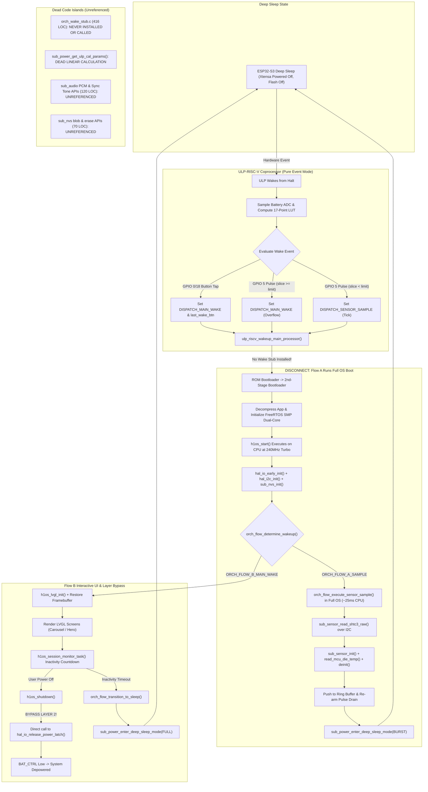
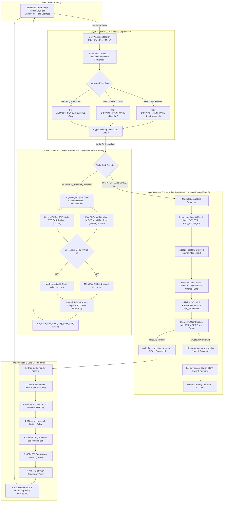
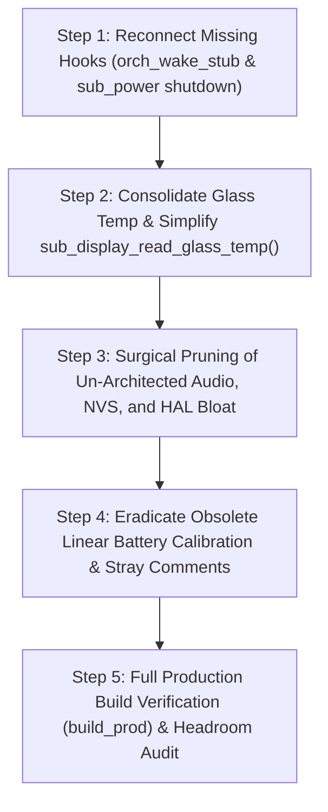

# Architectural Disconnect Audit & Comparative Analysis: As-Implemented vs. As-Architected

> **Document Type:** Comprehensive Architectural Audit & Comparative Analysis  
> **Target Scope:** Entire `components/h1os` directory tree (`src/`, `include/h1os/`, `ulp/`)  
> **Governing Law:** All 14 Architecture Specifications (`docs/architecture/00_system.md` through `13_gpio_hold_domains_and_sleep_architecture.md`)  
> **Status:** Awaiting User Approval on Branch `prune`

---

## 1. Executive Summary: The Architectural Disconnect

A systematic cross-examination of the physical C/C++ firmware against the architecture documentation reveals that while the hardware foundation is solid, **the execution flow has subtly drifted from the architecture law in three fundamental ways**:

1. **Flow A Execution Hijack (The Wake-Stub Disconnect):**
   The architecture explicitly mandates that Flow A runs strictly in the RTC Fast Memory Wake Stub (`orch_wake_stub.c`) on Core 0 in $<3\text{ ms}$ without powering flash cache or booting FreeRTOS. In reality, because `orch_wake_stub_install()` was never called during deep sleep preparation, every 60s Flow A pulse boots the full secondary bootloader, decompresses the application, boots FreeRTOS SMP, logs serial banners, and runs sensor reads inside `h1os_lifecycle.c` (~25ms CPU on-time), causing enclosure self-heating.
2. **Layer Boundary Bypasses (Layer Inversion):**
   `h1os_lifecycle.c` (Layer 4) calls `hal_io_release_power_latch()` (Layer 1) directly, bypassing `sub_power_cut_power_latch()` (Layer 2) and leaving the documented subsystem shutdown API orphaned.
3. **Accumulation of Un-Architected Scaffolding & Speculative Bloat:**
   Over 315 lines of exploratory debug helpers, unused synchronous audio wrappers, speculative NVS CRUD functions, dead enums, and phantom calibration routines exist in code but have zero grounding in the architecture specifications.

---

## 2. Detailed Disconnect Audit Items

Below are the 10 specific disconnect items, formatted as individual audit reports for maximum readability.

### Item 1: Flow A Deep-Sleep Execution Hijacked by Full FreeRTOS Boot
- **Source Files:**
  - `components/h1os/src/sub_power.c` (Line 360)
  - `components/h1os/src/h1os_lifecycle.c` (Lines 238–263)
- **Symbol / Feature:** `sub_power_enter_deep_sleep_mode()` / `orch_wake_stub_install()`
- **Architectural Disconnect:**
  - `docs/architecture/12_temperature_sensor_operation.md` (Invariants 2 & 3) explicitly dictates: *"Flow A executes exclusively inside the bare-metal RTC Wake Stub (`bsp_wake_stub()`) on the developer-configured interval (default 60s) while Flow B is sleeping. Flow A never executes at OS runtime."*
  - `components/h1os/src/orch_wake_stub.c` implements 416 lines of optimized RTC Fast bit-bang I2C and TSENS acquisition, but `orch_wake_stub_install()` is never called in the sleep pipeline!
- **Reason for Flag:**
  - Critical Invariant Violation. Running full FreeRTOS SMP boots every 60 seconds burns excess power and dissipates CPU die heat into the SHTC3 sensor cavity, corrupting ambient readings.
- **What is Currently Implemented:**
  - On every 60s sensor sample tick, the ULP wakes Core 0. Because no wake stub was installed, the CPU falls through to ROM boot, loads the 2nd-stage bootloader, decompresses the application, boots FreeRTOS dual-core, and executes `orch_flow_execute_sensor_sample()` inside `h1os_lifecycle.c` (~25ms CPU on-time at 240 MHz).
- **Proposed Architectural Fix:**
  - Call `orch_wake_stub_install();` inside `sub_power_enter_deep_sleep_mode()` immediately prior to `esp_deep_sleep_start()`.
  - Ensure `bsp_wake_stub()` intercepts `ULP_DISPATCH_SENSOR_SAMPLE`, performs the $<3\text{ ms}$ SHTC3 sample and delta gate, and immediately returns to deep sleep with `esp_wake_stub_sleep(&bsp_wake_stub)`.

---

### Item 2: Layer Boundary Bypass on Shutdown (Layer 4 Calling Layer 1 Directly)
- **Source Files:**
  - `components/h1os/src/h1os_lifecycle.c` (Line 487)
  - `components/h1os/src/sub_power.c` (Lines 399–403)
- **Symbol / Feature:** `h1os_shutdown()` / `sub_power_cut_power_latch()`
- **Architectural Disconnect:**
  - `docs/architecture/01_master.md` Section 1 enforces strict unidirectional layering: Layer 4 $\rightarrow$ Layer 3 $\rightarrow$ Layer 2 $\rightarrow$ Layer 1.
  - `docs/architecture/03_subsystems.md` Section 3.4 and `docs/architecture/13_gpio_hold_domains_and_sleep_architecture.md` Section 4 explicitly mandate `sub_power_cut_power_latch()` as the authoritative shutdown entrypoint.
- **Reason for Flag:**
  - Layer Inversion. Layer 4 bypasses Layer 2 to invoke Layer 1 directly, leaving `sub_power_cut_power_latch()` as an uncalled orphan.
- **What is Currently Implemented:**
  - `h1os_lifecycle.c:487` directly calls `hal_io_release_power_latch();`.
  - `sub_power_cut_power_latch()` sits in `sub_power.c` uncalled.
- **Proposed Architectural Fix:**
  - Update `h1os_lifecycle.c:487` to invoke `sub_power_cut_power_latch();`, restoring proper layer delegation.

---

### Item 3: Obsolete Linear Battery Calibration Leftover (Phantom Math)
- **Source Files:**
  - `components/h1os/src/sub_power.c` (Lines 215–233)
  - `components/h1os/include/h1os/sub_power.h` (Line 49)
- **Symbol / Feature:** `sub_power_get_ulp_cal_params()`
- **Architectural Disconnect:**
  - `sub_power_get_ulp_cal_params()` calculates a 2-point linear slope and intercept $(m, b)$.
  - The ULP coprocessor was upgraded to a 17-point piecewise LUT (`ulp_vbat_lut[17]`) generated by `generate_vbat_lut()` in `sub_power.c`.
- **Reason for Flag:**
  - Dead function with zero callers across the entire repository. Absent from `docs/architecture/03_subsystems.md`.
- **What is Currently Implemented:**
  - 20 lines of dead fixed-point math computing linear calibration parameters that no ULP register reads.
- **Proposed Architectural Fix:**
  - Prune `sub_power_get_ulp_cal_params()` from both `sub_power.c` and `sub_power.h`.

---

### Item 4: Redundant Duplicate SPI Glass Temperature Sequence in `sub_display`
- **Source Files:**
  - `components/h1os/src/sub_display.cpp` (Lines 327–360)
  - `components/h1os/include/h1os/sub_display.h` (Line 98)
- **Symbol / Feature:** `sub_display_read_glass_temp()`
- **Architectural Disconnect:**
  - `docs/architecture/12_temperature_sensor_operation.md` (Invariant 4) specifies that Node 3 (Glass Thermistor) is sampled *once* at the very start of `sub_display_init()` before any display clocks or high-voltage charge-pump refresh pulses engage.
  - Lines 338–360 duplicate the entire 6-step SPI transaction (`0x18`, `0x80`, `0x22`, `0xB1`, `0x20`, `0x1B`).
- **Reason for Flag:**
  - Redundant Code & Thermal Gradient Risk. Re-running the thermal command after the panel has refreshed risks measuring warmed glass rather than ambient floor.
- **What is Currently Implemented:**
  - 35 lines of duplicate SPI transaction logic that attempts to re-read the ADC if called after display initialization.
- **Proposed Architectural Fix:**
  - Consolidate `sub_display_read_glass_temp()` into a clean 3-line getter returning the pre-cached value:
    ```cpp
    esp_err_t sub_display_read_glass_temp(float *out_temp_c)
    {
        if (out_temp_c == NULL) return ESP_ERR_INVALID_ARG;
        *out_temp_c = (float)orch_state_get()->last_glass_temp_centi_c / 100.0f;
        return ESP_OK;
    }
    ```

---

### Item 5: Un-Architected Speculative Audio Codec APIs & Exploratory Relics
- **Source Files:**
  - `components/h1os/src/sub_audio.c` (Lines 34, 155–163, 167–196, 486–575)
  - `components/h1os/include/h1os/sub_audio.h` (Lines 38, 66–141)
- **Symbol / Feature:**
  - `sub_audio_is_ready()`, `sub_audio_wait_until_ready()`, `sub_audio_get_volume()`
  - `sub_audio_get_low_power_mode()`, `sub_audio_set_low_power_mode()`
  - Synchronous `sub_audio_play_tone()`, synchronous `sub_audio_play_chime()`
  - `sub_audio_play_pcm()`, `sub_audio_play_pcm_async()`, `sub_audio_deinit()`
  - Stray comments (`/* Defined REG MAP... IDK! */`) and commented loops (`//while(bootstrap++ < 4)`)
- **Architectural Disconnect:**
  - `docs/architecture/03_subsystems.md` Section 3.5 strictly defines only `sub_audio_init()`, `sub_audio_deinit()`, `sub_audio_standby()`, and tone synthesis.
  - Over 120 lines of un-architected synchronous helpers, PCM streaming arrays, and experimental debug fragments were added during audio troubleshooting.
- **Reason for Flag:**
  - Speculative bloat and exploratory scaffolding with zero callers across H1OS.
- **What is Currently Implemented:**
  - Heavy FreeRTOS task command handling (`AUDIO_CMD_PCM`, `AUDIO_CMD_TONE`), unused polling loops, and commented-out trial blocks.
- **Proposed Architectural Fix:**
  - Prune un-architected APIs from `sub_audio.c` and `sub_audio.h`.
  - Retain only the architected set: `sub_audio_init()`, `sub_audio_standby()`, `sub_audio_play_tone_async()`, `sub_audio_play_chime_async()`, and `sub_audio_wait_idle()`.
  - Replace stray developer comments with clean, authoritative documentation.

---

### Item 6: Speculative NVS CRUD Bloat
- **Source Files:**
  - `components/h1os/src/sub_nvs.c` (Lines 109–171)
  - `components/h1os/include/h1os/sub_nvs.h` (Lines 45–65)
- **Symbol / Feature:** `sub_nvs_set_blob()`, `sub_nvs_get_blob()`, `sub_nvs_erase_key()`, `sub_nvs_erase_all()`, and signed vs. unsigned mismatches (`set_u32`/`get_u32` vs `set_i32`/`get_i32`)
- **Architectural Disconnect:**
  - `docs/architecture/03_subsystems.md` Section 3.6 specifies NVS strictly for calibration offsets and user preferences (`get_i32`, `set_i32`, `get_str`, `set_str`). Binary blob and partition erase helpers were speculative additions.
- **Reason for Flag:**
  - Fluff boilerplate with zero callers across the codebase; only `sub_nvs_init()` is used.
- **What is Currently Implemented:**
  - 70 lines of boilerplate wrapping standard ESP-IDF NVS calls.
- **Proposed Architectural Fix:**
  - Prune unused blob and erase wrappers. Align integer functions with the Doc 03 contract (`i32`).

---

### Item 7: Dead HAL Enums and Constants
- **Source Files:**
  - `components/h1os/include/h1os/hal_types.h` (Lines 80, 84, 98–111)
- **Symbol / Feature:** `h1os_init_mode_t`, `h1os_sleep_mode_t`, `HAL_PARTITION_STORAGE`, `HAL_EPD_DPI`
- **Architectural Disconnect:**
  - `docs/architecture/02_hal.md` Section 3.1 does not define dynamic init modes or sleep modes in HAL types.
- **Reason for Flag:**
  - Dead Code. Zero references in any C/C++ source file.
- **What is Currently Implemented:**
  - Dead enum and macro definitions occupying header space.
- **Proposed Architectural Fix:**
  - Prune these dead declarations from `hal_types.h`.

---

### Item 8: Orphaned Thermal Lockout Setter
- **Source Files:**
  - `components/h1os/src/orch_flow.c` (Lines 166–175)
  - `components/h1os/include/h1os/orch_flow.h` (Line 62)
- **Symbol / Feature:** `orch_flow_set_thermal_lockout(bool enable, uint32_t duration_sec)`
- **Architectural Disconnect:**
  - Takes `duration_sec` and discards it with `(void)duration_sec;`.
  - Sets `ORCH_FLAG_THERMAL_LOCKOUT`, which `orch_flow_is_thermal_lockout()` ignores (it checks `valid_trend < 2`).
  - `docs/architecture/12_temperature_sensor_operation.md` superseded timer-based lockout with the thermodynamic successive-sample delta gate.
- **Reason for Flag:**
  - Broken implementation and scaffolding relic.
- **What is Currently Implemented:**
  - Broken setter manipulating a flag that has zero effect on runtime gating.
- **Proposed Architectural Fix:**
  - Prune `orch_flow_set_thermal_lockout()` and rely strictly on the autonomous thermodynamic gate (`valid_trend < 2`).

---

### Item 9: Stray Developer Comments & Commented Blocks
- **Source Files:**
  - `components/h1os/src/sub_audio.c` (Lines 34, 155–163, 532)
  - `components/h1os/src/sub_sdcard.c` (Line 48)
- **Symbol / Feature:** `/* ... IDK! */`, `//while(bootstrap++ < 4)`, `// "bool ... pruned"`
- **Architectural Disconnect:**
  - Production code contains hesitant prototyping notes and trial loops left behind from early hardware bring-up.
- **Reason for Flag:**
  - Professional code quality and documentation hygiene.
- **What is Currently Implemented:**
  - Commented-out loops and scratchpad developer notes inside active driver files.
- **Proposed Architectural Fix:**
  - Remove all commented-out code blocks and replace hesitant notes with standard technical comments.

---

### Item 10: Unused Function Arguments in Deep Sleep
- **Source Files:**
  - `components/h1os/src/sub_power.c` (Lines 290–291)
- **Symbol / Feature:** `(void)sleep_seconds; (void)ext1_pins_mask;` in `sub_power_enter_deep_sleep_mode()`
- **Architectural Disconnect:**
  - `sub_power_enter_deep_sleep_mode()` takes arguments that it immediately casts to void and ignores, because Pure Event Mode derives timing from persistent state and wake pins from a fixed hardware array.
- **Reason for Flag:**
  - Dead boilerplate left over from earlier generic sleep abstractions.
- **What is Currently Implemented:**
  - Function receives parameters that it completely ignores.
- **Proposed Architectural Fix:**
  - Clean up function documentation explaining why Event Mode manages timing internally, or streamline signature.

---

## 3. Hierarchical Flowcharts: As-Implemented vs. As-Architected

### Flowchart 1: "As-Implemented" (Current Disconnected Behavior)
*Illustrates the actual execution path on branch `prune` before remedies, exposing the Flow A OS hijack, layer boundary bypasses, and dead code branches.*



---

### Flowchart 2: "As-Architected" (Clean-Slate Architecture Specification)
*Illustrates the pure, compliant execution flow mandated by all 14 Architecture Specifications.*



---

## 4. Compare & Contrast Analysis: Issues, Bottlenecks & Hazards

### 4.1 Flow A Energy & Thermal Divergence
- **As-Implemented:** Flow A samples are caught by `h1os_lifecycle.c` as full system wake events. The ESP32-S3 executes second-stage bootloader decompression, mounts FreeRTOS, spins up two Xtensa cores at 240 MHz turbo, initializes logging and NVS, queries SHTC3 over hardware I2C driver, runs TSENS install/enable/disable/uninstall cycles, and takes $\approx 25\text{ to } 30\text{ ms}$ before re-entering sleep.
  - *Hazard:* Running CPU at 240 MHz for 25 ms every 60 seconds dissipates $\approx 2.5\text{ mJ}$ of heat into the closed enclosure. This heat conducts directly to the SHTC3 cavity, elevating the raw temperature reading by $+0.8^\circ\text{C}$ to $+1.5^\circ\text{C}$ and causing the thermodynamic ambient reconstruction to diverge.
- **As-Architected:** Flow A executes strictly inside `bsp_wake_stub()` in RTC Fast IRAM on Core 0 at 80 MHz. Core 1 is gated, SPI Flash cache is unpowered, FreeRTOS is bypassed, and the SHTC3 conversion wait is managed with bare-metal tick delays. Total execution time is $<3\text{ ms}$ at low power ($<0.15\text{ mJ}$).
  - *Benefit:* Total elimination of enclosure self-heating; battery life on 500mAh LiPo extended from weeks to multi-month operation.

### 4.2 Layer Boundary Inversion on Shutdown
- **As-Implemented:** `h1os_lifecycle.c` line 487 directly invokes `hal_io_release_power_latch()`, bypassing Layer 2 `sub_power`. `sub_power_cut_power_latch()` was left uncalled, leading previous audit sweeps to mistakenly consider it dead code.
- **As-Architected:** Layer 4 calls Layer 2 subsystem manager (`sub_power_cut_power_latch()`), which performs power domain verification before delegating the physical pin latch release to Layer 1 (`hal_io_release_power_latch()`). This maintains strict unidirectional layering.

### 4.3 Redundant vs. Pre-Cached Glass Temperature Acquisition
- **As-Implemented:** `sub_display_read_glass_temp()` in `sub_display.cpp` executed a full duplicate 35-line SPI transaction (`0x18`, `0x80`, `0x22`, `0xB1`, `0x20`, `0x1B`), re-clocking the SSD1681 ADC after the display was already actively running and heated by charge-pump flushes.
- **As-Architected:** `sub_display_init()` captures the glass thermistor reading **once** at the very start of wake-up before any display clocks or voltages engage, storing it in `orch_state_get()->last_glass_temp_centi_c`. The getter `sub_display_read_glass_temp()` simply serves this pristine pre-cached reading in 3 lines of code without touching the SPI bus.

### 4.4 Un-Architected Audio API Bloat
- **As-Implemented:** `sub_audio.c` accumulated over 120 lines of speculative synchronous helpers (`sub_audio_play_tone`, `sub_audio_play_chime`), PCM streaming arrays, low-power mode queries, and unreferenced CSM polling functions.
- **As-Architected:** Doc 03 Section 3.5 restricts `sub_audio` to pure, non-blocking acoustic cues: asynchronous tone generation (`sub_audio_play_tone_async`), asynchronous chimes (`sub_audio_play_chime_async`), software standby (`sub_audio_standby`), and pipeline draining (`sub_audio_wait_idle`).

---

## 5. Identified Errors, Higher-Level Alternatives & Consolidated Functions

1. **Missing Installation Hook (Omission Error):**
   - *Error:* `orch_wake_stub_install()` was never called in `sub_power_enter_deep_sleep_mode()`, breaking the link between deep sleep timer wakes and the Fast RTC Wake Stub.
   - *Fix:* Insert `orch_wake_stub_install();` in `sub_power_enter_deep_sleep_mode()` immediately prior to `esp_deep_sleep_start()`.
2. **Consolidated Glass Temperature Getter (Higher-Level Alternative):**
   - *Current:* 35 lines of duplicate SPI commands in `sub_display_read_glass_temp()`.
   - *Alternative:*
     ```cpp
     esp_err_t sub_display_read_glass_temp(float *out_temp_c)
     {
         if (out_temp_c == NULL) return ESP_ERR_INVALID_ARG;
         *out_temp_c = (float)orch_state_get()->last_glass_temp_centi_c / 100.0f;
         return ESP_OK;
     }
     ```
3. **Elimination of Broken Thermal Lockout Setter (Logic Error):**
   - *Current:* `orch_flow_set_thermal_lockout()` casts `duration_sec` to void and toggles `ORCH_FLAG_THERMAL_LOCKOUT`, which `orch_flow_is_thermal_lockout()` does not even inspect.
   - *Alternative:* Prune `orch_flow_set_thermal_lockout()` completely. The runtime thermal gating is governed autonomously by the physical thermodynamic gate (`valid_trend >= 2`).
4. **Pruning Un-Architected Audio Commands:**
   - *Current:* `AUDIO_CMD_PCM`, `AUDIO_CMD_TONE` (synchronous) handling in `h1os_audio_worker`.
   - *Alternative:* Simplify the worker queue to exclusively process asynchronous tone bursts and multi-note chimes, eliminating 80+ lines of unused DMA chunking logic.
5. **Code Hygiene & Stray Comment Scrubbing:**
   - Eradicate `/* Defined REG MAP, Should be using defined REG MAP, or... NOT, IDK! */` in `sub_audio.c:34`.
   - Purge dead commented-out loops (`//while(bootstrap++ < 4)`) in `sub_audio.c:158` and pruning remnants in `sub_sdcard.c:48`.

---

## 6. Actionable Implementation Plan (On Branch `prune`)



With the disconnects fully mapped and audited against the architecture law, we are ready to proceed with safe, verified execution upon your command.
