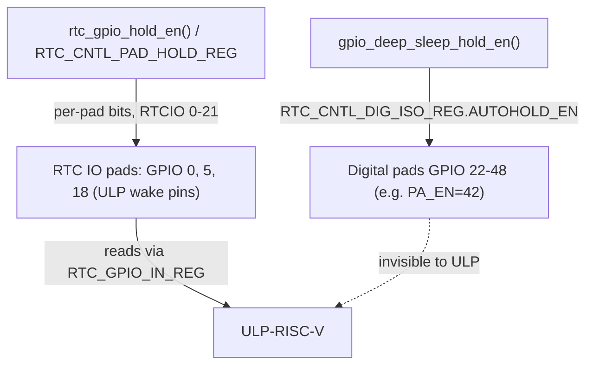

**Short answer: No.** `gpio_deep_sleep_hold_en()` only affects **digital** IO pads (GPIO 22+ on S3 — your `PA_EN`/GPIO 42). It writes `RTC_CNTL_DIG_ISO_REG` (`DG_PAD_AUTOHOLD_EN_M`), which has no effect on RTC IO pads like your wake pins GPIO 0/5/18 — those live in a separate hold domain (`RTC_CNTL_PAD_HOLD_REG`), and those are the only pins the ULP can see anyway. [1](#5-0) 

---

## Two separate hold domains



- The deep-sleep autohold is additionally **gated per-pad**: it only holds pads where you already called `gpio_hold_en()` / `gpio_ll_hold_en()` — which in your case is just GPIO 42. [2](#5-1) [3](#5-2) 
- The ULP reads `RTC_GPIO_IN_REG` / `RTC_GPIO_STATUS_REG`, which only cover RTCIO pads — digital pads aren't in its address space at all.

## What *would* break the ULP

Calling `rtc_gpio_hold_en()` (i.e., setting `RTC_CNTL_PAD_HOLD_REG` bits) on GPIO 0/5/18 — that freezes the RTC pad's input path in sleep, exactly the "Pad Hold Rule" your audit flagged. `gpio_hold_dis` on an RTCIO pad routes through `rtc_gpio_hold_dis`, confirming the two mechanisms are distinct. [4](#5-3) [5](#5-4) 

## One doc discrepancy to be aware of

The driver header claims input-mode holds still reflect live signals [6](#5-5) , while the HAL header claims held inputs freeze their read value [7](#5-6) . Either way, irrelevant to your ULP pins — just don't hold them.

## Notes

- `gpio_deep_sleep_hold_en()` persists across every deep sleep until `gpio_deep_sleep_hold_dis()`; the LL macros require `PERIPH_RCC_ATOMIC` — the public API handles that for you. [8](#5-7) 
- Also note holds only apply to output-capable GPIOs (`GPIO_HOLD_MASK`), and wake pins being inputs were never candidates anyway.

Wiki pages you might want to explore:
- [Peripheral Drivers (espressif/esp-idf)](/wiki/espressif/esp-idf#6)

### Citations

**File:** components/esp_hal_gpio/esp32s3/include/hal/gpio_ll.h (L424-428)
```text
static inline void _gpio_ll_deep_sleep_hold_en(gpio_dev_t *hw)
{
    CLEAR_PERI_REG_MASK(RTC_CNTL_DIG_ISO_REG, RTC_CNTL_DG_PAD_FORCE_UNHOLD);
    SET_PERI_REG_MASK(RTC_CNTL_DIG_ISO_REG, RTC_CNTL_DG_PAD_AUTOHOLD_EN_M);
}
```

**File:** components/esp_hal_gpio/esp32s3/include/hal/gpio_ll.h (L471-485)
```text
static inline void gpio_ll_hold_en(gpio_dev_t *hw, uint32_t gpio_num)
{
    SET_PERI_REG_MASK(RTC_CNTL_DIG_PAD_HOLD_REG, GPIO_HOLD_MASK[gpio_num]);
}

/**
  * @brief Disable gpio pad hold function.
  *
  * @param hw Peripheral GPIO hardware instance address.
  * @param gpio_num GPIO number, only support output GPIOs
  */
static inline void gpio_ll_hold_dis(gpio_dev_t *hw, uint32_t gpio_num)
{
    CLEAR_PERI_REG_MASK(RTC_CNTL_DIG_PAD_HOLD_REG, GPIO_HOLD_MASK[gpio_num]);
}
```

**File:** components/esp_driver_gpio/include/driver/gpio.h (L419-451)
```text
/**
  * @brief Enable gpio pad hold function.
  *
  * When a GPIO is set to hold, its state is latched at that moment and will not change when the internal
  * signal or the IO MUX/GPIO configuration is modified (including input enable, output enable, output value,
  * function, and drive strength values). This function can be used to retain the state of GPIOs when the power
  * domain of where GPIO/IOMUX belongs to becomes off. For example, chip or system is reset (e.g. watchdog
  * time-out, Deep-sleep events are triggered), or peripheral power-down in Light-sleep.
  *
  * This function works in both input and output modes, and only applicable to output-capable GPIOs.
  * If this function is enabled:
  *   in output mode: the output level of the GPIO will be locked and can not be changed.
  *   in input mode: the input read value can still reflect the changes of the input signal.
  *
  * Power down or call `gpio_hold_dis` will disable this function.
  *
  * Please be aware that,
  *
  * 1. USB pads cannot hold at low level after waking up from Deep-sleep. The USB related registers are reset, so the USB pull-up is back.
  *
  * 2. For ESP32-P4 rev < 3.0, the states of IOs can not be hold after waking up from Deep-sleep.
  *
  * 3. For ESP32/S2/C3/S3/C2, this function cannot be used to hold the state of a digital GPIO during Deep-sleep.
  * Even if this function is enabled, the digital GPIO will be reset to its default state when the chip wakes up from
  * Deep-sleep. If you want to hold the state of a digital GPIO during Deep-sleep, please call `gpio_deep_sleep_hold_en`.
  *
  * @param gpio_num GPIO number, only support output-capable GPIOs
  *
  * @return
  *     - ESP_OK Success
  *     - ESP_ERR_NOT_SUPPORTED Not support pad hold function
  */
esp_err_t gpio_hold_en(gpio_num_t gpio_num);
```

**File:** components/esp_driver_gpio/include/driver/gpio.h (L473-490)
```text
/**
  * @brief Enable all digital gpio pads hold function during Deep-sleep.
  *
  * Enabling this feature makes all digital gpio pads be at the holding state during Deep-sleep. The state of each pad
  * holds is its active configuration (not pad's sleep configuration!).
  *
  * Note:
  *   1. For digital IO, this API takes effect only if the corresponding digital IO pad hold function has been enabled. You
  *      can enable the GPIO pad hold function by calling `gpio_hold_en`.
  *      has been enabled. You can call `gpio_hold_en` to enable the gpio pad hold function.
  *   2. Though this API targets all digital IOs, the pad hold feature only works when the chip is in Deep-sleep mode. When
  *      the chip is in active mode, the digital GPIO state can be changed freely even if you have called this function, except
  *      for IOs that are already held by `gpio_hold_en`.
  *
  * After this API is being called, the digital gpio Deep-sleep hold feature will work during every sleep process. You
  * should call `gpio_deep_sleep_hold_dis` to disable this feature.
  */
void gpio_deep_sleep_hold_en(void);
```

**File:** components/esp_driver_gpio/src/gpio.c (L798-816)
```c
esp_err_t gpio_hold_dis(gpio_num_t gpio_num)
{
    int ret = ESP_OK;

    if (rtc_gpio_is_valid_gpio(gpio_num)) {
#if SOC_RTCIO_HOLD_SUPPORTED
        ret = rtc_gpio_hold_dis(gpio_num);
#endif
    } else if (GPIO_HOLD_MASK[gpio_num]) {
        GPIO_CHECK(GPIO_IS_VALID_OUTPUT_GPIO(gpio_num), "Only output-capable GPIO support this function", ESP_ERR_NOT_SUPPORTED);
        portENTER_CRITICAL(&gpio_context.gpio_spinlock);
        gpio_hal_hold_dis(gpio_context.gpio_hal, gpio_num);
        portEXIT_CRITICAL(&gpio_context.gpio_spinlock);
    } else {
        ret = ESP_ERR_NOT_SUPPORTED;
    }

    return ret;
}
```

**File:** components/esp_driver_gpio/src/gpio.c (L818-836)
```c
#if !SOC_GPIO_SUPPORT_HOLD_SINGLE_IO_IN_DSLP
void gpio_deep_sleep_hold_en(void)
{
    portENTER_CRITICAL(&gpio_context.gpio_spinlock);
    RTC_CNTL_ATOMIC() {
        gpio_hal_deep_sleep_hold_en(gpio_context.gpio_hal);
    }
    portEXIT_CRITICAL(&gpio_context.gpio_spinlock);
}

void gpio_deep_sleep_hold_dis(void)
{
    portENTER_CRITICAL(&gpio_context.gpio_spinlock);
    RTC_CNTL_ATOMIC() {
        gpio_hal_deep_sleep_hold_dis(gpio_context.gpio_hal);
    }
    portEXIT_CRITICAL(&gpio_context.gpio_spinlock);
}
#endif //!SOC_GPIO_SUPPORT_HOLD_SINGLE_IO_IN_DSLP
```

**File:** components/esp_hal_gpio/include/hal/gpio_hal.h (L284-300)
```text
/**
  * @brief Enable gpio pad hold function.
  *
  * The gpio pad hold function works in both input and output modes, but must be output-capable gpios.
  * If pad hold enabled:
  *   in output mode: the output level of the pad will be force locked and can not be changed.
  *   in input mode: the input value read will not change, regardless the changes of input signal.
  *
  * On ESP32/S2/C3/S3/C2, the state of digital gpio cannot be held during Deep-sleep, and it will resume the hold
  * function when the chip wakes up from Deep-sleep. If the digital gpio also needs to be held during Deep-sleep,
  * `gpio_deep_sleep_hold_en` should also be called.
  *
  * Power down or call gpio_hold_dis will disable this function.
  *
  * @param hal Context of the HAL layer
  * @param gpio_num GPIO number, only support output GPIOs
  */
```
