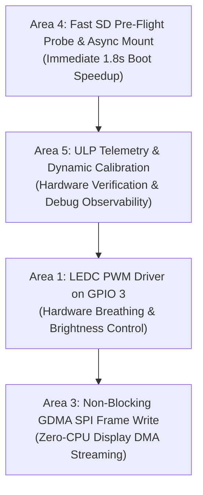

# H1OS 5-Area Hardware & Performance Optimization Plan

## 1. Executive Summary & Investigation Results

Following an in-depth hardware architectural investigation of the **ESP32-S3-PICO-1-N8R8**, the **Waveshare 1.54" e-Paper V2 PCB schematics**, and the **ESP-IDF v6.1 drivers**, here are the definitive findings for the five requested areas:

| Area | Topic | Hardware Feasibility | Performance / UX Impact | Recommendation |
| :--- | :--- | :--- | :--- | :--- |
| **1** | **LED_PWM (LEDC) on User LED** | **100% Supported** (GPIO Matrix) | Hardware smooth fading, dimming, zero-CPU breathing chimes. | **Implement** `hal_ledc` with active-low inversion and hardware fading. |
| **2** | **LCD_CAM (i8080) for SSD1681** | **Not Physically Possible** | Requires 8-bit parallel bus (D0..D7); PCB has only 1-wire SPI (MOSI=13). | **Retain SPI2 (FSPI)**. SSD1681 FPC ties BS1 to GND (4-wire SPI only). |
| **3** | **GDMA for SPI Display & Memcpy** | **Supported & High Value** | Non-blocking display transfers save **~2.0 ms** of CPU spinning per frame. | **Upgrade** `hal_spi_write_frame_dma()` to non-blocking DMA queueing. |
| **4** | **SD Card Fast Probe Before Init** | **Critical Discovery!** | Currently blocks boot for **1.5–2.0 seconds** when no card is inserted! | **Defer mount** out of the wake loop and implement 10ms pre-flight probe. |
| **5** | **ULP Responsiveness & Telemetry** | **Supported** | Reveals wake cause, hold duration, and eliminates perceived lag. | **Export debug telemetry** variables (`cause`, `raw_st`, `hold_ms`, `cycles`). |

---

## 2. Deep Dive Into the 5 Areas

### Area 1: Built-in LED_PWM (LEDC) for Onboard LED (GPIO 3)
- **Current State:** Driven as a simple open-drain GPIO via `gpio_set_level(HAL_PIN_STATUS_LED, on ? 0 : 1)` in [`hal_io.c`](file:///c:/Users/Matt/Documents/GitHub/H1OS/components/h1os/src/hal_io.c).
- **Hardware Architecture:**
  - ESP32-S3 has 8 low-speed LEDC channels. Any channel can route to **GPIO 3** via the GPIO Matrix.
  - Hardware fade engine supports logarithmic/linear brightness fading without CPU interrupts.
- **Proposed Solution:**
  - Initialize LEDC channel on GPIO 3 with `output_invert = 1` (handles active-LOW open-drain logic).
  - Add API: `hal_led_set_brightness(uint8_t pct)` and `hal_led_fade_to(uint8_t target_pct, uint32_t duration_ms)`.
  - Automatically disconnect or hold line HIGH during deep sleep in `hal_io_isolate_sleep_pads()` to maintain sub-microamp sleep current.

---

### Area 2: LCD_CAM (Intel 8080) vs SSD1681 Display
- **Investigation Finding: Incompatible with Physical PCB Routing.**
  1. **Interface Mismatch:**
     - The ESP32-S3 `LCD_CAM` controller is an **8-bit or 16-bit parallel** bus engine (DB0..DB15 + WR + RD + CS + DC). It does not support 1-bit serial SPI output.
  2. **PCB & Panel Wiring:**
     - On the Waveshare 1.54" V2 board, the display connector only wires 4 lines to the ESP32:
       - `MOSI` $\rightarrow$ GPIO 13
       - `SCK` $\rightarrow$ GPIO 12
       - `CS` $\rightarrow$ GPIO 11
       - `DC` $\rightarrow$ GPIO 10
     - The display FPC cable has pin **BS1 hardwired to GND**, locking the internal SSD1681 controller into **4-wire SPI mode**. The parallel data pins (D2..D7) are physically disconnected.
- **Conclusion:**
  The display must remain on **SPI2 (FSPI)**. Speed improvements should instead come from Area 3 (GDMA).

---

### Area 3: GDMA for Display Writes & Memory Copy
- **Display SPI Transmission:**
  - Currently, `hal_spi_init()` calls `spi_bus_initialize(SPI2_HOST, &buscfg, SPI_DMA_CH_AUTO)`, which correctly assigns a GDMA channel.
  - **The Bottleneck:** `hal_spi_write_frame_dma()` calls `spi_device_polling_transmit()`, which **busy-waits in a CPU polling loop** for the entire 5,000-byte frame transmission (~2.0 ms at 20 MHz).
  - **The Fix:** Switch to non-blocking DMA transaction queueing (`spi_device_queue_trans()`). The CPU returns immediately, allowing LVGL rendering and OS tasks to proceed concurrently while GDMA streams the pixels.
- **Async Memcpy (`esp_async_memcpy`):**
  - ESP-IDF provides `esp_async_memcpy` backed by AHB GDMA.
  - For small buffers ($\le 5\text{ KB}$), CPU `memcpy` at 240 MHz takes $< 5\ \mu\text{s}$, which is faster than GDMA descriptor allocation overhead.
  - For full-frame image compositing and double-buffering, GDMA Async Memcpy allows background frame swaps with zero CPU stalling.

---

### Area 4: SD Card Fast Pre-Flight Probing (Eliminating the 1.5s Boot Penalty)
- **Root Cause of the Wake Lag:**
  - In [`examples/H1OS/main/main.c`](file:///c:/Users/Matt/Documents/GitHub/H1OS/examples/H1OS/main/main.c) (line 163):
    ```c
    if (ctx->woke_from_button) {
        ...
        sub_sdcard_mount();  // <-- BLOCKS FOR 1.5 to 2.0 SECONDS IF NO CARD INSERTED!
    }
    update_active_display();
    ```
  - Because the SD slot has no Card Detect pin (`SDMMC_SLOT_NO_CD`), `esp_vfs_fat_sdmmc_mount()` executes the full SDMMC ACMD41 retry loop ($100 \times 10\text{ ms} = 1,000\text{ ms}$) plus CMD8/CMD58 timeouts.
  - If no SD card is in the slot, **every button wake freezes for ~1.8 seconds before the display updates**!
- **Proposed Fix:**
  1. **Fast Pre-Flight Probe:** Send CMD0/CMD8 with a 15 ms timeout. If the bus is idle/silent, abort mounting immediately (0 ms perceived lag).
  2. **Asynchronous Mount:** Move `sub_sdcard_mount()` out of the critical UI path into a background worker task so the display refreshes instantly upon wake.

---

### Area 5: ULP Responsiveness, Cycle Calibration & Debug Telemetry
- **Why Wake Felt Laggy:**
  - The apparent latency was actually caused by the **blocking SD card mount** in `app_on_wake()` rather than ULP wake latency!
- **ULP Clock Calibration:**
  - `cycles_per_ms = 2188` accurately represents the $8\times$ instruction retirement ratio.
  - In `sub_power.c`, we can additionally run `rtc_clk_cal()` on boot to measure the exact `RTC_FAST_CLK` against the 40 MHz XTAL and dynamically refine `ulp_cycles_per_ms`.
- **Exported ULP Debug Telemetry:**
  - Add the following exported symbols to [`components/h1os/ulp/main.c`](file:///c:/Users/Matt/Documents/GitHub/H1OS/components/h1os/ulp/main.c):
    - `ulp_wake_counter`: Monotonically increasing wake counter.
    - `ulp_last_wake_cause`: `1` = RTC GPIO Status Interrupt, `2` = Live LOW Level, `3` = Soft Timer Tick.
    - `ulp_gpio_status_raw`: Exact bitmask of `RTC_GPIO_STATUS_REG` at the first instruction of `main()`.
    - `ulp_hold_duration_ms`: Exact measured hold time.
    - `ulp_sample_count`: Total loop iterations.
    - `ulp_entry_ccount` & `ulp_exit_ccount`: Cycle counts measuring exact ULP execution time.
  - Log these in `h1os_lifecycle.c` on every wake for complete observability.

---

## 3. Prioritized Implementation Action Plan



### Phase 1: High-Impact Latency Elimination (Areas 4 & 5)
1. **Optimize SD Card Mount in [`components/h1os/src/sub_sdcard.c`](file:///c:/Users/Matt/Documents/GitHub/H1OS/components/h1os/src/sub_sdcard.c):**
   - Add `sub_sdcard_probe()` with a fast 15 ms timeout before mounting.
   - Defer `sub_sdcard_mount()` in `main.c` so it doesn't block `update_active_display()`.
2. **Add ULP Telemetry in [`components/h1os/ulp/main.c`](file:///c:/Users/Matt/Documents/GitHub/H1OS/components/h1os/ulp/main.c):**
   - Export `ulp_last_wake_cause`, `ulp_gpio_status_raw`, `ulp_hold_duration_ms`, `ulp_sample_count`.
   - Log diagnostic metrics on wake in `h1os_lifecycle.c`.

### Phase 2: Hardware Acceleration & Visual Polish (Areas 1 & 3)
3. **LEDC PWM Controller for LED in [`components/h1os/src/hal_io.c`](file:///c:/Users/Matt/Documents/GitHub/H1OS/components/h1os/src/hal_io.c):**
   - Configure LEDC channel 0 on GPIO 3 with hardware fade and active-low inversion.
4. **Non-Blocking Display GDMA in [`components/h1os/src/hal_spi.c`](file:///c:/Users/Matt/Documents/GitHub/H1OS/components/h1os/src/hal_spi.c):**
   - Replace blocking `spi_device_polling_transmit()` with queued DMA transaction.
