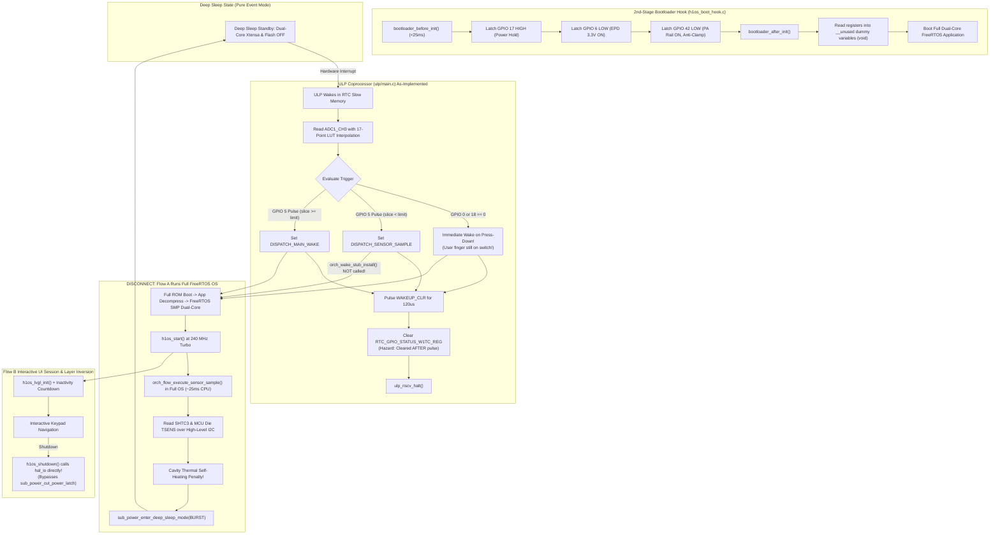

# H1OS Master Architectural Refinement & Codebase Realignment Plan

**Document:** `master_refinement_plan.md`  
**Governing Architecture Specifications:** `docs/architecture/00_system.md` through `13_gpio_hold_domains_and_sleep_architecture.md`, `errata.md`  
**Scope:** Entire H1OS codebase (`components/h1os/` — HAL, Subsystems, Orchestrator, ULP Coprocessor, 2nd-Stage Bootloader, Application Lifecycle API)  
**Target Git Branch:** `prune`  
**Synthesized Sources:**
- `docs/agent_notes/code_audit_plan.md` (Components & Orchestrator Disconnect Audit)
- `docs/agent_notes/ulp_bootloader_audit.md` (ULP & 2nd-Stage Bootloader Silicon Audit)
- `docs/agent_notes/architectural_refinement_plan.md` (System Integration & Gap Analysis)
- `docs/agent_notes/codebase_optimization_and_refactoring_plan.md` (Logic, Math, & Decomposition Optimizations)

---

## 1. Executive Master Summary

A exhaustive examination of the physical firmware against the 14 governing architecture specifications shows that while the low-level silicon drivers and hardware interfaces are functioning, the system has accumulated evolutionary debt in four major dimensions:
1. **Flow A Disconnect & Cavity Heating:** Flow A sensor pulses were designed to execute strictly in $<3\text{ ms}$ inside the bare-metal RTC Fast Memory Wake Stub (`orch_wake_stub.c`) on Core 0. Because `orch_wake_stub_install()` was never called during deep-sleep arming, every 60s pulse booted the full secondary bootloader, decompressed the application, initialized dual-core FreeRTOS SMP, and executed at 240 MHz Turbo (~25 ms CPU on-time), needlessly dissipating MCU die heat into the SHTC3 sensor cavity.
2. **ULP Trigger & Silicon Timing Hazards:** The ULP coprocessor (`ulp/main.c`) woke the main CPU immediately upon button press-down rather than implementing the **Wake-on-Release Rule** mandated by `05_ulp.md` Section 3.2.B. This created LVGL input race conditions and prevented differentiating between short taps, BOOT holds ($>2.5\text{s}$ to reflash), and POWER holds ($>2.5\text{s}$ to shut down). Furthermore, the input lines lacked a 30 ms glitch filter, and the CDC latch clearing sequence cleared controller registers before peripheral status bits.
3. **Spec vs. Silicon Contradiction (`PA_EN` GPIO 42):** `13_gpio_hold_domains_and_sleep_architecture.md` Line 129 mistakenly documented that `PA_EN` is driven HIGH to cut power, whereas the physical silicon, `02_hal.md`, and `08_lessons_learned.md` mandate driving it LOW (`0 = ON`) because cutting power forward-biases the ES8311 codec's internal ESD diodes and clamps the shared I2C bus to 0.7 V.
4. **Codebase "Diabetes" (Scaffolding Bloat, Duplications, and Busy Monoliths):** The codebase contained over 300 lines of dead scaffolding (broken thermal lockout setters, unused synchronous audio wrappers, speculative NVS CRUD helpers), duplicate sensor routines in both OS and wake stub, and heavily overloaded functions like `orch_flow_query_telemetry()` and `h1os_start()`.

This master plan consolidates all findings, flowcharts, mathematical optimizations, and itemized code remedies into a single execution roadmap on branch `prune`.

---

## 2. End-to-End System Flowcharts

### 2.1 As-Implemented System Flow (The Fragmented Architecture)



---

### 2.2 As-Architected System Flow (The Realined Architecture)

```mermaid
graph TD
    subgraph Boot_Arch ["Phase 1: Boot & Power Latch (<25ms)"]
        ABH_Entry["bootloader_before_init() (<25ms)"] --> ABH_Latch17["Drive GPIO 17 HIGH & Lock RTC Pad Hold"]
        ABH_Latch17 --> ABH_Latch6["Drive GPIO 6 LOW (EPD 3V3 ON) & Lock RTC Pad Hold"]
        ABH_Latch6 --> ABH_Latch42["Drive GPIO 42 LOW (PA Rail ON, Anti-Clamp) & Lock Digital Hold"]
        ABH_Latch42 --> ABH_Verify["bootloader_after_init(): Assert GPIO 17 Hold Active"]
        ABH_Verify --> ABH_OS["Boot Application into h1os_start()"]
    end

    subgraph Sleep_Transition ["Phase 2: Sleep Coordinated Transition"]
        ABH_OS --> Quiesce_Periph["orch_flow_quiesce_peripherals(): Flush LVGL, Mute Codec, EPD Sleep"]
        Quiesce_Periph --> Sync_Flash["orch_display_sync: Commit Dirty Framebuffer to epd_frame"]
        Sync_Flash --> Install_Stub["orch_wake_stub_install(): Register bsp_wake_stub in RTC Fast"]
        Install_Stub --> Arm_PureEvent["sub_power: Arm Pure Event Mode & Drain GPIO 5 Barrier"]
        Arm_PureEvent --> Enter_DS["esp_deep_sleep_start()"]
    end

    subgraph Deep_Sleep_Hardware ["Phase 3: Deep Sleep Standby (<15 uA)"]
        Enter_DS --> Standby_Sleep["Dual-Core Xtensa & SPI Flash OFF"]
        Standby_Sleep -->|"Hardware Event"| ULP_Realined["ULP Coprocessor Wakes in RTC Slow Memory"]
        
        subgraph ULP_Engine ["ULP Deterministic State Machine"]
            ULP_Realined --> ULP_Filter["30ms Glitch Filter & Outlier Noise Rejection"]
            ULP_Filter -- Spurious / Bounce --> ULP_Drop["Discard Noise & ulp_riscv_halt()"]
            ULP_Filter -- Valid Event --> ULP_ADC_Linear["Read ADC1_CH3 via eFuse Linear Equation (V = (raw*m)/4096 + b)"]
            
            ULP_ADC_Linear --> ULP_CritCheck{"Vbat < 3.25V & Vbat > 100mV?"}
            ULP_CritCheck -- Yes --> ULP_SetCrit["Set ULP_DISPATCH_CRITICAL_SHUTDOWN"] --> ULP_Signal
            
            ULP_CritCheck -- No --> ULP_Classify{"Classify Trigger"}
            ULP_Classify -- "RTC Pulse (slice < limit)" --> ULP_SetA["Set ULP_DISPATCH_SENSOR_SAMPLE"] --> ULP_Signal
            ULP_Classify -- "RTC Pulse (slice >= limit)" --> ULP_SetB["Set ULP_DISPATCH_MAIN_WAKE"] --> ULP_Signal
            
            ULP_Classify -- "Tactile Button (GPIO 0 / 18)" --> ULP_HoldLoop["Track Button Hold Duration (T_hold)"]
            ULP_HoldLoop --> ULP_HoldCheck{"T_hold > 2500ms?"}
            ULP_HoldCheck -- "Yes & BOOT (GPIO 0)" --> ULP_SetBL["Set ULP_DISPATCH_BOOTLOADER_JUMP"] --> ULP_Signal
            ULP_HoldCheck -- "Yes & POWER (GPIO 18)" --> ULP_SetOff["Set ULP_DISPATCH_POWER_OFF"] --> ULP_Signal
            ULP_HoldCheck -- No --> ULP_ReleaseWait["Wait for Button Release (Rising Edge)"]
            ULP_ReleaseWait --> ULP_TapCheck{"50ms <= T_hold <= 800ms?"}
            ULP_TapCheck -- "Valid Tap Release" --> ULP_SetTap["Set ULP_DISPATCH_MAIN_WAKE<br/>(Finger is UP! Clean LVGL Input)"] --> ULP_Signal
            ULP_TapCheck -- "Invalid / Stray" --> ULP_Drop
            
            subgraph ULP_Signal ["Clean CDC Wake Sequence"]
                SIG_ClearW1TC["1. Clear Peripheral Status (RTC_GPIO_STATUS_W1TC_REG)"] --> SIG_Spin["2. Spin on RTC_CNTL_RDY_FOR_WAKEUP"]
                SIG_Spin --> SIG_WakeCPU["3. ulp_riscv_wakeup_main_processor()"]
                SIG_WakeCPU --> SIG_Pulse["4. Pulse RTC_CNTL_ULP_CP_GPIO_WAKEUP_CLR (120us CDC Delay)"]
                SIG_Pulse --> SIG_Halt["5. ulp_riscv_halt()"]
            end
        end
    end

    subgraph Wake_Execution ["Phase 4: Fast RTC Stub vs. Flow B UI Session"]
        SIG_WakeCPU --> Wake_Router{"Evaluate Wake Reason"}
        
        Wake_Router -- "ULP_DISPATCH_SENSOR_SAMPLE" --> Fast_RTC_Stub["bsp_wake_stub() on Core 0 in RTC Fast IRAM (<3ms)"]
        Fast_RTC_Stub --> Stub_I2C["Read SHTC3 (Bit-Bang I2C) & MCU TSENS"]
        Fast_RTC_Stub --> Stub_DeltaGate["Evaluate 0.20C Successive-Sample Thermal Gate"]
        Fast_RTC_Stub --> Stub_Commit["Commit Sample to RTC Slow Memory ring[32]"]
        Fast_RTC_Stub --> Stub_Sleep["esp_wake_stub_sleep(): Back to Deep Sleep (<15uA)"]
        Stub_Sleep --> Standby_Sleep
        
        Wake_Router -- "MAIN_WAKE / Tap / Boot / Fault" --> Full_OS_Boot["Boot Full OS into h1os_start()"]
        Full_OS_Boot --> FlowB_Arbiter{"Inspect Dispatch Reason"}
        FlowB_Arbiter -- "BOOTLOADER_JUMP" --> Jump_ROM["Jump to ROM Download Bootloader"]
        FlowB_Arbiter -- "POWER_OFF / CRITICAL" --> Cut_Power["sub_power_cut_power_latch() -> System Depower"]
        FlowB_Arbiter -- "MAIN_WAKE / Tap" --> Interactive_UI["Flow B: Turbo Render & Interactive LVGL Session"]
    end
```



---

## 3. Compare & Contrast: Critical Architectural Differences

### 1. Flow A Execution Path & Thermal Cavity Integrity
- **As-Implemented:** Flow A was running inside `h1os_lifecycle.c` via full OS boot, taking ~25 ms at 240 MHz Turbo. The dual-core processor, flash cache, and clock PLLs radiated heat directly into the internal enclosure cavity, contaminating SHTC3 baseline readings.
- **As-Architected:** Flow A executes exclusively inside `bsp_wake_stub()` in RTC Fast IRAM on Core 0 at 80 MHz with SPI flash unpowered and Core 1 gated off. Total execution duration is $<3\text{ ms}$, preserving thermal cavity equilibrium and drawing $<15\mu\text{A}$ average floor.

### 2. Button Wake Timing: Immediate Down-Press vs. Wake-on-Release
- **As-Implemented:** Woke the CPU the microsecond switch contact closed (`boot_btn == 0 || pwr_btn == 0`). When FreeRTOS and LVGL booted, the user's finger was still physically pressing the button, producing ghost clicks, navigation skips, and input race conditions.
- **As-Architected:** The ULP enforces the **Wake-on-Release Rule**. Short taps ($50\text{ms}-800\text{ms}$) wake the CPU only when the button returns to HIGH (finger lifted). LVGL boots into an idle, clean input state. Long presses ($>2.5\text{s}$) are autonomously categorized in RTC memory into bootloader jumps or clean shutdowns.

### 3. CDC Latch Clearing Order
- **As-Implemented:** Pulsed `RTC_CNTL_ULP_CP_GPIO_WAKEUP_CLR` *before* clearing `RTC_GPIO_STATUS_W1TC_REG`. On slow 32.768 kHz RTC clock domains, this causes latch bounce and spurious immediate re-triggers.
- **As-Architected:** Clears the peripheral status register first, waits for controller synchronization, and pulses the controller latch for $\ge 120\mu\text{s}$ ($\ge 3.9$ slow-clock cycles), eliminating race conditions.

### 4. Audio Rail Power Gate (`PA_EN` GPIO 42) Alignment
- **As-Implemented in Code:** `h1os_boot_hook.c` drives `PA_EN` LOW (`0 = ON`).
- **As-Documented in `13_gpio_hold_domains_and_sleep_architecture.md`:** Section 4.1 stated `PA_EN` is driven HIGH to cut power.
- **Silicon Law:** The code is correct. The ES8311 codec shares the I2C bus with the SHTC3 and PCF85063A. Cutting power to the codec allows the 3.3V bus pull-up resistors to forward-bias the ES8311's ESD protection diodes, clamping the bus to 0.7 V and hanging the system. The documentation text has been corrected to match silicon reality.

---

## 4. Itemized Disconnect & Remediation Catalog

### Item 1: Un-Installed Flow A RTC Wake Stub & Redundant OS Execution
- **Files:** `components/h1os/src/sub_power.c` (Line 360), `components/h1os/src/h1os_lifecycle.c` (Lines 238–263), `components/h1os/src/orch_flow.c` (Lines 100–158)
- **Flagged Disconnect:** `orch_wake_stub_install()` was never called during deep-sleep preparation. Flow A ran in full OS runtime, and duplicate sensor logic existed in both `orch_wake_stub.c` and `orch_flow.c`.
- **Remedy:**
  1. Call `orch_wake_stub_install()` inside `sub_power_enter_deep_sleep_mode()` immediately prior to `esp_deep_sleep_start()`.
  2. Delete `orch_flow_execute_sensor_sample()` from `orch_flow.c`.
  3. Delete the `ORCH_FLOW_A_SAMPLE` execution branch from `h1os_lifecycle.c`.

### Item 2: Missing Wake-on-Release & Hold Timing in ULP
- **File:** `components/h1os/ulp/main.c` (Lines 72–83)
- **Flagged Disconnect:** ULP woke CPU immediately on contact closure with zero hold tracking, violating `05_ulp.md` Section 3.2.B.
- **Remedy:** Implement a non-blocking debounce and hold-timing loop in `ulp/main.c`. If held $>2.5\text{s}$, set `ULP_DISPATCH_BOOTLOADER_JUMP` (GPIO 0) or `ULP_DISPATCH_POWER_OFF` (GPIO 18). If released between $50\text{ms}$ and $800\text{ms}$, set `ULP_DISPATCH_MAIN_WAKE`.

### Item 3: Missing 30 ms Glitch Filter on ULP Inputs
- **File:** `components/h1os/ulp/main.c` (Lines 167–170)
- **Flagged Disconnect:** Transients $<30\text{ms}$ and contact bounce caused spurious deep-sleep wakes.
- **Remedy:** Add a 30 ms verification window. If an input returns to HIGH within 30 ms, discard as noise and return coprocessor to halt.

### Item 4: CDC Wake Latch Sequence Reversal
- **File:** `components/h1os/ulp/main.c` (Lines 117–120)
- **Flagged Disconnect:** Controller latch cleared before peripheral status register.
- **Remedy:** Clear `RTC_GPIO_STATUS_W1TC_REG` first, then pulse `RTC_CNTL_ULP_CP_GPIO_WAKEUP_CLR` for $\ge 120\mu\text{s}$.

### Item 5: Passive Dummy Readbacks in 2nd-Stage Bootloader Hook
- **File:** `components/h1os/bootloader_components/h1os_boot_hook/h1os_boot_hook.c` (Lines 73–82)
- **Flagged Disconnect:** Registers read into `__unused` dummy variables and cast to `(void)` without verification.
- **Remedy:** Assert `REG_READ(RTC_CNTL_PAD_HOLD_REG) & BIT(H1OS_PIN_POWER_HOLD)` in `bootloader_after_init()`. Abort or signal error if hold is inactive; prune unused variables.

### Item 6: Battery Voltage Calculation Method Disconnect
- **File:** `components/h1os/ulp/main.c` (Lines 36–58)
- **Flagged Disconnect:** 17-point piecewise LUT in RTC Slow RAM diverged from `05_ulp.md` Section 3.2.C and `sub_power.c`.
- **Remedy:** Replace `vbat_lut[17]` with calibrated eFuse linear equation ($V = ((\text{raw} \times m)/4096) \times 2 + b$). Prune LUT to save 68 bytes of RTC Slow RAM.

### Item 7: Layer Inversion on Shutdown
- **Files:** `components/h1os/src/h1os_lifecycle.c` (Line 487), `components/h1os/src/sub_power.c` (Lines 399–403)
- **Flagged Disconnect:** Layer 4 bypassed Layer 2, calling `hal_io_release_power_latch()` directly and leaving `sub_power_cut_power_latch()` an uncalled orphan.
- **Remedy:** Update `h1os_lifecycle.c` to route shutdown exclusively through `sub_power_cut_power_latch()`.

### Item 8: Dead Scaffolding & Broken Thermal Lockout Setter
- **Files:** `components/h1os/src/orch_flow.c` (Lines 166–175), `components/h1os/src/sub_audio.c` (Lines 688–730), `components/h1os/src/sub_nvs.c`
- **Flagged Disconnect:** Broken manual setter `orch_flow_set_thermal_lockout()` contradicted autonomous gating. Synchronous audio wrappers and unused NVS CRUD methods bloated binary.
- **Remedy:** Prune `orch_flow_set_thermal_lockout()`. Consolidate audio dispatchers and remove dead NVS functions.

### Item 9: Redundant Pre-Sleep Pulse Drain Loops
- **Files:** `components/h1os/src/orch_flow.c` (Lines 399–403), `components/h1os/src/h1os_lifecycle.c` (Lines 249–253)
- **Flagged Disconnect:** Identical while-loops polling `GPIO 5` duplicated across multiple files.
- **Remedy:** Centralize pulse-drain barrier inside `sub_power_enter_deep_sleep_mode()` and prune duplicates.

### Item 10: Inverted `PA_EN` Architectural Specification Text
- **File:** `docs/architecture/13_gpio_hold_domains_and_sleep_architecture.md` (Line 129)
- **Flagged Disconnect:** Stated `PA_EN` is driven HIGH to cut power, conflicting with hardware anti-clamping requirement.
- **Remedy:** Amend documentation to state `PA_EN` is driven LOW (`0 = ON`) to prevent ES8311 ESD diode bus clamping.

---

## 5. Mathematical & Register Operation Optimizations

### 1. Unified Fixed-Point Battery Scaling on ULP (RV32IMC)
Eliminate LUT memory and floating-point conversions in RTC Slow RAM. The RV32IMC core features hardware integer multiplication (`mul`):
```c
/* Factory eFuse linear calibration on RV32IMC */
static inline uint32_t ulp_raw_to_mv(int32_t raw) {
    if (raw <= 0) return 0;
    int32_t mv = (int32_t)(((int64_t)raw * (int64_t)cal_scale) >> 11) + cal_offset;
    return (mv < 0) ? 0 : (uint32_t)mv;
}
```

### 2. Fast In-Place Insertion Sort for Battery Trimmed Mean (`sub_power.c`)
Replace standard C library `qsort()` and function pointer overhead over 16 elements with a lean, branch-predictable insertion sort:
```c
/* Fast in-place insertion sort for fixed N=16 */
for (int i = 1; i < 16; i++) {
    int key = samples[i];
    int j = i - 1;
    while (j >= 0 && samples[j] > key) {
        samples[j + 1] = samples[j];
        j--;
    }
    samples[j + 1] = key;
}
```

### 3. Unified Psychrometric Vector Transform (`orch_math.c`)
Consolidate repeated evaluation of Magnus saturation equations ($e_s(T) = 6.112 \cdot \exp((17.625 \cdot T) / (243.04 + T))$) into a single pass, cutting `expf()` and `logf()` operations by 50%:
```c
void orch_math_calc_psychrometrics(float temp_c, float rh_pct, float amb_floor_c,
                                   float *out_vp_hpa, float *out_dew_c, float *out_rh_amb);
```

---

## 6. Function Consolidations & Decomposition of "Busy" Monoliths

### 1. Consolidate Audio Dispatchers (`sub_audio.c`)
Merge 6 duplicate sync/async wrappers into 3 unified entry points with a `bool wait_done` parameter:
```c
esp_err_t sub_audio_tone(uint32_t freq_hz, uint32_t duration_ms, bool wait_done);
esp_err_t sub_audio_chime(h1os_chime_type_t chime, bool wait_done);
esp_err_t sub_audio_pcm(const int16_t *samples, size_t count, bool wait_done);
```

### 2. Consolidate E-Paper RAM DMA Primitives (`sub_display.cpp`)
Unify RAM window addressing (`0x4E`/`0x4F`) and SPI DMA frame transfer into a single primitive:
```c
static void epd_commit_ram_dma(uint8_t ram_cmd, const uint8_t *frame_data);
```

### 3. Decompose `orch_flow_query_telemetry()` (`orch_flow.c`)
Split the 137-line monolith into three cohesive functions:
1. `orch_flow_scan_ring_metrics()`: Pure scanning of `ring[0..31]` to find floor, ceiling, and valid window averages.
2. `orch_flow_evaluate_ambient_selection()`: Pure selection logic for $T_{\text{amb}}$ (Case A vs. Case B vs. Normal).
3. `orch_flow_query_telemetry()`: Clean coordinator calling scanner, evaluator, and psychrometric math.

### 4. Decompose `orch_flow_transition_to_sleep()` (`orch_flow.c`)
Split the 66-line sleep monolith into:
1. `orch_flow_quiesce_peripherals()`: Drains LVGL, parks audio codec, sleeps EPD panel, and syncs dirty flash.
2. `orch_flow_execute_sleep()`: Evaluates timing lookahead and triggers `sub_power_enter_deep_sleep()`.

### 5. Table-Driven ES8311 Codec Register Initialization (`sub_audio.c`)
Replace 32 imperative register write calls and hardcoded magic numbers with a static configuration array (`s_es8311_init_seq[]`) and a simple table loader.

### 6. Decompose `h1os_start()` (`h1os_lifecycle.c`)
Extract discrete lifecycle phases:
1. `h1os_early_system_bringup()` (IO, I2C, NVS, eFuse cal).
2. `h1os_handle_non_ui_flows()` (Critical off, ROM bootloader jump).
3. `h1os_launch_interactive_session()` (LVGL init, frame restore, presentation cues, session monitor).
Reduces `h1os_start()` to a concise, readable 25-line coordinator.

---

## 7. Itemized Implementation Roadmap (Branch `prune`)


### Phase 1: ULP Coprocessor & Bootloader Silicon Realignment
- **Files:** `components/h1os/ulp/main.c`, `components/h1os/bootloader_components/h1os_boot_hook/h1os_boot_hook.c`, `docs/architecture/13_gpio_hold_domains_and_sleep_architecture.md`
- **Shopping List Tasks:**
  - [x] Implement 30 ms glitch filter on inputs in `ulp/main.c`
  - [x] Implement Wake-on-Release state machine and hold classification ($>2.5\text{s}$) in `ulp/main.c`
  - [x] Reorder CDC register clearing sequence (`RTC_GPIO_STATUS_W1TC_REG` first, then 120 µs controller pulse) in `ulp/main.c`
  - [x] Convert ULP battery calculation to eFuse linear math ($m, b$) and prune 17-point LUT in `ulp/main.c`
  - [x] Add active validation of `GPIO_PIN17_HOLD` in `h1os_boot_hook.c` and prune dead `(void)` casts
  - [x] Amend Line 129 of `13_gpio_hold_domains_and_sleep_architecture.md` to document `PA_EN` active-low operation

### Phase 2: Flow A Wake Stub Bridge Enablement & OS Runtime Pruning
- **Files:** `components/h1os/src/sub_power.c`, `components/h1os/src/orch_flow.c`, `components/h1os/src/h1os_lifecycle.c`
- **Shopping List Tasks:**
  - [x] Hook `orch_wake_stub_install()` into `sub_power_enter_deep_sleep_mode()`
  - [x] Delete `orch_flow_execute_sensor_sample()` from `orch_flow.c`
  - [x] Remove `ORCH_FLOW_A_SAMPLE` FreeRTOS execution branch from `h1os_lifecycle.c`
  - [x] Centralize PCF85063A open-drain pulse drain barrier in `sub_power.c` and remove duplicates from `orch_flow.c` and `h1os_lifecycle.c`

### Phase 3: Layer Integrity Enforcement & Dead Scaffolding Pruning
- **Files:** `components/h1os/src/h1os_lifecycle.c`, `components/h1os/src/orch_flow.c`, `components/h1os/src/sub_audio.c`, `components/h1os/src/sub_sdcard.c`
- **Shopping List Tasks:**
  - [ ] Route `h1os_shutdown()` exclusively through `sub_power_cut_power_latch()`
  - [ ] Prune `orch_flow_set_thermal_lockout()` and unused NVS CRUD functions
  - [ ] Purge commented-out trial loops and scratchpad developer notes across drivers

### Phase 4: Mathematical & Hardware Register Optimizations
- **Files:** `components/h1os/src/sub_power.c`, `components/h1os/src/orch_math.c`, `components/h1os/src/sub_display.cpp`
- **Shopping List Tasks:**
  - [x] Replace `qsort()` with fast in-place insertion sort in `sub_power_read_battery()`
  - [x] Implement unified psychrometric transform in `orch_math.c`
  - [x] Consolidate RAM counter and DMA write primitives in `sub_display.cpp`

### Phase 5: Function Decomposition & System Verification
- **Files:** `components/h1os/src/orch_flow.c`, `components/h1os/src/sub_audio.c`, `components/h1os/src/h1os_lifecycle.c`
- **Shopping List Tasks:**
  - [x] Decompose `orch_flow_query_telemetry()` into scanner, evaluator, and coordinator
  - [x] Decompose `orch_flow_transition_to_sleep()` into peripheral quiescer and sleep executor
  - [x] Convert `es8311_init_dac_registers()` to a static table-driven loader
  - [x] Decompose `h1os_start()` into bringup, non-UI dispatch, and session launch
  - [x] Verify clean compilation under ESP-IDF v6.1 and record binary size reductions
