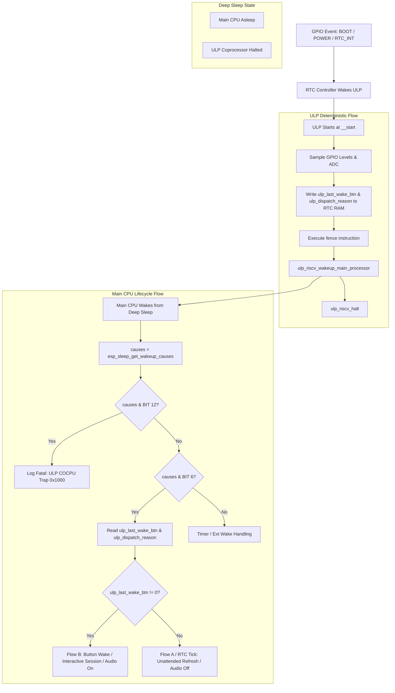

# Engineering Plan: Peterson Lock Excision, Deterministic Wake Classification & Anti-Fallback Simplification

## Executive Summary & Root Cause Analysis

### 1. The `Causes bitmask: 0x00001000` Revelation
In ESP-IDF `components/esp_hw_support/sleep_modes.c`, wakeup causes are mapped from raw hardware registers:
- `wakeup_cause_raw & RTC_COCPU_TRIG_EN` maps to `BIT(ESP_SLEEP_WAKEUP_ULP)` (`BIT(6)` = `0x00000040`).
- `wakeup_cause_raw & RTC_COCPU_TRAP_TRIG_EN` maps to `BIT(ESP_SLEEP_WAKEUP_COCPU_TRAP_TRIG)` (`BIT(12)` = `0x00001000`).

The runtime log output `Lifecycle: WAKE #2 (Causes bitmask: 0x00001000, ButtonWake: 0)` proved that the ULP RISC-V coprocessor suffered a **hardware trap/crash (`COCPU_TRAP_TRIG`)**, which triggered an emergency wake of the Main CPU.

Because `causes & BIT(ESP_SLEEP_WAKEUP_ULP)` was false (bit 6 was 0), `h1os_lifecycle.c` fell through to `is_rtc_wake = true`, misdiagnosed the event as an unattended external RTC alarm, and immediately commanded deep sleep re-entry. In `sub_power_enter_deep_sleep_mode()`, the Main CPU attempted to acquire `ulp_shared_lock` via Peterson's algorithm (`ulp_riscv_lock_acquire`). Because the ULP had crashed with the lock held or corrupted, the Main CPU spun indefinitely until the Task Watchdog (`task_wdt`) reset the system.

### 2. The `CONFIG_ULP_RISCV_INTERRUPT_ENABLE` Root Cause
Why was `CONFIG_ULP_RISCV_INTERRUPT_ENABLE` not enabled?
In default ESP-IDF configurations, `CONFIG_ULP_RISCV_INTERRUPT_ENABLE` defaults to `n` (designed for periodic timer-polled ULP programs). When H1OS transitioned to Pure Event Mode, the Kconfig option was omitted from `sdkconfig.defaults`.
Without `CONFIG_ULP_RISCV_INTERRUPT_ENABLE=y`:
- ESP-IDF does not link interrupt vector tables or register RTC IO interrupt handlers for the ULP.
- Any interrupt event or illegal access triggers an unhandled trap, raising `RTC_COCPU_TRAP_TRIG_EN` and setting bit 12 (`0x1000`).

### 3. Strict Architectural Mandate: Zero Fallback Fluff
Per explicit architectural directive, all fallback fluff is eliminated:
- No multi-tier guessing or speculative fallbacks (e.g. attempting to read `RTC_GPIO_STATUS_REG` from the Main CPU, which suffers from a race condition because the ULP W1TC-clears the status register).
- Single, authoritative, deterministic communication channel: ULP writes `ulp_last_wake_btn` and `ulp_dispatch_reason` to RTC Slow RAM, enforces memory ordering with `fence`, pulses wake to the Main CPU, and halts cleanly via `ulp_riscv_halt()`.
- Main CPU inspects `esp_sleep_get_wakeup_causes()`. If `BIT(ESP_SLEEP_WAKEUP_COCPU_TRAP_TRIG)` is present, a fatal coprocessor trap is logged and reported immediately. If `BIT(ESP_SLEEP_WAKEUP_ULP)` is present, the Main CPU reads RTC Slow RAM directly.

---

## Architecture Flowchart



---

## Detailed Implementation Phases

### Phase 1: Peterson Lock Excision
- **Target Files:**
  - `components/h1os/ulp/main.c`
  - `components/h1os/src/sub_power.c`
- **Actions:**
  1. Remove `volatile ulp_riscv_lock_t shared_lock` from `components/h1os/ulp/main.c`.
  2. Remove all calls to `ulp_riscv_lock_acquire()` and `ulp_riscv_lock_release()` in `main.c`.
  3. Replace lock blocks with `asm volatile("fence" ::: "memory")` on the ULP RISC-V core.
  4. In `sub_power.c`, remove `ulp_riscv_lock_acquire(&ulp_shared_lock)` and `ulp_riscv_lock_release(&ulp_shared_lock)`.
  5. Replace with `asm volatile("memw" ::: "memory")` on Xtensa.
  6. Replace non-existent `ulp_riscv_shutdown()` with canonical ESP-IDF `ulp_riscv_halt()`.

### Phase 2: Enable `CONFIG_ULP_RISCV_INTERRUPT_ENABLE`
- **Target Files:**
  - `examples/H1OS/sdkconfig.defaults`
  - `examples/H1OS/sdkconfig`
- **Actions:**
  1. Add `CONFIG_ULP_RISCV_INTERRUPT_ENABLE=y` to `examples/H1OS/sdkconfig.defaults`.
  2. Update `examples/H1OS/sdkconfig` with `CONFIG_ULP_RISCV_INTERRUPT_ENABLE=y`.
  3. Enables vector table generation and interrupt handlers in the ESP-IDF ULP build.

### Phase 3: Deterministic Wake Classification & Error Propagation (No Fallbacks)
- **Target Files:**
  - `components/h1os/src/h1os_lifecycle.c`
  - `components/h1os/src/orch_flow.c`
- **Actions:**
  1. In `h1os_lifecycle.c`:
     - Inspect `causes = esp_sleep_get_wakeup_causes()`.
     - Explicitly handle `causes & BIT(ESP_SLEEP_WAKEUP_COCPU_TRAP_TRIG)` (`0x1000`): Log critical fault `[ULP FAULT] Coprocessor trapped/crashed!`.
     - Inspect `causes & BIT(ESP_SLEEP_WAKEUP_ULP)` (`0x0040`): Read `ulp_last_wake_btn` authoritatively. If `ulp_last_wake_btn != 0`, set `button_woke = true` and `is_rtc_wake = false`. If `ulp_last_wake_btn == 0`, set `is_rtc_wake = true`.
     - Eliminate all fallback guessing logic and delete obsolete reads of `RTC_GPIO_STATUS_REG` from the Main CPU.
  2. In `orch_flow.c`:
     - Log fatal trap if `causes & BIT(ESP_SLEEP_WAKEUP_COCPU_TRAP_TRIG)` occurs.
     - Evaluate `causes & BIT(ESP_SLEEP_WAKEUP_ULP)` cleanly.

### Phase 4: Non-Destructive Sleep Staging
- **Target File:**
  - `components/h1os/src/sub_power.c`
- **Actions:**
  1. In `sub_power_enter_deep_sleep_mode()`, remove the zeroing of `ulp_last_wake_btn` and `ulp_last_wake_cause` immediately prior to `esp_deep_sleep_start()`.
  2. Ensure evidence remains valid across the sleep threshold until refreshed by the ULP on its subsequent run.

### Phase 5: Verification & Governance
- **Actions:**
  1. Reconfigure CMake and execute production compilation:
     ```powershell
     & "C:\Espressif\tools\Microsoft.v6.1.PowerShell_profile.ps1"; idf.py -B build_prod build
     ```
  2. Verify binary sizes and symbol table (`ulp_h1os.sym`) to confirm `shared_lock` is eradicated.
  3. Run GFM documentation audit script:
     ```powershell
     python tools/audit_gfm.py
     ```
