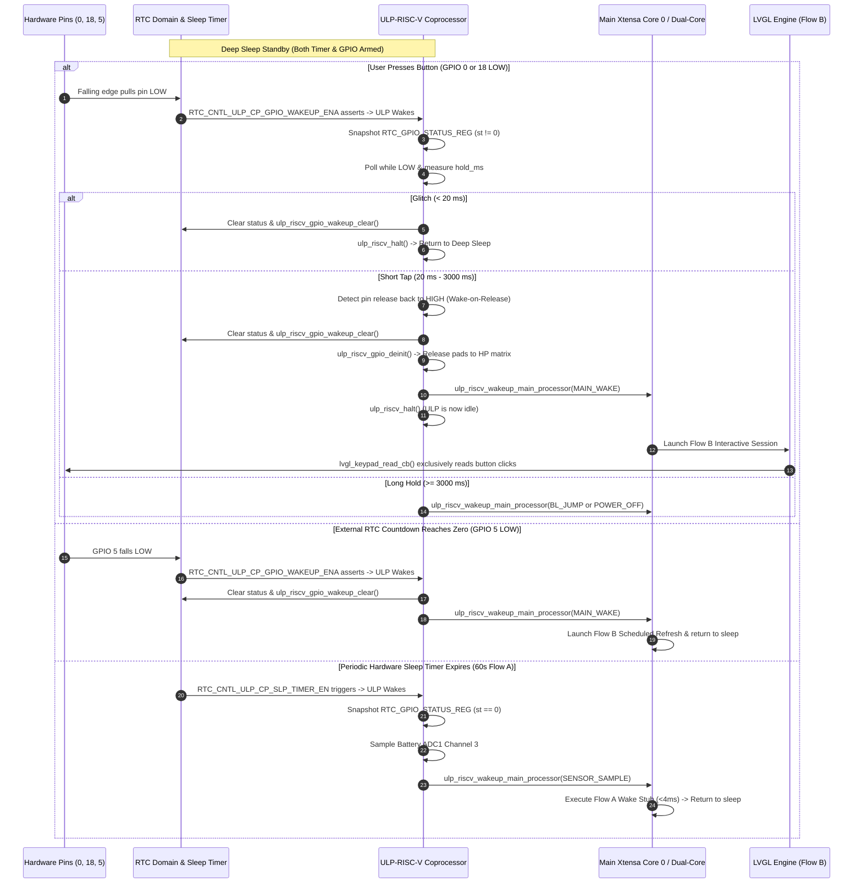

# Action Plan: ULP-RISC-V Reference Architecture Alignment & Code Correction

**Target Silicon:** ESP32-S3-PICO-1-N8R8  
**Target Board:** Waveshare ESP32-S3 ePaper 1.54" V2  
**Branch:** `E-Class-Dev-002`  
**Reference Model:** ESP-IDF `system/ulp/ulp_riscv/gpio_interrupt` & DeepWiki Q&A  
**Architecture Authority:**
- `docs/architecture/05_ulp.md` (ULP-RISC-V Hardware Monitor Specification)
- `docs/architecture/07_state_machine.md` (Application Execution Flow & State Machine)
- `docs/architecture/01_master.md` (System Master Specification)

---

## 1. Executive Summary of Corrections

Based on the official ESP-IDF `system/ulp/ulp_riscv/gpio_interrupt` reference code, the ESP32-S3 Technical Reference Manual (TRM), and H1OS architectural mandates, we are correcting the ULP-RISC-V and main application sleep wake paths as follows:

1. **Dual-Wake Hardware Arming (`sub_power.c`):**
   - The ULP is configured with `cfg.wakeup_source = ULP_RISCV_WAKEUP_SOURCE_GPIO`, which hardware-arms `RTC_CNTL_ULP_CP_GPIO_WAKEUP_ENA` (bit 29).
   - In addition, `RTC_CNTL_ULP_CP_SLP_TIMER_EN` (bit 31) is armed in `RTC_CNTL_ULP_CP_TIMER_REG` to allow concurrent periodic 60s Flow A soft-timer ticks.
   - Right before `esp_deep_sleep_start()`, both bits are verified armed, and any prior GPIO wake latch is cleared via `RTC_CNTL_ULP_CP_GPIO_WAKEUP_CLR`.

2. **Sleep Pad Isolation & Pad Holds (`hal_io.c`):**
   - Following the reference model, each wakeup pin is initialized in the RTC domain as input:
     - `rtc_gpio_init(io)`
     - `rtc_gpio_set_direction(io, RTC_GPIO_MODE_INPUT_ONLY)`
     - `rtc_gpio_pulldown_dis(io)`
     - Pull-up rule: `rtc_gpio_pullup_dis(io)` for GPIO 0 and GPIO 18 (external 10kΩ on PCB); `rtc_gpio_pullup_en(io)` for GPIO 5 (open-drain INT).
     - `rtc_gpio_hold_en(io)` to lock pad configurations through the deep sleep transition.
     - `rtc_gpio_wakeup_enable(io, GPIO_INTR_LOW_LEVEL)`
   - Settling delay of 100 µs is maintained, and `RTC_GPIO_STATUS_W1TC_REG` is cleared before sleep.

3. **ULP Coprocessor Code Correction (`components/h1os/ulp/main.c`):**
   - Wakes reactively into `main()`.
   - Snapshots wake cause:
     ```c
     uint32_t st = REG_GET_FIELD(RTC_GPIO_STATUS_REG, RTC_GPIO_STATUS_INT);
     ```
   - **Branch 1: GPIO Wake (`st != 0` or live pin LOW):**
     - Differentiates pin source:
       - `RTCIO 0 (GPIO 0)`: BOOT key.
       - `RTCIO 18 (GPIO 18)`: POWER key.
       - `RTCIO 5 (GPIO 5)`: PCF85063A countdown timer / alarm.
     - For buttons (GPIO 0 & 18):
       - Measures `hold_ms` while pin is held LOW.
       - **Glitch Rejection:** If `hold_ms < 20 ms`, noise/transient spike: clear latches (`RTC_GPIO_STATUS_W1TC_REG` and `ulp_riscv_gpio_wakeup_clear()`) and call `ulp_riscv_halt()` without waking the main CPU.
       - **Wake-on-Release:** For valid taps ($20\text{ ms} \le \text{hold\_ms} < 3000\text{ ms}$), waits for pin release back to HIGH, sets `dispatch_reason = ULP_DISPATCH_MAIN_WAKE` (2), clears wake latches, releases GPIOs, and wakes main CPU into Flow B.
       - **Long Hold ($\ge 3000\text{ ms}$):** Sets `ULP_DISPATCH_BOOTLOADER_JUMP` (4) for BOOT or `ULP_DISPATCH_POWER_OFF` (5) for POWER, clears latches, releases GPIOs, and wakes main CPU.
     - For RTC INT (GPIO 5):
       - Sets `dispatch_reason = ULP_DISPATCH_MAIN_WAKE` (2), clears latches, releases GPIOs, and wakes main CPU for scheduled unattended refresh.
   - **Branch 2: Periodic Sleep Timer Wake (`st == 0` and all pins idle HIGH):**
     - Samples battery ADC (ADC1 Channel 3 / GPIO 4) with eFuse calibration.
     - If brownout (<3.25V), triggers critical shutdown.
     - Otherwise, sets `dispatch_reason = ULP_DISPATCH_SENSOR_SAMPLE` (1) for Flow A wake stub, releases GPIOs, and wakes Core 0.

4. **Zero-Polling Active Flow Invariant (`h1os_lifecycle.c` & `h1os_lvgl.cpp`):**
   - Verified: No manual IO polling in Flow A or Flow B.
   - In Flow B, buttons are handled **exclusively** by `lvgl_keypad_read_cb` in `h1os_lvgl.cpp`.
   - `h1os_session_monitor_task` in `h1os_lifecycle.c` only monitors `s_session_expiry_us` and delays 500 ms.

---

## 2. Mermaid Sequence Diagram



---

## 3. Concrete Code Changes to Execute

### File 1: `components/h1os/src/hal_io.c`
In `hal_io_isolate_sleep_pads()`:
Ensure `rtc_gpio_hold_en()` is added for the wake pins as per the reference skeleton:
```c
    // GPIO 5 (RTC_INT)
    rtc_gpio_init(HAL_PIN_RTC_INT);
    rtc_gpio_set_direction(HAL_PIN_RTC_INT, RTC_GPIO_MODE_INPUT_ONLY);
    rtc_gpio_pullup_en(HAL_PIN_RTC_INT);
    rtc_gpio_pulldown_dis(HAL_PIN_RTC_INT);
    rtc_gpio_hold_en(HAL_PIN_RTC_INT);
    io_mux_enable_lp_io_clock(HAL_PIN_RTC_INT, true);
    rtc_gpio_wakeup_enable(HAL_PIN_RTC_INT, GPIO_INTR_LOW_LEVEL);

    // GPIO 0 (BOOT)
    rtc_gpio_init(HAL_PIN_BUTTON_BOOT);
    rtc_gpio_set_direction(HAL_PIN_BUTTON_BOOT, RTC_GPIO_MODE_INPUT_ONLY);
    rtc_gpio_pullup_dis(HAL_PIN_BUTTON_BOOT);
    rtc_gpio_pulldown_dis(HAL_PIN_BUTTON_BOOT);
    rtc_gpio_hold_en(HAL_PIN_BUTTON_BOOT);
    io_mux_enable_lp_io_clock(HAL_PIN_BUTTON_BOOT, true);
    rtc_gpio_wakeup_enable(HAL_PIN_BUTTON_BOOT, GPIO_INTR_LOW_LEVEL);

    // GPIO 18 (POWER)
    rtc_gpio_init(HAL_PIN_BUTTON_POWER);
    rtc_gpio_set_direction(HAL_PIN_BUTTON_POWER, RTC_GPIO_MODE_INPUT_ONLY);
    rtc_gpio_pullup_dis(HAL_PIN_BUTTON_POWER);
    rtc_gpio_pulldown_dis(HAL_PIN_BUTTON_POWER);
    rtc_gpio_hold_en(HAL_PIN_BUTTON_POWER);
    io_mux_enable_lp_io_clock(HAL_PIN_BUTTON_POWER, true);
    rtc_gpio_wakeup_enable(HAL_PIN_BUTTON_POWER, GPIO_INTR_LOW_LEVEL);
```

### File 2: `components/h1os/src/sub_power.c`
Align `sub_power_init_ulp()` to use `cfg.wakeup_source = ULP_RISCV_WAKEUP_SOURCE_GPIO`:
```c
    ulp_riscv_cfg_t cfg = {
        .wakeup_source = ULP_RISCV_WAKEUP_SOURCE_GPIO,
    };
    err = ulp_riscv_config_and_run(&cfg);
    if (err != ESP_OK) {
        ESP_LOGE(TAG, "ulp_riscv_config_and_run failed: %s", esp_err_to_name(err));
        return err;
    }

    /* Arm periodic sleep timer alongside GPIO wakeup */
    SET_PERI_REG_MASK(RTC_CNTL_ULP_CP_TIMER_REG, RTC_CNTL_ULP_CP_SLP_TIMER_EN);
```
And in `sub_power_enter_deep_sleep()`:
```c
    /* Clear any lingering GPIO wakeup latch and ensure both timer & GPIO are armed */
    SET_PERI_REG_MASK(RTC_CNTL_ULP_CP_TIMER_REG, RTC_CNTL_ULP_CP_GPIO_WAKEUP_CLR);
    SET_PERI_REG_MASK(RTC_CNTL_ULP_CP_TIMER_REG,
                      RTC_CNTL_ULP_CP_SLP_TIMER_EN | RTC_CNTL_ULP_CP_GPIO_WAKEUP_ENA);
```

### File 3: `components/h1os/ulp/main.c`
Refine wake discrimination and latch clearing matching the reference model:
```c
    uint32_t st = REG_GET_FIELD(RTC_GPIO_STATUS_REG, RTC_GPIO_STATUS_INT);
    gpio_status_raw = st;
    int boot_btn = ulp_riscv_gpio_get_level(GPIO_NUM_0);
    int pwr_btn  = ulp_riscv_gpio_get_level(GPIO_NUM_18);
    int rtc_int  = ulp_riscv_gpio_get_level(GPIO_NUM_5);

    if (st != 0 || boot_btn == 0 || pwr_btn == 0 || rtc_int == 0) {
        /* GPIO wake branch */
        ...
    } else {
        /* Periodic soft-timer wake branch (Flow A) */
        ...
    }
```
Always clear both `RTC_GPIO_STATUS_W1TC_REG` and `ulp_riscv_gpio_wakeup_clear()` before halting or waking main CPU.

---

## 4. Verification & Validation Steps

1. **Compilation Validation:**
   - Compile development build:
     ```powershell
     & "C:\Espressif\tools\Microsoft.v6.1.PowerShell_profile.ps1"; idf.py -B build_dev build
     ```
   - Compile production build:
     ```powershell
     & "C:\Espressif\tools\Microsoft.v6.1.PowerShell_profile.ps1"; idf.py -B build_prod build
     ```
2. **User Notification & Review:**
   - Present completed changes and build status for user verification.
