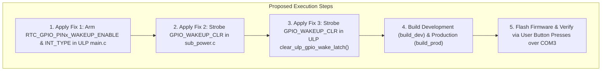

# Action Plan: Resolution of RTC GPIO Wake Latching & ULP Wakeup Defect

**Target Silicon:** ESP32-S3-PICO-1-N8R8  
**Target Board:** Waveshare ESP32-S3 ePaper 1.54" V2  
**Branch:** `E-Class-Dev-002`  
**Governing Authority:** Architecture Documents (`05_ulp.md`, `07_state_machine.md`, `01_master.md`)  
**Date:** 2026-10-16  

---

## 1. Root Cause Identification

1. **Defect 1: Missing Per-Pin RTC GPIO Wakeup & Interrupt Type Configuration**
   - The ULP coprocessor initializes pins using `ulp_riscv_gpio_init()` and `ulp_riscv_gpio_input_enable()`.
   - These IDF helpers **only** set `RTC_IO_TOUCH_PADx_MUX_SEL` and `FUN_IE`.
   - They **do not** touch `RTC_GPIO_PINx_WAKEUP_ENABLE` or `RTC_GPIO_PINx_INT_TYPE` in `RTC_GPIO_PINx_REG`.
   - At reset and after deinit, `RTC_GPIO_PINx_INT_TYPE` defaults to `0` (`ULP_RISCV_GPIO_INTR_DISABLE`).
   - With `INT_TYPE = 0`:
     - The hardware level comparator never flags transitions.
     - `RTC_GPIO_STATUS_REG` never latches bits 0, 5, or 18 (`rtcio_int_st` is always 0).
     - `RTC_CNTL_ULP_CP_GPIO_WAKEUP_ENA` has no signal to trigger on, so the ULP is never woken by external button presses or RTC alarms.

2. **Defect 2: Continuous Latch Assertion of `GPIO_WAKEUP_CLR` in `sub_power.c`**
   - In `sub_power_enter_deep_sleep()`:
     `SET_PERI_REG_MASK(RTC_CNTL_ULP_CP_TIMER_REG, RTC_CNTL_ULP_CP_GPIO_WAKEUP_CLR);`
   - Writing 1 to `RTC_CNTL_ULP_CP_GPIO_WAKEUP_CLR` without clearing it leaves the clear signal continuously asserted.
   - This continuously clears incoming GPIO wake signals at the hardware level, suppressing all GPIO wakeup triggers.
   - **Fix:** Strobe the clear bit: set it, then immediately clear it (`CLEAR_PERI_REG_MASK`).

3. **Defect 3: RTC Alarm Starvation during Long Button Holds**
   - If a button press is held for up to 3000 ms, the loop currently spins without checking whether GPIO 5 (PCF85063A countdown alarm) has asserted.
   - The arbitration logic will be updated so that if the external RTC timer fires, the event is recorded and processed.

---

## 2. Proposed Concrete Code Corrections

### Fix 1: Arm Per-Pin Wakeup and Level Trigger in ULP (`components/h1os/ulp/main.c`)

In ULP `main.c`, define a helper to arm each RTC GPIO for low-level wakeup:

```c
static inline void ulp_arm_gpio_wakeup_pin(gpio_num_t pin)
{
    /* Enable wakeup comparator for this pin */
    SET_PERI_REG_MASK(RTC_GPIO_PIN0_REG + 4 * pin, RTC_GPIO_PIN0_WAKEUP_ENABLE);
    /* Set interrupt trigger type to LOW LEVEL (active LOW buttons & open-drain INT) */
    REG_SET_FIELD(RTC_GPIO_PIN0_REG + 4 * pin, RTC_GPIO_PIN0_INT_TYPE, ULP_RISCV_GPIO_INTR_LOW_LEVEL);
}
```

Call this for all three pins (`GPIO_NUM_0`, `GPIO_NUM_18`, `GPIO_NUM_5`) during pin initialization in `main()`, and ensure they remain configured before halting or returning to sleep:

```c
    ulp_riscv_gpio_init(GPIO_NUM_5);
    ulp_riscv_gpio_input_enable(GPIO_NUM_5);
    ulp_riscv_gpio_pullup(GPIO_NUM_5); /* PCF85063A open-drain INT */
    ulp_riscv_gpio_pulldown_disable(GPIO_NUM_5);
    ulp_arm_gpio_wakeup_pin(GPIO_NUM_5);

    ulp_riscv_gpio_init(GPIO_NUM_0);
    ulp_riscv_gpio_input_enable(GPIO_NUM_0); /* BOOT key: 10k external pullup */
    ulp_riscv_gpio_pullup_disable(GPIO_NUM_0);
    ulp_riscv_gpio_pulldown_disable(GPIO_NUM_0);
    ulp_arm_gpio_wakeup_pin(GPIO_NUM_0);

    ulp_riscv_gpio_init(GPIO_NUM_18);
    ulp_riscv_gpio_input_enable(GPIO_NUM_18); /* POWER key: 10k external pullup */
    ulp_riscv_gpio_pullup_disable(GPIO_NUM_18);
    ulp_riscv_gpio_pulldown_disable(GPIO_NUM_18);
    ulp_arm_gpio_wakeup_pin(GPIO_NUM_18);
```

### Fix 2: Strobe `RTC_CNTL_ULP_CP_GPIO_WAKEUP_CLR` in `sub_power.c`

In `sub_power_enter_deep_sleep()` ([`components/h1os/src/sub_power.c`](file:///c:/Users/Matt/Documents/GitHub/H1OS/components/h1os/src/sub_power.c)):

```c
    /* Strobe GPIO wakeup clear to drop any prior latch without keeping clear asserted */
    SET_PERI_REG_MASK  (RTC_CNTL_ULP_CP_TIMER_REG, RTC_CNTL_ULP_CP_GPIO_WAKEUP_CLR);
    CLEAR_PERI_REG_MASK(RTC_CNTL_ULP_CP_TIMER_REG, RTC_CNTL_ULP_CP_GPIO_WAKEUP_CLR);

    /* Arm both ULP periodic sleep timer AND ULP RTC GPIO wakeup */
    SET_PERI_REG_MASK  (RTC_CNTL_ULP_CP_TIMER_REG,
                        RTC_CNTL_ULP_CP_SLP_TIMER_EN | RTC_CNTL_ULP_CP_GPIO_WAKEUP_ENA);
```

### Fix 3: Also Strobe `GPIO_WAKEUP_CLR` in ULP `ulp_riscv_gpio_wakeup_clear()` Pattern

In `components/h1os/ulp/main.c`, whenever clearing the ULP GPIO wakeup latch:
```c
static inline void clear_ulp_gpio_wake_latch(void)
{
    REG_WRITE(RTC_GPIO_STATUS_W1TC_REG, RTC_GPIO_STATUS_INT_W1TC_M);
    SET_PERI_REG_MASK(RTC_CNTL_ULP_CP_TIMER_REG, RTC_CNTL_ULP_CP_GPIO_WAKEUP_CLR);
    CLEAR_PERI_REG_MASK(RTC_CNTL_ULP_CP_TIMER_REG, RTC_CNTL_ULP_CP_GPIO_WAKEUP_CLR);
}
```

---

## 3. Execution & Verification Flow



---

## 4. Acceptance Criteria
- [ ] `RTC_GPIO_PINx_WAKEUP_ENABLE` and `RTC_GPIO_PINx_INT_TYPE = 4 (LOW_LEVEL)` armed on GPIO 0, 18, and 5.
- [ ] `RTC_CNTL_ULP_CP_GPIO_WAKEUP_CLR` is strictly strobed (set then cleared), never left high.
- [ ] Both `build_dev` and `build_prod` compile cleanly with 0 errors.
- [ ] In COM3 telemetry, `rtcio_raw` reflects active button clicks (`cause = 1` or `cause = 2`), and ULP wakes instantly on button press.
