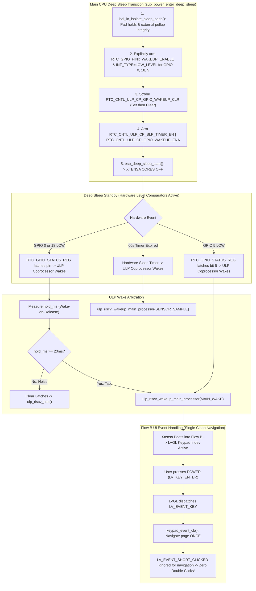

# Action Plan: Fixing ULP External Interrupt Wake & UI Power Button Double-Click

**Target Silicon:** ESP32-S3-PICO-1-N8R8  
**Target Board:** Waveshare ESP32-S3 ePaper 1.54" V2  
**Branch:** `E-Class-Dev-002`  
**Governing Authority:** Architecture Documents (`05_ulp.md`, `07_state_machine.md`, `01_master.md`)  
**Date:** 2026-10-16  

---

## 1. Root-Cause Analysis

### Defect 1: RTC GPIO Wake Fields Must Be Armed on Main CPU Before Sleep
- **The Silicon Reality:** The ULP coprocessor is halted during deep sleep and only begins executing *after* an armed wake event occurs.
- If `RTC_GPIO_PINx_WAKEUP_ENABLE` and `RTC_GPIO_PINx_INT_TYPE` are not configured by the **main CPU before `esp_deep_sleep_start()`**, the hardware level comparator remains uninitialized (`INT_TYPE = 0` / disabled).
- When a user presses GPIO 0 or GPIO 18, `RTC_GPIO_STATUS_INT` never latches (`rtcio_raw = 0x000000`), no hardware wake pulse is generated, and the ULP only ever wakes on the 60s soft-timer tick (`cause = 3`).
- **Resolution:** In `sub_power_enter_deep_sleep()`, explicitly write to `RTC_GPIO_PINx_REG` for all three wakeup pins (`GPIO 0`, `GPIO 18`, and `GPIO 5`):
  - Set `RTC_GPIO_PIN0_WAKEUP_ENABLE` (bit 10).
  - Set `RTC_GPIO_PIN0_INT_TYPE` to `4` (`ULP_RISCV_GPIO_INTR_LOW_LEVEL`).

### Defect 2: Strobe `RTC_CNTL_ULP_CP_GPIO_WAKEUP_CLR`
- Writing `1` into `RTC_CNTL_ULP_CP_GPIO_WAKEUP_CLR` and leaving it set continuously asserts the hardware clear signal, masking incoming GPIO wake pulses.
- **Resolution:** Strobe the clear bit by setting it, then immediately clearing it:
  ```c
  SET_PERI_REG_MASK  (RTC_CNTL_ULP_CP_TIMER_REG, RTC_CNTL_ULP_CP_GPIO_WAKEUP_CLR);
  CLEAR_PERI_REG_MASK(RTC_CNTL_ULP_CP_TIMER_REG, RTC_CNTL_ULP_CP_GPIO_WAKEUP_CLR);
  ```

### Defect 3: UI Power Button Double-Click in `examples/H1OS/main/main.c`
- In `keypad_event_cb` ([`examples/H1OS/main/main.c`](file:///c:/Users/Matt/Documents/GitHub/H1OS/examples/H1OS/main/main.c#L101-L135)):
  - When the POWER button is pressed, the keypad indev driver dispatches `LV_KEY_ENTER`.
  - The handler catches `LV_EVENT_KEY` with `key == LV_KEY_ENTER` $\rightarrow$ turns page backward (`update_active_display()`).
  - When the POWER button is released, LVGL natively emits `LV_EVENT_SHORT_CLICKED` on the focused screen.
  - The handler catches `LV_EVENT_SHORT_CLICKED` $\rightarrow$ turns page backward **a second time**.
  - **Resolution:** Consolidate navigation handling strictly under `LV_EVENT_KEY`. Remove the redundant navigation under `LV_EVENT_SHORT_CLICKED`.

---

## 2. Mermaid Workflow & Event Pipeline



---

## 3. Concrete Code Changes to Execute

### File 1: Main CPU Deep Sleep Arming ([`components/h1os/src/sub_power.c`](file:///c:/Users/Matt/Documents/GitHub/H1OS/components/h1os/src/sub_power.c))
In `sub_power_enter_deep_sleep()`:
```c
    /* Arm per-pin RTC GPIO wakeup comparator & low-level trigger on Main CPU before sleep */
    const gpio_num_t wake_pins[] = {HAL_PIN_BUTTON_BOOT, HAL_PIN_BUTTON_POWER, HAL_PIN_RTC_INT};
    for (size_t i = 0; i < sizeof(wake_pins) / sizeof(wake_pins[0]); i++) {
        gpio_num_t pin = wake_pins[i];
        SET_PERI_REG_MASK(RTC_GPIO_PIN0_REG + 4 * pin, RTC_GPIO_PIN0_WAKEUP_ENABLE);
        REG_SET_FIELD    (RTC_GPIO_PIN0_REG + 4 * pin, RTC_GPIO_PIN0_INT_TYPE, 4 /* ULP_RISCV_GPIO_INTR_LOW_LEVEL */);
    }

    /* Strobe GPIO wakeup clear latch before arming */
    SET_PERI_REG_MASK  (RTC_CNTL_ULP_CP_TIMER_REG, RTC_CNTL_ULP_CP_GPIO_WAKEUP_CLR);
    CLEAR_PERI_REG_MASK(RTC_CNTL_ULP_CP_TIMER_REG, RTC_CNTL_ULP_CP_GPIO_WAKEUP_CLR);

    /* Arm both ULP periodic sleep timer AND ULP RTC GPIO wakeup in RTC_CNTL_ULP_CP_TIMER_REG */
    SET_PERI_REG_MASK  (RTC_CNTL_ULP_CP_TIMER_REG,
                        RTC_CNTL_ULP_CP_SLP_TIMER_EN | RTC_CNTL_ULP_CP_GPIO_WAKEUP_ENA);
```

### File 2: Eliminate Double-Click in [`examples/H1OS/main/main.c`](file:///c:/Users/Matt/Documents/GitHub/H1OS/examples/H1OS/main/main.c)
In `keypad_event_cb()`:
```c
    if (code == LV_EVENT_KEY) {
        uint32_t key = lv_event_get_key(e);
        if (key == 0 && lv_event_get_param(e) != NULL) {
            key = *(const uint32_t *)lv_event_get_param(e);
        }
        ESP_LOGI(TAG, "Keypad event received: LV_EVENT_KEY (key=0x%lx)", (unsigned long)key);

        if (key == LV_KEY_NEXT || key == LV_KEY_RIGHT) {
            // BOOT Button: Forward Cycle (Non-blocking acoustic feedback)
            sub_audio_play_tone_async(1046, 50);
            s_app_state.active_page = (s_app_state.active_page + 1) % H1OS_NUM_SCREENS;
            ESP_LOGI(TAG, "Keypad forward (BOOT): Navigating to page %u/%u",
                     s_app_state.active_page + 1, H1OS_NUM_SCREENS);
            update_active_display();
            return;
        } else if (key == LV_KEY_PREV || key == LV_KEY_LEFT || key == LV_KEY_ENTER) {
            // POWER Button: Reverse Cycle (Non-blocking acoustic feedback)
            sub_audio_play_tone_async(880, 50);
            s_app_state.active_page = (s_app_state.active_page + H1OS_NUM_SCREENS - 1) % H1OS_NUM_SCREENS;
            ESP_LOGI(TAG, "Keypad reverse (POWER): Navigating to page %u/%u",
                     s_app_state.active_page + 1, H1OS_NUM_SCREENS);
            update_active_display();
            return;
        }
    }

    // Note: Do NOT process LV_EVENT_SHORT_CLICKED for page navigation because LVGL emits both
    // LV_EVENT_KEY and LV_EVENT_SHORT_CLICKED on keypad enter press, causing a duplicate page cycle.
```

---

## 4. Acceptance Criteria
- [ ] Main CPU explicitly arms `RTC_GPIO_PIN0_WAKEUP_ENABLE` and `RTC_GPIO_PIN0_INT_TYPE = 4` before deep sleep.
- [ ] `RTC_CNTL_ULP_CP_GPIO_WAKEUP_CLR` is strobed and never left high.
- [ ] UI double-click on POWER button eliminated by removing redundant `LV_EVENT_SHORT_CLICKED` navigation.
- [ ] Both `build_dev` and `build_prod` compile cleanly with 0 errors.
