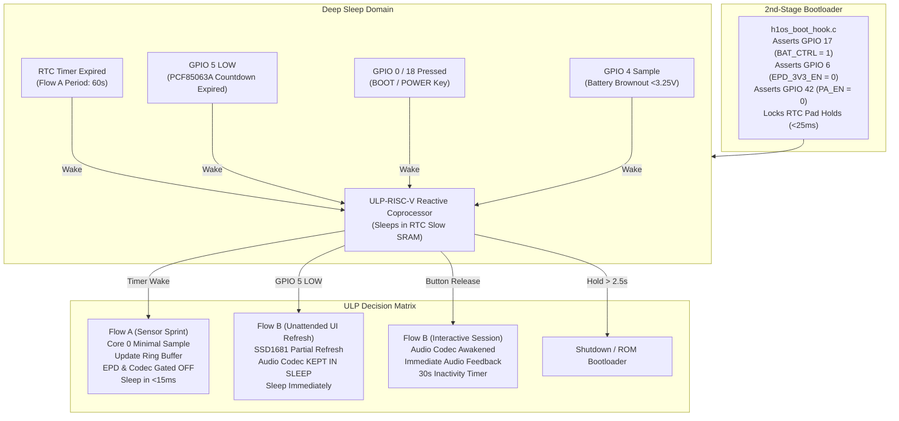

# H1OS Architectural Revision Plan: Reactive ULP Coprocessor & Power Isolation

## Executive Summary
This action plan defines the architectural overhaul required to resolve overnight battery depletion, eliminate spurious Flow B wake cycles, enable the reactive 24/7 ULP-RISC-V hardware coprocessor monitor, enforce strict audio codec gating, and ensure immediate acoustic feedback on the first user interaction.

---

## 1. Root Cause & Architectural Baseline Analysis

| Problem Observed | Direct Mechanism | Architectural Target |
| :--- | :--- | :--- |
| **ULP Not Running / Ring 0/32** | ULP binary was embedded but never loaded via `ulp_riscv_load_binary()`. Wake stub bit-bang I2C failed because GPIO Matrix output mux remained bound to I2C0 peripheral. | Load and run ULP coprocessor via `sub_power_init_ulp()`. ULP handles all RTC/button/timer interrupts. |
| **828 Wake Cycles / 54% Battery Drain in 21h** | Wake stub failed to read PCF85063A remaining time over bit-bang I2C, defaulting `rem_sec = 0` and spuriously promoting into Flow B every ~90s. | External PCF85063A timer strictly controls Flow B. Flow B and EPD refresh execute ONLY when RTC INT fires or button is pressed. |
| **Codec Thermal Oscillation (26°C–32°C)** | Bootloader energizes `PA_EN` (`GPIO 42 = 0`) to prevent I2C clamping errata. 828 wake cycles repeatedly booted dual cores and toggled power states. | Codec stays in <1 µA silicon standby (`0x0D=0xFC`) across all sleep and unattended wakes. Powered up strictly on physical button wake. |
| **First Click in Flow B Muted** | Button wake edge was consumed as hardware wakeup trigger (`EXT1`/`ULP`); LVGL keypad only received subsequent clicks without visual wake acknowledgement. | First click is intercepted by ULP to wake Flow B, and Flow B inverts the top-right awake badge (silent visual ack). Second click is handled by LVGL callback with acoustic tone & page navigation. |

---

## 2. Core Architectural Principles

---

## 3. Step-by-Step Implementation Work Packages

### Phase 1: ULP-RISC-V Coprocessor Loader & Runtime Initialization
- **Target Files:** [`components/h1os/src/sub_power.c`](file:///c:/Users/Matt/Documents/GitHub/H1OS/components/h1os/src/sub_power.c), [`components/h1os/include/h1os/sub_power.h`](file:///c:/Users/Matt/Documents/GitHub/H1OS/components/h1os/include/h1os/sub_power.h), [`components/h1os/ulp/main.c`](file:///c:/Users/Matt/Documents/GitHub/H1OS/components/h1os/ulp/main.c)
1. **Binary Symbol Linking:** Expose `ulp_main_bin_start` and `ulp_main_bin_end` from the embedded ULP assembly target.
2. **ULP Loader Function (`sub_power_init_ulp`):**
   - Check if ULP is already loaded (`RTC_SLOW_MEM` magic check). On cold boot, load binary via `ulp_riscv_load_binary()`.
   - Pass ADC calibration parameters (`cal_scale`, `cal_offset`, `vbat_critical_mv = 3250`) from eFuse into exported ULP variables.
   - Configure ULP wake timer period based on `flow_a_period_sec` (`ulp_set_wakeup_period(0, period_us)`).
   - Start coprocessor via `ulp_riscv_run()`.
3. **Sleep Configuration:**
   - In `sub_power_enter_deep_sleep()`, verify `esp_sleep_enable_ulp_wakeup()` is active.
   - Ensure the ULP exclusively owns waking the main processor.

### Phase 2: Reactive ULP Coprocessor Firmware Alignment
- **Target Files:** [`components/h1os/ulp/main.c`](file:///c:/Users/Matt/Documents/GitHub/H1OS/components/h1os/ulp/main.c), [`docs/architecture/05_ulp.md`](file:///c:/Users/Matt/Documents/GitHub/H1OS/docs/architecture/05_ulp.md)
1. **Interrupt & Wake Source Handling:**
   - **GPIO 5 (PCF85063A INT):** If LOW, set `dispatch_reason = ULP_DISPATCH_MAIN_WAKE`, `last_wake_btn = 0`, and wake CPU.
   - **GPIO 0 & 18 (Buttons):** Classify tap vs. hold. Wakes strictly on **release** for taps (`last_wake_btn = 1` or `2`, `dispatch_reason = ULP_DISPATCH_MAIN_WAKE`). Wakes on hold (>2.5s) for shutdown or bootloader jump.
   - **Timer:** If wake was triggered by RTC timer, set `dispatch_reason = ULP_DISPATCH_SENSOR_SAMPLE` and wake CPU for Flow A.
   - **Battery Check:** If battery is between 100 mV and 3250 mV, trigger `ULP_DISPATCH_CRITICAL_SHUTDOWN`.

### Phase 3: Flow A/B Execution Gating & Codec Isolation
- **Target Files:** [`components/h1os/src/h1os_lifecycle.c`](file:///c:/Users/Matt/Documents/GitHub/H1OS/components/h1os/src/h1os_lifecycle.c), [`components/h1os/src/orch_flow.c`](file:///c:/Users/Matt/Documents/GitHub/H1OS/components/h1os/src/orch_flow.c)
1. **Wake Reason Inspection:**
   - Read `ulp_dispatch_reason` and `ulp_last_wake_btn` immediately in `orch_flow_determine_wakeup()`.
2. **Strict Flow A Gating:**
   - If `ulp_dispatch_reason == ULP_DISPATCH_SENSOR_SAMPLE`:
     - Run isolated SHTC3 read and push to ring buffer.
     - **NEVER initialize display, LVGL, or audio.**
     - Re-enter deep sleep immediately (<15 ms).
3. **Flow B Unattended vs Interactive Gating:**
   - If `ulp_dispatch_reason == ULP_DISPATCH_MAIN_WAKE` and `ulp_last_wake_btn == 0` (External RTC countdown wake):
     - Initialize display and render updated telemetry frame.
     - **Audio codec stays in software standby (`<1 µA`) without initialization.**
     - Return to deep sleep immediately after EPD partial refresh completes.
   - If `ulp_dispatch_reason == ULP_DISPATCH_MAIN_WAKE` and `ulp_last_wake_btn != 0` (User button release):
     - Launch interactive session.
     - Initialize audio codec (`sub_audio_init()`).
     - Start 30-second inactivity countdown timer.

### Phase 4: Two-Stage Click Interaction Model (First Click Wake Badge & Second Click LVGL Navigation)
- **Target Files:** [`components/h1os/src/h1os_lifecycle.c`](file:///c:/Users/Matt/Documents/GitHub/H1OS/components/h1os/src/h1os_lifecycle.c), [`examples/H1OS/main/main.c`](file:///c:/Users/Matt/Documents/GitHub/H1OS/examples/H1OS/main/main.c), [`examples/H1OS/main/screens/screen_base.c`](file:///c:/Users/Matt/Documents/GitHub/H1OS/examples/H1OS/main/screens/screen_base.c), [`components/h1os/src/sub_audio.c`](file:///c:/Users/Matt/Documents/GitHub/H1OS/components/h1os/src/sub_audio.c)
1. **First Click (Intercepted by ULP in Deep Sleep):**
   - User taps `BOOT` (GPIO 0) or `POWER` (GPIO 18).
   - The ULP coprocessor intercepts the edge in RTC domain, debounces, detects release, records `last_wake_btn`, sets `dispatch_reason = ULP_DISPATCH_MAIN_WAKE`, and triggers `ulp_riscv_wakeup_main_processor()`.
   - **No navigation and no tone occurs on this 1st click.**
2. **Flow B Boot & Wake Badge Toggle:**
   - Flow B initializes LVGL and brings up the audio subsystem into warm standby (`sub_audio_init()`).
   - Flow B detects `woke_from_button` (or `last_wake_btn != 0`).
   - Rather than paging forward/backward, Flow B **inverts the top-right status badge** (`screen_base_set_awake_badge(true)`: solid black background with white text) on the active page and issues a partial refresh of the badge area.
   - Starts the 30-second inactivity session countdown timer (`h1os_reset_session_timer()`).
   - The screen remains on the current page with the inverted badge visually signaling: *"I am awake and listening."*
3. **Second Click (Processed by LVGL Keypad Callback):**
   - Because the system is now awake in an active interactive session, subsequent presses are routed directly to LVGL's keypad indev (`keypad_event_cb` in `main.c`).
   - The 2nd click triggers non-blocking acoustic feedback (`sub_audio_play_tone_async()`), advances or reverses the carousel page (`update_active_display()`), and resets the 30s inactivity timer.
4. **Audio Subsystem Pre-Arming:**
   - Because `sub_audio_init()` ran during Flow B boot, the I2S clock tree and ES8311 CSM are already active in warm idle, ensuring the 2nd click tone is generated with zero transient clipping or H-bridge latency.

### Phase 5: Verification & Metrology
1. Compile with `prod` and `dev` profiles (`idf.py -B build_prod build`).
2. Verify ULP symbol table and memory consumption (`<4 KB RTC Slow SRAM`).
3. Monitor current consumption in deep sleep (<20 µA target) and confirm thermal camera shows no oscillation above ambient during unattended countdown intervals.
4. Validate that `Wakes` and `Ring` counters increment in lockstep on the OS Diagnostics screen.
