# Implementation Plan: Audio Task Handshake & External RTC / ULP Wake Remediation (Rev 3)

## Executive Summary

Incorporating the latest silicon audit verification, this revised specification corrects the **32.768 kHz slow clock domain crossing (CDC) arithmetic**, establishes **dual-sided GPIO 5 line draining** (covering both ULP-handled slices and Main-CPU Flow A/Flow B sleep re-entry), verifies **hardware `WAKEUP_ENA` re-arm dynamics**, and enforces **canonical RTC pad isolation**.

### Key Silicon Confirmations & Fixes

1. **CDC Pulse Duration Corrected to 120 µs (≥3.9 Slow Clock Cycles):**
   - Per ESP-IDF documentation (`sleep_modes.rst` L406–407), any GPIO wakeup signal or latch clear must be held for **≥ 3 RTC slow-clock cycles** to be reliably sampled by the RTC comparator and synchronizers.
   - For an external 32.768 kHz crystal (`CONFIG_RTC_CLK_SRC_EXT_CRYS`), $T_{\text{cycle}} \approx 30.517\ \mu\text{s}$.
     $$t_{\text{hold}} \ge 3 \times 30.517\ \mu\text{s} = 91.55\ \mu\text{s}$$
   - The previously proposed $50\ \mu\text{s}$ duration provided only $\approx 1.64$ cycles (insufficient for XTAL32K).
   - **Resolution:** Explicitly bump the latch clear pulse duration to `esp_rom_delay_us(120)` (or `ulp_riscv_delay_us(120)` in ULP), guaranteeing $\approx 3.93$ cycles on XTAL32K and $\approx 16.2$ cycles on internal 136–150 kHz RC slow clock.

2. **Dual-Sided GPIO 5 Line Draining:**
   - **ULP-Side Drain:** The ULP-RISC-V coprocessor executes in $\approx 15\text{–}30\ \mu\text{s}$, while the external PCF85063A open-drain pulse holds `GPIO 5` LOW for $\approx 15.625\text{ ms}$. On intermediate slices (ticks 1–4), the ULP must poll `GPIO 5` until HIGH before re-enabling `WAKEUP_ENA` and executing `ulp_riscv_shutdown()`.
   - **Main-CPU Side Drain:** When a tick hands off wake execution to the Xtensa core (Flow A sample burst or Flow B periodic UI session), the Main CPU must also drain `GPIO 5` until verified HIGH before entering `esp_deep_sleep_start()`.

3. **`WAKEUP_ENA` Re-Arm & Empirical Audit:**
   - In ULP: After line is verified HIGH and `WAKEUP_CLR` is pulsed, explicitly assert `RTC_CNTL_ULP_CP_GPIO_WAKEUP_ENA = 1`.
   - In Main CPU: `sub_power_enter_deep_sleep_mode()` re-arms `RTC_CNTL_ULP_CP_GPIO_WAKEUP_ENA = 1` and logs `RTC_CNTL_ULP_CP_TIMER_REG` to empirically verify `ENA` state before `esp_deep_sleep_start()`.

4. **Pad Isolation & Hold Release:**
   - Canonical `rtc_gpio_hold_dis()` on `GPIO 5`, `GPIO 18`, and `GPIO 0`.
   - Input enable maintained during sleep via `rtc_gpio_init()` + `rtc_gpio_set_direction(pin, RTC_GPIO_MODE_INPUT_ONLY)`.

---

## 1. Flowchart & State Machine

```mermaid
flowchart TD
    subgraph AudioHandshake ["Phase 1: Audio Worker Task Handshake & Orphan Prevention"]
        A1["Caller: sub_audio_init()"] --> A2["Capture xTaskGetCurrentTaskHandle()"]
        A2 --> A3["xTaskCreatePinnedToCore(..., (void*)current_task, ...)"]
        A3 --> A4["ulTaskNotifyTake(pdTRUE, 500ms)"]
        W1["audio_worker_task(pvParameters)"] --> W2["Local Task Init"]
        W2 --> W3["xTaskNotifyGive(creator_task)"]
        W3 --> W4["while(1) { xQueueReceive(...) }"]
        W3 -.->|"Handshake Signal"| A4
        A4 -->|"pdPASS"| A5["s_audio_inited = true -> Return ESP_OK"]
        A4 -->|"Timeout (0)"| A6["vTaskDelete(s_audio_task_handle) -> Return ESP_ERR_TIMEOUT"]
    end

    subgraph RTCArming ["Phase 2: Safe PCF85063A Arming & Readback"]
        R1["sub_rtc_arm_countdown(seconds)"] --> R2["Stop Timer Safely: clk_src | TIE | TI_TP (TE=0)"]
        R2 --> R3["Write Timer_val (seconds)"]
        R3 --> R4["Read-Modify-Write Control_2: Clear TF & AF (Preserve COF)"]
        R4 --> R5["Readback Control_2: Verify (TF==0 && AF==0)"]
        R5 --> R6["Start Timer: clk_src | TE | TIE | TI_TP (clk_src | 0x07)"]
        R6 --> R7["Readback Timer_mode: Verify TE=1 & TI_TP=1"]
    end

    subgraph DualDrain ["Phase 3 & 4: Dual-Sided Drain, 120us CDC Delay & Re-Arm"]
        D1["PCF85063A 15.6ms Pulse on GPIO 5"] --> D2{"Handled by ULP or Main CPU?"}
        D2 -->|"ULP Alone (Intermediate)"| U1["ULP: Poll GPIO 5 until HIGH"]
        U1 --> U2["ULP: Pulse WAKEUP_CLR (120us delay)"]
        U2 --> U3["ULP: Re-arm WAKEUP_ENA = 1"]
        U3 --> U4["ULP: ulp_riscv_shutdown()"]
        D2 -->|"Main CPU (Flow A / Flow B)"| M1["Main CPU: Execute Sample / Display"]
        M1 --> M2["Main CPU: Poll GPIO 5 until HIGH (25ms bounded)"]
        M2 --> M3["Main CPU: Pulse WAKEUP_CLR (120us delay)"]
        M3 --> M4["Main CPU: Re-arm WAKEUP_ENA = 1"]
        M4 --> M5["Main CPU: Audit ULP_CP_TIMER_REG -> esp_deep_sleep_start()"]
    end
```



---

## 2. Component Implementation Details

### Phase 1: Audio Worker Task Handshake & Orphan Prevention ([`sub_audio.c`](file:///c:/Users/Matt/Documents/GitHub/H1OS/components/h1os/src/sub_audio.c))
1. In `audio_worker_task(void *pvParameters)`:
   - Cast `pvParameters` to `TaskHandle_t creator_task`.
   - Before entering the `while (1)` loop, execute:
     ```c
     if (creator_task != NULL) {
         xTaskNotifyGive(creator_task);
     }
     ```
2. In `sub_audio_init()`:
   - Capture `TaskHandle_t current_task = xTaskGetCurrentTaskHandle();`.
   - Pass `(void *)current_task` into `xTaskCreatePinnedToCore()`.
   - If creation succeeds (`res == pdPASS`), block:
     ```c
     if (ulTaskNotifyTake(pdTRUE, pdMS_TO_TICKS(500)) == 0) {
         ESP_LOGE(TAG, "Audio worker task startup timeout (>500ms). Deleting orphan task.");
         vTaskDelete(s_audio_task_handle);
         s_audio_task_handle = NULL;
         vQueueDelete(s_audio_queue);
         s_audio_queue = NULL;
         return ESP_ERR_TIMEOUT;
     }
     ```
   - If `res != pdPASS`, delete queue and return `ESP_ERR_NO_MEM`.

### Phase 2: Safe PCF85063A Arming & Readback Verification ([`sub_rtc.c`](file:///c:/Users/Matt/Documents/GitHub/H1OS/components/h1os/src/sub_rtc.c))
1. In `sub_rtc_arm_countdown(uint32_t seconds)`:
   - Calculate prescaler:
     ```c
     uint8_t clk_src = (seconds <= 255) ? TIMER_CLK_1_HZ : TIMER_CLK_1_60_HZ;
     uint8_t timer_val = (seconds <= 255) ? (uint8_t)seconds : (uint8_t)((seconds + 59) / 60);
     ```
   - **Step 1 (Safe Stop):** Write `clk_src | TIMER_INT_ENABLE_BIT | TIMER_PULSE_MODE_BIT` (`TE = 0`) to `RTC_REG_TIMER_MODE`.
     - *Rationale:* Preserves `TI_TP = 1` (Pulsed Mode) and target clock divider so `GPIO 5` is never pulled LOW by level fallback.
   - **Step 2 (Load Value):** Write `timer_val` to `RTC_REG_TIMER_VALUE`.
   - **Step 3 (Clear Flags):** Read `RTC_REG_CONTROL_2`, clear `TF` and `AF` while preserving `COF[2:0] = 0x07`:
     ```c
     ctrl2 = (ctrl2 & ~(CTRL2_TF_MASK | CTRL2_AF_MASK)) | CTRL2_COF_OFF;
     pcf85063_write_reg_u8(RTC_REG_CONTROL_2, ctrl2);
     ```
   - **Step 4 (Readback Flag Verification):** Read back `RTC_REG_CONTROL_2`. Verify `(read_ctrl2 & (CTRL2_TF_MASK | CTRL2_AF_MASK)) == 0`. Retry up to 3 times if not cleared.
   - **Step 5 (Enable Timer):** Dynamically compute `uint8_t timer_mode = clk_src | TIMER_ENABLE_BIT | TIMER_INT_ENABLE_BIT | TIMER_PULSE_MODE_BIT;` (`clk_src | 0x07`, which is `0x17` for 1 Hz or `0x1F` for 1/60 Hz). Write to `RTC_REG_TIMER_MODE`.
   - **Step 6 (Readback Mode Verification):** Read back `RTC_REG_TIMER_MODE`. Verify `(read_mode & 0x07) == 0x07` (`TE = 1`, `TIE = 1`, `TI_TP = 1`).

### Phase 3: Main-CPU Dual-Sided Drain & Fixed Cadence ([`h1os_lifecycle.c`](file:///c:/Users/Matt/Documents/GitHub/H1OS/components/h1os/src/h1os_lifecycle.c) & [`orch_flow.c`](file:///c:/Users/Matt/Documents/GitHub/H1OS/components/h1os/src/orch_flow.c))
1. **Eliminate Intermediate Remainder Hot-Rearm in Flow A:**
   - Remove lines 246–260 of `h1os_lifecycle.c`.
   - The PCF85063A remains on a constant, uninterrupted 60s base cadence throughout all intermediate slices.
   - Target period is an exact integer multiple: `overflow_limit = flow_b_sec / flow_a_sec`.
2. **Main-CPU GPIO 5 Drain in Both Flow A & Flow B Sleep Transitions:**
   - In `orch_flow_transition_to_sleep()` (Flow B session exit) and `h1os_lifecycle.c` (Flow A burst exit), execute:
     ```c
     uint32_t drain_wait_us = 0;
     while (gpio_get_level(HAL_PIN_RTC_INT) == 0 && drain_wait_us < 25000) {
         esp_rom_delay_us(500);
         drain_wait_us += 500;
     }
     ```
3. **Avoid Unnecessary Re-Arming on Flow B Wake:**
   - In `sub_power_enter_deep_sleep_mode()`: If the RTC countdown timer is already active in pulsed mode at `flow_a_sec`, do NOT stop or re-arm it; allow it to continue counting down predictably.

### Phase 4: ULP Drain Loop, 120 µs CDC Delay & Pad Isolation ([`sub_power.c`](file:///c:/Users/Matt/Documents/GitHub/H1OS/components/h1os/src/sub_power.c) & [`ulp/main.c`](file:///c:/Users/Matt/Documents/GitHub/H1OS/components/h1os/ulp/main.c))

1. **ULP-RISC-V Bounded Drain & Re-Arm in `components/h1os/ulp/main.c`:**
   - Before shutting down on an unlatched/intermediate tick, ULP polls `GPIO 5` until HIGH:
     ```c
     uint32_t waited_us = 0;
     while ((ulp_riscv_gpio_get_level(RTC_INT_PIN) == 0) && (waited_us < RTC_INT_TIMEOUT_US)) {
         ulp_riscv_delay_us(RTC_INT_POLL_US);
         waited_us += RTC_INT_POLL_US;
     }
     rtc_int_stuck = (ulp_riscv_gpio_get_level(RTC_INT_PIN) == 0);
     ```
   - Clear status: `REG_WRITE(RTC_GPIO_STATUS_W1TC_REG, RTC_GPIO_STATUS_INT_W1TC_M);`.
   - Pulse latch clear with **120 µs delay** (guarantees ≥3 slow-clock cycles on XTAL32K):
     ```c
     SET_PERI_REG_MASK(RTC_CNTL_ULP_CP_TIMER_REG, RTC_CNTL_ULP_CP_GPIO_WAKEUP_CLR);
     ulp_riscv_delay_us(120);
     CLEAR_PERI_REG_MASK(RTC_CNTL_ULP_CP_TIMER_REG, RTC_CNTL_ULP_CP_GPIO_WAKEUP_CLR);
     ```
   - If line is clean HIGH (`!rtc_int_stuck`), explicitly re-arm:
     ```c
     SET_PERI_REG_MASK(RTC_CNTL_ULP_CP_TIMER_REG, RTC_CNTL_ULP_CP_GPIO_WAKEUP_ENA);
     ```

2. **Main CPU 120 µs CDC Delay & Register Dump in `sub_power.c`:**
   - In `sub_power_enter_deep_sleep_mode()`:
     ```c
     REG_WRITE(RTC_GPIO_STATUS_W1TC_REG, RTC_GPIO_STATUS_INT_W1TC_M);
     REG_WRITE(RTC_CNTL_INT_CLR_REG, RTC_CNTL_COCPU_INT_CLR | RTC_CNTL_COCPU_TRAP_INT_CLR | RTC_CNTL_ULP_CP_INT_CLR);
     SET_PERI_REG_MASK(RTC_CNTL_ULP_CP_TIMER_REG, RTC_CNTL_ULP_CP_GPIO_WAKEUP_CLR);
     esp_rom_delay_us(120); /* Guaranteed >= 3.9 RTC_SLOW_CLK cycles on XTAL32K */
     CLEAR_PERI_REG_MASK(RTC_CNTL_ULP_CP_TIMER_REG, RTC_CNTL_ULP_CP_GPIO_WAKEUP_CLR);
     CLEAR_PERI_REG_MASK(RTC_CNTL_ULP_CP_TIMER_REG, RTC_CNTL_ULP_CP_SLP_TIMER_EN);
     SET_PERI_REG_MASK(RTC_CNTL_ULP_CP_TIMER_REG, RTC_CNTL_ULP_CP_GPIO_WAKEUP_ENA);
     esp_rom_delay_us(120);

     ESP_LOGI(TAG, "Pre-Sleep Audit: ULP_CP_TIMER=0x%08lx, GPIO_STATUS=0x%08lx",
              (unsigned long)REG_READ(RTC_CNTL_ULP_CP_TIMER_REG),
              (unsigned long)REG_READ(RTC_GPIO_STATUS_REG));
     ```

3. **Pad Sleep Configuration & Canonical Hold Release:**
   - In `sub_power_enter_deep_sleep_mode()`:
     ```c
     rtc_gpio_hold_dis(HAL_PIN_RTC_INT);
     rtc_gpio_hold_dis(HAL_PIN_BUTTON_BOOT);
     rtc_gpio_hold_dis(HAL_PIN_BUTTON_POWER);
     ```

4. **Peterson Spinlock Memory Barriers:**
   - On Xtensa LX7 (`sub_power.c` / `h1os_lifecycle.c`), insert `asm volatile("memw" ::: "memory");` before releasing spinlock.
   - On ULP-RISC-V (`ulp/main.c`), insert `asm volatile("fence" ::: "memory");` before releasing spinlock.

---

## 3. Concrete Verification & Approval Checklist

- [ ] **CDC Hold Verification:** Confirm `RTC_CNTL_ULP_CP_GPIO_WAKEUP_CLR` remains asserted for ≥ 120 µs (≥3 slow-clock cycles on 32.768 kHz).
- [ ] **Dual-Sided Drain Verification:** Confirm `GPIO 5 == 1` is sampled on both ULP (before `ulp_riscv_shutdown()`) and Main CPU (before `esp_deep_sleep_start()`).
- [ ] **Pre-Sleep Register Dump:** Inspect `ULP_CP_TIMER_REG` audit log to confirm `GPIO_WAKEUP_ENA` is actively asserted (`1`) immediately prior to sleep entry.
- [ ] **Pad Hold Audit:** Confirm `rtc_gpio_hold_dis()` is enforced on `GPIO 5`, `18`, and `0` prior to `esp_deep_sleep_start()`.
- [ ] **Orphan Task Prevention:** Induce forced timeout in `sub_audio_init()` unit test; confirm task is deleted via `vTaskDelete()` and queue is freed cleanly.
- [ ] **Prescaler Math Check:** Unit test `sub_rtc_arm_countdown()` across boundary values: 60s (`0x17`), 255s (`0x17`), and 300s (`0x1F`).
- [ ] **Compilation:** `build_prod` compiles cleanly with zero warnings or errors.
- [ ] **Partition Headroom:** Flash/RAM headroom maintained >80%.
- [ ] **GFM Compliance:** `tools/audit_gfm.py` reports 0 defects.
