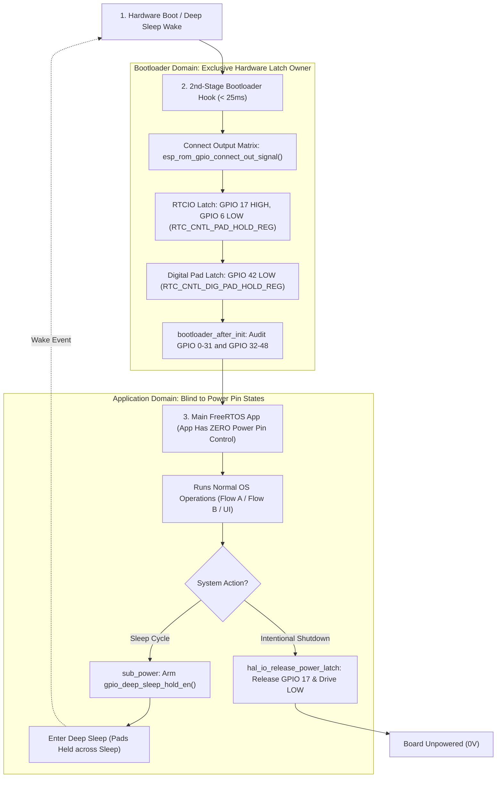

# Architecture & Action Plan: Boot Hook Hardening & Deep Sleep Pad Latch Integrity (Rev 2)

> **Target Chip:** ESP32-S3 (ESP-IDF v6.1) | **Subsystem:** 2nd-Stage Bootloader Hooks & Power Architecture  
> **Source Files:** `components/h1os/bootloader_components/h1os_boot_hook/h1os_boot_hook.c`, `components/h1os/src/sub_power.c`, `components/h1os/src/hal_io.c`  
> **Status:** Ready for Review & Proceed

---

## 1. Architectural Philosophy: Strict Separation of Concerns

> *"The bootloader owns the hardware latch so the application can completely forget about it. Only on intentional power-off does the application release the latch to deassert."*

The power architecture enforces a strict separation of concerns across the system lifecycle:



### Core Invariants:
1. **Bootloader is Sole Latch Authority:** The 2nd-stage bootloader hooks latch `BAT_CTRL` (GPIO 17), `EPD_3V3_EN` (GPIO 6), and `PA_EN` (GPIO 42) in $<25\text{ ms}$ on **every boot and every wake**.
2. **Main Application Zero-Touch Rule:** The main application never reconfigures, toggles, or manages the power rails during normal runtime or wake transitions. `hal_io_release_pad_holds()` exclusively manages dynamic peripheral pins (`EPD_CS`) and never touches the power rails.
3. **Deep Sleep Preservation:** Because GPIO 42 is a digital pad (`RTC_CNTL_DIG_PAD_HOLD_REG`), `sub_power.c` calls `gpio_deep_sleep_hold_en()` prior to sleep to prevent the pad from floating in deep sleep.
4. **Shutdown as Single Exit Point:** The application only touches `BAT_CTRL` when executing an intentional graceful shutdown via `sub_power_cut_power_latch()`.

---

## 2. Implementation Specifications

### Step 1: Bootloader Hook Hardening (`h1os_boot_hook.c`)
1. **Explicit Signal Routing:** Call `esp_rom_gpio_connect_out_signal(pin, SIG_GPIO_OUT_IDX, false, false)` immediately after `esp_rom_gpio_pad_select_gpio(pin)` for all three pins to eliminate dependency on reset default matrix states:
   ```c
   /* GPIO 17 - Power Hold */
   esp_rom_gpio_pad_select_gpio(H1OS_PIN_POWER_HOLD);
   esp_rom_gpio_connect_out_signal(H1OS_PIN_POWER_HOLD, SIG_GPIO_OUT_IDX, false, false);
   gpio_ll_set_level(&GPIO, (gpio_num_t)H1OS_PIN_POWER_HOLD, 1);
   gpio_ll_output_enable(&GPIO, (gpio_num_t)H1OS_PIN_POWER_HOLD);
   REG_SET_BIT(RTC_CNTL_PAD_HOLD_REG, BIT(H1OS_PIN_POWER_HOLD));

   /* GPIO 6 - EPD 3V3 Enable */
   esp_rom_gpio_pad_select_gpio(H1OS_PIN_EPD_3V3_EN);
   esp_rom_gpio_connect_out_signal(H1OS_PIN_EPD_3V3_EN, SIG_GPIO_OUT_IDX, false, false);
   gpio_ll_set_level(&GPIO, (gpio_num_t)H1OS_PIN_EPD_3V3_EN, 0);
   gpio_ll_output_enable(&GPIO, (gpio_num_t)H1OS_PIN_EPD_3V3_EN);
   REG_SET_BIT(RTC_CNTL_PAD_HOLD_REG, BIT(H1OS_PIN_EPD_3V3_EN));

   /* GPIO 42 - PA Enable */
   gpio_ll_hold_dis(&GPIO, (gpio_num_t)H1OS_PIN_PA_EN);
   esp_rom_gpio_pad_select_gpio(H1OS_PIN_PA_EN);
   esp_rom_gpio_connect_out_signal(H1OS_PIN_PA_EN, SIG_GPIO_OUT_IDX, false, false);
   gpio_ll_set_level(&GPIO, (gpio_num_t)H1OS_PIN_PA_EN, 0);
   gpio_ll_output_enable(&GPIO, (gpio_num_t)H1OS_PIN_PA_EN);
   gpio_ll_hold_en(&GPIO, (gpio_num_t)H1OS_PIN_PA_EN);
   ```

2. **Audit Register Bank Split:** Update `bootloader_after_init()` to audit both low bank (GPIO 0–31) and high bank (GPIO 32–48 for GPIO 42):
   ```c
   uint32_t g42_out = (REG_READ(GPIO_OUT1_REG) >> (H1OS_PIN_PA_EN - 32)) & 1U;
   uint32_t g42_oe  = (REG_READ(GPIO_ENABLE1_REG) >> (H1OS_PIN_PA_EN - 32)) & 1U;
   ```

### Step 2: Deep Sleep Digital Pad Hold (`sub_power.c`)
In `sub_power_enter_deep_sleep_mode()` before `esp_deep_sleep_start()`:
```c
/* Arm global digital pad auto-hold across deep sleep to preserve GPIO 42 (PA_EN) */
gpio_deep_sleep_hold_en();
```
This sets `RTC_CNTL_DG_PAD_AUTOHOLD_EN_M` and clears `DG_PAD_FORCE_UNHOLD`, ensuring GPIO 42 does not float during deep sleep.

### Step 3: Enforce Main Application "Hands-Off" Policy (`hal_io.c`)
Verify and audit that `hal_io_early_init()` and `hal_io_release_pad_holds()` do **NOT** attempt to manage or reconfigure GPIO 17, 6, or 42. They remain latched by the bootloader throughout the application lifetime until `hal_io_release_power_latch()` is explicitly called on shutdown.

---

## 3. Empirical Verification & Acceptance Checklist

| Invariant / Check | Expected Behavior | Verification Method |
| :--- | :--- | :--- |
| **Boot Hook Execution** | $<25\text{ ms}$ power rail assertion | Scope trigger on GPIO 17 at $V_{\text{dd}}$ rise |
| **Deep Sleep Latch Survival** | GPIO 42 remains steady $0\text{V}$ (LOW) through sleep | Multimeter / scope on GPIO 42 across sleep cycle |
| **Zero App Manipulation** | No reconfiguration or unhold calls in main app | Code audit & log inspection |
| **Graceful Shutdown** | GPIO 17 releases hold & drives LOW only on shutdown | Run shutdown command, observe board power cut |
| **Clean Build** | 0 errors across `build_dev` and `build_prod` | `idf.py -B build_prod build` |
