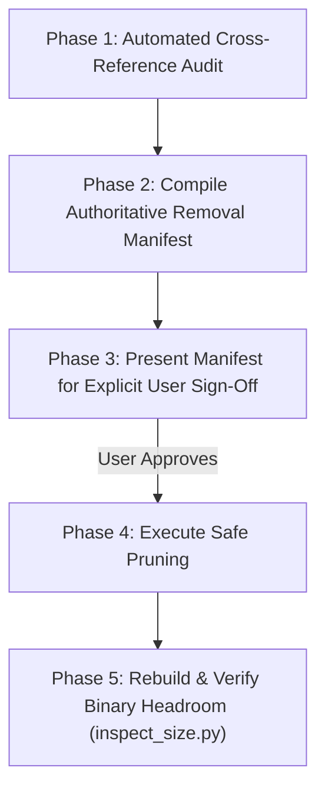

# Plan: Full Codebase Dead Code & Unused Symbol Pruning

> **Status:** Revised per User Comments — Awaiting Removal Manifest Approval  
> **Target Scope:** Entire `components/h1os` directory tree  
> **Objective:** Identify, audit, catalog, and submit an authoritative Removal Manifest for user approval before deleting any dead or unreferenced code.

---

## 1. Updated Audit Directives & Policy

1. **Lax Public Umbrella Policy:**
   - The H1OS project is actively under development.
   - Backward compatibility with prior versions of the public Layer 4 API (`h1os.h`) is relaxed. Any unreferenced or obsolete functions in `h1os.h` or elsewhere in the source tree are eligible for pruning.
2. **Mandatory Removal Manifest Approval Gate:**
   - **No code will be deleted without explicit user sign-off on a compiled Removal Manifest.**
   - The manifest will detail every candidate symbol, its source file, its size footprint, and why it is dead/unreferenced.
3. **Protected Critical Primitives:**
   - Low-level bootloader hooks (`h1os_boot_hook.c`) asserting power latch and display gates must remain intact to prevent hardware power brownouts.

---

## 2. Removal Manifest Candidates (To be Audited & Approved)

The following candidates are flagged for inclusion in the forthcoming Removal Manifest:

| Candidate Symbol / Feature | Source File | Category | Rationale |
| :--- | :--- | :--- | :--- |
| `sub_power_get_ulp_cal_params()` | `components/h1os/src/sub_power.c` `components/h1os/include/h1os/sub_power.h` | Dead Function | Obsolete 2-point linear calibration $(m, b)$. Superseded by 17-point piecewise LUT (`vbat_lut[17]`). Zero callers. |
| Obsolete Layer 4 API Placeholders | `components/h1os/include/h1os.h` `components/h1os/src/h1os_lifecycle.c` | Public API | Any stub or unreferenced public wrapper not utilized by the active firmware flows or examples. |
| Legacy Audio Tone Generators | `components/h1os/src/sub_audio.c` `components/h1os/include/h1os/sub_audio.h` | Audio Subsystem | Any unused hardcoded PCM arrays or deprecated chime tables. |
| Unreferenced HAL Macros | `components/h1os/include/h1os/hal_types.h` | Constants | Obsolete touch controller pin definitions, legacy test pads, or redundant mask definitions. |

---

## 3. Execution Phases

1. **Phase 1: Cross-Reference Workspace Audit:** Run static symbol analysis across `components/h1os` to identify every function, macro, and type definition with zero internal callers.
2. **Phase 2: Formal Removal Manifest Compilation:** Present an exhaustive table of candidate deletions.
3. **Phase 3: User Manifest Review & Sign-Off:** Block execution until user explicitly reviews and approves the manifest.
4. **Phase 4: Code Pruning:** Remove approved dead code.
5. **Phase 5: Clean Rebuild Verification:** Build `build_prod` with `-Werror=unused-function` and quantify flash/RAM savings.
