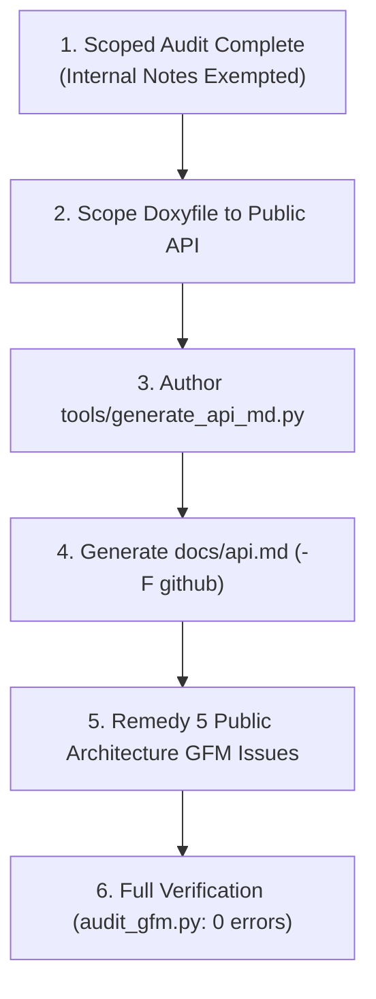

# Architecture & Action Plan: Doxyfile API Generation & Scoped GFM Compliance (Rev 2)

> **Target:** H1OS Public Documentation Suite & Automated API Tooling  
> **Tools Verified:** Doxygen v1.18.0 (`C:\Program Files\doxygen\bin\doxygen.exe`), Moxygen (`C:\Users\Matt\AppData\Roaming\npm\moxygen.ps1`)  
> **Status:** Ready for Review & Proceed

---

## 1. Scope Boundary & Internal Document Exemption

Per user guidance and the updated [`.agents/skills/gfm/SKILL.md`](file:///c:/Users/Matt/Documents/GitHub/H1OS/.agents/skills/gfm/SKILL.md) and [`.agents/rules/gfm.md`](file:///c:/Users/Matt/Documents/GitHub/H1OS/.agents/rules/gfm.md):

- **In-Scope (Mandatory Strict GFM Compliance):**
  - Public-facing documentation: `README.md`, `ERRATA.md`, `CHANGELOG.md`, `docs/architecture/*.md`, `docs/drivers/*.md`, `docs/pinout.md`, `docs/guide.md`, `docs/history.md`, and `docs/api.md`.
- **Out-of-Scope (Exempt from Strict GFM Formatting):**
  - Internal agent working notes, planning logs, scratchpads, and historical test dumps (`docs/agent_notes/`, `docs/logs/`, brain artifacts).
  - *Rationale:* Internal working docs frequently contain specialized multi-line structures, cell layouts, and HTML `<br>` breaks that distort or break when forced into strict GFM syntax.

With internal documents exempted, the scoped audit (`python tools/audit_gfm.py`) reveals exactly **5 targeted defects** in public documentation.

---

## 2. Implementation & Remediation Workflow



### Phase 1: Doxyfile Configuration Hardening
1. In [`Doxyfile`](file:///c:/Users/Matt/Documents/GitHub/H1OS/Doxyfile):
   - Scope `INPUT` strictly to public headers and subsystem interfaces:
     ```ini
     INPUT                  = components/h1os/include \
                              components/h1os/src \
                              README.md
     ```
     *(Removes `examples/` from INPUT to prevent internal application static symbols from polluting the public API manual).*
   - Set `USE_MATHJAX = YES` to eliminate Doxygen parser warnings on mathematical formulas.
   - Set `GENERATE_LATEX = NO` to save disk space and build time.
   - Keep `GENERATE_XML = YES` with `XML_OUTPUT = xml` in `docs/doxygen/`.

### Phase 2: Automated API Generator (`tools/generate_api_md.py`)
1. Create [`tools/generate_api_md.py`](file:///c:/Users/Matt/Documents/GitHub/H1OS/tools/generate_api_md.py):
   - Invokes `doxygen Doxyfile`.
   - Invokes `moxygen -F github docs/doxygen/xml -o docs/api.md`.
   - Produces clean, GitHub-native Markdown without broken Pandoc `{#id}` tags.
2. Execute the script to generate a fresh, pristine [`docs/api.md`](file:///c:/Users/Matt/Documents/GitHub/H1OS/docs/api.md).

### Phase 3: Public Architecture GFM Remediation (5 Items)
Patch the 5 public documentation issues:
1. **`docs/architecture/05_ulp.md` (Line 11):**
   - Replace `$T_{\text{flow\_b}}$` and `$T_{\text{flow\_a}}$` with `$T_{\text{flow-b}}$` and `$T_{\text{flow-a}}$` to fix MathJax `_` mode failure.
2. **`docs/architecture/12_temperature_sensor_operation.md`:**
   - **Lines 82, 83, 87:** Replace raw `&` characters in Mermaid node labels with `and` (`B_SCAN`, `B_CONF`, `B_UI`).
   - **Line 110:** Replace `\text{tsens\_raw}` with `\text{tsens-raw}`.
   - **Line 143:** Replace `\text{valid\_trend}` with `\text{valid-trend}`.

### Phase 4: Final Verification
- Run `python tools/audit_gfm.py` to confirm **0 public documentation issues detected**.
- Inspect `docs/api.md` to confirm clean formatting.
