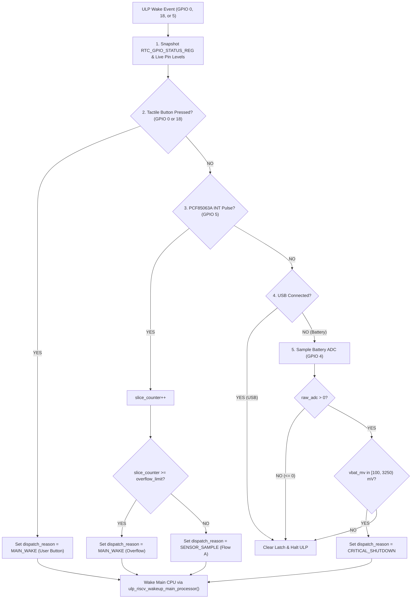

# Architecture Plan (Revised): Overnight ULP Sleep, ADC Setup & Pinout Specification

**Date:** October 17, 2026  
**Status:** PROPOSED (REVISION 2 - Incorporating User Feedback & Official ESP-IDF ADC Guidelines)  
**Governing Documents & Errata:**
- [`docs/pinout.md`](file:///c:/Users/Matt/Documents/GitHub/H1OS/docs/pinout.md) (*"Docs are law"*: Updating IO0 & IO18 external 10kΩ pull-up specifications)
- [`docs/architecture/05_ulp.md`](file:///c:/Users/Matt/Documents/GitHub/H1OS/docs/architecture/05_ulp.md) (ULP Reactive Hardware Monitor Specification)
- [`docs/architecture/errata.md`](file:///c:/Users/Matt/Documents/GitHub/H1OS/docs/architecture/errata.md) (ERR-001 Pure Event Mode & Slicing Architecture)
- [`docs/architecture/04_orchestrator.md`](file:///c:/Users/Matt/Documents/GitHub/H1OS/docs/architecture/04_orchestrator.md) (Flow A / Flow B Execution Lifecycle)
- [`docs/architecture/07_state_machine.md`](file:///c:/Users/Matt/Documents/GitHub/H1OS/docs/architecture/07_state_machine.md) (Application Execution Flow & Sleep Transition Sequence)

---

## 1. Forensic Summary & User Corrections

| Area | User Feedback & Architectural Reality | Implementation Directive |
| :--- | :--- | :--- |
| **Hardware Pull-Ups** | **User Comment:** *"update pinout.md, boot0 and power have external pullups, 10k each."*<br>Hardware has physical external 10kΩ pull-ups to 3.3V on both `GPIO 0` (BOOT) and `GPIO 18` (POWER). | 1. Update [`docs/pinout.md`](file:///c:/Users/Matt/Documents/GitHub/H1OS/docs/pinout.md) to document external 10kΩ pull-ups for IO0 and IO18.<br>2. In [`sub_power.c`](file:///c:/Users/Matt/Documents/GitHub/H1OS/components/h1os/src/sub_power.c), keeping internal pull-ups disabled (`rtc_gpio_pullup_dis`) prevents parallel leakage across the 10kΩ pull-ups. |
| **ULP VBAT Timing** | **User Comment:** *"vbat reading should be last to avoid read delays, and missed io states."*<br>Currently, the ULP reads the ADC on Line 66 before evaluating buttons or RTC flags. | In [`components/h1os/ulp/main.c`](file:///c:/Users/Matt/Documents/GitHub/H1OS/components/h1os/ulp/main.c), evaluate `GPIO 0`, `GPIO 18`, and `GPIO 5` **first**. Only evaluate battery voltage after IO triggers are serviced. |
| **ADC Sleep Routing & Init** | **Official Guidance:**<br>1. ADC1 requires `ulp_mode = ADC_ULP_MODE_RISCV` so `esp_sleep_sub_mode_config(ESP_SLEEP_USE_ADC_TSEN_MONITOR_MODE, true)` maintains RTC domain voltage $\ge 0.9\text{V}$ in deep sleep.<br>2. `GPIO 4` (`BAT_ADC`) **must** be routed to the RTC/analog domain prior to deep sleep (`rtc_gpio_init(HAL_PIN_BAT_ADC)` without wakeup bits).<br>3. `ulp_riscv_adc_read_channel()` returns `-1` on error. Any raw value $\le 0$ must be ignored and **never** trigger brownout. | 1. In [`sub_power.c`](file:///c:/Users/Matt/Documents/GitHub/H1OS/components/h1os/src/sub_power.c), add `rtc_gpio_init(HAL_PIN_BAT_ADC)` before sleep.<br>2. In [`components/h1os/ulp/main.c`](file:///c:/Users/Matt/Documents/GitHub/H1OS/components/h1os/ulp/main.c), ignore `raw_adc <= 0`. Compare against raw thresholds or validated calibrated millivolts. |
| **Flow B EPD Refresh** | **User Comment:** *"yes"* (confirmed Flow B updates EPD on unattended RTC wakes).<br>**User Comment:** *"no needed"* (omit extra debug logging). | Keep existing streamlined refresh pipeline in [`orch_flow.c`](file:///c:/Users/Matt/Documents/GitHub/H1OS/components/h1os/src/orch_flow.c) and [`screen_env_hero.c`](file:///c:/Users/Matt/Documents/GitHub/H1OS/examples/H1OS/main/screens/screen_env_hero.c). |

---

## 2. Revised ULP Execution State Machine



---

## 3. Targeted Code Modifications

### 3.1 Update Pinout Specification ([`docs/pinout.md`](file:///c:/Users/Matt/Documents/GitHub/H1OS/docs/pinout.md))
- Update lines 11 and 29:
  - **IO0 (`BOOT0`):** `Active LOW`. Notes: *External 10kΩ pull-up to 3.3V on PCB.*
  - **IO18 (`BAT_KEY`):** `Active LOW`. Notes: *External 10kΩ pull-up to 3.3V on PCB.*

---

### 3.2 ULP Coprocessor Routine ([`components/h1os/ulp/main.c`](file:///c:/Users/Matt/Documents/GitHub/H1OS/components/h1os/ulp/main.c))
1. **Move ADC Reading to End of `main()`:**
   - Sample IO interrupt status register (`RTC_GPIO_STATUS_REG`) and live levels (`GPIO 0`, `GPIO 18`, `GPIO 5`) immediately upon wake.
2. **Handle Button Wakes First:**
   - If `GPIO 0` or `GPIO 18` is triggered, set `dispatch_reason = 2 (ULP_DISPATCH_MAIN_WAKE)`, `wake_main = true`, and skip battery sampling.
3. **Handle RTC Slicing Second:**
   - If `GPIO 5` is triggered, increment `slice_counter`. Dispatch Flow A or Flow B accordingly, `wake_main = true`, and skip battery sampling.
4. **Evaluate Battery Voltage Last (and only if not already waking):**
   - If `usb_connected != 0`: bypass battery check entirely.
   - Read `raw_adc = ulp_riscv_adc_read_channel(ADC_UNIT_1, ADC_CHANNEL_3)`.
   - **Crucial Guard:** If `raw_adc <= 0` (conversion invalid or timeout), discard reading; **do not** trigger brownout.
   - If `raw_adc > 0`, interpolate `vbat_mv`. If `100 <= vbat_mv < 3250`, assert `dispatch_reason = 5 (ULP_DISPATCH_CRITICAL_SHUTDOWN)` and `wake_main = true`.

---

### 3.3 Sleep Routing & ADC Preparation ([`components/h1os/src/sub_power.c`](file:///c:/Users/Matt/Documents/GitHub/H1OS/components/h1os/src/sub_power.c))
1. **Route `GPIO 4` (`HAL_PIN_BAT_ADC`) to RTC Domain before Sleep:**
   - In `sub_power_enter_deep_sleep_mode()`:
     ```c
     /* Route ADC1 Channel 3 (GPIO 4) to RTC subsystem for ULP sampling (no wakeup bits) */
     rtc_gpio_init(HAL_PIN_BAT_ADC);
     rtc_gpio_set_direction(HAL_PIN_BAT_ADC, RTC_GPIO_MODE_INPUT_ONLY);
     rtc_gpio_pullup_dis(HAL_PIN_BAT_ADC);
     rtc_gpio_pulldown_dis(HAL_PIN_BAT_ADC);
     ```
2. **Preserve External 10kΩ Pull-Up Configuration on Buttons:**
   - Keep internal pull-ups disabled (`rtc_gpio_pullup_dis`) on `HAL_PIN_BUTTON_BOOT` and `HAL_PIN_BUTTON_POWER` to avoid parallel leakage with the external 10kΩ PCB pull-ups.
   - Keep internal pull-up enabled (`rtc_gpio_pullup_en`) on `HAL_PIN_RTC_INT` (open-drain line without external pull-up).

---

## 4. Verification Checklist

- [ ] **Documentation Integrity:** [`docs/pinout.md`](file:///c:/Users/Matt/Documents/GitHub/H1OS/docs/pinout.md) reflects the physical 10kΩ external pull-ups.
- [ ] **Zero Latency Button Wake:** Pressing BOOT or POWER wakes the device into Flow B immediately without waiting on ADC conversion.
- [ ] **Zero-Glitch Battery Protection:** `raw_adc <= 0` is safely discarded; no false brownout shutdowns occur.
- [ ] **Unattended Flow B Execution:** External PCF85063A countdown timer wakes the system into Flow B, refreshes the EPD with updated cycle count and time, and returns cleanly to sleep.
- [ ] **Compiler Build:** Build succeeds with 0 errors via canonical command:
  ```powershell
  & "C:\Espressif\tools\Microsoft.v6.1.PowerShell_profile.ps1"; idf.py -B build_dev build
  ```
