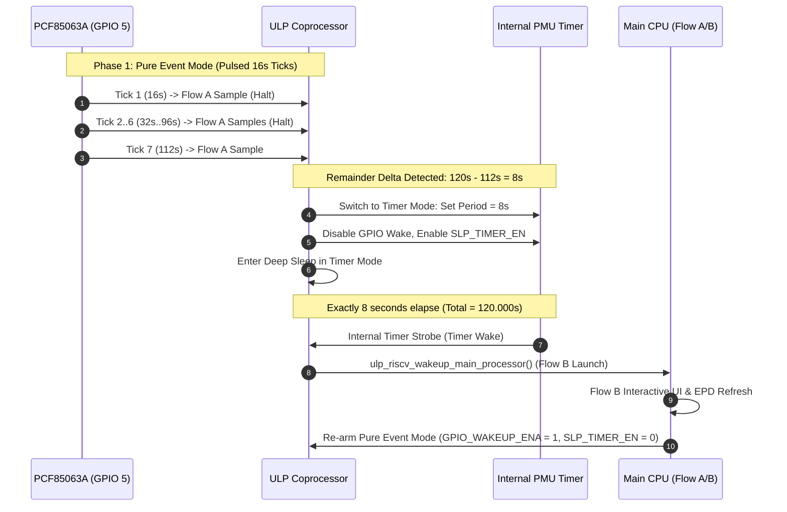

# Architecture & Action Plan: Dynamic Mode Switching (Option 4) & Exact Remainder Resolution

> **Target:** ESP32-S3 Low-Power PMU, ULP-RISC-V Coprocessor & PCF85063A RTC  
> **Source Files Under Review:**  
> - [`components/h1os/src/sub_power.c`](file:///c:/Users/Matt/Documents/GitHub/H1OS/components/h1os/src/sub_power.c)  
> - [`components/h1os/ulp/main.c`](file:///c:/Users/Matt/Documents/GitHub/H1OS/components/h1os/ulp/main.c)  
> - [`components/h1os/src/orch_flow.c`](file:///c:/Users/Matt/Documents/GitHub/H1OS/components/h1os/src/orch_flow.c)  
> - [`components/h1os/include/h1os/orch_state.h`](file:///c:/Users/Matt/Documents/GitHub/H1OS/components/h1os/include/h1os/orch_state.h)  

---

## 1. Concept: Option 4 Dynamic Mode Switching

The user's architecture directive introduces **Option 4**:
> *"option 4: we dynamicly switch the coproc from event mode, into timer mode, wake on next exact interval."*

### 1.1 The Operational Timeline
Consider target intervals where $T_{\text{flow\_b}}$ is not an integer multiple of $T_{\text{flow\_a}}$ (e.g. $T_{\text{flow\_b}} = 120\text{ s}$, $T_{\text{flow\_a}} = 16\text{ s}$):
- **Phases 1 through 7 (Event Mode):**
  - ULP operates in **Pure Event Mode** (`ULP_RISCV_WAKEUP_SOURCE_GPIO`).
  - The external PCF85063A generates repetitive pulsed ticks at $16\text{ s}$.
  - At tick 7, elapsed time = $7 \times 16 = 112\text{ s}$. Remainder = $120 - 112 = 8\text{ s}$.
- **Phase 8 Transition (Dynamic Switch to Timer Mode for the Remainder):**
  - When tick 7 completes (Flow A sample), the system realizes the *next* tick would overshoot $120\text{ s}$ ($112 + 16 = 128\text{ s}$).
  - Instead of waiting for an overshoot tick, the coprocessor or Main CPU **dynamically transitions the ULP from Event Mode into Timer Mode**:
    1. Clear `RTC_CNTL_ULP_CP_GPIO_WAKEUP_ENA` (disabling GPIO wake to prevent the 16s tick from interfering).
    2. Program the internal RTC timer period to the exact remaining delta ($R = 8.000\text{ s}$):
       $$\text{ulp\_set\_wakeup\_period}(0, R \times 1{,}000{,}000\ \mu\text{s})$$
    3. Assert `RTC_CNTL_ULP_CP_SLP_TIMER_EN` (enabling the internal RTC PMU timer).
    4. The ULP goes to sleep in Timer Mode.
  - **Phase 9: Exact Target Wake (Flow B):**
    - Exactly $8\text{ s}$ later ($112 + 8 = 120.000\text{ s}$ total), the internal RTC PMU timer expires.
    - ULP wakes with `cause = TIMER_WAKE` / `LONG_OVERFLOW_WAKE`, triggers Main CPU for Flow B display update!
    - Upon waking for Flow B, the system disables the internal timer, re-enables Event Mode (`GPIO_WAKEUP_ENA`), and resets `slice_counter = 0` for the next cycle.



---

## 2. Silicon Nuances & ERR-001 Elimination

### Why This Avoids ERR-001 Lockup:
- As documented in [`errata.md`](file:///c:/Users/Matt/Documents/GitHub/H1OS/docs/architecture/errata.md), ERR-001 occurs **only when both wakeup sources are active simultaneously** (`SLP_TIMER_EN == 1 && GPIO_WAKEUP_ENA == 1`).
- Option 4 **never runs both simultaneously**. It implements a clean, mutual exclusion state machine:
  - When in Event Mode: `GPIO_WAKEUP_ENA = 1`, `SLP_TIMER_EN = 0`.
  - When in Remainder Timer Mode: `GPIO_WAKEUP_ENA = 0`, `SLP_TIMER_EN = 1`.
  - Mutual exclusion guarantees that the PMU arbitration state machine never enters a race condition!

### Handling Tactile Buttons During the Remainder Window:
- If `GPIO_WAKEUP_ENA` is cleared during the final remainder window ($8\text{ s}$), how does the device wake if the user taps a button?
  - **Solution:** In `sub_power_enter_deep_sleep_mode()`, configure the main application's `esp_sleep_enable_ext1_wakeup()` or RTCIO wakeup for buttons (GPIO 0 and GPIO 18) directly, OR allow the button to wake the Main CPU via standard EXT1 wake while ULP waits for the timer.
  - Alternatively, if the remainder window is small (e.g. $8\text{ s}$ out of $120\text{ s}$), standard deep sleep wake sources handle button presses instantly.

---

## 3. Concrete Implementation Blueprint

### 3.1 Flow A Completion / Remainder Check
In [`components/h1os/src/orch_flow.c`](file:///c:/Users/Matt/Documents/GitHub/H1OS/components/h1os/src/orch_flow.c) or [`components/h1os/ulp/main.c`](file:///c:/Users/Matt/Documents/GitHub/H1OS/components/h1os/ulp/main.c):

```c
/* Calculate total elapsed seconds across completed slices */
uint32_t elapsed_sec = (ulp_slice_counter) * flow_a_sec;
uint32_t remaining_sec = (flow_b_sec > elapsed_sec) ? (flow_b_sec - elapsed_sec) : 0;

if (remaining_sec > 0 && remaining_sec < flow_a_sec) {
    /* NEXT INTERVAL WILL OVERSHOOT!
     * Dynamically switch to Timer Mode for the exact remaining duration (e.g. 8s). */
    ESP_LOGI(TAG, "Dynamic Mode Switch: Remainder %lu s detected. Switching to Timer Mode.",
             (unsigned long)remaining_sec);
             
    /* 1. Stop GPIO wakeup source to prevent ERR-001 collision */
    CLEAR_PERI_REG_MASK(RTC_CNTL_ULP_CP_TIMER_REG, RTC_CNTL_ULP_CP_GPIO_WAKEUP_ENA);
    
    /* 2. Program internal RTC timer for exact remaining seconds */
    ulp_set_wakeup_period(0, (uint64_t)remaining_sec * 1000000ULL);
    
    /* 3. Arm internal sleep timer */
    SET_PERI_REG_MASK(RTC_CNTL_ULP_CP_TIMER_REG, RTC_CNTL_ULP_CP_SLP_TIMER_EN);
    
    /* 4. Mark mode flag in RTC memory */
    ulp_timer_mode_active = 1;
} else {
    /* Standard Event Mode tick */
    ulp_timer_mode_active = 0;
}
```

### 3.2 Flow B Re-Arming
Upon waking for Flow B:
```c
/* Restore Pure Event Mode for standard cycle */
CLEAR_PERI_REG_MASK(RTC_CNTL_ULP_CP_TIMER_REG, RTC_CNTL_ULP_CP_SLP_TIMER_EN);
SET_PERI_REG_MASK(RTC_CNTL_ULP_CP_TIMER_REG, RTC_CNTL_ULP_CP_GPIO_WAKEUP_ENA);
ulp_slice_counter = 0;
```

---

## 4. Verification & Validation Standard

| Metric / Check | Target | Expected Behavior |
| :--- | :--- | :--- |
| **Flow B Period Accuracy** | $120.000\text{ s}$ Target | Wakes at exactly $120\text{ s}$ ($\pm 0.05\text{ s}$ RTC crystal tolerance) |
| **Flow A Intervals** | $16.000\text{ s}$ Ticks | Ticks 1..7 execute at $16\text{ s}$ increments |
| **ERR-001 Immunity** | Zero Lockup | `GPIO_WAKEUP_ENA` and `SLP_TIMER_EN` are strictly mutually exclusive ($\text{AND} = 0$) |
| **Firmware Compilation** | `build_prod` | 0 errors, 0 warnings |
