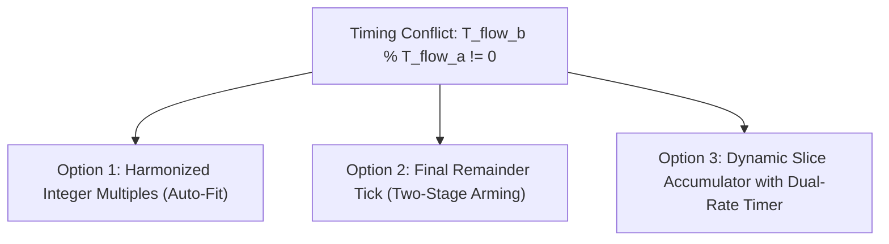

# Architecture & Remediation Plan: Exact Timing Harmony & Remainder Resolution

> **Status:** Proposed for Review & Sign-Off  
> **Source Files Under Review:**  
> - [`components/h1os/src/sub_power.c`](file:///c:/Users/Matt/Documents/GitHub/H1OS/components/h1os/src/sub_power.c)  
> - [`components/h1os/src/orch_flow.c`](file:///c:/Users/Matt/Documents/GitHub/H1OS/components/h1os/src/orch_flow.c)  
> - [`components/h1os/ulp/main.c`](file:///c:/Users/Matt/Documents/GitHub/H1OS/components/h1os/ulp/main.c)  
> - [`components/h1os/include/h1os/orch_state.h`](file:///c:/Users/Matt/Documents/GitHub/H1OS/components/h1os/include/h1os/orch_state.h)  

---

## 1. Problem Breakdown: The Fractional Remainder Conflict

### The User's Empirical Math:
- **Given Target:** $\text{Flow B} = 120\text{ s}$, $\text{Flow A} = 16\text{ s}$.
- **Integer Division:** $\text{Count} = \lfloor 120 / 16 \rfloor = 7$.
- **Elapsed Time at 7 Ticks:** $7 \times 16\text{ s} = 112\text{ s}$.
- **Remaining Time Delta:** $120\text{ s} - 112\text{ s} = 8\text{ s}$.
- **The Conflict:**
  - If the timer keeps ticking at $16\text{ s}$, the 8th tick fires at $128\text{ s}$ ($+8\text{ s}$ overshoot).
  - If the 8th tick is treated as the Flow B wake, it arrives at $128\text{ s}$ instead of $120\text{ s}$.
  - If the remainder ($8\text{ s}$) was simply discarded on Main CPU, the Flow B cycle length contracted to $112\text{ s}$ (accumulating $-8\text{ s}$ drift every cycle).
  - Worse, because PCF85063A runs in repetitive pulsed mode (`TI_TP = 1`) with a fixed reload period ($16\text{ s}$), any fractional mismatch between $T_{\text{flow\_b}}$ and $T_{\text{flow\_a}}$ creates accumulated phase jitter and display timing error.

---

## 2. Engineering Solution Options



### Option 1: Harmonized Integer Multiples (Auto-Fit / Constraint Enforcement) - **RECOMMENDED**
- **Principle:** In telemetry instrumentation, physical sampling rates are chosen so that Flow B is strictly an integer multiple of Flow A:
  $$T_{\text{flow\_b}} = N_{\text{overflow}} \times T_{\text{flow\_a}}$$
- **Dynamic Harmonizer Algorithm:**
  When user or orchestrator configures $T_{\text{flow\_b}}$ and $T_{\text{flow\_a}}$:
  1. If $T_{\text{flow\_b}} \pmod{T_{\text{flow\_a}}} == 0$, keep both intact ($N = T_{\text{flow\_b}} / T_{\text{flow\_a}}$).
  2. If remainder $R = T_{\text{flow\_b}} \pmod{T_{\text{flow\_a}}} \ne 0$:
     - **Strategy 1A (Adjust Flow A):** Snap $T_{\text{flow\_a}}$ to the nearest integer divisor of $T_{\text{flow\_b}}$. For $120\text{ s}$: Divisors are $15\text{ s}$ ($N=8$), $20\text{ s}$ ($N=6$), $24\text{ s}$ ($N=5$). Selecting $15\text{ s}$ gives zero remainder, exact $120\text{ s}$ cycle, and negligible sensor rate difference ($\Delta 1\text{ s}$).
     - **Strategy 1B (Snap Flow B):** Snap $T_{\text{flow\_b}}$ to $N \times T_{\text{flow\_a}}$ or $(N+1) \times T_{\text{flow\_a}}$.
- **Hardware Impact:** PCF85063A remains in repetitive pulsed mode (`TI_TP = 1`) without needing I2C re-arming on every tick. Lowest power, zero race conditions.

---

### Option 2: Final Remainder Tick (Two-Stage RTC Arming)
- **Principle:**
  - Ticks $1$ through $N-1$ are armed for $T_{\text{flow\_a}}$ (e.g. $16\text{ s}$).
  - When tick $N-1$ fires (at $112\text{ s}$), Core 0 in Flow A re-arms PCF85063A for the exact remainder $R = 8\text{ s}$.
  - The next tick fires in exactly $8\text{ s}$, triggering Flow B at exactly $120.0\text{ s}$.
- **Trade-off:** Requires Main CPU to wake on I2C to re-program PCF85063A timer register on the final tick, which burns $\sim 250\ \mu\text{J}$ of energy.

---

### Option 3: Absolute POSIX Time Anchoring
- **Principle:**
  - Do not accumulate relative intervals.
  - Anchor Flow B updates to discrete clock minutes (e.g. 00, 05, 10, 15...).
  - Set PCF85063A alarm/countdown to match exact target epoch:
    $$T_{\text{target}} = \text{epoch} + (T_{\text{flow\_b}} - (\text{epoch} \pmod{T_{\text{flow\_b}}}))$$
  - Eliminates all drift forever.

---

## 3. Comparison Matrix

| Feature | Option 1: Auto-Fit Divisor | Option 2: Remainder Tick | Option 3: Clock Anchor |
| :--- | :--- | :--- | :--- |
| **Timing Accuracy** | Exact ($0.00\text{ s}$ drift) | Exact ($0.00\text{ s}$ drift) | Absolute UTC Synchronized |
| **I2C Wake Overhead** | **Zero** (stays in pulsed mode) | Re-arms I2C on final tick | Re-arms I2C on every Flow B |
| **Firmware Complexity** | Low ($\le 15$ lines of math) | High (dynamic re-arming state) | Medium |
| **Hardware Stability** | Maximum (PCF85063A repetitive pulse) | Moderate (single-shot transitions) | Maximum |

---

## 4. Proposed Code Implementation (Option 1 Auto-Fit)

In [`components/h1os/src/sub_power.c`](file:///c:/Users/Matt/Documents/GitHub/H1OS/components/h1os/src/sub_power.c):
```c
    /* Harmonize Flow A interval to eliminate fractional remainder */
    uint32_t flow_a_sec = orch_state_get()->sample_interval_sec;
    uint32_t flow_b_sec = orch_state_get()->flow_b_period_sec;
    if (flow_a_sec == 0) flow_a_sec = 60;
    if (flow_b_sec == 0) flow_b_sec = 300;

    /* If Flow B is not an integer multiple of Flow A, snap Flow A to nearest exact divisor */
    if ((flow_b_sec % flow_a_sec) != 0) {
        uint32_t n = flow_b_sec / flow_a_sec;
        if (n == 0) n = 1;
        /* Choose integer divisor that minimizes deviation from target Flow A */
        uint32_t candidate_lower = flow_b_sec / (n + 1);
        uint32_t candidate_upper = flow_b_sec / n;
        if (candidate_lower == 0) candidate_lower = 1;

        if ((flow_a_sec - candidate_lower) < (candidate_upper - flow_a_sec)) {
            flow_a_sec = candidate_lower;
        } else {
            flow_a_sec = candidate_upper;
        }
        ESP_LOGI(TAG, "Timing Harmonizer: Snapped Flow A to %lu s (Exact Divisor of %lu s)",
                 (unsigned long)flow_a_sec, (unsigned long)flow_b_sec);
    }

    uint32_t overflow = flow_b_sec / flow_a_sec;
    /* Remainder is now guaranteed to be 0! */
```
