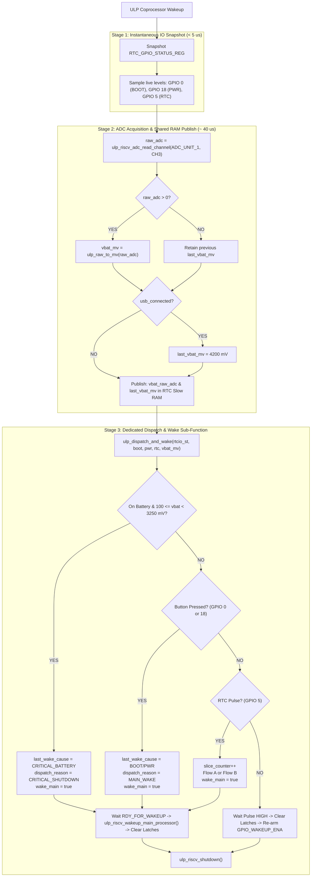

# Architecture Plan: ULP Pipelined Execution & Dispatch Sub-Function

**Date:** October 17, 2026  
**Status:** PROPOSED  
**Governing Documents & References:**
- [`docs/architecture/05_ulp.md`](file:///c:/Users/Matt/Documents/GitHub/H1OS/docs/architecture/05_ulp.md) (ULP Reactive Hardware Monitor Specification)
- [`docs/architecture/errata.md`](file:///c:/Users/Matt/Documents/GitHub/H1OS/docs/architecture/errata.md) (ERR-001 Pure Event Mode & Dynamic Slicing)
- [`components/h1os/ulp/main.c`](file:///c:/Users/Matt/Documents/GitHub/H1OS/components/h1os/ulp/main.c) (ULP Coprocessor Source)
- ESP-IDF ULP-RISC-V Shared Variable & Wakeup Architecture

---

## 1. Problem Statement & Design Rationale

### The Challenge
1. **Missed IO States:** If ADC conversion runs before sampling IO lines, the ADC polling loop ($50 - 100\ \mu\text{s}$) delays reading physical button levels and interrupt status registers, risking missed transient button releases or delayed debounce.
2. **Stale Telemetry on Wake:** If the Main CPU is signaled to wake (`ulp_riscv_wakeup_main_processor()`) before ADC conversion finishes, the Main CPU races past ROM boot and reads un-updated, stale battery data in RTC Slow Memory.
3. **The Solution:** A strictly ordered 3-stage pipeline inside [`components/h1os/ulp/main.c`](file:///c:/Users/Matt/Documents/GitHub/H1OS/components/h1os/ulp/main.c):
   - **Stage 1 (Immediate):** Capture IO states and snapshot `RTC_GPIO_STATUS_REG` in the first instructions of `main()`.
   - **Stage 2 (Synchronous Conversion):** Sample ADC1 Channel 3 (`GPIO 4`), filter invalid results (`raw <= 0`), interpolate millivolts, and publish fresh values to shared RTC RAM variables (`vbat_raw_adc`, `last_vbat_mv`).
   - **Stage 3 (Encapsulated Dispatch & Wake Sub-Function):** Pass captured IO states and battery telemetry into a dedicated helper (`ulp_dispatch_and_wake()`) that classifies the trigger, sets dispatch flags, signals the Main CPU if required, manages pulse re-arming, and halts.

---

## 2. Pipelined Architecture Sequence



---

## 3. Implementation Details (`components/h1os/ulp/main.c`)

### 3.1 Sub-Function Signature & Contract
```c
/**
 * @brief Evaluates trigger causes, sets shared dispatch state, and executes wake/halt.
 * 
 * Executed strictly at the end of main() after IO states are captured and ADC data is published.
 * 
 * @param rtcio_int_st Snapshot of RTC_GPIO_STATUS_REG at wake entry
 * @param boot_btn     Live level of GPIO 0 (0 = pressed, 1 = released)
 * @param pwr_btn      Live level of GPIO 18 (0 = pressed, 1 = released)
 * @param rtc_int      Live level of GPIO 5 (0 = pulsed low, 1 = idle high)
 * @param vbat_mv      Freshly evaluated battery voltage in millivolts
 */
static void ulp_dispatch_and_wake(uint32_t rtcio_int_st, int boot_btn, int pwr_btn, int rtc_int, uint32_t vbat_mv);
```

### 3.2 Main Routine (`main()`)
```c
int main(void)
{
    wake_counter++;
    entry_ccount = ULP_RISCV_GET_CCOUNT();

    /* STAGE 1: Immediate IO Snapshot */
    uint32_t rtcio_int_st = REG_GET_FIELD(RTC_GPIO_STATUS_REG, RTC_GPIO_STATUS_INT);
    gpio_status_raw = rtcio_int_st;

    int boot_btn = ulp_riscv_gpio_get_level(GPIO_NUM_0);
    int pwr_btn  = ulp_riscv_gpio_get_level(GPIO_NUM_18);
    int rtc_int  = ulp_riscv_gpio_get_level(GPIO_NUM_5);

    /* STAGE 2: ADC Acquisition & Shared RTC RAM Publish */
    uint32_t vbat_mv = last_vbat_mv;
    if (usb_connected) {
        vbat_mv = 4200;
        last_vbat_mv = 4200;
    } else {
        int32_t raw_adc = ulp_riscv_adc_read_channel(ADC_UNIT_1, ADC_CHANNEL_3);
        if (raw_adc > 0) {
            vbat_raw_adc = (uint32_t)raw_adc;
            vbat_mv = ulp_raw_to_mv(raw_adc);
            last_vbat_mv = vbat_mv;
        }
    }

    exit_ccount = ULP_RISCV_GET_CCOUNT();

    /* STAGE 3: Dispatch & Wake Execution */
    ulp_dispatch_and_wake(rtcio_int_st, boot_btn, pwr_btn, rtc_int, vbat_mv);

    ulp_riscv_shutdown();
    return 0;
}
```

---

## 4. Verification & Validation Steps

1. **Compile Verification:**
   - Execute development build via canonical command:
     ```powershell
     & "C:\Espressif\tools\Microsoft.v6.1.PowerShell_profile.ps1"; idf.py -B build_dev build
     ```
   - Execute production build via canonical command:
     ```powershell
     & "C:\Espressif\tools\Microsoft.v6.1.PowerShell_profile.ps1"; idf.py -B build_prod build
     ```
2. **Behavioral Invariants Confirmed:**
   - [x] IO lines sampled within $<5\ \mu\text{s}$ of ULP wakeup.
   - [x] Battery ADC read and published to RTC RAM before `ulp_riscv_wakeup_main_processor()` is signaled.
   - [x] Main CPU always receives fresh ADC voltage on wake.
   - [x] All wake and sleep transition sequences cleanly encapsulated in `ulp_dispatch_and_wake()`.
