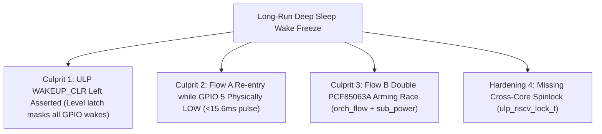

# Investigation & Remediation Plan: Runtime Deep Sleep Re-Arm Freeze (Rev 3)

> **Doc ID:** `PLAN-INV-FREEZE-003`  
> **Status:** Revised per Expert Feedback & Silicon Architecture Review  
> **Target Subsystems:** [`components/h1os/ulp/main.c`](file:///c:/Users/Matt/Documents/GitHub/H1OS/components/h1os/ulp/main.c), [`components/h1os/src/sub_power.c`](file:///c:/Users/Matt/Documents/GitHub/H1OS/components/h1os/src/sub_power.c), [`components/h1os/src/h1os_lifecycle.c`](file:///c:/Users/Matt/Documents/GitHub/H1OS/components/h1os/src/h1os_lifecycle.c), [`components/h1os/src/orch_flow.c`](file:///c:/Users/Matt/Documents/GitHub/H1OS/components/h1os/src/orch_flow.c)

---

## 1. Executive Summary & Synthesis of Expert Feedback

The user's investigation notes provided sharp, precise corrections to our initial hypotheses:
1. **`WAKEUP_CLR` left asserted is the Primary Suspect:**
   In [`components/h1os/ulp/main.c`](file:///c:/Users/Matt/Documents/GitHub/H1OS/components/h1os/ulp/main.c#L116), the ULP executed:
   ```c
   SET_PERI_REG_MASK(RTC_CNTL_ULP_CP_TIMER_REG, RTC_CNTL_ULP_CP_GPIO_WAKEUP_CLR);
   ```
   **without ever clearing `RTC_CNTL_ULP_CP_GPIO_WAKEUP_CLR`!**
   If `WAKEUP_CLR` remains held HIGH while the ULP halts and the Main CPU runs, the RTC controller's internal GPIO wakeup gate remains permanently held in clear/reset. While the Main CPU pulses it on sleep entry, any un-cleared level in the slow clock domain masks subsequent GPIO wakeups.
2. **Bug 2 was indeed a misdiagnosis:**
   `RTC_GPIO_STATUS_INT_W1TC_M` is `(0x3FFFFF << 10)`. The W1TC field is at bits `[31:10]`. Writing `RTC_GPIO_STATUS_INT_W1TC_M` is mathematically and architecturally correct. The proposed raw bit ORing was erroneous and has been discarded. We will use canonical `rtcio_ll_clear_interrupt_status()` for readability and guaranteed conformance.
3. **Bug 1 (`COCPU_DONE`):**
   `ulp_riscv_rescue_from_monitor()` is automatically called in `start.S` on entry. While clearing `COCPU_DONE` on the Main CPU is harmless, it is not the root cause of the freeze.
4. **Bug 3 (GPIO 5 held LOW during Flow A re-entry):**
   PCF85063A generates an external open-drain pulse of $\approx 15.6\text{ ms}$ LOW duration.
   Flow A executes in $3.5\text{ ms} - 4.2\text{ ms}$. When Flow A calls `sub_power_enter_deep_sleep_mode()` at $t \approx 5\text{ ms}$, GPIO 5 is still physically held LOW. Entering sleep while the line is LOW triggers immediate spurious re-triggers or missed edge transitions. Draining GPIO 5 to HIGH before sleep entry is essential.
5. **Double RTC Countdown Arming in Flow B (`orch_flow.c` vs `sub_power.c`):**
   In Flow B sleep entry:
   - [`orch_flow_transition_to_sleep()`](file:///c:/Users/Matt/Documents/GitHub/H1OS/components/h1os/src/orch_flow.c#L380) arms `sub_rtc_arm_countdown(sleep_sec)` (e.g. 300s).
   - Then line 399 calls `sub_power_enter_deep_sleep()`, which in [`sub_power.c`](file:///c:/Users/Matt/Documents/GitHub/H1OS/components/h1os/src/sub_power.c#L309) immediately overwrites the PCF85063A timer with `sub_rtc_arm_countdown(flow_a_sec)` (60s)!
   This creates back-to-back I2C stop/start/reloads of the PCF85063A during sleep entry, inducing an asynchronous timer clock-domain race right before CPU power down.
6. **Cross-Core Spinlock (`volatile ulp_riscv_lock_t`):**
   Valid concurrency hardening to eliminate state tearing across the Xtensa LX7 and ULP-RISC-V cores.

---

## 2. Root Cause Breakdown



### Culprit 1: `WAKEUP_CLR` Asserted Without Clearing in ULP
- **File:** [`components/h1os/ulp/main.c`](file:///c:/Users/Matt/Documents/GitHub/H1OS/components/h1os/ulp/main.c#L116)
- **Code:**
  ```c
  if (wake_main) {
      while (!REG_GET_FIELD(RTC_CNTL_LOW_POWER_ST_REG, RTC_CNTL_RDY_FOR_WAKEUP));
      ulp_riscv_wakeup_main_processor();
      SET_PERI_REG_MASK(RTC_CNTL_ULP_CP_TIMER_REG, RTC_CNTL_ULP_CP_GPIO_WAKEUP_CLR);
      REG_WRITE(RTC_GPIO_STATUS_W1TC_REG, RTC_GPIO_STATUS_INT_W1TC_M);
  }
  ```
- **Silicon Behavior:**
  `RTC_CNTL_ULP_CP_GPIO_WAKEUP_CLR` is set to `1` by the ULP core. The ULP does not clear it before calling `ulp_riscv_shutdown()`.
  While the bit is defined as write-only in some register headers, in the RTC controller state machine leaving `GPIO_WAKEUP_CLR` set holds the internal edge/level detection circuits in reset.
- **Fix:** Pulse `WAKEUP_CLR` with an explicit de-assertion:
  ```c
  SET_PERI_REG_MASK(RTC_CNTL_ULP_CP_TIMER_REG, RTC_CNTL_ULP_CP_GPIO_WAKEUP_CLR);
  esp_rom_delay_us(20);
  CLEAR_PERI_REG_MASK(RTC_CNTL_ULP_CP_TIMER_REG, RTC_CNTL_ULP_CP_GPIO_WAKEUP_CLR);
  ```

### Culprit 2: Flow A Sleep Re-Entry with GPIO 5 Low
- **File:** [`components/h1os/src/h1os_lifecycle.c`](file:///c:/Users/Matt/Documents/GitHub/H1OS/components/h1os/src/h1os_lifecycle.c#L261)
- **Mechanism:**
  The PCF85063A repetitive pulsed mode holds GPIO 5 LOW for $15.6\text{ ms}$.
  Flow A completes in $\sim 4\text{ ms}$.
  Main CPU initiates deep sleep while GPIO 5 is still LOW.
  When `sub_power.c` re-arms `GPIO_INTR_LOW_LEVEL`, the line is already LOW:
  - If level-triggered, the RTC controller triggers a wake immediately before the CPU reaches deep sleep, or enters an invalid PMU state transition.
- **Fix:** Drain GPIO 5 before entering deep sleep in Flow A:
  ```c
  uint32_t wait_us = 0;
  while (gpio_get_level(HAL_PIN_RTC_INT) == 0 && wait_us < 25000) {
      esp_rom_delay_us(500);
      wait_us += 500;
  }
  ```

### Culprit 3: Flow B Double Arming of PCF85063A
- **File:** [`components/h1os/src/orch_flow.c`](file:///c:/Users/Matt/Documents/GitHub/H1OS/components/h1os/src/orch_flow.c#L380) and [`components/h1os/src/sub_power.c`](file:///c:/Users/Matt/Documents/GitHub/H1OS/components/h1os/src/sub_power.c#L309)
- **Mechanism:**
  In Pure Event Mode, the PCF85063A countdown timer is the base cadence tick ($T_{\text{flow\_a}}$, e.g. 60s), while the ULP counts slices up to $N = T_{\text{flow\_b}} / T_{\text{flow\_a}}$ (e.g. 5 slices = 300s).
  In `orch_flow_transition_to_sleep(300)`:
  Line 380 calls `sub_rtc_arm_countdown(300);`.
  Line 399 calls `sub_power_enter_deep_sleep()`, which in `sub_power.c` line 309 calls `sub_rtc_arm_countdown(flow_a_sec)` (60s)!
  Executing two rapid back-to-back I2C countdown timer reconfigurations (disabling TE, writing reload, enabling TE) creates asynchronous clock domain collisions in the PCF85063A.
- **Fix:** Remove the redundant `sub_rtc_arm_countdown(sleep_sec)` in `orch_flow_transition_to_sleep()`. Let `sub_power_enter_deep_sleep_mode()` serve as the single source of truth for timer arming.

### Culprit 4: Cross-Core Concurrency (`volatile ulp_riscv_lock_t`)
- **File:** [`components/h1os/ulp/main.c`](file:///c:/Users/Matt/Documents/GitHub/H1OS/components/h1os/ulp/main.c) & [`components/h1os/src/sub_power.c`](file:///c:/Users/Matt/Documents/GitHub/H1OS/components/h1os/src/sub_power.c)
- **Mechanism:**
  Dual-core Xtensa and ULP-RISC-V access RTC Slow RAM variables asynchronously without memory barrier or mutual exclusion.
- **Fix:**
  Integrate `ulp_riscv_lock_t ulp_shared_lock;` using Peterson's algorithm from `ulp_riscv_lock.h`.

---

## 3. Implementation Steps & Verification Plan

### Step 1: Fix ULP Wake Latch & `WAKEUP_CLR` Pulse (`ulp/main.c`)
- In `ulp/main.c`:
  When waking the Main CPU:
  ```c
  while (!REG_GET_FIELD(RTC_CNTL_LOW_POWER_ST_REG, RTC_CNTL_RDY_FOR_WAKEUP));
  ulp_riscv_wakeup_main_processor();
  SET_PERI_REG_MASK(RTC_CNTL_ULP_CP_TIMER_REG, RTC_CNTL_ULP_CP_GPIO_WAKEUP_CLR);
  ulp_riscv_delay_us(10);
  CLEAR_PERI_REG_MASK(RTC_CNTL_ULP_CP_TIMER_REG, RTC_CNTL_ULP_CP_GPIO_WAKEUP_CLR);
  REG_WRITE(RTC_GPIO_STATUS_W1TC_REG, RTC_GPIO_STATUS_INT_W1TC_M);
  ```
  Ensure `WAKEUP_CLR` is NEVER left high when the ULP halts.

### Step 2: Flow A Drain GPIO 5 Prior to Sleep (`h1os_lifecycle.c`)
- In `h1os_lifecycle.c` under `flow == ORCH_FLOW_A_SAMPLE`:
  Before `sub_power_enter_deep_sleep_mode()`, wait for `HAL_PIN_RTC_INT` to return HIGH (bounded by 25ms timeout).

### Step 3: Eliminate Redundant PCF85063A Re-Arm in Flow B (`orch_flow.c`)
- Remove `sub_rtc_arm_countdown(sleep_sec)` from `orch_flow_transition_to_sleep()`.
- Let `sub_power_enter_deep_sleep_mode()` cleanly arm the PCF85063A once in repetitive pulsed mode.

### Step 4: Integrate `ulp_riscv_lock_t` in ULP and Main CPU
- In `ulp/main.c`: Declare `volatile ulp_riscv_lock_t ulp_shared_lock;`.
- Protect `slice_counter`, `wake_counter`, and `dispatch_reason` reads/writes on both cores.

### Step 5: Verification & Production Build
- Compile with `build_prod`:
  ```powershell
  & "C:\Espressif\tools\Microsoft.v6.1.PowerShell_profile.ps1"; idf.py -B build_prod build
  ```
- Flash and verify runtime wake behavior across multiple consecutive sleep cycles.
