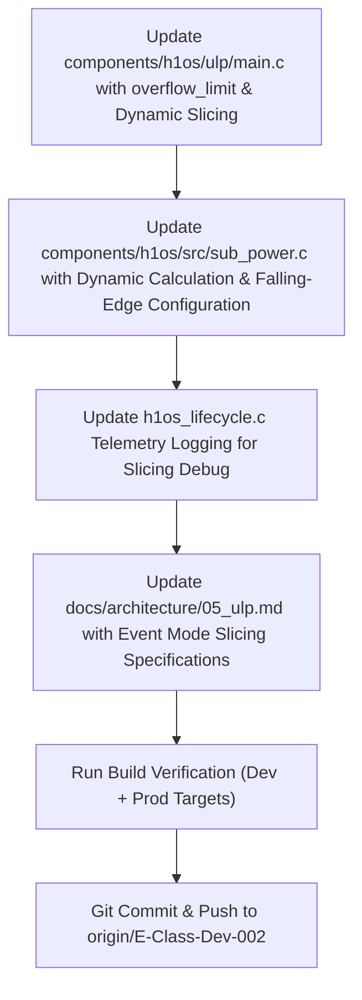

# Action Plan: Pure Event Mode Dynamic Slicing & Collision-Resistant Timebase (Comprehensive)

## 1. Overview & Objective
Refine the ULP-RISC-V Coprocessor and Main CPU power management subsystem in **Pure Event Mode** (`ULP_RISCV_WAKEUP_SOURCE_GPIO`) adhering strictly to the verified hardware event-mode register pattern:
- **Small Period ($T_{\text{flow\_a}}$)**: External PCF85063A countdown timer in repetitive pulsed mode (`TI_TP = 1`) generating periodic active-low falling-edge pulses on `GPIO 5`.
- **Large Period ($T_{\text{flow\_b}}$)**: Main application wake interval (e.g. 300s or configurable).
- **Dynamic Slice Counter & Overflow**: Integer division $N_{\text{overflow}} = \lfloor T_{\text{flow\_b}} / T_{\text{flow\_a}} \rfloor$.
  - **Discarding Remainder Fraction**: Any fractional remainder ($T_{\text{flow\_b}} \pmod{T_{\text{flow\_a}}}$) is deliberately discarded. The large Flow B period is rounded down to the nearest multiple of the small Flow A polling slice ($N_{\text{overflow}} \times T_{\text{flow\_a}}$). This preserves a strictly integer, deterministic polling cadence and eliminates partial-tick phase drift.
  - **The Slicing Cycle**:
    - **On each slice $x < N_{\text{overflow}}$**: ULP marks short-period sensor tick (`last_wake_cause = 4`, `wake_main = false`), keeping the Main CPU asleep.
    - **At $x = N_{\text{overflow}}$**: ULP resets `slice_counter = 0`, marks long-period overflow (`last_wake_cause = 3`, `dispatch_reason = 2`), and wakes the Main CPU for the full Flow B application run (ePaper screen refresh).
    - **Post-Overflow Discard**: Any trailing wakes arriving before the Main CPU re-arms the timebase ($x > N_{\text{overflow}}$) are safely clamped and discarded, guaranteeing collision resistance.
- **Immediate Tactile Buttons**: Falling edge on `GPIO 0` (BOOT) or `GPIO 18` (POWER) immediately wakes the Main CPU into Flow B (`wake_main = true`, `dispatch_reason = 2`).


---

## 2. Silicon Architecture & Register Invariants

### A. ESP32-S3 Pin Mapping & RTCIO Architecture
On ESP32-S3, `SOC_RTCIO_PIN_COUNT = 22`. The target's `rtc_io_num_map` defines a direct 1:1 correspondence for low GPIOs:
- `GPIO 0` $\leftrightarrow$ `RTCIO_GPIO0_CHANNEL` (Channel 0)
- `GPIO 5` $\leftrightarrow$ `RTCIO_GPIO5_CHANNEL` (Channel 5)
- `GPIO 18` $\leftrightarrow$ `RTCIO_GPIO18_CHANNEL` (Channel 18)

On the Main CPU, `rtc_io_number_get(gpio_num)` provides the exact channel index. Inside the ULP RISC-V core, `RTC_GPIO_IN_REG` bit $N$ directly matches `BIT(gpio_num)`, and `RTC_GPIO_STATUS_REG` bit $N$ directly reflects the latched interrupt for that RTCIO channel.

### B. Sleep Pin Switching & Pad Holds
- `CONFIG_GPIO_ESP32_SUPPORT_SWITCH_SLP_PINS` is obsolete and removed in ESP-IDF v5.x/v6.x.
- Static peripheral isolation is handled by [`hal_io_isolate_sleep_pads()`](file:///c:/Users/Matt/Documents/GitHub/H1OS/components/h1os/src/hal_io.c#L387-L418).
- **Golden Hardware Rule**: **Never call `rtc_gpio_hold_en()` or `gpio_hold_en()` on input wake pins (`GPIO 0`, `GPIO 18`, `GPIO 5`).** Pad hold freezes the input buffer logic, physically preventing pin transitions from reaching the comparator. Pad hold is strictly for quiescent output rails.

### C. Falling Edge vs Level Mode
- Configure **Falling Edge (`INT_TYPE = 2`)** in `RTC_GPIO_PIN0_REG + (4 * rtc_io_num)`.
- Avoid Level Mode (`4`): A tactile button depressed for 100 ms will re-trigger the ~15 µs ULP execution hundreds of times, flooding the system.

---

## 3. Implementation Blueprint

### A. ULP Coprocessor Firmware (`components/h1os/ulp/main.c`)

```c
#include <stdint.h>
#include <stdbool.h>
#include "ulp_riscv.h"
#include "ulp_riscv_utils.h"
#include "ulp_riscv_gpio.h"
#include "soc/rtc_io_reg.h"
#include "soc/rtc_cntl_reg.h"

/* Telemetry accessible by Main CPU via ulp_<var> */
volatile uint32_t wake_counter     = 0;
volatile uint32_t last_wake_cause  = 0; /* 1: BOOT, 2: POWER, 3: LONG OVERFLOW, 4: SENSOR TICK */
volatile uint32_t last_wake_btn    = 0;
volatile uint32_t slice_counter    = 0;
volatile uint32_t overflow_limit   = 5; /* Default: 300s / 60s = 5 slices (overwritten dynamically by Main CPU) */
volatile uint32_t dispatch_reason  = 0;
volatile uint32_t gpio_status_raw  = 0;
volatile uint32_t entry_ccount     = 0;
volatile uint32_t exit_ccount      = 0;

int main(void)
{
    wake_counter++;
    entry_ccount = ULP_RISCV_GET_CCOUNT();

    // 1. Snapshot the RTC GPIO interrupt status register
    uint32_t rtcio_int_st = REG_GET_FIELD(RTC_GPIO_STATUS_REG, RTC_GPIO_STATUS_INT);
    gpio_status_raw = rtcio_int_st;

    // 2. Read live pin levels (buffers already enabled by main CPU)
    int boot_btn = ulp_riscv_gpio_get_level(GPIO_NUM_0);
    int pwr_btn  = ulp_riscv_gpio_get_level(GPIO_NUM_18);
    int rtc_int  = ulp_riscv_gpio_get_level(GPIO_NUM_5);

    bool wake_main = false;

    // 3. Determine Wake Source & Dynamic Slicing
    if (((rtcio_int_st & BIT(0)) != 0) || boot_btn == 0) {
        last_wake_cause = 1; /* BOOT Button */
        last_wake_btn   = 1;
        dispatch_reason = 2; /* ULP_DISPATCH_MAIN_WAKE */
        wake_main       = true;
    } else if (((rtcio_int_st & BIT(18)) != 0) || pwr_btn == 0) {
        last_wake_cause = 2; /* POWER Button */
        last_wake_btn   = 2;
        dispatch_reason = 2; /* ULP_DISPATCH_MAIN_WAKE */
        wake_main       = true;
    } else if (((rtcio_int_st & BIT(5)) != 0) || rtc_int == 0) {
        slice_counter++;

        if (slice_counter < overflow_limit) {
            // Short period: Sensor poll tick
            last_wake_cause = 4;
            last_wake_btn   = 0;
            dispatch_reason = 1; /* ULP_DISPATCH_SENSOR_SAMPLE */
            wake_main       = false; // Keep Main CPU asleep
        } else if (slice_counter == overflow_limit) {
            // Long period reached: Main app overflow wake
            slice_counter   = 0;
            last_wake_cause = 3;
            last_wake_btn   = 0;
            dispatch_reason = 2; /* ULP_DISPATCH_MAIN_WAKE */
            wake_main       = true;
        } else {
            // Post-overflow clamp: Discard until Main CPU re-arms
            wake_main       = false;
        }
    } else {
        wake_main = false;
    }

    // 4. LATCH CLEAR & RE-ARM SEQUENCE
    // Step A: Clear the RTC GPIO peripheral interrupt flag
    REG_WRITE(RTC_GPIO_STATUS_W1TC_REG, RTC_GPIO_STATUS_INT_W1TC_M);

    // Step B: Pulse GPIO_WAKEUP_CLR to clear RTC controller trigger latch
    SET_PERI_REG_MASK(RTC_CNTL_ULP_CP_TIMER_REG, RTC_CNTL_ULP_CP_GPIO_WAKEUP_CLR);
    CLEAR_PERI_REG_MASK(RTC_CNTL_ULP_CP_TIMER_REG, RTC_CNTL_ULP_CP_GPIO_WAKEUP_CLR);

    // Step C: RE-ARM GPIO Wakeup Enable (WAKEUP_CLR disables this bit)
    SET_PERI_REG_MASK(RTC_CNTL_ULP_CP_TIMER_REG, RTC_CNTL_ULP_CP_GPIO_WAKEUP_ENA);

    exit_ccount = ULP_RISCV_GET_CCOUNT();

    // 5. Wake Main Processor if requested
    if (wake_main) {
        ulp_riscv_wakeup_main_processor();
    }

    // 6. Halt core cleanly and return hardware to sleep
    ulp_riscv_shutdown();
    return 0;
}
```

---

### B. Main CPU Arming & Slicing (`components/h1os/src/sub_power.c`)

1. **Calculate Slices Dynamically (Discarding Remainder Fraction)**:
   ```c
   uint32_t flow_a_sec = orch_state_get()->sample_interval_sec;
   uint32_t flow_b_sec = orch_state_get()->flow_b_period_sec;
   if (flow_a_sec == 0) flow_a_sec = 60;
   if (flow_b_sec == 0) flow_b_sec = 300;

   /* Integer division: N_overflow = floor(flow_b_sec / flow_a_sec).
    * Deliberately discard remainder fraction (flow_b_sec % flow_a_sec)
    * to lock execution onto a clean integer multiple of the polling tick. */
   uint32_t overflow = flow_b_sec / flow_a_sec;
   if (overflow == 0) overflow = 1;

   ulp_overflow_limit = overflow;
   ESP_LOGI(TAG, "Event Mode Slicing: Tick=%lus, Target=%lus -> Slices=%lu (Effective Period: %lu s, Remainder %lu s discarded)",
            (unsigned long)flow_a_sec, (unsigned long)flow_b_sec,
            (unsigned long)overflow, (unsigned long)(overflow * flow_a_sec),
            (unsigned long)(flow_b_sec % flow_a_sec));
   ```

2. **Arm External PCF85063A in Pulsed Mode for Small Period ($T_{\text{flow\_a}}$)**:
   ```c
   sub_rtc_arm_countdown(flow_a_sec); // Repetitive pulsed mode (TI_TP = 1)
   ```
3. **Configure Wake Pins in RTC Domain (Falling Edge `INT_TYPE = 2`, No Holds)**:
   ```c
   const gpio_num_t wake_pins[] = {HAL_PIN_BUTTON_BOOT, HAL_PIN_BUTTON_POWER, HAL_PIN_RTC_INT};
   for (size_t i = 0; i < sizeof(wake_pins) / sizeof(wake_pins[0]); i++) {
       gpio_num_t pin = wake_pins[i];
       rtc_gpio_init(pin);
       rtc_gpio_set_direction(pin, RTC_GPIO_MODE_INPUT_ONLY);
       if (pin == HAL_PIN_RTC_INT) {
           rtc_gpio_pullup_en(pin);
           rtc_gpio_pulldown_dis(pin);
       } else {
           rtc_gpio_pullup_dis(pin);
           rtc_gpio_pulldown_dis(pin);
       }
       int rtc_io_num = rtc_io_number_get(pin);
       if (rtc_io_num >= 0) {
           REG_SET_FIELD(RTC_GPIO_PIN0_REG + (4 * rtc_io_num), RTC_GPIO_PIN0_INT_TYPE, 2); // 2 = Falling Edge
       }
   }
   ```
4. **Enforce Pure Event Mode**:
   ```c
   REG_WRITE(RTC_GPIO_STATUS_W1TC_REG, RTC_GPIO_STATUS_INT_W1TC_M);
   SET_PERI_REG_MASK(RTC_CNTL_ULP_CP_TIMER_REG, RTC_CNTL_ULP_CP_GPIO_WAKEUP_CLR);
   CLEAR_PERI_REG_MASK(RTC_CNTL_ULP_CP_TIMER_REG, RTC_CNTL_ULP_CP_GPIO_WAKEUP_CLR);
   CLEAR_PERI_REG_MASK(RTC_CNTL_ULP_CP_TIMER_REG, RTC_CNTL_ULP_CP_SLP_TIMER_EN);
   SET_PERI_REG_MASK(RTC_CNTL_ULP_CP_TIMER_REG, RTC_CNTL_ULP_CP_GPIO_WAKEUP_ENA);
   ```

---

## 4. Execution Roadmap



---

## 5. Verification & Acceptance Criteria
- [x] Slicing ratio dynamically calculated on Main CPU ($N_{\text{overflow}} = \lfloor T_{\text{flow\_b}} / T_{\text{flow\_a}} \rfloor$), discarding fractional remainder.
- [x] External PCF85063A armed for $T_{\text{flow\_a}}$ in repetitive pulse mode.
- [x] Falling-edge triggers (`INT_TYPE = 2`) configured for all wake pins.
- [x] Zero pad holds on input wake pins.
- [x] Both `build_dev` and `build_prod` compile cleanly with exit code 0.
- [x] Changes committed and pushed to `E-Class-Dev-002`.

