# ULP Coprocessor & 2nd-Stage Bootloader Architectural Audit

**Document:** `ulp_bootloader_audit.md`  
**Target Subsystems:** 
- `components/h1os/ulp/main.c` (ULP-RISC-V Coprocessor Firmware)
- `components/h1os/bootloader_components/h1os_boot_hook/h1os_boot_hook.c` (Early 2nd-Stage Bootloader Hook)
**Governing Architecture Specifications:**
- `docs/architecture/05_ulp.md` (Layer 3: ULP-RISC-V Coprocessor Hardware Monitor Specification)
- `docs/architecture/13_gpio_hold_domains_and_sleep_architecture.md` (GPIO Hold Domains & Sleep Architecture)
- `docs/architecture/errata.md` (ERR-001: ESP32-S3 PMU Dual-Wake Coprocessor Block)
- `docs/architecture/02_hal.md` (Hardware Abstraction Layer Pinouts & Policies)
- `docs/architecture/08_lessons_learned.md` (What Worked, What Failed, & Rationale)

---

## Executive Summary

The ULP coprocessor firmware (`ulp/main.c`) and early 2nd-stage bootloader hook (`h1os_boot_hook.c`) form the low-power foundation of H1OS. Together, they govern early power rail latching (<25 ms from power-on), deep-sleep isolation, time slicing, and tactile wake classification.

While both components build cleanly under ESP-IDF v5.4 / v6.1 and successfully boot on the ESP32-S3-PICO-1, this deep architectural audit against the governing documentation reveals **7 major architectural disconnects and silicon hazards**:
1. **Missing Wake-on-Release & Hold Timing in ULP:** The ULP currently wakes the Main CPU immediately on button down-press, directly violating `05_ulp.md` Section 3.2.B. This leads to LVGL input races and prevents differentiating between short taps, BOOT holds (>2.5s to flash), and POWER holds (>2.5s to shut down).
2. **Missing Input Glitch Filter:** The ULP accepts raw low states without the mandatory 30 ms glitch filter, exposing the dual-core Xtensa to spurious wakes from mechanical contact bounce and electrical noise.
3. **Cross-Domain Latch Re-Assertion Race (CDC Hazard):** In `ulp/main.c`, the RTC interrupt status (`RTC_GPIO_STATUS_W1TC_REG`) is cleared *after* pulsing the controller wake latch (`RTC_CNTL_ULP_CP_GPIO_WAKEUP_CLR`), risking re-triggering under slow 32.768 kHz CDC sync delays.
4. **Power Gate (`PA_EN` GPIO 42) Documentation vs. Silicon Reality Collision:** `13_gpio_hold_domains_and_sleep_architecture.md` Line 129 states `PA_EN` is driven HIGH to cut power, whereas `h1os_boot_hook.c` and `02_hal.md` drive it LOW (active-low gate). Driving it HIGH unpowers the ES8311, which causes its ESD protection diodes to forward-bias and clamp the shared I2C bus to 0.7 V (`08_lessons_learned.md` 1.8). The code is silicon-accurate, but the architecture doc contains an errant inverted statement that must be reconciled.
5. **Dead Audit Variables in Bootloader Hook:** `h1os_boot_hook.c` performs register readbacks of GPIO 17 and GPIO 42 into `__unused` variables that are cast to `(void)`, consuming ROM space without validating or asserting rail health.
6. **ADC Battery Calibration Disconnect:** The ULP implements a 17-point LUT interpolation (`ulp_raw_to_mv`), whereas `05_ulp.md` Section 3.2.C and `sub_power.c` mandate using factory eFuse linear scale and offset coefficients ($V = ((\text{raw} \times m) / 4096) \times 2 + b$).
7. **Redundant Cycle Counter Profiling:** ULP firmware records cycle counts into `entry_ccount` and `exit_ccount`, which are never read or processed by the Main CPU orchestrator.

---

## Hierarchical Flowcharts

### Flowchart 1: As-Implemented (Current Firmware & Bootloader Hook)

```mermaid
graph TD
    subgraph Bootloader ["2nd-Stage Bootloader Hook (h1os_boot_hook.c)"]
        BH_Entry["bootloader_before_init() (<25ms)"] --> BH_Latch17["Drive GPIO 17 HIGH & Lock RTC Pad Hold"]
        BH_Latch17 --> BH_Latch6["Drive GPIO 6 LOW (EPD 3V3 ON) & Lock RTC Pad Hold"]
        BH_Latch6 --> BH_Latch42["Drive GPIO 42 LOW (PA Rail ON) & Lock Digital Hold"]
        BH_Latch42 --> BH_AfterInit["bootloader_after_init()"]
        BH_AfterInit --> BH_ReadDead["Read GPIO registers to __unused dummy variables (void)"]
        BH_ReadDead --> BH_AppBoot["Boot Application Image"]
    end

    subgraph ULP_Current ["ULP Coprocessor (ulp/main.c) As Implemented"]
        ULP_Wake["Hardware Interrupt Event (GPIO Wake)"] --> ULP_ReadStatus["Read RTC_GPIO_STATUS_REG & Sample Pin Levels"]
        ULP_ReadStatus --> ULP_ADC["Read ADC1_CH3 (Raw Sample) & 17-Point LUT Interpolation"]
        ULP_ADC --> ULP_EvalDispatch["Evaluate Dispatch Logic"]
        
        ULP_EvalDispatch --> ULP_CritBat{"vbat_mv < 3.25V & not USB?"}
        ULP_CritBat -- Yes --> ULP_SetCrit["Set ULP_DISPATCH_CRITICAL_SHUTDOWN (5)"] --> ULP_WakeMain["ulp_riscv_wakeup_main_processor()"]
        
        ULP_CritBat -- No --> ULP_BtnCheck{"boot_btn == 0 OR pwr_btn == 0?"}
        ULP_BtnCheck -- Yes (IMMEDIATE) --> ULP_SetMainWake["Set ULP_DISPATCH_MAIN_WAKE (2)<br/>(Finger still down!)"] --> ULP_WakeMain
        
        ULP_BtnCheck -- No --> ULP_RtcCheck{"rtc_int == 0 (GPIO 5)?"}
        ULP_RtcCheck -- Yes --> ULP_IncSlice["slice_counter++"]
        ULP_IncSlice --> ULP_SliceCheck{"slice_counter < overflow_limit?"}
        ULP_SliceCheck -- Yes --> ULP_SetSensor["Set ULP_DISPATCH_SENSOR_SAMPLE (1)"] --> ULP_WakeMain
        ULP_SliceCheck -- No --> ULP_SetOverflow["Set ULP_DISPATCH_MAIN_WAKE (2)"] --> ULP_WakeMain
        
        ULP_WakeMain --> ULP_Spin["Spin on RTC_CNTL_RDY_FOR_WAKEUP"]
        ULP_Spin --> ULP_PulseClr["Pulse RTC_CNTL_ULP_CP_GPIO_WAKEUP_CLR for 120us"]
        ULP_PulseClr --> ULP_ClearW1TC["Clear RTC_GPIO_STATUS_W1TC_REG (Hazard: Cleared AFTER pulse)"]
        ULP_ClearW1TC --> ULP_Halt["ulp_riscv_halt()"]
    end
```



---

### Flowchart 2: As-Architected (Target Spec: Wake-on-Release, Timing, & Clean CDC)

```mermaid
graph TD
    subgraph Bootloader_Arch ["2nd-Stage Bootloader Hook (Target Spec)"]
        ABH_Entry["bootloader_before_init() (<25ms)"] --> ABH_Latch17["Drive GPIO 17 HIGH & Lock RTC Pad Hold"]
        ABH_Latch17 --> ABH_Latch6["Drive GPIO 6 LOW (EPD 3V3 ON) & Lock RTC Pad Hold"]
        ABH_Latch6 --> ABH_Latch42["Drive GPIO 42 LOW (PA Rail ON, Anti-Clamp) & Lock Hold"]
        ABH_Latch42 --> ABH_Assert["Audit & Assert Power Rails via Hardware Status Registers"]
        ABH_Assert --> ABH_AppBoot["Boot Application Image"]
    end

    subgraph ULP_Arch ["ULP Coprocessor (05_ulp.md & errata.md Mandates)"]
        AULP_Wake["Hardware Interrupt Event (GPIO Wake)"] --> AULP_ReadStatus["Read RTC_GPIO_STATUS_REG & Sample Pin Levels"]
        AULP_ReadStatus --> AULP_GlitchFilter["Glitch Filter: Debounce & Verify Pulse >= 30ms"]
        
        AULP_GlitchFilter -- Spurious / Glitch --> AULP_DropGlitch["Discard Noise Pulse & Return to Sleep"]
        AULP_GlitchFilter -- Valid Pulse --> AULP_ADC["Read ADC1_CH3 with Factory eFuse Linear Coefficients"]
        
        AULP_ADC --> AULP_CheckCrit{"Vbat < 3.25V & Vbat > 100mV?"}
        AULP_CheckCrit -- Yes --> AULP_SetCrit["Set ULP_DISPATCH_CRITICAL_SHUTDOWN"] --> AULP_ExecWake
        
        AULP_CheckCrit -- No --> AULP_ClassifyTrigger{"Classify Hardware Wake Source"}
        
        AULP_ClassifyTrigger -- "RTC INT (GPIO 5)" --> AULP_SliceLogic["slice_counter++"]
        AULP_SliceLogic --> AULP_SliceGate{"slice_counter < overflow_limit?"}
        AULP_SliceGate -- Yes --> AULP_SensorSample["Flow A Prep: Set ULP_DISPATCH_SENSOR_SAMPLE"] --> AULP_ExecWake
        AULP_SliceGate -- No --> AULP_FlowBWake["Periodic Overflow: Set ULP_DISPATCH_MAIN_WAKE"] --> AULP_ExecWake
        
        AULP_ClassifyTrigger -- "Tactile Button (GPIO 0 or 18)" --> AULP_HoldTiming["Track Button Hold Duration (T_hold)"]
        
        AULP_HoldTiming --> AULP_HoldCheck{"T_hold > 2500ms?"}
        AULP_HoldCheck -- "Yes & BOOT (GPIO 0)" --> AULP_Bootloader["Set ULP_DISPATCH_BOOTLOADER_JUMP"] --> AULP_ExecWake
        AULP_HoldCheck -- "Yes & POWER (GPIO 18)" --> AULP_PowerOff["Set ULP_DISPATCH_POWER_OFF"] --> AULP_ExecWake
        AULP_HoldCheck -- No --> AULP_ReleaseWait["Wait for Button Release (Rising Edge back to HIGH)"]
        
        AULP_ReleaseWait --> AULP_ReleaseCheck{"50ms <= T_hold <= 800ms?"}
        AULP_ReleaseCheck -- "Valid Short Tap Release" --> AULP_TapWake["Set ULP_DISPATCH_MAIN_WAKE<br/>(Finger is UP! Clean LVGL Input)"] --> AULP_ExecWake
        AULP_ReleaseCheck -- "Invalid / Stray Release" --> AULP_Drop["Discard Event & Halt"]
        
        subgraph AULP_ExecWake ["Clean CDC Wake Sequence"]
            EW_ClearW1TC["1. Clear Peripheral Interrupt Flag (RTC_GPIO_STATUS_W1TC_REG)"] --> EW_Spin["2. Spin on RTC_CNTL_RDY_FOR_WAKEUP"]
            EW_Spin --> EW_WakeCPU["3. Wake Main CPU (ulp_riscv_wakeup_main_processor())"]
            EW_WakeCPU --> EW_PulseClr["4. Pulse RTC_CNTL_ULP_CP_GPIO_WAKEUP_CLR (>= 120us CDC Sync)"]
            EW_PulseClr --> EW_Halt["5. ulp_riscv_halt()"]
        end
    end
```



---

## Detailed Compare & Contrast Analysis

### 1. Tactile Button Handling: Immediate Wake vs. Wake-on-Release & Classification
- **As-Implemented:** Lines 72–83 in `components/h1os/ulp/main.c` check `boot_btn == 0` or `pwr_btn == 0` and immediately assign `dispatch_reason = ULP_DISPATCH_MAIN_WAKE` and awaken the Main CPU.
- **As-Architected (`05_ulp.md` Section 3.2.B):** Mandates the **Wake-on-Release Rule**. The ULP must not wake the CPU when the button is first pushed down. Instead, it must monitor the button line:
  - If held $>2.5\text{s}$ on `GPIO 0`, it triggers `ULP_DISPATCH_BOOTLOADER_JUMP`.
  - If held $>2.5\text{s}$ on `GPIO 18`, it triggers `ULP_DISPATCH_POWER_OFF`.
  - If released between $50\text{ms}$ and $800\text{ms}$, it triggers `ULP_DISPATCH_MAIN_WAKE`.
- **System Impact:** Under the current implementation, when the Main CPU powers up and LVGL boots, the user's finger is still actively pressing the tactile switch. This causes LVGL's keypad driver to detect a stale down-press, creating double-clicks, unintended screen switches, or boot timing races.

### 2. Glitch Filtering & Electrical Noise
- **As-Implemented:** Lines 167–170 take instantaneous reads via `ulp_riscv_gpio_get_level()` with zero debounce.
- **As-Architected (`05_ulp.md` Section 3.2.B & `CHANGELOG.md`):** Mandates that any pulse $<30\text{ms}$ is an electrical transient or switch contact bounce and must be cleanly discarded without waking the Main CPU.
- **System Impact:** Mechanical contact bounce triggers spurious Main CPU wakes, needlessly cycling the high-power Xtensa cores out of deep sleep and draining the battery.

### 3. CDC Latch Clearing Sequence & Race Hazards
- **As-Implemented:** Lines 117–120 execute `RTC_CNTL_ULP_CP_GPIO_WAKEUP_CLR` pulse, followed by `RTC_GPIO_STATUS_W1TC_REG`.
- **As-Architected:** To prevent cross-domain clock (CDC) re-latching on XTAL32K (32.768 kHz RTC clock domain), the peripheral interrupt status register `RTC_GPIO_STATUS_W1TC_REG` must be cleared *first*, followed by the controller pulse, ensuring the level comparator has ceased asserting before clearing the latch.
- **System Impact:** Clearing the controller pulse while the peripheral status bit is still latched can cause the RTC state machine to immediately re-latch a wake condition as soon as the clear pulse ends.

### 4. Audio Rail `PA_EN` (GPIO 42) Polarity Discrepancy
- **As-Implemented (`h1os_boot_hook.c` Line 61):** `gpio_ll_set_level(&GPIO, 42, 0)` drives `PA_EN` LOW (Rail ON).
- **Architecture Spec (`13_gpio_hold_domains_and_sleep_architecture.md` Line 129):** States `PA_EN` is *"Driven HIGH (`GPIO_OUT1_REG` bit 10) to cut power to the audio amplifier during boot."*
- **Silicon Law (`02_hal.md` Line 49 & `08_lessons_learned.md` Section 1.8):** `PA_EN` is an active-low MOSFET gate (`0 = ON`). Furthermore, if the audio rail is cut (HIGH) while the I2C bus is pulled up to 3.3V, the ES8311 codec's ESD diodes forward-bias and clamp SDA/SCL to 0.7 V, crashing the entire system.
- **System Impact:** The code in `h1os_boot_hook.c` is **correct** for silicon stability (rail energized, amplifier muted via `PA_CTRL` GPIO 46 = 0). The specification in `13_gpio_hold_domains_and_sleep_architecture.md` contains an inverted statement (errant typo) that must be corrected to maintain architectural integrity.

---

## Comprehensive Itemized Disconnect Audit

### Item 1: Missing Wake-on-Release Rule & Long-Press Classification in ULP

- **File:** `components/h1os/ulp/main.c`
- **Function / Symbol:** `ulp_dispatch_and_wake()`
- **Line Numbers:** Lines 72–83
- **Disconnect:** The ULP wakes the Main CPU immediately on contact closure (`boot_btn == 0 || pwr_btn == 0`).
- **Reason for Flag:** Direct violation of `docs/architecture/05_ulp.md` Section 3.2.B ("Wake on Release Rule" and "Tap vs Hold Classifier").
- **What is Currently Implemented:**
```c
} else if (((rtcio_int_st & BIT(0)) != 0) || boot_btn == 0) {
    /* BOOT Button (GPIO 0) pressed: Immediate tactile wake */
    last_wake_cause = 1;
    last_wake_btn   = 1;
    dispatch_reason = 2; /* ULP_DISPATCH_MAIN_WAKE */
    wake_main       = true;
} else if (((rtcio_int_st & BIT(18)) != 0) || pwr_btn == 0) {
    /* POWER Button (GPIO 18) pressed: Immediate tactile wake */
    last_wake_cause = 2;
    last_wake_btn   = 2;
    dispatch_reason = 2; /* ULP_DISPATCH_MAIN_WAKE */
    wake_main       = true;
}
```
- **Proposed Fix:** Implement a timing loop in the ULP coprocessor that tracks pin low duration. If low $>2.5\text{s}$, dispatch `ULP_DISPATCH_BOOTLOADER_JUMP` (for GPIO 0) or `ULP_DISPATCH_POWER_OFF` (for GPIO 18). If released between $50\text{ms}$ and $800\text{ms}$, dispatch `ULP_DISPATCH_MAIN_WAKE`. If $<50\text{ms}$, discard as contact bounce.

---

### Item 2: Missing Glitch Filter for External Wake Sources

- **File:** `components/h1os/ulp/main.c`
- **Function / Symbol:** `main()`
- **Line Numbers:** Lines 167–170
- **Disconnect:** Pad levels are read instantaneously and passed directly to dispatch logic.
- **Reason for Flag:** `docs/architecture/05_ulp.md` Section 3.2.B mandates: *"Glitch Rejection: Noise pulses $<30\text{ms}$ are discarded."*
- **What is Currently Implemented:**
```c
/* 2. Sample live levels (pads already configured by main CPU) */
int boot_btn = ulp_riscv_gpio_get_level(GPIO_NUM_0);
int pwr_btn  = ulp_riscv_gpio_get_level(GPIO_NUM_18);
int rtc_int  = ulp_riscv_gpio_get_level(GPIO_NUM_5);
```
- **Proposed Fix:** Before dispatching wake logic, sample the input pad repeatedly across a $30\text{ms}$ window (`ulp_riscv_delay_us()`) or verify the level persists before proceeding. Discard transients $<30\text{ms}$.

---

### Item 3: CDC Interrupt Latch Clearing Sequence Hazard

- **File:** `components/h1os/ulp/main.c`
- **Function / Symbol:** `ulp_dispatch_and_wake()`
- **Line Numbers:** Lines 117–120
- **Disconnect:** The RTC controller wake latch is cleared before the peripheral interrupt status register is acknowledged.
- **Reason for Flag:** In ESP32-S3 TRM Section 5.12 (RTC IO Interrupts), the peripheral interrupt flag in `RTC_GPIO_STATUS_W1TC_REG` must be written before clearing the controller latch, otherwise the active status line re-latches the wakeup interrupt.
- **What is Currently Implemented:**
```c
/* Step C: Pulse RTC controller wake latch & clear peripheral interrupt status.
 * Critical Fix: WAKEUP_CLR must be pulsed for >= 120us (>= 3 slow-clock cycles on XTAL32K). */
SET_PERI_REG_MASK(RTC_CNTL_ULP_CP_TIMER_REG, RTC_CNTL_ULP_CP_GPIO_WAKEUP_CLR);
ulp_riscv_delay_us(120);
CLEAR_PERI_REG_MASK(RTC_CNTL_ULP_CP_TIMER_REG, RTC_CNTL_ULP_CP_GPIO_WAKEUP_CLR);
REG_WRITE(RTC_GPIO_STATUS_W1TC_REG, RTC_GPIO_STATUS_INT_W1TC_M);
```
- **Proposed Fix:** Reorder the clearing sequence:
```c
/* 1. Clear peripheral interrupt flag */
REG_WRITE(RTC_GPIO_STATUS_W1TC_REG, RTC_GPIO_STATUS_INT_W1TC_M);
/* 2. Pulse controller wake latch for >= 120us (3 slow-clock cycles) */
SET_PERI_REG_MASK(RTC_CNTL_ULP_CP_TIMER_REG, RTC_CNTL_ULP_CP_GPIO_WAKEUP_CLR);
ulp_riscv_delay_us(120);
CLEAR_PERI_REG_MASK(RTC_CNTL_ULP_CP_TIMER_REG, RTC_CNTL_ULP_CP_GPIO_WAKEUP_CLR);
```

---

### Item 4: Audio Amplifier Rail (`PA_EN` GPIO 42) Documentation vs. Silicon Reality

- **File:** `docs/architecture/13_gpio_hold_domains_and_sleep_architecture.md` vs `components/h1os/bootloader_components/h1os_boot_hook/h1os_boot_hook.c`
- **Function / Symbol:** `bootloader_before_init()` / Section 4.1.3
- **Line Numbers:** `h1os_boot_hook.c` Lines 57–63; `13_gpio_hold_domains_and_sleep_architecture.md` Line 129
- **Disconnect:** Spec states `PA_EN` is driven HIGH to cut power, while bootloader code drives it LOW (`0 = ON`).
- **Reason for Flag:** Hardware design contradiction. `HAL_PIN_PA_EN` is active LOW. Furthermore, cutting power to the audio rail forward-biases the ES8311 ESD protection diodes and clamps the shared I2C bus (`08_lessons_learned.md` 1.8).
- **What is Currently Implemented:**
```c
/* 3. Configure GPIO 42 (PA_EN) as Output, drive LOW (0 = ON), and lock digital pad hold */
gpio_ll_hold_dis(&GPIO, (gpio_num_t)H1OS_PIN_PA_EN);
esp_rom_gpio_pad_select_gpio(H1OS_PIN_PA_EN);
esp_rom_gpio_connect_out_signal(H1OS_PIN_PA_EN, SIG_GPIO_OUT_IDX, false, false);
gpio_ll_set_level(&GPIO, (gpio_num_t)H1OS_PIN_PA_EN, 0);
gpio_ll_output_enable(&GPIO, (gpio_num_t)H1OS_PIN_PA_EN);
gpio_ll_hold_en(&GPIO, (gpio_num_t)H1OS_PIN_PA_EN);
```
- **Proposed Fix:** Keep the bootloader code as-is (silicon-compliant). Update `docs/architecture/13_gpio_hold_domains_and_sleep_architecture.md` Section 4.1.3 to accurately state: `HAL_PIN_PA_EN` is driven LOW (`0 = ON`) to energize the audio power rail and prevent ES8311 ESD bus clamping, while the amplifier output is muted via `PA_CTRL` (GPIO 46 = 0).

---

### Item 5: Dead Audit Variables in 2nd-Stage Bootloader Hook

- **File:** `components/h1os/bootloader_components/h1os_boot_hook/h1os_boot_hook.c`
- **Function / Symbol:** `bootloader_after_init()`
- **Line Numbers:** Lines 71–82
- **Disconnect:** Five registers are read into `__unused` local variables and cast to `(void)` without verification or assertion.
- **Reason for Flag:** Dead code. It burns ROM execution time in the critical boot path without providing diagnostic telemetry or fail-safe latch validation.
- **What is Currently Implemented:**
```c
void bootloader_after_init(void)
{
    /* Low bank audit (GPIO 0-31) */
    uint32_t g17_out  __unused = (REG_READ(GPIO_OUT_REG)          >> H1OS_PIN_POWER_HOLD) & 1U;
    uint32_t g17_oe   __unused = (REG_READ(GPIO_ENABLE_REG)       >> H1OS_PIN_POWER_HOLD) & 1U;
    uint32_t g17_hold __unused = (REG_READ(RTC_CNTL_PAD_HOLD_REG) >> H1OS_PIN_POWER_HOLD) & 1U;

    /* High bank audit (GPIO 32-48, GPIO 42 is bit 10) */
    uint32_t g42_out  __unused = (REG_READ(GPIO_OUT1_REG)         >> (H1OS_PIN_PA_EN - 32)) & 1U;
    uint32_t g42_oe   __unused = (REG_READ(GPIO_ENABLE1_REG)      >> (H1OS_PIN_PA_EN - 32)) & 1U;
    (void)g17_out; (void)g17_oe; (void)g17_hold;
    (void)g42_out; (void)g42_oe;
}
```
- **Proposed Fix:** Either implement active validation (e.g. logging a bootloader warning/aborting if `g17_hold != 1`), or remove the dead readback instructions to streamline the bootloader binary.

---

### Item 6: Battery Voltage Calculation Method Disconnect

- **File:** `components/h1os/ulp/main.c`
- **Function / Symbol:** `ulp_raw_to_mv()`
- **Line Numbers:** Lines 45–58
- **Disconnect:** ULP calculates battery voltage via a 17-point piecewise LUT in RTC Slow RAM, whereas `05_ulp.md` Section 3.2.C and `sub_power.c` specify using eFuse factory calibration scale and offset coefficients.
- **Reason for Flag:** Mathematical and architectural divergence. `05_ulp.md` explicitly defines the eFuse linear equation: $V_{\text{bat(mV)}} = \left(\frac{\text{raw} \times m_{\text{scale}}}{4096}\right) \times 2 + b_{\text{offset}}$, and exports `ulp_cal_scale` / `ulp_cal_offset` in the shared RTC interface.
- **What is Currently Implemented:**
```c
static inline uint32_t ulp_raw_to_mv(int32_t raw)
{
    if (raw <= 0) return vbat_lut[0];
    if (raw >= 4095) return vbat_lut[16];

    uint32_t idx = (uint32_t)raw >> 8;       /* Segment index (0..15) */
    uint32_t rem = (uint32_t)raw & 0xFF;     /* Remainder within segment (0..255) */

    uint32_t y0 = vbat_lut[idx];
    uint32_t y1 = vbat_lut[idx + 1];

    /* Hardware integer multiply on RV32IMC, shift by 8 (/256) */
    return y0 + (((y1 - y0) * rem) >> 8);
}
```
- **Proposed Fix:** Align ULP battery evaluation with `05_ulp.md` Section 3.2.C and `sub_power.c` by passing the eFuse scale and offset words into RTC Slow RAM, computing the millivolt reading via direct linear scaling, and removing the 17-word LUT overhead.

---

### Item 7: Unreferenced Cycle Count Profiling

- **File:** `components/h1os/ulp/main.c`
- **Function / Symbol:** `entry_ccount` and `exit_ccount`
- **Line Numbers:** Lines 32–33, 160, 185
- **Disconnect:** Cycle count markers are recorded on every wake but are completely unreferenced by the Main CPU orchestrator or telemetry.
- **Reason for Flag:** Dead instrumentation left behind from early prototyping.
- **What is Currently Implemented:**
```c
volatile uint32_t entry_ccount     = 0;
volatile uint32_t exit_ccount      = 0;
...
entry_ccount = ULP_RISCV_GET_CCOUNT();
...
exit_ccount = ULP_RISCV_GET_CCOUNT();
```
- **Proposed Fix:** Prune `entry_ccount` and `exit_ccount` from `ulp/main.c` and header declarations.

---

## Synthesis: Syntax, Higher-Level Alternatives, and Consolidations

### 1. Consolidation of Wake & Hold Classification
Rather than spreading button reading and state checks across discrete if-else chains, the ULP can leverage a consolidated state machine in RTC memory:
- **State `IDLE_SLEEP`:** ULP wakes on GPIO level interrupt.
- **State `DEBOUNCE_WAIT`:** ULP runs a non-blocking delay loop ($30\text{ms}$). If level releases early, discard as contact glitch.
- **State `HOLD_EVAL`:** ULP counts hold intervals. If held $>2.5\text{s}$, set appropriate long-press dispatch reason and wake.
- **State `RELEASE_WAKE`:** If pin transitions back to HIGH before $800\text{ms}$, set `ULP_DISPATCH_MAIN_WAKE` and wake Main CPU into a clean input state.

### 2. Elimination of LUT Memory in RTC Slow Domain
Replacing the 17-point LUT (`vbat_lut[17]`) with two calibration words (`ulp_cal_scale` and `ulp_cal_offset`) saves 60 bytes of scarce RTC Slow RAM and eliminates runtime table indexing.

### 3. Documentation Correction for `PA_EN`
Correcting `13_gpio_hold_domains_and_sleep_architecture.md` Section 4.1 eliminates the false impression of an implementation bug in `h1os_boot_hook.c`, codifying the essential hardware anti-clamping requirement for future developers.
