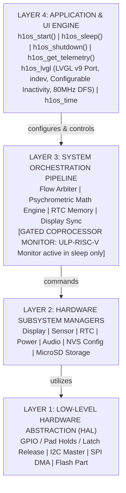

# Master Architecture Blueprint: H1OS Clean-Slate Architecture

- **Target Silicon:** ESP32-S3-PICO-1-N8R8 (Xtensa dual-core LX7 + ULP-RISC-V Coprocessor, 8MB Octal Flash, 8MB Octal PSRAM).
- **Target Hardware:** Waveshare ESP32-S3 ePaper 1.54" V2 (Non-Touch Monochrome Display; no touch controller present or supported by H1OS).
- **Operating System:** **H1OS** (E-Class Environmental Telemetry Instrument Operating System).
- **Framework:** ESP-IDF v6.1 (Ninja Build System, Driver V2 APIs, FreeRTOS SMP).
- **Architecture Philosophy:** Strict unidirectional dependency layering, zero circular inclusions, hardware determinism, reactive coprocessor monitors, and interactive user sessions with dynamic power droop.

---

## 1. High-Level 4-Layer Hierarchy

### Invariant Rules of Layer Separation
1. **Unidirectional Control:** Higher layers may `#include` and call lower layers. Lower layers **NEVER** include or call higher layers.
2. **No Hardware Subsystem Cross-Calls in Layer 2:** `sub_display` never talks to `sub_power`; `sub_sensor` never checks power states. Inter-subsystem coordination is strictly the responsibility of Layer 3 Orchestrator.
3. **Common Data Types Rooted at Base:** All shared enums, error types, coordinate structs, and math definitions live in `hal_types.h` at the HAL level.
4. **Bootloader Power Latching:** Power latching (`GPIO 17 BAT_CTRL = 1`) is asserted strictly in the 2nd-stage bootloader hook (`h1os_boot_hook`). Runtime HAL preserves sleep pad holds and exposes routines to **release** the latch during verified power-off.
5. **ULP Sleep-Gating Rule:** The ULP-RISC-V Coprocessor is active **only** while the system is in deep sleep. Once Flow B wakes, the dual-core Xtensa and LVGL take complete ownership of the hardware. The ULP is completely suppressed to prevent interference.

---

## 2. Layer Definitions & Component Breakdown

### Layer 1: Hardware Abstraction Layer (HAL)
Pure C, hardware adapters ("How the thing gets done"). No RTOS policies, no state machines, no math.
- **`hal_types.h`**: Fixed-width types, error codes, pinout constants, bitmasks.
- **`hal_io.c/.h`**: Pad holds, EPD rail switch (`EPD_3V3_EN` GPIO 6), audio rail (`PA_EN` GPIO 42), power latch release (`BAT_CTRL` GPIO 17), stateless button level reading (`hal_io_read_buttons`).
- **`hal_i2c.c/.h`**: Thread-safe, mutex-protected I2C bus driver (`ESP-IDF i2c_master`) on GPIO 47/48.
- **`hal_spi.c/.h`**: High-speed DMA SPI bus driver (20 MHz write, half-duplex 3-wire read).
- **`hal_flash.c/.h`**: Raw sector erase/read/write routines mapped to partition `epd_frame`.

### Layer 2: Hardware Subsystem Managers
Self-contained peripheral drivers ("Does the thing"). Expose clean APIs with state encapsulated locally.
- **`sub_display.cpp/.h`**: SSD1681 200x200 1-bit driver (non-touch), Ping-Pong buffer RAM management (`0x24`/`0x26`), partial waveform LUT, panel busy synchronization, Deep Sleep Mode 1 (`0x10, 0x01`).
- **`sub_sensor.c/.h`**: SHTC3 raw I2C polling (`Wake` $\rightarrow$ `Read` $\rightarrow$ `Sleep`) using normal power mode (`0x7866`) with CRC-8 for full ADC precision, internal MCU TSENS die driver. Pure physical reads.
- **`sub_rtc.c/.h`**: PCF85063A POSIX timekeeping, countdown timer, hardware alarms, interrupt clearing (`GPIO 5`), parasitic CLKOUT disabled (`COF=111`).
- **`sub_power.c/.h`**: Battery ADC curve fitting (12 dB attenuation across 200kΩ/200kΩ divider), 16-sample trimmed mean, Zero-Volt Cable Guard ($V_{\text{bat}} \approx 0\text{mV}$ while latch held $\rightarrow$ USB powered), deep sleep execution.
- **`sub_audio.c/.h`**: ES8311 software standby register sequence to prevent I2C ESD clamping, synthesized acoustic chime generator, and asynchronous PCM playback.
- **`sub_nvs.c/.h`**: Persistent key-value configuration storage for calibration offsets and user preferences.
- **`sub_sdcard.c/.h`**: Basic 1-bit SDMMC FATFS manager: initialization, de-initialization, basic file I/O, format, and capacity checking.

### Layer 3: System Pipeline & Orchestrator
The central intelligence of H1OS. Houses persistent RTC memory, flow arbitration, psychrometric math, and sleep coordination.
- **`orch_state.h/.c`**: Shared RTC Slow Memory structure (<512 bytes), boot/wake counters, flags, Tri-Node sliding ring buffer.
- **`orch_math.c/.h`**: E-Class psychrometrics: Magnus vapor pressure invariant ($e$), dew point reconstruction, continuous EWMA filtering, integer slope stability gating.
- **`orch_flow.c/.h`**: Single Unified Binary Execution Arbiter. Governs Flow A (Headless Sensor Sample Burst) vs Flow B (Interactive Session). Manages Thermal Lockout MUX. Executes coordinated 8-step sleep transition sequence.
- **`orch_display_sync.c/.h`**: Dirty framebuffer commit to `epd_frame` SPI flash partition during sleep transition.
- **`orch_wake_stub.c/.h`**: Fast RTC wake stub for headless Flow A sample bursts.
- **`ulp/main.c` (ULP-RISC-V Coprocessor Monitor)**: Purely reactive hardware monitor running in deep sleep. Wakes on timer (Flow A) or external interrupt (GPIO 5 alarm, GPIO 0/18 button tap/hold, GPIO 4 battery guard). Gated off during Flow B.

### Layer 4: Application Lifecycle API & Services
The public interface of H1OS exposed to developers.
- **`h1os.h`**: Master umbrella header declaring all public types and entry points.
- **`h1os_lifecycle.c`**: Declarative lifecycle engine: `h1os_start()`, `h1os_sleep()`, `h1os_shutdown()`, `h1os_get_telemetry()`, `h1os_is_session_active()`.
- **`h1os_lvgl.cpp/.h`**: LVGL v9 graphics port, keypad indev binding, 80 MHz DFS idle power droop.
- **`h1os_time.c/.h`**: POSIX clock bridge, timezone formatting, formatted date/time strings, and pluggable external SNTP sync callback.
- **`h1os_font_*.c`**: 1-bpp pre-rendered monochrome Montserrat bold fonts (`H1OS_FONT_14`, `H1OS_FONT_20`, `H1OS_FONT_32`).

---

## 3. Real-Time Execution Primitives

1. **Reactive Wake Architecture:**
   - ULP Coprocessor is purely reactive (never polls in loops).
   - If external RTC alarm fires on `GPIO 5`, ULP launches Flow B directly and suppresses the next Flow A run.
   - If user taps button, ULP launches Flow B.
   - If user holds BOOT $> 2.5\text{s}$, ULP primes and triggers ROM Bootloader jump.
   - If user holds POWER $> 2.5\text{s}$, ULP primes instant clean power-off.
2. **Flow B Execution Profiles & Sleep Timing:**
   - **User Tap Wake (Interactive Session):** Initiated by a user button tap on `GPIO 0` or `GPIO 18`. System activates the configurable inactivity session (`inactivity_timeout_sec`, default 30s) and displays the inverted awake badge. LVGL native `lv_indev` owns buttons. Between user interactions, DFS drops CPU to 80 MHz baseline. Any user click resets the inactivity timer. After the configured inactivity period elapses, system executes coordinated transition to deep sleep.
   - **External RTC Timer Wake (Unattended Refresh):** Initiated when PCF85063A countdown timer reaches zero on `GPIO 5`. The dual-core processor boots, renders the updated telemetry dashboard to the E-Paper panel, flushes the framebuffer, and **goes right back to sleep immediately** once the display update completes to preserve battery power.
   - **First / Cold Boot:** Initiated by initial battery insertion or power-on. System boots, executes hardware self-tests, renders initial screen, and waits the configured `inactivity_timeout_sec` for potential user interaction before entering initial deep sleep.
3. **Deterministic 8-Step Sleep Transition Sequence (`orch_flow_transition_to_sleep`):**
   1. Drain LVGL rendering and flush pipeline completely (`h1os_lvgl_has_pending_tasks()`).
   2. Wait for audio playback idle and hardware soft-mute zero-cross ramp (`sub_audio_wait_idle()`).
   3. Wait for physical EPD BUSY falling edge on `GPIO 8` (`sub_display_wait_busy()`).
   4. Post-busy microcapsule voltage settling guard ($250\text{ ms}$).
   5. Commit dirty framebuffer to raw SPI flash partition `epd_frame` if modified (`orch_display_sync_save_if_dirty()`).
   6. Command SSD1681 display controller into Deep Sleep Mode 1 (`sub_display_enter_deep_sleep()`).
   7. Arm external PCF85063A countdown timer (`sub_rtc_arm_countdown()`).
   8. Zero-Hour conflict avoidance & hardware deep sleep entry (`sub_power_enter_deep_sleep()`).
