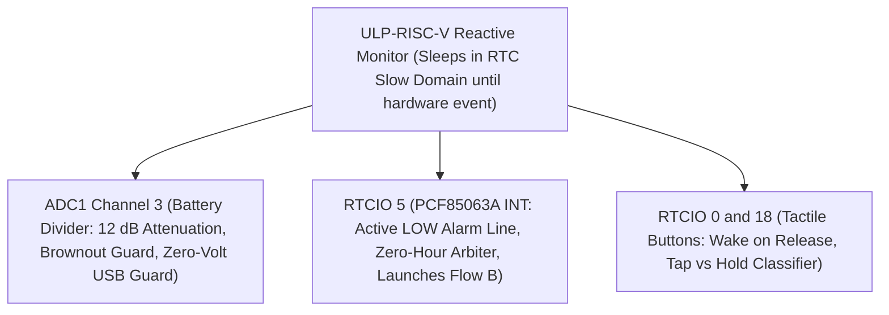

# Layer 3: ULP-RISC-V Coprocessor Hardware Monitor Specification

## 1. Overview
The ULP-RISC-V Coprocessor acts as the **Reactive Hardware Monitor** in the ESP32-S3 RTC domain. While the dual-core Xtensa LX7 processors are in deep sleep, the ULP coprocessor sleeps alongside them in RTC Slow Memory.

> **The Sleep-Gating Rule:** The ULP Coprocessor is gated strictly by the main application. It executes **only while the system is in deep sleep**. Once Flow B wakes, the dual-core Xtensa processor and LVGL take complete, exclusive control of the hardware. The ULP is completely idle and suppressed to ensure Flow B is never interrupted.

> **The Reactive Rule:** The ULP **never polls in loops**. It wakes ONLY on deterministic hardware conditions.
>
> > [!NOTE]
> > **Empirical Validation Completed (`examples/riscv_test`):**
> > Dedicated silicon testing demonstrated that the ESP32-S3 PMU sleep timer (`RTC_CNTL_ULP_CP_SLP_TIMER_EN`) and RTC GPIO wakeup (`RTC_CNTL_ULP_CP_GPIO_WAKEUP_ENA`) are **fully compatible and can be armed concurrently**. The historical trap `0x1000` was caused solely by missing `CONFIG_ULP_RISCV_INTERRUPT_ENABLE=y`. With interrupt vectors linked, both internal PMU timers and external RTC GPIO interrupts execute reliably without mutual exclusivity or trap conditions.

---


## 2. Core Responsibilities & Silicon Boundaries



---

## 3. Purely Reactive Wake Events
 
### 3.1 Condition 1: Internal Periodic Timer Expired
1. ULP wakes from its internal RTC timer (which was armed only because $T_{\text{rtc}} \ge (N_{\text{ulp}} \times T_{\text{sleep}}) + T_{\text{sleep}}$).
2. Sets `ULP_DISPATCH_SENSOR_SAMPLE` in `orch_persisted_state_t`.
3. Triggers `ulp_riscv_wakeup_main_processor()` to launch Core 0 into the Flow A Wake Stub.
4. Core 0 logs the SHTC3 reading, updates `ulp_cnt`, evaluates next-sleep lookahead, re-arms the timer if window remains clear, and returns to deep sleep.
 
### 3.2 Condition 2: External Hardware Interrupts (`EXTINT` / Edge)
 
#### A. PCF85063A Hardware Countdown Timer (`GPIO 5` Transition LOW)
- When the external PCF85063A countdown timer reaches zero, `GPIO 5` pulls LOW.
- **Why Hardware Countdown Timer, Not Calendar Alarm:**
  - The PCF85063A calendar alarm registers (`0x0B..0x0F`) match discrete seconds, minutes, and hours, but **fail on midnight boundary rollover**. An alarm set at 23:57 for a 5-minute wake (intended for 00:02) would fail or produce undefined behavior across the day boundary without complex software calendar arithmetic.
  - The PCF85063A **hardware countdown timer** (`Timer_val` `0x10`, `Timer_mode` `0x11`) decrements independent of time-of-day. It ticks at 1 Hz or 1/60 Hz directly to zero, asserting the Timer Flag (`TF` in Reg `0x01`) and pulling `GPIO 5` LOW reliably regardless of midnight transitions.
- **Simplified Zero-Hour Gating (Next-Sleep Lookahead):**
  - If the orchestrator determined that $T_{\text{rtc}} < (N_{\text{ulp}} \times T_{\text{sleep}}) + T_{\text{sleep}}$ (i.e., the next sleep accumulation would overshoot or straddle the external RTC timer expiration), the internal periodic timer was **never armed**.
  - The ULP sleeps until `GPIO 5` transitions LOW.
  - Upon catching the RTC timer interrupt, the ULP sets `ULP_DISPATCH_MAIN_WAKE` and wakes the dual-core Xtensa directly into Flow B (Interactive LVGL Session).
  - **Zero-Hour Conflict Solved:** Competing timers are eliminated. No race condition can occur when the next sub-interval crosses the countdown timer boundary.

#### B. Button Transitions (`GPIO 0` BOOT & `GPIO 18` POWER)
- **Glitch Rejection:** Noise pulses $< 30\text{ms}$ are discarded.
- **Wake on Release Rule (Clean LVGL Unit State):**
  - The ULP tracks the button state in RTC domain and **does NOT wake the main processor on initial press-down**.
  - It tracks hold duration and **wakes the processor strictly upon release (rising edge back to HIGH)** for short taps.
  - **Why Wake on Release:** This guarantees that when the dual-core Xtensa boots and LVGL initializes its keypad driver, the user's finger is **already lifted off the physical button**. The button line is clean, idle HIGH, eliminating spurious double-clicks, unwanted initial screen toggles, or bootloader timing races.
- **Short Tap Release ($50\text{ms} - 800\text{ms}$):**
  - Upon release, sets `ULP_DISPATCH_MAIN_WAKE` and wakes the CPU into Flow B (Interactive Session).
  - Main CPU and LVGL boot into an idle, clean input state ready for new user clicks.
- **Hold on BOOT ($> 2.5\text{s}$):**
  - Sets `ULP_DISPATCH_BOOTLOADER_JUMP` upon hold detection and wakes the CPU directly into the ROM Download Bootloader for safe reflashing.
- **Hold on POWER ($> 2.5\text{s}$):**
  - Sets `ULP_DISPATCH_POWER_OFF` upon hold detection and wakes the CPU to execute clean shutdown (flushing framebuffer and cutting the GPIO 17 latch).

#### C. Battery Guard & Zero-Volt Cable Guard (`GPIO 4` / ADC1_CH3)
- When awakened, the ULP reads battery voltage using factory eFuse linear coefficients:

$$
V_{\text{bat(mV)}} = \left(\frac{\text{raw} \times m_{\text{scale}}}{4096}\right) \times 2 + b_{\text{offset}}
$$

- **Brownout Threshold ($V_{\text{bat}} < 3.25\text{V}$):**
  - If $V_{\text{bat}} > 100\text{mV}$ and $< 3250\text{mV}$, sets `ULP_DISPATCH_CRITICAL_SHUTDOWN` to draw the emergency low-battery icon and cut the latch.
- **Zero-Volt Cable Guard ($V_{\text{bat}} \approx 0\text{mV}$):**
  - If the power latch is held HIGH and $V_{\text{bat}} < 100\text{mV}$, the instrument is running exclusively from USB cable VBUS without a LiPo cell. Shutdown is bypassed.

---

## 4. Shared RTC Memory Interface

The ULP program and the main application share a strict structure located at the base of `RTC_SLOW_MEM`:

```c
#pragma once
#include <stdint.h>
#include <stdbool.h>

typedef enum {
    ULP_DISPATCH_NONE = 0,
    ULP_DISPATCH_SENSOR_SAMPLE,     // Flow A Wake Stub (<4ms)
    ULP_DISPATCH_MAIN_WAKE,         // Flow B Interactive LVGL Session
    ULP_DISPATCH_BOOTLOADER_JUMP,   // ROM Bootloader Jump primed by BOOT hold
    ULP_DISPATCH_POWER_OFF,         // Clean Power-Off primed by POWER hold
    ULP_DISPATCH_CRITICAL_SHUTDOWN  // Battery brownout threshold (<3.25V)
} ulp_dispatch_reason_t;

/* Exported variables accessible by the main Xtensa core via ulp_<var> */
extern uint32_t ulp_wake_counter;
extern uint32_t ulp_dispatch_reason;
extern uint32_t ulp_cal_scale;
extern int32_t  ulp_cal_offset;
extern uint32_t ulp_last_vbat_mv;
extern uint32_t ulp_vbat_critical_mv;
extern uint32_t ulp_boot_btn_events;
extern uint32_t ulp_last_wake_btn; /* 0: None/RTC, 1: BOOT (GPIO 0), 2: POWER (GPIO 18) */
```

---

## 5. Silicon GPIO Wakeup Routing

On ESP32-S3, waking the coprocessor from deep sleep via IO edges requires routing through the RTC IO domain:

1. **RTC IO Interrupt Arming & Pad Holds:**
   ```c
   /* Configure RTC GPIO input lines for ULP reactive interrupt */
   gpio_wakeup_enable(HAL_PIN_BUTTON_BOOT, GPIO_INTR_LOW_LEVEL);
   gpio_wakeup_enable(HAL_PIN_BUTTON_POWER, GPIO_INTR_LOW_LEVEL);
   gpio_wakeup_enable(HAL_PIN_RTC_INT, GPIO_INTR_LOW_LEVEL);
   gpio_hold_en(HAL_PIN_BUTTON_BOOT);
   gpio_hold_en(HAL_PIN_BUTTON_POWER);
   gpio_hold_en(HAL_PIN_RTC_INT);

   /* Arm ULP coprocessor GPIO wakeup in RTC_CNTL alongside periodic sleep timer */
   SET_PERI_REG_MASK(RTC_CNTL_ULP_CP_TIMER_REG, RTC_CNTL_ULP_CP_GPIO_WAKEUP_ENA);
   ```

2. **Coprocessor vs. CPU Wake Separation:**
   - When a button transitions LOW or the PCF85063A pulls INT LOW, the hardware wakes the **ULP-RISC-V core**.
   - The dual-core Xtensa CPU **remains powered down** in deep sleep (`esp_sleep_enable_ext1_wakeup()` is NEVER invoked; only `esp_sleep_enable_ulp_wakeup()` is enabled).
   - The ULP RISC-V program executes `main()`, determines the wake cause, debounces button hold/release transitions, clears the hardware interrupt latch via `ulp_riscv_gpio_wakeup_clear()`, updates shared RTC slow memory, and only wakes the Xtensa CPU via `ulp_riscv_wakeup_main_processor()` if a valid user event or RTC expiration occurs.

