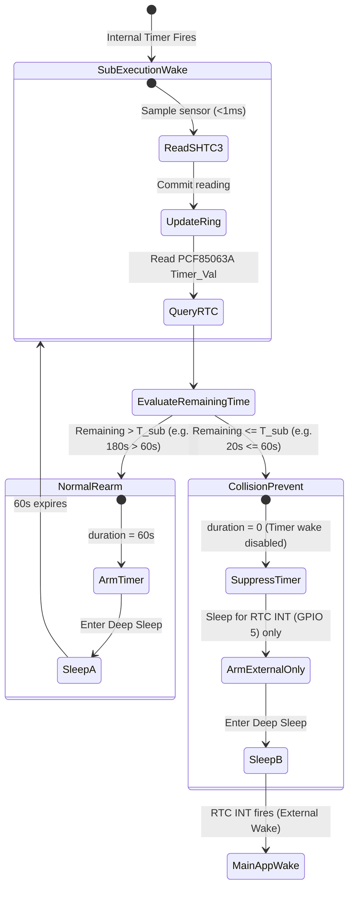

# Application Execution Flow & State Machine

This document models the end-to-end execution flow of the Clean-Slate ESP32-S3 BSP across cold boots, isolated background sub-execution (<10ms), and full application wakeups.

---

## 1. Master System Flowchart

```mermaid
flowchart TD
    %% Hardware Wake / Cold Reset
    Start([Hardware Reset / Cold Power / Deep Sleep Wake]) --> ROMBoot[ROM Bootloader]
    
    %% Branch Decision: Wake Stub vs Full Boot
    ROMBoot --> CheckStub{Wake Stub Registered<br/>AND<br/>Timer Wake & Armed?}
    
    %% FLOW A: Unified Binary RTC Wake Stub (<8ms)
    subgraph FlowA ["FLOW A: Single Binary RTC Wake Stub Sprint (<8ms)"]
        CheckStub -- "YES (Flow A Sensor Sprint)" --> StubExec[esp_wake_stub execution in IRAM/RTC<br/>• Core 1 is GATED OFF<br/>• Main Flash Cache is UNPOWERED<br/>• FreeRTOS is NOT Booted]
        StubExec --> StubI2C[Init I2C Master on GPIO 47/48<br/>Codec parked in Reg 0x0D]
        StubI2C --> StubRead[Read SHTC3 & TSENS Die ~1ms]
        StubRead --> StubMath[Compute Dew Point & Plateau Gate]
        StubMath --> StubCommit[Commit orch_tri_node_sample_t to RTC SRAM]
        StubCommit --> ZeroHourCheck{PCF85063A remaining time<br/>T_rem <= T_sub?}
        
        ZeroHourCheck -- "YES (Collision Imminent)" --> SuppressTimer[Suppress timer rearm<br/>Wait for external RTC INT]
        ZeroHourCheck -- "NO" --> RearmTimer[Rearm 60s timer wake]
        
        SuppressTimer --> ReSleep[esp_default_wake_stub_then_deep_sleep<br/>Total active on-time: 4-6ms]
        RearmTimer --> ReSleep
        ReSleep --> DeepSleepStandby[Hardware Deep Sleep Standby<br/>Current < 15 µA]
    end

    %% FLOW B: Full Application Bootloader -> FreeRTOS
    subgraph FlowB ["FLOW B: Full Dual-Core Application Lifecycle"]
        CheckStub -- "NO (Full Boot / Display Alarm / Button)" --> Bootloader2[2nd-Stage Bootloader<br/>ROM Early Pad Hold]
        Bootloader2 --> EarlyInit[hal_io_early_init<br/>1. Release pad holds<br/>2. Lock BAT_CTRL GPIO 17 HIGH]
        EarlyInit --> BootFreeRTOS[Initialize FreeRTOS SMP<br/>Bring Up Core 0 + Core 1 Dual-Core]
        BootFreeRTOS --> DisarmSub[Clear sub-exec active flag in RTC memory]
        
        DisarmSub --> RestoreFrame{ORCH_FLAG_EPD_FRAME_VALID<br/>set in RTC memory?}
        RestoreFrame -- YES --> FlashLoad[hal_flash_read 'epd_frame'<br/>Load 5000B into Display 0x26 Old RAM]
        RestoreFrame -- NO --> ClearFrame[Initialize Framebuffers to 0xFF White]

        FlashLoad --> InitSubsystems[Initialize Full Hardware Profile<br/>SPI, Display, Audio, Power ADC]
        ClearFrame --> InitSubsystems

        InitSubsystems --> DispatchLifecycle{Reset Reason == DEEPSLEEP?}
        DispatchLifecycle -- YES --> CallWake[Dispatch on_wake ctx, user_data]
        DispatchLifecycle -- NO --> CallBoot[Dispatch on_boot user_data]

        CallWake --> AppWork[Application Active Execution<br/>Read Telemetry / Render LVGL UI]
        CallBoot --> AppWork
    end

    %% Stand-Down / Sleep Flow
    subgraph StandDown ["Stand-Down Execution Sequence"]
        AppWork --> CallSleep[bsp_app_sleep duration_sec]
        CallSleep --> PreSleepHook[1. Invoke user on_pre_sleep hook]
        PreSleepHook --> SleepSplash[2. Trigger visual sleep splash UI]
        SleepSplash --> SleepChime[3. Play acoustic sleep chime]
        SleepChime --> PanelWait[4. Wait for E-Paper panel busy release]
        PanelWait --> CheckDirty{Frame Marked Dirty<br/>s_dirty == true?}
        
        CheckDirty -- YES --> FlashSync[hal_flash_write<br/>Sync 5000B to 'epd_frame' partition<br/>Set ORCH_FLAG_EPD_FRAME_VALID]
        CheckDirty -- NO --> SkipSync[Skip Flash Write<br/>Save SPI Flash endurance]

        FlashSync --> ArmRTC[5. Arm PCF85063A countdown timer]
        SkipSync --> ArmRTC

        ArmRTC --> ArmSubExec[6. Arm sub-exec timer in RTC memory<br/>if enabled in config]
        ArmSubExec --> IsolatePeripherals[7. Deinit subsystems & isolate pins]
        IsolatePeripherals --> EnterDeepSleep[8. Enter hardware deep sleep]
        EnterDeepSleep --> SleepState
    end

    %% Wake Loop
    SleepState --> Start
```

---

## 2. Zero-Hour Conflict Avoidance State Machine

The Zero-Hour logic eliminates the edge case where an internal sub-execution timer wake collides with an external RTC alarm:

---

## 3. Subsystem Lifecycle & FreeRTOS Resource Mapping

| Resource / Subsystem | Flow A (Sub-Execution) | Flow B (Main App) | Deep Sleep Standby |
| :--- | :--- | :--- | :--- |
| **CPU Clock** | 80 MHz / 160 MHz (Low-power) | 240 MHz (Performance) | Power gated (OFF) |
| **FreeRTOS Scheduler**| Single task, exits to sleep | Multitasking SMP | Suspended |
| **I2C Bus** | Init -> Read -> Deinit (<3ms) | Continuous / Polled | High-impedance (Pull-ups held) |
| **SPI DMA Bus** | Powered OFF / Uninitialized | 20 MHz DMA active | Pins held (CS=1, RST=1) |
| **E-Paper 3.3V Rail** | Kept ON (Pad hold GPIO 6) | Kept ON (Active) | Kept ON (Pad hold GPIO 6) |
| **BAT_CTRL (GPIO 17)**| Locked HIGH (RTC hold) | Locked HIGH (RTC hold) | Locked HIGH (RTC hold) |
| **Flash Access** | Zero operations | Read on boot; Write on sleep| Power down / Inactive |
| **Quiescent Current** | ~18 mA (for 7 ms) | ~45-80 mA | **< 15 µA** |
