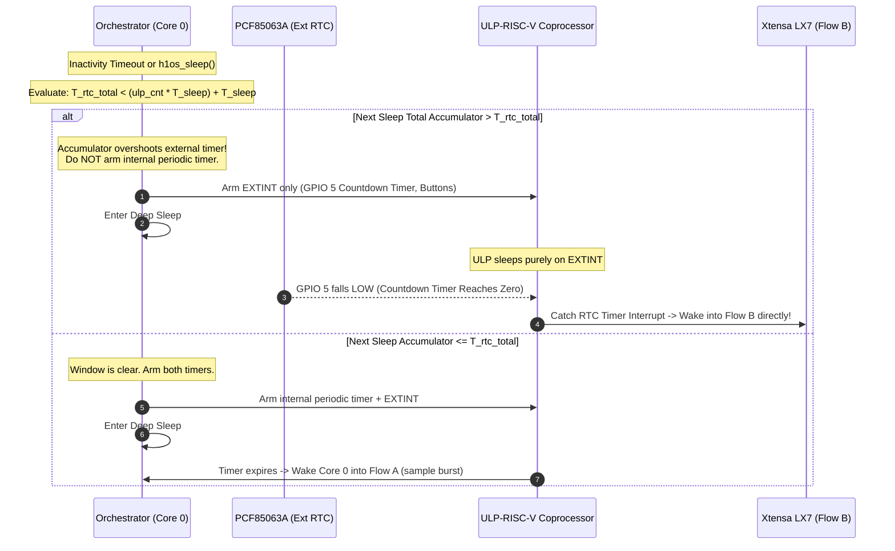

# Application Execution Flow & State Machine

This document models the end-to-end execution flow of **H1OS** across deep sleep, the reactive ULP Monitor, isolated Flow A sensor pulses, and the Flow B interactive user session (with a developer-configurable inactivity timeout defaulting to 30 seconds).

---

## 1. Master System Flowchart

```mermaid
flowchart TD
    %% Deep Sleep Resting State
    DeepSleep[Hardware Deep Sleep Standby] --> ULP_Wake{ULP Hardware Event}

    %% ULP Reactive Monitor Decisions
    subgraph ULP_Monitor ["ULP-RISC-V Reactive Monitor (RTC Domain)"]
        ULP_Wake -- "Internal Timer Expired (Armed only if RTC_rem >= ULP_int)" --> LaunchFlowA[Set DISPATCH_SENSOR_SAMPLE<br/>Wake Core 0 into Flow A]

        ULP_Wake -- "External Interrupt (GPIO 5 Timer)" --> LaunchFlowB_Alarm[Set DISPATCH_MAIN_WAKE<br/>Wake Dual-Core into Flow B]
        ULP_Wake -- "Button Edge (GPIO 0 / 18)" --> CheckHold{Hold Duration}
        CheckHold -- "Short Tap RELEASE (Clean Line)" --> LaunchFlowB_Tap[Set DISPATCH_MAIN_WAKE<br/>Wake Dual-Core into Flow B]
        CheckHold -- "BOOT Held > 2.5s" --> LaunchBL[Set DISPATCH_BOOTLOADER_JUMP<br/>Wake into ROM Bootloader]
        CheckHold -- "POWER Held > 2.5s" --> LaunchPowerOff[Set DISPATCH_POWER_OFF<br/>Wake to execute Power Cut]

        ULP_Wake -- "Battery Guard (GPIO 4)" --> CheckVbat{Vbat < 3.25V?}
        CheckVbat -- "YES (and > 100mV)" --> LaunchCritical[Set DISPATCH_CRITICAL_SHUTDOWN<br/>Emergency Low-Battery Shutdown]
        CheckVbat -- "Vbat == 0mV (USB Cable)" --> KeepSleeping[Bypass Shutdown<br/>Return to Sleep]
    end

    %% FLOW A: Unified Binary RTC Wake Stub
    subgraph FlowA ["FLOW A: Headless Sensor Pulse"]
        LaunchFlowA --> StubExec[esp_wake_stub on Core 0 @ 80MHz<br/>• Core 1 GATED OFF<br/>• Flash Cache UNPOWERED<br/>• FreeRTOS NOT Booted]
        StubExec --> StubI2C[Read SHTC3 Normal Mode & MCU Die TSENS]
        StubI2C --> StubMath[Compute Dew Point, Vapor Pressure & EWMA]
        StubMath --> StubCommit[Append to 32-slot Ring in RTC Slow Memory]
        StubCommit --> StubRearm[Re-arm Periodic RTC Timer]
        StubRearm --> StubSleep[Return immediately to Deep Sleep]
    end
    StubSleep --> DeepSleep

    %% FLOW B: Full Dual-Core Application (LVGL v9)
    subgraph FlowB ["FLOW B: Dual-Core Screen Refresh & Interaction"]
        LaunchFlowB_Alarm --> Bootloader2[2nd-Stage Bootloader<br/>h1os_boot_hook: Latch BAT_CTRL HIGH]
        LaunchFlowB_Tap --> Bootloader2
        ColdBoot[First Power On / Cold Boot] --> Bootloader2

        Bootloader2 --> BootFreeRTOS[Initialize FreeRTOS SMP Dual-Core LX7]
        BootFreeRTOS --> TurboRender[240 MHz Turbo PM Lock<br/>Read Telemetry & Blit LVGL Screen to EPD]
        
        TurboRender --> WakeSource{Wake Source?}
        WakeSource -- "RTC Countdown Timer (Unattended)" --> SleepStart
        WakeSource -- "User Tap or Cold Boot" --> LVGL_Active[Interactive Session (Configurable Timeout)<br/>LVGL Takes Hold of Display & Buttons]
        
        LVGL_Active --> UserClick{User Button Click?}
        UserClick -- "BOOT Click" --> ScreenToggle[Toggle Screen 1 Env <-> Screen 2 Health<br/>Reset Inactivity Timer]
        ScreenToggle --> LVGL_Active

        UserClick -- "No Interaction (Idle)" --> DFSDrop[Dynamic Frequency Scaling:<br/>Drop CPU to 80 MHz Baseline]
        DFSDrop --> InactivityTimer{Inactivity Timer Expired?}
        InactivityTimer -- "NO" --> UserClick
        InactivityTimer -- "YES" --> SleepStart[Initiate Sleep Transition]
    end

    %% Coordinated Sleep Transition Sequence
    subgraph Sleep_Transition_Seq ["Coordinated Sleep Transition Sequence"]
        SleepStart --> PreSleepHook["1. Invoke user on_pre_sleep hook"]
        PreSleepHook --> DrainLVGL["2. Drain LVGL Buffer & Finish Draw Tasks"]
        DrainLVGL --> WaitBusy["3. Wait for SSD1681 BUSY release @ 80 MHz DFS"]
        WaitBusy --> SettleDelay["4. 250ms Micro-capsule Settling Delay"]
        SettleDelay --> CheckDirty{Frame Marked Dirty?}
        CheckDirty -- "YES" --> FlashSync["5. Commit 5000B to epd_frame flash"]
        CheckDirty -- "NO" --> SkipSync["5. Skip Flash Write"]
        FlashSync --> PanelSleep["6. Put SSD1681 into Deep Sleep Mode 1"]
        SkipSync --> PanelSleep
        PanelSleep --> ClearTF["7. Clear PCF85063A TF Flag in Control_2"]
        ClearTF --> GateCheck{"8. Zero-Hour Lookahead:<br/>T_rtc_total < (ulp_cnt * T_sleep) + T_sleep?"}
        GateCheck -- "YES (Accumulator Overshoot)" --> ArmExtOnly["Arm ONLY GPIO 5 RTC_INT & Buttons<br/>Do NOT arm internal periodic timer"]
        GateCheck -- "NO (Safe Window)" --> ArmAll["Arm internal periodic timer + EXTINT"]
        ArmExtOnly --> EnterSleep["9. Enter Hardware Deep Sleep"]
        ArmAll --> EnterSleep
    end
    EnterSleep --> DeepSleep

    %% Direct Actions
    LaunchBL --> ROM_Bootloader[ROM Download Bootloader Mode]
    LaunchPowerOff --> CutLatch[Flush Frame & Release GPIO 17 Latch]
    LaunchCritical --> EmergencySplash[Draw Low Battery Icon & Cut Latch]
```

---

## 2. Zero-Hour Conflict Elimination Sequence


