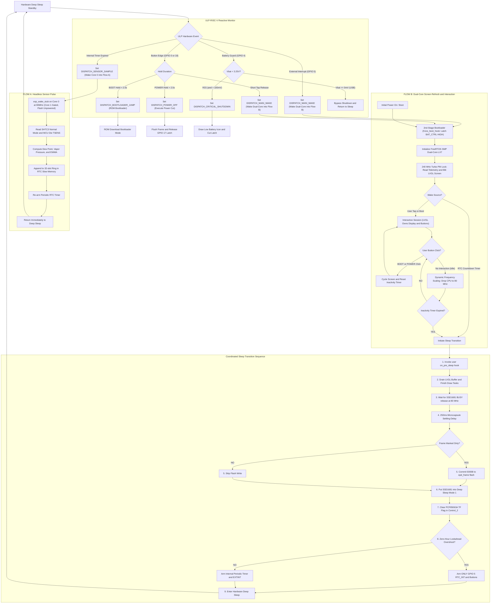
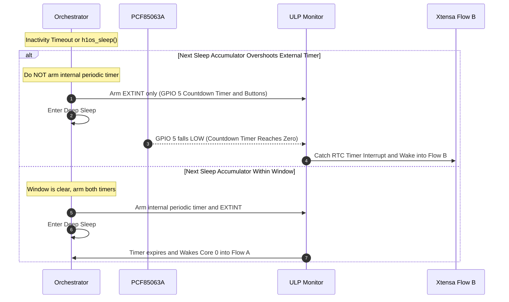

# Application Execution Flow & State Machine

This document models the end-to-end execution flow of **H1OS** across deep sleep, the reactive ULP Monitor, isolated Flow A sensor pulses, and the Flow B interactive user session (with a developer-configurable inactivity timeout defaulting to 30 seconds).

---

## 1. Master System Flowchart

---

## 2. Zero-Hour Conflict Elimination Sequence

---

## 3. Human-Machine Interaction & Power Policies

### 3.1 Two-Stage Click Interaction
To prevent unintended audio chirps and spurious screen skipping while deep sleeping:
1. **First Click in Deep Sleep (Wake Interaction):**
   - Intercepted by the ULP-RISC-V coprocessor in RTC domain.
   - ULP debounces the release, records `ulp_last_wake_btn`, and wakes the main processor into Flow B.
   - Flow B boots, detects the user button wake, initializes LVGL, and renders the screen with the **inverted awake badge**.
   - **No page advance or audio tick occurs on the wake click**, guaranteeing that waking the screen does not skip the user's current view.
2. **Second Click in Flow B (Active Navigation):**
   - The user is now looking at the awakened UI.
   - The second click is received directly by the running LVGL keypad driver (`keypad_event_cb`).
   - LVGL dispatches the page switch, plays the tactile 15ms audio tick, and resets the 30-second inactivity session timer.

### 3.2 Audio Codec Standby Gating (<1 µA Invariant)
- **Unattended Wakes (RTC Countdown Timer):**
  - Environmental display refresh wakes bypass the ES8311 codec and NS4168 amplifier initialization entirely.
  - The codec remains in hardware standby / power-down state (<1 µA).
  - This eliminates parasitic heat injection into the enclosure and maximizes battery longevity.
- **User Wakes (Cold Boot or Tactile Button):**
  - Audio subsystem initializes only when `is_user_wake` is true.
  - Initial volume is set strictly from `presentation.volume_pct` (defaulting to 0% / muted if unconfigured).

### 3.3 Strict Lifecycle Contract Validation
- Silent fallback magic numbers (`300s`, `120s`, `30s`) have been removed from `h1os_lifecycle.c`.
- If an unconfigured duration or timeout of `0` is passed to `h1os_sleep()`, `inactivity_timeout_sec`, or `flow_b_period_sec`, the system logs an explicit `ESP_LOGE` error detailing the contract violation and triggers clean shutdown rather than silently injecting synthetic delays.

