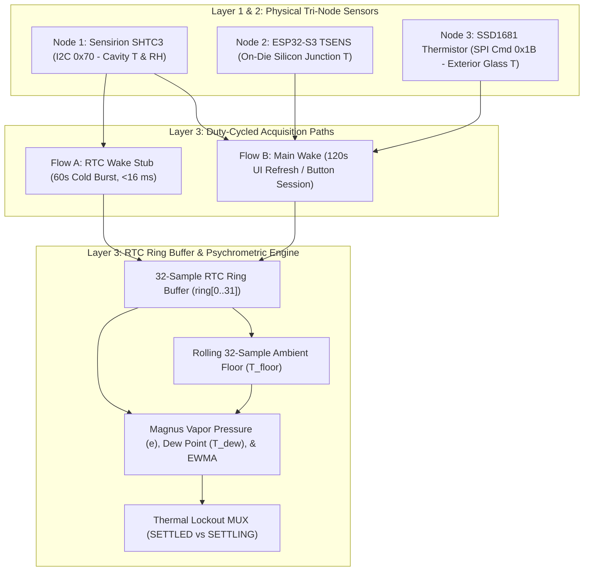
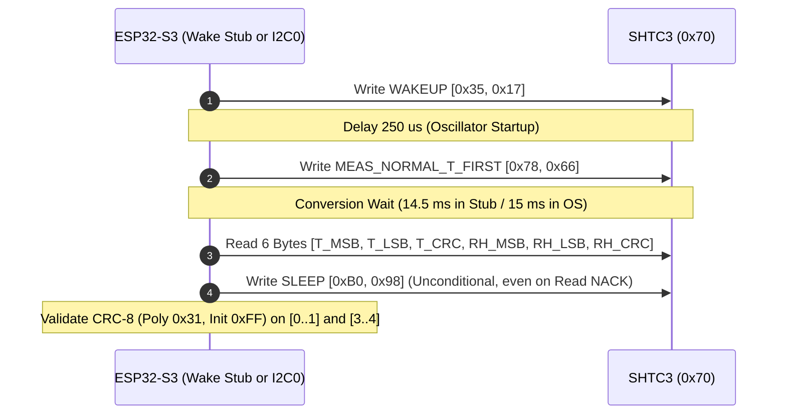
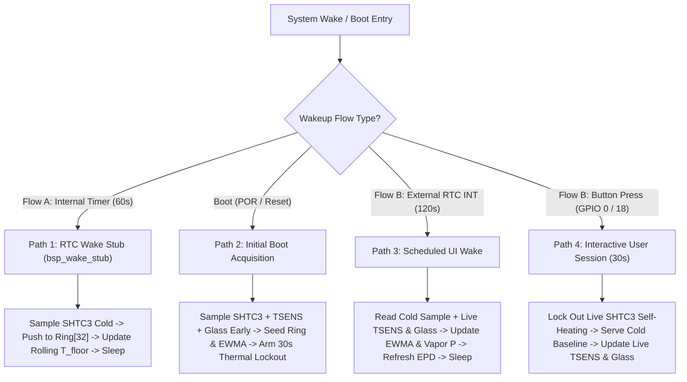

# Tri-Node Temperature & Psychrometric Sensor Operation Specification

## 1. Overview & Tri-Node Sensor Topology

The Waveshare ESP32-S3-ePaper-1.54 V2 houses its environmental sensor inside a compact enclosure shared with the ESP32-S3 SoC, the SSD1681 E-Paper charge pump, the ES8311/NS4168 audio subsystem, and the LiPo battery management circuitry. Whenever the MCU, display charge pump, or audio amplifier are active, waste heat conducts through the shared PCB copper planes toward the sensor cavity.

To separate **true room ambient conditions** from **parasitic enclosure self-heating**, H1OS implements a **Tri-Node Thermal Architecture** coupled with **Duty-Cycled Cold Sampling (Flow A)** and **Psychrometric Invariant Reconstruction**.

### 1.1 Physical Sensor Nodes

| Node | Hardware Device | Bus / Interface | Resolution & Range | Primary Role in H1OS |
| :--- | :--- | :--- | :--- | :--- |
| **Node 1 (Primary Cavity)** | Sensirion **SHTC3** | Shared Master I2C (`I2C_NUM_0`, `0x70`) on `GPIO 47` (SDA) / `GPIO 48` (SCL) | 16-bit ($0.01^\circ\text{C}$, $0.01\%\text{ RH}$); $-40^\circ\text{C}$ to $+125^\circ\text{C}$ | Measures raw cavity temperature ($T_{\text{meas}}$) and relative humidity ($RH_{\text{meas}}$) to compute invariant water vapor pressure ($e$). |
| **Node 2 (Heat Source)** | **ESP32-S3 Internal TSENS** | On-die SAR ADC band-gap peripheral (`esp_driver_tsens`) | $\pm 1.0^\circ\text{C}$; configured for $-10^\circ\text{C}$ to $+50^\circ\text{C}$ | Measures silicon junction temperature ($T_{\text{mcu}}$) to quantify internal thermal injection ($\Delta T_{\text{die}} = T_{\text{mcu}} - T_{\text{amb}}$). |
| **Node 3 (Outer Boundary)** | **SSD1681 Glass Thermistor** | SPI2 Command `0x1B` (`HAL_PIN_EPD_MISO` / `MOSI`) | 9-bit signed ($0.5^\circ\text{C}$ step); $-40^\circ\text{C}$ to $+85^\circ\text{C}$ | Measures exterior E-Paper glass substrate temperature ($T_{\text{glass}}$), thermally decoupled from the main PCB ground plane. |

---

## 2. SHTC3 Hardware Setup, Command Protocol, & Timing Specification

### 2.1 Electrical & Pad Configuration
1. **Power Supply Rail (`GPIO 6` / `EPD_3V3_EN`):**
   - Active-LOW PMOS load switch (`0 = ON`, `1 = OFF`).
   - Must remain latched LOW (`gpio_hold_en(HAL_PIN_EPD_3V3_EN)`) across deep sleep so the SHTC3 and SSD1681 retain power while drawing only quiescent sleep current ($\sim 0.5\ \mu\text{A}$ for SHTC3 in sleep mode).
2. **I2C Bus Pull-Ups & Pin Multiplexing (`GPIO 47` SDA, `GPIO 48` SCL):**
   - External $4.7\text{ k}\Omega$ pull-up resistors to switched `3V3` rail.
   - **In Full OS (Flow B / Boot):** Driven by hardware `I2C_NUM_0` master controller at `400 kHz` (`hal_i2c.c`).
   - **In RTC Wake Stub (Flow A):** Because `VDD3P3_CPU` powers up fresh out of `DEEPSLEEP_RESET` without running `hal_i2c_init()`, `bsp_wake_stub()` must explicitly route `IO_MUX_GPIO47_REG` and `IO_MUX_GPIO48_REG` to `PIN_FUNC_GPIO` (`1`) with `PIN_INPUT_ENABLE` (`FUN_IE`) and `PIN_PULLUP_EN` (`FUN_PU`) enabled before executing open-drain bit-banged I2C (~100 kHz, $5\ \mu\text{s}$ quarter-period delay).

### 2.2 SHTC3 Command Set & Timing Table

All SHTC3 commands are 16-bit big-endian words (`[MSB, LSB]`):

| Command | Hex Code | Wire Bytes | Required Delay | Specification Notes |
| :--- | :--- | :--- | :--- | :--- |
| **WAKEUP** | `0x3517` | `0x35, 0x17` | **$\ge 240\ \mu\text{s}$** (use `250 µs`) | Transitions SHTC3 from Sleep ($0.5\ \mu\text{A}$) to Idle. Sensor NACKs measurement commands if issued before $240\ \mu\text{s}$. |
| **MEAS_NORMAL_T_FIRST** | `0x7866` | `0x78, 0x66` | **$14.5\text{ ms}$ – $15.0\text{ ms}$** | **Mandatory H1OS Measurement Mode:** Normal Power Mode (full 16-bit ADC repeatability), Temperature first, Clock Stretching Disabled. (Datasheet: $10.8\text{ ms}$ typ, $12.1\text{ ms}$ max at $25^\circ\text{C}$; $14.5\text{ ms}$ provides full margin over temperature). |
| **SLEEP** | `0xB098` | `0xB0, 0x98` | **$0\ \mu\text{s}$** (Immediate) | Returns SHTC3 to ultralow-power sleep. **Must be issued unconditionally after every measurement or error.** |
| **SOFT_RESET** | `0x805D` | `0x80, 0x5D` | **$\ge 240\ \mu\text{s}$** | Resets internal sensor state machine if bus recovery is required. |
| **READ_ID** | `0xEFC8` | `0xEF, 0xC8` | **$0\ \mu\text{s}$** | Returns `[ID_MSB, ID_LSB, CRC8]` where `(ID & 0x083F) == 0x0807`. |

> [!IMPORTANT]
> **Why Normal Mode (`0x7866`) Is Mandatory:** Low-Power Mode (`0x609C`) reduces internal ADC oversampling, increasing RMS noise from $\pm 0.04^\circ\text{C}$ to $\pm 0.2^\circ\text{C}$. Because dew point and relative humidity reconstruction exponentiate temperature via the Magnus formula, a $0.2^\circ\text{C}$ temperature step introduces up to $\pm 1.5\%\text{ RH}$ artificial jump. Normal Mode (`0x7866`) eliminates this quantization noise while adding only $\sim 12\text{ ms}$ of wait time.

### 2.3 Deterministic 6-Step Readout Sequence

Every SHTC3 acquisition (both in `bsp_wake_stub()` and `sub_sensor_read_shtc3_raw()`) must follow this exact sequence:

**Unconditional Sleep Invariant:** If step 2 (`0x7866` write) or step 3 (`0x70 | 1` read address header) fails with an I2C NACK, the driver **must still transmit `0xB098` (SLEEP)** before returning an error or rebooting. Leaving the SHTC3 in idle mode draws $\sim 45\ \mu\text{A}$ continuously and self-heats the sensor die.

---

## 3. When & How Sensors Are Sampled Across System Lifecycles

To prevent active CPU, SPI, SDMMC, audio, and E-Paper currents from biasing temperature measurements, sensor acquisition is governed by the system wakeup state:

### 3.1 Mode 1: Initial Boot (`ORCH_FLOW_BOOT`)
- **When:** Power-on reset (`ESP_RST_POWERON`) or software restart when `s_persisted_state.magic != ORCH_RTC_MAGIC`.
- **How:**
  1. Immediately after `hal_io_early_init()` and `hal_i2c_init()` — **before** playing the boot audio chime, mounting the MicroSD card, or driving the 2.1-second full OTP E-Paper refresh — perform a cold SHTC3 read (`sub_sensor_read_shtc3_raw(&raw_t, &raw_rh, false)`) and MCU die temperature read (`sub_sensor_read_mcu_die_temp()`).
  2. After `sub_display_init()`, read the SSD1681 glass thermistor (`sub_display_read_glass_temp()`).
  3. Push this initial `orch_tri_node_sample_t` into `ring[0]` (`total_samples = 1`).
  4. Initialize `amb_floor_temp_centi_c = sample.shtc3_temp_centi_c` and seed all EWMA state fields (`reconstructed_amb_temp_c`, `reconstructed_amb_rh_pct`, `reconstructed_dew_point_c`, `vapor_pressure_hpa`, `ewma_inited = true`).
  5. **Arm Thermal Lockout (`orch_flow_set_thermal_lockout(true, session.inactivity_timeout_sec)`)** so that while the user clicks through screens during the 30-second boot session, heat from the boot chime and full E-Paper refresh does not corrupt the displayed ambient temperature.

### 3.2 Mode 2: Flow A — Headless RTC Wake Stub (`bsp_wake_stub`, Every `60s`)
- **When:** Internal RTC timer expiry (`cause == TIMER_EXPIRE`, `0x08`) while the system is in deep sleep.
- **How:**
  1. Verify `RTC_GPIO 5` (`HAL_PIN_RTC_INT`) is HIGH (`1`). If LOW (`0`), promote immediately to Flow B (`esp_default_wake_deep_sleep()`).
  2. Bit-bang SHTC3 wakeup (`0x3517`), wait `250 µs`, trigger Normal Mode (`0x7866`), wait `14,500 µs`, read 6 bytes, send sleep (`0xB098`), and verify both CRC-8 bytes.
  3. Convert raw ticks to integer centi-units (`temp_centi_c`, `rh_centi_pct`).
  4. Populate `orch_tri_node_sample_t`:
     - `.shtc3_temp_centi_c = temp_centi_c`
     - `.shtc3_rh_centi_pct = rh_centi_pct`
     - `.mcu_tsens_centi_c = INT16_MIN` (sentinel indicating TSENS was powered down in wake stub)
     - `.epd_glass_centi_c = INT16_MIN` (sentinel indicating SPI EPD glass sensor was asleep in wake stub)
     - `.quality_flags = 0x03` (Bit 0: Cold sample, Bit 1: Thermally settled)
  5. Push sample into `st->ring[st->ring_head]` and recompute `st->amb_floor_temp_centi_c` as the **minimum `shtc3_temp_centi_c` across the active ring buffer** (up to 32 samples).
  6. Read PCF85063A countdown registers (`0x10`, `0x11`). Rearm internal timer only if `sample_interval_sec < rem_sec`; otherwise disable `TIMER_EXPIRE` in `RTC_CNTL_WAKEUP_STATE_REG` and sleep until `GPIO 5` triggers Flow B.

### 3.3 Mode 3: Flow B — Scheduled Periodic RTC Wake (`is_rtc_wake == true`, Every `120s`)
- **When:** PCF85063A hardware countdown reaches `0` and pulls `GPIO 5` (`RTC_INT`) LOW. The device has been in deep sleep for the preceding `60s` since Flow A, so the PCB is thermally settled.
- **How:**
  1. Perform a fresh SHTC3 Normal Mode read (`sub_sensor_read_shtc3_raw`), read live `MCU Die` (`sub_sensor_read_mcu_die_temp`), and read live `EPD Glass` (`sub_display_read_glass_temp`).
  2. Push the complete 3-node `orch_tri_node_sample_t` (with real `shtc3`, `mcu_tsens`, and `epd_glass` values) to `st->ring[]`.
  3. Update the rolling 32-sample `amb_floor_temp_centi_c` and advance the EWMA filter (`alpha = 0.30`).
  4. Render the active LVGL screen (`380 ms` partial refresh or every-15th full refresh) and immediately execute the 8-step sleep transition sequence.

### 3.4 Mode 4: Flow B — Interactive User Button Session (`is_rtc_wake == false`, `30s` Window)
- **When:** User presses `BOOT` (`GPIO 0`) or `POWER` (`GPIO 18`) to wake the unit or navigate between screens (`1/4` $\leftrightarrow$ `4/4`).
- **How:**
  1. **First Render on Button Wake:** If the system woke from deep sleep (and was not recently in an active session within the last `60s`), capture one initial cold Tri-Node reading, update the ring buffer and EWMA state, and **immediately arm Thermal Lockout** for the session duration (`orch_flow_set_thermal_lockout(true, timeout_sec)`).
  2. **Subsequent Page Switches During Active Session:** Every button press resets the `30s` session timer and re-arms Thermal Lockout. While locked out:
     - `orch_flow_query_telemetry()` **does not overwrite ambient temperature or humidity with warm live SHTC3 reads**; it returns the locked-in cold EWMA values (`reconstructed_amb_temp_c`, `reconstructed_amb_rh_pct`, `reconstructed_dew_point_c`).
     - `h1os_get_telemetry()` **still performs live reads of `MCU Die` (`TSENS`) and `EPD Glass` (`0x1B`)** so Page 2 (`EPD Glass`) and Page 3 (`MCU Die` and `Thermal ΔT`) reflect real-time hardware diagnostics as the CPU warms up.

---

## 4. Complete Mathematical Pipeline & Equations

### 4.1 Stage 1: Raw ADC Tick to Physical Unit Conversion

Given the 16-bit unsigned raw sensor words $S_T \in [0, 65535]$ and $S_{RH} \in [0, 65535]$ verified by CRC-8:

- **Fixed-Point Centi-Units (Used in RTC Wake Stub & Ring Buffer Storage):**

$$
T_{\text{centi}} = -4500 + \left\lfloor \frac{17500 \times S_T}{65535} \right\rfloor \quad [0.01^\circ\text{C}]
$$

$$
RH_{\text{centi}} = \left\lfloor \frac{10000 \times S_{RH}}{65535} \right\rfloor \quad [0.01\%]
$$

- **Floating-Point Physical Units (Used in Layer 3 Math Engine):**

$$
T_{\text{meas}} = -45.0 + 175.0 \times \left(\frac{S_T}{65535.0}\right) \quad [^\circ\text{C}]
$$

$$
T_{\text{meas(F)}} = \left(T_{\text{meas}} \times \frac{9.0}{5.0}\right) + 32.0 \quad [^\circ\text{F}]
$$

$$
RH_{\text{meas}} = \text{clamp}\left(100.0 \times \left(\frac{S_{RH}}{65535.0}\right),\; 0.0,\; 100.0\right) \quad [\%]
$$

### 4.2 Stage 2: Rolling 32-Sample Ambient Floor ($T_{\text{floor}}$)

The ambient floor $T_{\text{floor}}$ represents the baseline minimum temperature over the active 32-sample ring buffer window ($N = \min(\text{total\_samples},\; 32)$, spanning roughly $32$ to $64$ minutes of history):

$$
T_{\text{floor(centi)}} = \min_{k \in [0, N-1]} \Big(\text{ring}[k].\text{shtc3\_temp\_centi\_c}\Big)
$$

$$
T_{\text{floor}} = \frac{T_{\text{floor(centi)}}}{100.0} \quad [^\circ\text{C}]
$$

> [!CAUTION]
> **Anti-Ratchet Rule:** $T_{\text{floor}}$ **must never** be implemented as an unbounded all-time minimum (`if (T < T_floor) T_floor = T`). An unbounded minimum latches onto the coldest overnight temperature and never rises when the room warms up during the day. Computing $T_{\text{floor}}$ across the circular 32-sample ring buffer allows the floor to naturally track upward and downward diurnal room temperature cycles while rejecting short-term thermal spikes.

### 4.3 Stage 3: Psychrometric Invariants (Magnus-Tetens Equations)

Water vapor partial pressure $e$ inside the vented sensor cavity depends only on the absolute moisture concentration, making it invariant to localized PCB self-heating:

1. **Saturation Vapor Pressure at Measured Cavity Temperature ($e_s(T_{\text{meas}})$):**

$$
e_s(T) = 6.112 \cdot \exp\left(\frac{17.625 \cdot T}{243.04 + T}\right) \quad [\text{hPa}]
$$

2. **Actual Water Vapor Pressure ($e$):**

$$
e = \left(\frac{RH_{\text{meas}}}{100.0}\right) \cdot e_s(T_{\text{meas}}) \quad [\text{hPa}]
$$

3. **True Dew Point ($T_{\text{dew}}$):**

$$
\gamma(T, RH) = \ln\left(\frac{RH}{100.0}\right) + \frac{17.625 \cdot T}{243.04 + T}
$$

$$
T_{\text{dew}} = \frac{243.04 \cdot \gamma(T_{\text{meas}}, RH_{\text{meas}})}{17.625 - \gamma(T_{\text{meas}}, RH_{\text{meas}})} \quad [^\circ\text{C}]
$$

4. **Absolute Humidity / Vapor Density ($d_v$):**

$$
d_v = 216.7 \times \frac{e}{273.15 + T_{\text{amb}}} \quad [\text{g/m}^3]
$$

5. **Thermal-Compensated Relative Humidity Reconstruction ($RH_{\text{recon}}$):**
   - When the system is **thermally settled** (cold sample after deep sleep), the unheated cavity temperature is the true ambient temperature ($T_{\text{ref}} = T_{\text{meas}}$), so $RH_{\text{recon}} = RH_{\text{meas}}$.
   - When compensating for **active self-heating** ($T_{\text{meas}} > T_{\text{floor}} + 0.5^\circ\text{C}$ during an interactive session), relative humidity is reconstructed against the unheated baseline $T_{\text{floor}}$:

$$
RH_{\text{recon}} = \text{clamp}\left(100.0 \times \frac{e}{e_s(T_{\text{floor}})},\; 0.0,\; 100.0\right) \quad [\%]
$$

### 4.4 Stage 4: Exponentially Weighted Moving Average (EWMA) Filter

Each cold sample updates the persistent EWMA state in RTC Slow SRAM using smoothing factor $\alpha = 0.30$:

$$
Y_n = \alpha \cdot X_n + (1.0 - \alpha) \cdot Y_{n-1} \quad (\alpha = 0.30)
$$

- On the first valid sample (`ewma_inited == false`), the filter is seeded directly ($Y_0 = X_0$) so there is zero startup convergence lag.
- On subsequent cold samples (`ewma_inited == true`), $T_{\text{amb}}$, $RH_{\text{amb}}$, and $T_{\text{dew}}$ are updated via `orch_math_update_ewma()`.

### 4.5 Stage 5: Tri-Node Thermal Gradient & Settlement Status

1. **MCU-to-Ambient Thermal Gradient ($\Delta T_{\text{die}}$):**

$$
\Delta T_{\text{die}} = T_{\text{mcu}} - T_{\text{amb}} \quad [^\circ\text{C}]
$$

2. **Settlement Status (`SETTLED` vs. `SETTLING`):**
   - **`SETTLED` (`is_thermally_settled == true`):** Reported when `!orch_flow_is_thermal_lockout()` and $\Delta T_{\text{die}} \le 2.5^\circ\text{C}$.
   - **`SETTLING` (`is_thermally_settled == false`):** Reported whenever the Thermal Lockout timer is active (during an interactive session following E-Paper / audio / CPU activity) or when $\Delta T_{\text{die}} > 2.5^\circ\text{C}$.

---

## 5. Hardware Verification & Sanity Bounds

Every sensor reading is validated against strict hardware and physical bounds before being committed to `orch_persisted_state_t` or rendered on the UI:

| Check | Target Node | Validation Rule | Failure Action |
| :--- | :--- | :--- | :--- |
| **CRC-8 Checksum** | SHTC3 (`0x70`) | `shtc3_crc8(T) == rx[2]` and `shtc3_crc8(RH) == rx[5]` | Discard reading; send `0xB098` sleep; retain previous EWMA state. |
| **Plausible Temp Range** | SHTC3 (`0x70`) | $-40.0^\circ\text{C} \le T_{\text{meas}} \le +85.0^\circ\text{C}$ | Reject corrupted all-zero (`0x0000`) or all-one (`0xFFFF`) bus reads. |
| **Plausible RH Range** | SHTC3 (`0x70`) | $0.0\% \le RH_{\text{meas}} \le 100.0\%$ | Clamp to $[0.0, 100.0]\%$. |
| **Wake Stub Sentinel** | `ring[].mcu_tsens` / `epd_glass` | Value `== INT16_MIN` (`-32768`) | Indicates sample originated in headless wake stub; `h1os_get_telemetry()` must query live `sub_sensor_read_mcu_die_temp()` and `sub_display_read_glass_temp()`. |
| **Glass Sensor Bus Guard** | SSD1681 (`0x1B`) | `raw[0] != 0x00 && raw[0] != 0xFF` and $-40^\circ\text{C} \le T_{\text{glass}} \le +85^\circ\text{C}$ | If SPI MISO floats or returns `0xFF`, fall back to latest valid glass reading or $T_{\text{amb}}$. |
