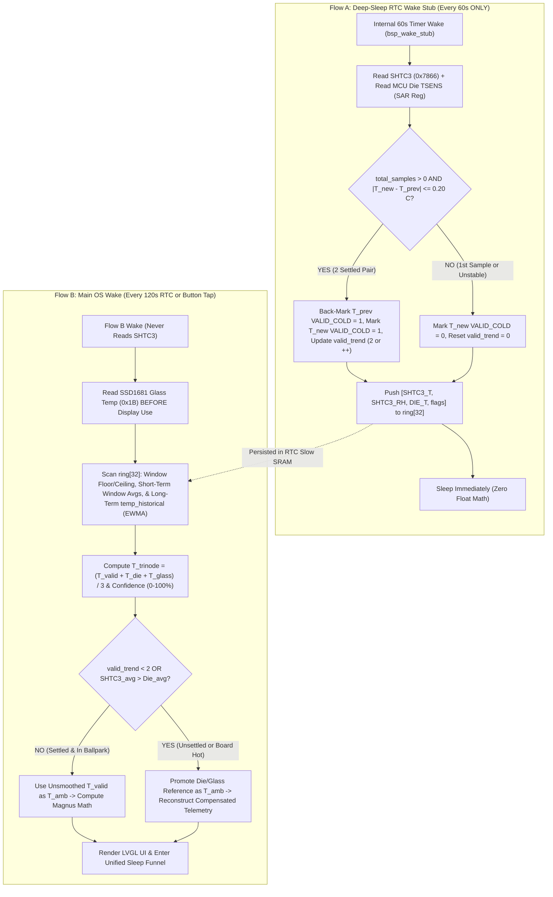

# Tri-Node Temperature & Psychrometric Sensor Operation Specification

## 1. Core Design Philosophy & Architectural Invariants

None of the three onboard temperature sensors (`SHTC3`, `ESP32-S3 Internal Die TSENS`, `SSD1681 E-Paper Glass Thermistor`) is assumed to be unconditionally accurate in isolation. Instead, H1OS relies on a physical thermodynamic law: **when zero heat is being generated by the system, all three sensors must converge to within marginal tolerances of one another.**

To enforce this without complex or fragmented state guards, sensor operation obeys **six strict invariants**:

1. **SHTC3 Never Reads in Flow B:** The Sensirion SHTC3 (`0x70`) is **never** queried during Flow B (UI wakes or interactive user sessions).
2. **Flow A Runs Strictly in Deep Sleep (`60s` Period):** Flow A executes **exclusively** inside the bare-metal RTC Wake Stub (`bsp_wake_stub()`) on the developer-configured interval (default `60s`) while Flow B is sleeping. Flow A **never** executes at OS runtime — not as a fallback, and not as a redundancy.
3. **Flow A Captures SHTC3 + MCU Die Temp Only (Zero Float Math):** During each `60s` low-power wake stub pulse, Flow A reads the SHTC3 (`T`, `RH`) and the ESP32-S3 internal die temperature (`TSENS` via RTC SAR register), evaluates the **Successive-Sample Thermal Delta Gate**, pushes both readings into the 32-sample RTC ring buffer, and immediately returns to sleep.
4. **Glass Temperature Is Read Strictly Before Display Activation in Flow B:** On Flow B wake, the SSD1681 glass thermistor (SPI command `0x1B`) is read **once at the very beginning of `sub_display_init()`** before any RAM write, LUT load, or high-voltage charge-pump refresh occurs, preventing display drive heat from offsetting the glass reading.
5. **Three-Tier Temporal Hierarchy on Flow B Time (No Artificial Smoothing on Current Temp):**
   - **Current Sample ($T_{\text{valid}}, RH_{\text{valid}}$):** The newest valid cold sample is used **directly** as the typical live ambient temperature ($T_{\text{amb}} = T_{\text{valid}}$) and relative humidity ($RH_{\text{valid}}$) with **zero artificial smoothing**, because Flow A already gates out thermal spikes.
   - **Short-Term Runtime Average ($\overline{T}_{\text{shtc3}}, \overline{T}_{\text{die}}$):** Local valid window averages across the 32-sample ring buffer (`32 min` span), accompanied by `window_low` and `window_high`.
   - **Long-Term Runtime History (`temp_historical` / $T_{\text{historical}}, RH_{\text{historical}}$):** A persistent light EWMA updated on Flow B that bridges the gap between the local 32-sample window average and long-term multi-hour trend history.
6. **Tri-Node Mean, Linear Confidence Score (0–100%), & Conditional Promotion:** Flow B averages the newest valid `SHTC3` ($T_{\text{valid}}$), newest `Die` ($T_{\text{die}}$), and newest `Glass` ($T_{\text{glass}}$) readings into a single **Tri-Node Temperature ($T_{\text{trinode}}$)** and compares it against the current valid sample ($\Delta T_{\text{trinode}} = T_{\text{valid}} - T_{\text{trinode}}$) to compute a continuous **0–100% Linear Confidence Score**. `Glass`/`Die` temperatures are promoted into active compensation math **only** if `valid_trend < 2` or if the SHTC3 valid window average ($\overline{T}_{\text{shtc3}}$) is consistently hotter than the Die Temp valid window average ($\overline{T}_{\text{die}}$) over time.

---

## 2. Tri-Node Sensor Topology & Confidence Scoring

### 2.1 Physical Sensor Roles

| Node | Hardware Device | Interface | Sampled When | Stored Where | Role |
| :--- | :--- | :--- | :--- | :--- | :--- |
| **Node 1 (Cavity)** | Sensirion **SHTC3** | Bit-Bang I2C (`0x70`) on `GPIO 47`/`48` | **Flow A Only** (`60s` RTC Wake Stub) | `ring[0..31].shtc3_temp_centi_c` & `shtc3_rh_centi_pct` | Primary environmental temperature and relative humidity acquisition. |
| **Node 2 (Silicon Die)** | **ESP32-S3 TSENS** | RTC SAR register (`SENS_SAR_TSENS_CTRL_REG`) | **Flow A** (`60s` Stub) & **Flow B** | `ring[0..31].mcu_tsens_centi_c` | Tracks MCU silicon temperature history in the ring buffer to detect processor or peripheral heat leakage. |
| **Node 3 (Exterior Glass)** | **SSD1681 Thermistor** | SPI2 Command `0x1B` | **Flow B Only** (Pre-Refresh in `sub_display_init()`) | `st->last_glass_temp_centi_c` | Unheated exterior display surface reference read before charge-pump activation. |

### 2.2 Tri-Node Mean & Linear Confidence Score (0–100%)

Instead of brittle multi-branch heat-source heuristics, Flow B combines the three nodes into a single **Tri-Node Composite Reading ($T_{\text{trinode}}$)** and derives a continuous **0–100% Confidence Score**:

1. **Tri-Node Mean Temperature ($T_{\text{trinode}}$):**
   Take the newest valid SHTC3 reading ($T_{\text{valid}}$), the newest MCU Die reading ($T_{\text{die}}$), and the newest EPD Glass reading ($T_{\text{glass}}$), sum them, and divide by 3:

$$
T_{\text{trinode}} = \frac{T_{\text{valid}} + T_{\text{die}} + T_{\text{glass}}}{3.0} \quad [^\circ\text{C}]
$$

2. **Tri-Node Delta ($\Delta T_{\text{trinode}}$):**
   Compute the deviation between the current valid sample ($T_{\text{valid}}$) and the Tri-Node composite mean ($T_{\text{trinode}}$):

$$
\Delta T_{\text{trinode}} = T_{\text{valid}} - T_{\text{trinode}} \quad [^\circ\text{C}]
$$

3. **Linear Confidence Mapping ($0\% \to 100\%$):**
   Map the magnitude $|\Delta T_{\text{trinode}}|$ linearly onto a continuous $0\text{–}100\%$ confidence scale across a $15.0^\circ\text{C}$ span (where $0.0^\circ\text{C}$ divergence = $100\%$ confidence, and $\ge 15.0^\circ\text{C}$ divergence = $0\%$ confidence):

$$
\text{Confidence } [\%] = \text{clamp}\left(100.0 - \left(\frac{|\Delta T_{\text{trinode}}|}{15.0} \times 100.0\right),\; 0.0,\; 100.0\right)
$$

| Tri-Node Delta Magnitude ($|\Delta T_{\text{trinode}}|$) | Linear Confidence Score ($0\text{–}100\%$) | Physical Interpretation |
| :--- | :--- | :--- |
| **$|\Delta T_{\text{trinode}}| < 5.0^\circ\text{C}$** | **$67\% \text{ – } 100\%$** | All three nodes have converged within the local ballpark; minimal thermal gradient across cavity, die, and glass. |
| **$5.0^\circ\text{C} \le |\Delta T_{\text{trinode}}| < 10.0^\circ\text{C}$** | **$34\% \text{ – } 66\%$** | Moderate thermal gradient present across the enclosure (e.g., residual CPU warmth or mild external radiant warming). |
| **$|\Delta T_{\text{trinode}}| \ge 10.0^\circ\text{C}$** | **$0\% \text{ – } 33\%$** | Large thermal divergence across nodes (e.g., direct sunlight on glass or heavy sustained subsystem load). |



---

## 3. Flow A Specification: Bare-Metal Sensor Acquisition & Thermal Gating

Flow A runs **strictly** inside [`bsp_wake_stub()`](file:///c:/Users/Matt/Documents/GitHub/esp32-s3_bsp/components/h1os/src/orch_wake_stub.c) in RTC Fast IRAM every `sample_interval_sec` (`60s`) while Flow B is sleeping.

### 3.1 SHTC3 & Low-Power Die Temp Acquisition Sequence
1. **Wake & Zero-Hour Check:**
   - Verify `esp_wake_stub_get_wakeup_cause() == TIMER_EXPIRE` (`0x08`) and `RTC_GPIO 5` (`HAL_PIN_RTC_INT`) is HIGH (`1`). If `RTC_GPIO 5 == 0` (the `120s` Flow B countdown expired simultaneously), immediately boot Flow B via `esp_default_wake_deep_sleep()`.
2. **Low-Power MCU Die TSENS Read (`< 100 µs`):**
   - Enable the internal SAR temperature sensor directly via RTC/SAR registers (`SENS.sar_tsens_ctrl.tsens_power_up = 1`), delay `50 µs`, read the 8-bit raw code `tsens_raw = SENS.sar_tsens_ctrl.tsens_out`, power down `tsens_power_up = 0`, and convert to centi-°C using fixed-point integer arithmetic:

$$
T_{\text{die(centi)}} = (438 \times \text{tsens\_raw}) - 27880 - 20450 \quad [0.01^\circ\text{C}]
$$

3. **SHTC3 Normal-Power Readout (`~15 ms`):**
   - Configure `IO_MUX_GPIO47_REG` (`SDA`) and `IO_MUX_GPIO48_REG` (`SCL`) with `PIN_FUNC_GPIO`, `PIN_INPUT_ENABLE`, and `PIN_PULLUP_EN`.
   - Transmit `0x3517` (Wakeup) $\rightarrow$ delay `250 µs`.
   - Transmit `0x7866` (Normal Mode, T-first, no clock stretching) $\rightarrow$ delay `14,500 µs`.
   - Read 6 bytes `[T_MSB, T_LSB, T_CRC, RH_MSB, RH_LSB, RH_CRC]`.
   - **Unconditionally transmit `0xB098` (Sleep)** — even if the read NACKs — so the SHTC3 never remains awake.
   - Verify both Sensirion CRC-8 checksums (polynomial `0x31`, init `0xFF`). If a NACK or CRC error occurs, abort the sample without rebooting into the OS and re-enter sleep for the next tick.
   - Convert raw 16-bit words ($S_T, S_{RH}$) to integer centi-units:

$$
T_{\text{new(centi)}} = -4500 + \left\lfloor \frac{17500 \times S_T}{65535} \right\rfloor, \qquad RH_{\text{new(centi)}} = \left\lfloor \frac{10000 \times S_{RH}}{65535} \right\rfloor
$$

### 3.2 Successive-Sample Thermal Delta Gate & Trend Back-Marking

A single isolated sample cannot prove thermal stability on its own. Therefore, Flow A compares the new sample $T_{\text{new(centi)}}$ against the immediately preceding sample $T_{\text{prev(centi)}}$ (`prev_idx = (st->ring_head + 31) % 32`, taken `60s` ago):

$$
\Delta T_{\text{step}} = \left| T_{\text{new(centi)}} - T_{\text{prev(centi)}} \right|
$$

- **Gate Threshold ($\varepsilon_{\text{max}}$):** Set to the maximum SHTC3 sensor repeatability/settlement tolerance: **`20` centi-°C ($0.20^\circ\text{C}$)**.
- **Case 0 — Very First Sample After Boot (`st->total_samples == 0`):**
  - No previous sample exists to compare against yet.
  - Mark `SAMPLE_FLAG_VALID_COLD = 0` and set `st->valid_trend = 0`. *(When the second sample arrives `60s` later and passes Case 1, this first sample is retroactively back-marked valid.)*
- **Case 1 — Thermally Settled Pair (`st->total_samples > 0` AND $\Delta T_{\text{step}} \le 20$ centi-°C):**
  - **Back-mark the previous sample (`ring[prev_idx]`) as valid** (`ring[prev_idx].quality_flags |= SAMPLE_FLAG_VALID_COLD`) and **mark the new sample as valid** (`SAMPLE_FLAG_VALID_COLD = 1`).
  - Update the consecutive settled trend counter:
    - If starting a new settled streak (`st->valid_trend == 0`), both the back-marked previous sample and the new sample are now valid, so **`st->valid_trend = 2`** (cleanly satisfying Flow B's `valid_trend >= 2` gate as soon as the first settled pair completes).
    - If continuing an existing settled streak (`st->valid_trend >= 2`), increment **`st->valid_trend++`**.
  - Compute trend rate metric: $\text{Trend Rate} = \frac{\text{valid\_trend}}{\text{sample\_interval\_sec}}$.
- **Case 2 — Thermally Unstable (`st->total_samples > 0` AND $\Delta T_{\text{step}} > 20$ centi-°C):**
  - Mark the new sample `SAMPLE_FLAG_VALID_COLD = 0`.
  - Reset consecutive settled trend counter: `st->valid_trend = 0`.

### 3.3 Ring Buffer Commit & Runt-Guard Sleep Return
1. Write `{ shtc3_temp_centi_c, shtc3_rh_centi_pct, mcu_tsens_centi_c, quality_flags }` into `st->ring[st->ring_head]`, advance `st->ring_head = (st->ring_head + 1) % 32`, and increment `st->total_samples++` and `st->wake_count++`.
2. Read PCF85063A (`0x51`) registers `0x10` (`Timer_value`) and `0x11` (`Timer_mode`).
   - If `rem_sec > sample_interval_sec`: rearm internal wakeup timer for `sample_interval_sec` (`60s`).
   - If `rem_sec <= sample_interval_sec`: disable `TIMER_EXPIRE` in `RTC_CNTL_WAKEUP_STATE_REG` so the next wakeup is triggered exclusively by the external PCF85063A `GPIO 5` interrupt (Flow B).

---

## 4. Flow B Specification: Three-Tier Temporal Hierarchy, Tri-Node Confidence, & Psychrometrics

Flow B executes on scheduled `120s` PCF85063A wakes (`is_rtc_wake == true`) and user button wakes (`is_rtc_wake == false`). **Flow B never reads the SHTC3.**

### 4.1 Step 1: Pre-Display Glass Temperature Capture
Inside `sub_display_init()`, immediately after the SSD1681 hardware reset (`GPIO 9`) and software reset (`0x12`), and **before** any display RAM transfer or waveform refresh:
1. Issue SPI command `0x1B` (`sub_display_read_glass_temp()`) to read the 9-bit signed glass thermistor.
2. Validate that `raw[0] != 0x00 && raw[0] != 0xFF` and $-40.0^\circ\text{C} \le T_{\text{glass}} \le +85.0^\circ\text{C}$.
3. Store the validated reading in `st->last_glass_temp_centi_c`.

### 4.2 Step 2: Three-Tier Temporal Metrics (Current, Short-Term Window, & Long-Term `temp_historical`)

To preserve 100% of real room dynamics on the live reading while maintaining both short-term and long-term context, Flow B maintains **three distinct temporal tiers**:

| Temporal Tier | Variable / Metric | Time Horizon | How It Is Computed | Role |
| :--- | :--- | :--- | :--- | :--- |
| **Tier 1: Current Sample** *(No Artificial Smoothing)* | $T_{\text{valid}},\; RH_{\text{valid}}$ | **Instantaneous** (`0s` lag) | Newest sample in `ring[]` with `SAMPLE_FLAG_VALID_COLD == 1`. | Primary live reading used for $T_{\text{amb}}$ and Magnus psychrometrics when settled. |
| **Tier 2: Short-Term Runtime Average** *(Local Window)* | $\overline{T}_{\text{shtc3}},\; \overline{T}_{\text{die}},$<br>$T_{\text{low}},\; T_{\text{high}}$ | **32-Sample Ring** (`~32 min`) | Arithmetic mean, floor ($\min$), and ceiling ($\max$) of all valid samples currently in `ring[0..31]`. | Short-term window baseline; detects board/codec thermal leakage ($\overline{T}_{\text{shtc3}} > \overline{T}_{\text{die}}$) and bounds local extremes. |
| **Tier 3: Long-Term Runtime Average** *(`temp_historical`)* | $T_{\text{historical}},\; RH_{\text{historical}}$ *(Light EWMA)* | **Multi-Hour History** | First-order EWMA updated once per Flow B wake from $T_{\text{valid}}$: $T_{\text{historical}(n)} = \alpha T_{\text{valid}} + (1 - \alpha) T_{\text{historical}(n-1)}$. | Bridges the gap between the 32-sample window and multi-hour history without flattening live $T_{\text{amb}}$. |

1. **Valid Window Floor (`window_low_centi_c`) and Valid Window Ceiling (`window_high_centi_c`):**

$$
T_{\text{low}} = \min_{k \in \text{ValidWindow}} \big(T_{\text{shtc3}}[k]\big), \qquad T_{\text{high}} = \max_{k \in \text{ValidWindow}} \big(T_{\text{shtc3}}[k]\big)
$$

   ```c
   int16_t current_low  = INT16_MAX;
   int16_t current_high = INT16_MIN;
   for (uint8_t i = 0; i < count; i++) {
       if (ring[i].quality_flags & SAMPLE_FLAG_VALID_COLD) {
           if (ring[i].shtc3_temp_centi_c < current_low)  current_low  = ring[i].shtc3_temp_centi_c;
           if (ring[i].shtc3_temp_centi_c > current_high) current_high = ring[i].shtc3_temp_centi_c;
       }
   }
   ```

2. **Short-Term Valid Window Averages ($\overline{T}_{\text{shtc3}}$ and $\overline{T}_{\text{die}}$):**

$$
\overline{T}_{\text{shtc3}} = \frac{1}{M} \sum_{k \in \text{ValidWindow}} T_{\text{shtc3}}[k], \qquad \overline{T}_{\text{die}} = \frac{1}{M} \sum_{k \in \text{ValidWindow}} T_{\text{die}}[k]
$$

3. **Long-Term Runtime Average (`temp_historical` = Light EWMA):**
   Updated on Flow B from the newest valid cold sample $(T_{\text{valid}}, RH_{\text{valid}})$ to track long-term background drift without affecting the instantaneous $T_{\text{amb}}$:

$$
T_{\text{historical}(n)} = \alpha \cdot T_{\text{valid}} + (1 - \alpha) \cdot T_{\text{historical}(n-1)}, \qquad RH_{\text{historical}(n)} = \alpha \cdot RH_{\text{valid}} + (1 - \alpha) \cdot RH_{\text{historical}(n-1)}
$$

   *(Seeded directly on the first valid sample: $T_{\text{historical}} = T_{\text{valid}}$, $RH_{\text{historical}} = RH_{\text{valid}}$.)*

### 4.3 Step 3: Dynamic $T_{\text{amb}}$ Selection (Current Sample vs. Fallback Promotion)

Flow B selects the active ambient temperature $T_{\text{amb}}$ based on `valid_trend` and the short-term window comparison ($\overline{T}_{\text{shtc3}}$ vs. $\overline{T}_{\text{die}}$):

- **Typical Settled Operation (`valid_trend >= 2` AND $\overline{T}_{\text{shtc3}} \le \overline{T}_{\text{die}} + \delta_{\text{leak}}$):**
  The SHTC3 has produced $\ge 2$ consecutive thermally stable samples and its valid window average is not hotter than the valid silicon die window average. The **unsmoothed current valid sample** is used directly:

$$
T_{\text{amb}} = T_{\text{valid}}
$$

- **Case A — Unsettled Trend (`valid_trend < 2`):**
  Fewer than 2 consecutive Flow A samples passed the $\Delta T_{\text{step}} \le 0.20^\circ\text{C}$ gate (e.g., immediately after boot or during a rapid thermal transient). Promote the coolest settled reference between **Glass Temp** ($T_{\text{glass}}$), **Die Temp** ($T_{\text{die}}$), and the current sample ($T_{\text{valid}}$):

$$
T_{\text{amb}} = \min\big(T_{\text{glass}},\; T_{\text{die}},\; T_{\text{valid}}\big)
$$

- **Case B — Board / Codec Thermal Leakage ($\overline{T}_{\text{shtc3}} > \overline{T}_{\text{die}} + \delta_{\text{leak}}$ over the valid window):**
  If the short-term valid SHTC3 window average is consistently hotter than the valid MCU die window average (indicating the audio codec or board rail is warming the SHTC3 while the MCU die is cooler), promote the cooler reference of **Die Temp** and **Glass Temp**:

$$
T_{\text{amb}} = \min\big(T_{\text{die}},\; T_{\text{glass}}\big)
$$

### 4.4 Step 4: Psychrometric Math (Executed Exclusively in Flow B)

Using the unsmoothed current valid reading $(T_{\text{valid}}, RH_{\text{valid}})$ and the dynamically selected ambient temperature $T_{\text{amb}}$ from Step 3:

- **Saturation Vapor Pressure ($e_s$):**

$$
e_s(T) = 6.112 \cdot \exp\left(\frac{17.625 \cdot T}{243.04 + T}\right) \quad [\text{hPa}]
$$

- **Actual Cavity Water Vapor Pressure ($e$, from current valid reading):**

$$
e = \left(\frac{RH_{\text{valid}}}{100.0}\right) \cdot e_s(T_{\text{valid}}) \quad [\text{hPa}]
$$

- **Dew Point ($T_{\text{dew}}$):**

$$
\gamma = \ln\left(\frac{e}{6.112}\right), \qquad T_{\text{dew}} = \frac{243.04 \cdot \gamma}{17.625 - \gamma} \quad [^\circ\text{C}]
$$

- **Ambient Relative Humidity ($RH_{\text{amb}}$):**
  *(Note: In typical settled operation where $T_{\text{amb}} = T_{\text{valid}}$, $RH_{\text{amb}}$ equals $RH_{\text{valid}}$ directly; when $T_{\text{amb}}$ is promoted from $T_{\text{die}}$ or $T_{\text{glass}}$ under Case A or Case B, this reconstructs the compensated ambient RH.)*

$$
RH_{\text{amb}} = \text{clamp}\left(100.0 \times \frac{e}{e_s(T_{\text{amb}})},\; 0.0,\; 100.0\right) \quad [\%]
$$

- **Absolute Humidity ($d_v$):**

$$
d_v = 216.7 \times \frac{e}{273.15 + T_{\text{amb}}} \quad [\text{g/m}^3]
$$

---

## 5. Unified Sleep & Wake Entry Architecture (No Fragmented Guards)

Instead of scattered wake/sleep checks across multiple layers, sleep entry and wakeup routing are consolidated into **two deterministic choke points**:

1. **Choke Point 1 — Bare-Metal Wake Vector (`bsp_wake_stub` in `orch_wake_stub.c`):**
   - Runs on every deep-sleep wakeup before the bootloader.
   - **If `cause == TIMER_EXPIRE` AND `RTC_GPIO 5 == HIGH`:** Runs Flow A (SHTC3 + Die TSENS read $\rightarrow$ $\Delta T_{\text{step}}$ gate $\rightarrow$ ring push $\rightarrow$ PCF85063A runt check $\rightarrow$ `esp_wake_stub_sleep()`). Never boots the OS.
   - **All other wakeup causes (`EXT1` RTC alarm on `GPIO 5`, `EXT1` buttons on `GPIO 0`/`18`, or `ULP` brownout):** Calls `esp_default_wake_deep_sleep()` to boot directly into Flow B.
2. **Choke Point 2 — Unified Flow B Sleep Funnel (`orch_flow_transition_to_sleep` in `orch_flow.c`):**
   - Every Flow B path (immediate post-render sleep on scheduled `120s` RTC wake, or `30s` inactivity timeout after boot/button wake) exits through a **single function**: `orch_flow_transition_to_sleep(sleep_sec)`.
   - Drains LVGL & audio $\rightarrow$ waits for `EPD_BUSY` LOW + `250 ms` settling $\rightarrow$ saves dirty framebuffer to flash $\rightarrow$ puts SSD1681 into Deep Sleep Mode 1 $\rightarrow$ arms PCF85063A countdown (`120s`) $\rightarrow$ arms internal Flow A timer (`60s`) $\rightarrow$ latches sleep pad holds and enters deep sleep.
