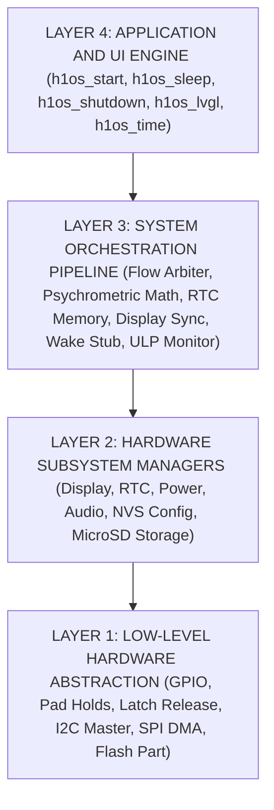

# Master Architecture Blueprint: H1OS Clean-Slate Architecture

- **Target Silicon:** ESP32-S3-PICO-1-N8R8 (Xtensa dual-core LX7 + ULP-RISC-V Coprocessor, 8MB Octal Flash, 8MB Octal PSRAM).
- **Target Hardware:** Waveshare ESP32-S3 ePaper 1.54" V2 (Non-Touch Monochrome Display; no touch controller present or supported by H1OS).
- **Operating System:** **H1OS** (E-Class Environmental Telemetry Instrument Operating System).
- **Framework:** ESP-IDF v6.1 (Ninja Build System, Driver V2 APIs, FreeRTOS SMP).
- **Architecture Philosophy:** Strict unidirectional dependency layering, zero circular inclusions, hardware determinism, reactive coprocessor monitors, and interactive user sessions with dynamic power droop.

---

## 1. High-Level 4-Layer Hierarchy

### Invariant Rules of Layer Separation
1. **Unidirectional Control:** Higher layers may `#include` and call lower layers. Lower layers **NEVER** include or call higher layers.
2. **No Hardware Subsystem Cross-Calls in Layer 2:** `sub_display` never talks to `sub_power`; `sub_audio` never calls `sub_power`. Inter-subsystem coordination is strictly the responsibility of Layer 3 Orchestrator.
3. **Common Data Types Rooted at Base:** All shared enums, error types, coordinate structs, and math definitions live in `hal_types.h` at the HAL level.
4. **Bootloader Power Latching:** Power latching (`GPIO 17 BAT_CTRL = 1`) is asserted strictly in the 2nd-stage bootloader hook (`h1os_boot_hook`). Runtime HAL preserves sleep pad holds and exposes routines to **release** the latch during verified power-off.
5. **ULP Sleep-Gating Rule:** The ULP-RISC-V Coprocessor is active **only** while the system is in deep sleep. Once Flow B wakes, the dual-core Xtensa and LVGL take complete ownership of the hardware. The ULP is completely suppressed (`RTC_CNTL_ULP_CP_GPIO_WAKEUP_ENA = 0`) to prevent interference.

---

## 2. Layer Definitions & Component Breakdown

### Layer 1: Hardware Abstraction Layer (HAL)
Pure C, hardware adapters ("How the thing gets done"). No RTOS policies, no state machines, no math.
- **`hal_types.h`**: Fixed-width types, error codes, pinout constants, bitmasks, `sys_clk_mode_t`, `h1os_chime_type_t`, `h1os_wake_btn_t`.
- **`hal_io.c/.h`**: Pad holds, power latch release (`BAT_CTRL` GPIO 17), LEDC PWM status indicator (`GPIO 3`), stateless button level reading (`hal_io_read_buttons`), USB SOF host detection (`hal_check_usb_ll`).
- **`hal_i2c.c/.h`**: Thread-safe, mutex-protected I2C bus driver (`ESP-IDF i2c_master`) on GPIO 47/48 with cached device handles.
- **`hal_spi.c/.h`**: High-speed DMA SPI bus driver (20 MHz write, half-duplex 3-wire read).
- **`hal_flash.c/.h`**: Raw sector erase/read/write routines mapped to partition `epd_frame`.

### Layer 2: Hardware Subsystem Managers
Self-contained peripheral drivers ("Does the thing"). Expose clean APIs with state encapsulated locally.
- **`sub_display.cpp/.h`**: SSD1681 200x200 1-bit driver (non-touch), Ping-Pong buffer RAM management (`0x24`/`0x26`), partial waveform LUT, panel busy synchronization, pre-display on-glass temperature acquisition (`0x1B`), Deep Sleep Mode 1 (`0x10, 0x01`).
- **`sub_rtc.c/.h`**: PCF85063A POSIX timekeeping, countdown timer, hardware alarms, interrupt clearing (`GPIO 5`), parasitic CLKOUT disabled (`COF=111`).
- **`sub_power.c/.h`**: Exclusive ULP quiet-state battery voltage retrieval (`ulp_vbat_ring[8]`), 13-point LiPo OCV lookup curve in tenths of a percent (`0..1000`), Elapsed Runtime Empirical Autonomy Engine (`sub_power_calc_autonomy`), Zero-Volt Cable Guard, Dynamic Frequency Scaling (`sub_power_init_dfs`), and Pure Event Mode deep sleep execution.
- **`sub_audio.c/.h`**: ES8311 software standby register sequence (`0x00=0x1E`, `0x0D=0xFC`) to prevent pulling down the shared I2C bus, synthesized acoustic chime/tone generator, and asynchronous PCM playback via `sub_audio_play()`.
- **`sub_nvs.c/.h`**: Persistent key-value configuration storage for autonomy runtimes and user preferences.
- **`sub_sdcard.c/.h`**: Asynchronous and synchronous 1-bit SDMMC FATFS manager: mount, unmount, format, and capacity checking.

### Layer 3: System Pipeline & Orchestrator
The central intelligence of H1OS. Houses persistent RTC memory, flow arbitration, psychrometric math, and sleep coordination.
- **`orch_state.h/.c`**: Shared `volatile` RTC Slow Memory structure, boot/wake counters, flags, Tri-Node 32-slot sliding ring buffer, and cumulative battery autonomy runtimes mirrored to NVS.
- **`orch_math.c/.h`**: E-Class psychrometrics: Magnus saturation and actual vapor pressure ($e$), dew point ($T_{\text{dew}}$), absolute humidity ($d_v$), continuous EWMA filtering, and integer steady-state plateau gating (`orch_math_is_plateau_settled`).
- **`orch_flow.c/.h`**: Single Unified Binary Execution Arbiter. Governs Flow A vs Flow B, evaluates steady-state SHTC3 telemetry and Tri-Node range verification confidence (`0..100%`), and executes the coordinated sleep transition sequence.
- **`orch_display_sync.c/.h`**: Dirty framebuffer commit to `epd_frame` SPI flash partition during sleep transition and 6-cycle partial refresh anti-ghosting counter.
- **`orch_wake_stub.c/.h`**: Fast `RTC_IRAM_ATTR` wake stub (`bsp_wake_stub`) for headless Flow A sample bursts (bit-bang I2C SHTC3 normal mode `0x7866` + Q12 fixed-point internal SAR TSENS die temperature).
- **`ulp/main.c` (ULP-RISC-V Coprocessor Monitor)**: Pure Event Mode reactive hardware monitor running in deep sleep (`ULP_RISCV_WAKEUP_SOURCE_GPIO`). Wakes on `GPIO 5` PCF85063A countdown slices (routing intermediate slices to Flow A wake stub and overflow slice to Flow B), `GPIO 0`/`18` button tap/hold, and samples `ADC1_CH3` (`GPIO 4`) for quiet-state battery metrology and brownout guard. Gated off during Flow B.

### Layer 4: Application Lifecycle API & Services
The public interface of H1OS exposed to developers.
- **`h1os.h`**: Master umbrella header declaring all public types and entry points.
- **`h1os_version.h`**: Semantic version macros (`2.4.4-dev`) and inline getters.
- **`h1os_lifecycle.c`**: Declarative lifecycle engine: `h1os_start()`, `h1os_sleep()`, `h1os_shutdown()`, `h1os_shutdown_for_storage()`, `h1os_get_telemetry()`, `h1os_is_session_active()`, `h1os_reset_session_timer()`, `h1os_set_volume()`.
- **`h1os_lvgl.cpp/.h`**: LVGL v9 graphics port, keypad indev binding, 240 MHz pixel-pack turbo scope with 80 MHz idle/busy-wait power droop.
- **`h1os_time.c/.h`**: POSIX clock bridge, timezone formatting, formatted date/time strings, and pluggable external SNTP sync callback.

---

## 3. Real-Time Execution Primitives

1. **Pure Event Mode Reactive Wake Architecture:**
   - ULP Coprocessor operates in Pure Event Mode (`ULP_RISCV_WAKEUP_SOURCE_GPIO`, internal PMU timer disabled per Errata `ERR-001`).
   - External PCF85063A countdown timer generates periodic ticks on `GPIO 5` (`flow_a_period_sec`). ULP increments `slice_counter`: if `slice_counter < overflow_limit`, ULP dispatches `ULP_DISPATCH_SENSOR_SAMPLE` (handled entirely inside `bsp_wake_stub` in $<16\text{ ms}$ without booting FreeRTOS); if `slice_counter >= overflow_limit`, ULP dispatches `ULP_DISPATCH_MAIN_WAKE` (Flow B).
   - If user taps button (`30ms..2500ms`), ULP waits for release (Wake-on-Release) and launches Flow B.
   - If user holds BOOT $\ge 2.5\text{s}$, ULP primes and triggers ROM Bootloader jump (`ULP_DISPATCH_BOOTLOADER_JUMP`).
   - If user holds POWER $\ge 2.5\text{s}$, ULP primes instant clean power-off (`ULP_DISPATCH_POWER_OFF`).
2. **Flow B Execution Profiles & Sleep Timing:**
   - **User Tap Wake (Interactive Session):** Initiated by a user button tap on `GPIO 0` or `GPIO 18`. System activates the configurable inactivity session (`inactivity_timeout_sec`, default 30s) and displays the inverted awake badge. LVGL native `lv_indev` owns buttons. Between user interactions, DFS drops CPU to 80 MHz baseline. Any user click resets the inactivity timer.
   - **External RTC Timer Wake (Unattended Refresh):** Initiated when PCF85063A countdown slices reach `overflow_limit` on `GPIO 5`. The dual-core processor boots, renders the updated telemetry dashboard to the E-Paper panel (skipping audio codec initialization), flushes the framebuffer, and **goes right back to sleep immediately** once the display update completes.
   - **Boot:** Initiated by initial battery insertion or power-on. System boots, synchronizes RTC time, renders boot splash and initial screen, and runs the configured `inactivity_timeout_sec` interactive session before entering deep sleep.
3. **Deterministic Sleep Transition Sequence (`h1os_sleep` -> `orch_flow_transition_to_sleep`):**
   1. Trigger optional pre-sleep chime/splash and invoke application `on_pre_sleep` hook under `h1os_lvgl_lock()`.
   2. Drain LVGL rendering and flush pipeline completely and stop the Core 1 LVGL task (`h1os_quiesce_lvgl_pipeline()`).
   3. Wait for audio playback idle (`sub_audio_wait_idle()`) and place ES8311 + NS4168 into `<1 µA` standby (`sub_audio_standby()`).
   4. Wait for physical EPD BUSY falling edge on `GPIO 8` (`sub_display_wait_busy()`).
   5. Commit dirty framebuffer to raw SPI flash partition `epd_frame` if modified (`orch_display_sync_save_if_dirty()`).
   6. Command SSD1681 display controller into Deep Sleep Mode 1 (`sub_display_enter_deep_sleep()`).
   7. Arm external PCF85063A countdown timer for initial Flow A slice (`sub_rtc_arm_countdown()`) and install `bsp_wake_stub`.
   8. Persist cumulative autonomy runtimes to NVS, isolate static sleep pads, drain `RTC_INT` and button lines HIGH, arm ULP GPIO wakeup, and enter deep sleep (`sub_power_enter_deep_sleep()`).
