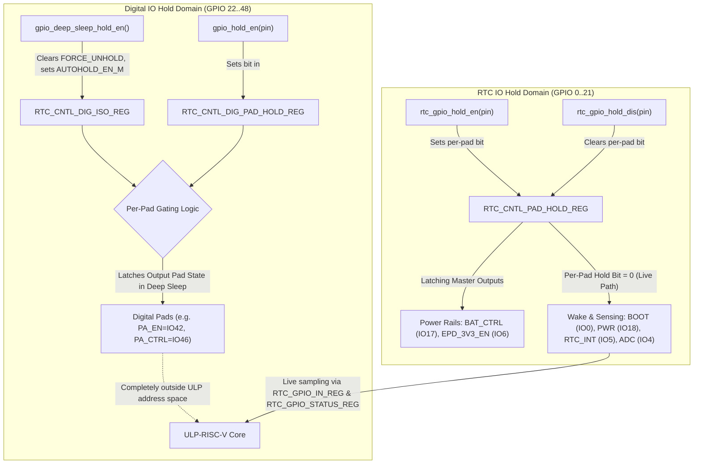
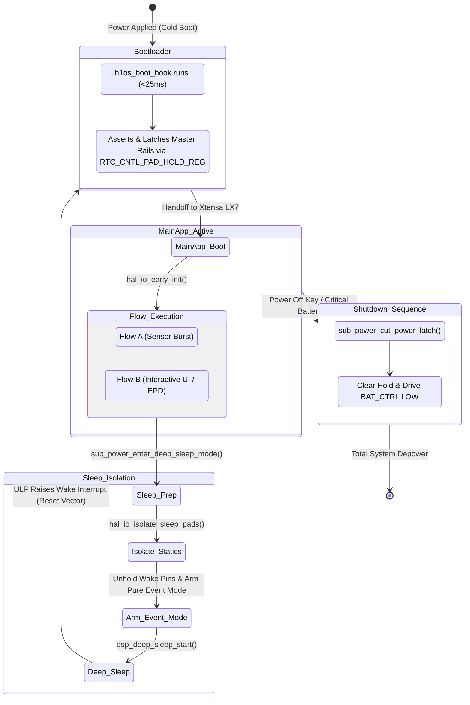
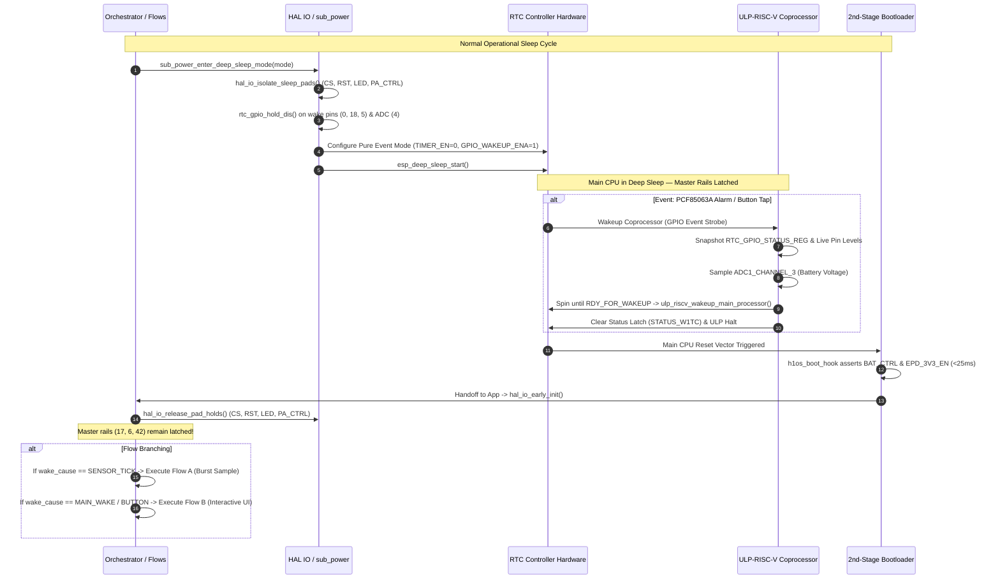

# Layer 1: Silicon Hold Domains & Low-Power Sleep Architecture

## 1. Overview & Problem Statement

On the ESP32-S3 SoC (specifically the Waveshare ESP32-S3-PICO-1-N8R8 hardware platform), managing GPIO states across deep-sleep cycles presents a fundamental silicon dichotomy:
1. **Output Rails Must Not Float:** Master battery power switches, display rails, and amplifier muting gates must remain firmly driven across deep-sleep power-down and CPU reset to prevent catastrophic inrush currents, I2C bus clamping, and audio speaker pops.
2. **Wake Inputs Must Not Freeze:** Input pins monitored by the ULP-RISC-V coprocessor for event-driven wakeups (tactile buttons and external RTC countdown timer interrupts) must maintain live electrical connectivity to the RTC GPIO status comparators.

Misunderstanding the boundaries between ESP32-S3 pad isolation domains leads to two catastrophic failure modes:
- **Floating Rail Glitches:** Peripheral LDOs collapsing or floating during sleep, causing cold resets, display re-inits, or audio brownouts.
- **Wake Suppression Lockup:** Inadvertently arming hold latches on RTC input pads, freezing their sampled logic states in deep sleep and permanently trapping the device in an un-wakeable sleep state.

This specification establishes the authoritative hardware architecture, domain boundaries, lifecycle ownership, and implementation patterns for all pad hold operations within H1OS.

---

## 2. Silicon Architecture: The Two Distinct Hold Domains

The ESP32-S3 silicon partitions pad retention into two physically and logically separate hardware register domains:



### 2.1 Domain Comparison Matrix

| Property | Digital IO Hold Domain | RTC IO Hold Domain |
| :--- | :--- | :--- |
| **Applicable Pins** | GPIO 22 through GPIO 48 | GPIO 0 through GPIO 21 (`RTCIO 0..21`) |
| **Primary Registers** | `RTC_CNTL_DIG_ISO_REG`<br>`RTC_CNTL_DIG_PAD_HOLD_REG` | `RTC_CNTL_PAD_HOLD_REG`<br>`RTC_CNTL_PWC_REG` |
| **Public API** | `gpio_hold_en()`<br>`gpio_deep_sleep_hold_en()`<br>`gpio_deep_sleep_hold_dis()` | `rtc_gpio_hold_en()`<br>`rtc_gpio_hold_dis()`<br>`rtc_gpio_force_hold_dis_all()` |
| **Low-Level (LL) Macro** | `_gpio_ll_deep_sleep_hold_en()`<br>`gpio_ll_hold_en()` | `rtcio_ll_hold_enable()`<br>`rtcio_ll_hold_disable()` |
| **Activation Requirement** | Two-stage: Pad bit in `DIG_PAD_HOLD_REG` **AND** global `AUTOHOLD_EN_M` | Single-stage: Per-pad bit in `RTC_CNTL_PAD_HOLD_REG` |
| **ULP Core Visibility** | **Invisible** (No register mapping in RTC domain) | **Visible** via `RTC_GPIO_IN_REG` & `RTC_GPIO_STATUS_REG` |
| **Effect on Inputs** | Only output-capable pads supported (`GPIO_HOLD_MASK`) | **Freezes input buffer read value** if held |
| **H1OS Assigned Signals** | `HAL_PIN_PA_EN` (GPIO 42)<br>`HAL_PIN_PA_CTRL` (GPIO 46) | `HAL_PIN_POWER_HOLD` (GPIO 17)<br>`HAL_PIN_EPD_3V3_EN` (GPIO 6)<br>`HAL_PIN_BUTTON_BOOT` (GPIO 0)<br>`HAL_PIN_BUTTON_POWER` (GPIO 18)<br>`HAL_PIN_RTC_INT` (GPIO 5)<br>`HAL_PIN_BATTERY_ADC` (GPIO 4) |

---

## 3. The Pad Hold Rule & The Input Freezing Discrepancy

### 3.1 The Silicon Discrepancy
A documentation discrepancy exists across ESP-IDF software layers:
- In `components/esp_driver_gpio/include/driver/gpio.h`:
  > *"in input mode: the input read value can still reflect the changes of the input signal."*
- In `components/esp_hal_gpio/include/hal/gpio_hal.h`:
  > *"in input mode: the input value read will not change, regardless the changes of input signal."*

On actual ESP32-S3 silicon, when an RTC IO pad is held in `RTC_CNTL_PAD_HOLD_REG` during deep sleep, the pad's internal input transmission gate is isolated to prevent leakage. Consequently, the value latched in `RTC_GPIO_IN_REG` **freezes** at the instant of hold assertion.

### 3.2 The Absolute Pad Hold Rule
> [!CAUTION]
> **The Invariant Pad Hold Rule:**
> Wake pins (`HAL_PIN_BUTTON_BOOT` GPIO 0, `HAL_PIN_BUTTON_POWER` GPIO 18, `HAL_PIN_RTC_INT` GPIO 5) and analog sensing inputs (`HAL_PIN_BATTERY_ADC` GPIO 4) **MUST NEVER** have pad holds enabled (`RTC_CNTL_PAD_HOLD_REG`).
>
> Prior to entering deep sleep, software must explicitly enforce `rtc_gpio_hold_dis()` on every wake and sensing input.

---

## 4. Separation of Concerns: Bootloader Hook vs. Main Application

To prevent race conditions, capacitor inrush brownouts, and display/audio bus contention during wake-up transitions, pad control follows a strict separation of concerns:



### 4.1 Master Rails Latched in 2nd-Stage Bootloader
The 2nd-stage bootloader hook ([`h1os_boot_hook.c`](../../components/h1os/bootloader_components/h1os_boot_hook/h1os_boot_hook.c)) executes within $<25\text{ ms}$ of silicon reset. It configures and locks the three hardware master rails:
1. `HAL_PIN_POWER_HOLD` (GPIO 17, `RTCIO 17`):
   - Driven HIGH (`GPIO_OUT_REG` bit 17).
   - Latched via `RTC_CNTL_PAD_HOLD_REG.GPIO_PIN17_HOLD = 1`.
   - **Main App Obligation:** The main application **never touches or deasserts** GPIO 17 hold during normal execution. The rail remains permanently latched across deep-sleep sessions so the application can operate without fear of accidental shutdown.
2. `HAL_PIN_EPD_3V3_EN` (GPIO 6, `RTCIO 6`):
   - Driven LOW (`GPIO_OUT_REG` bit 6) to keep the display power gate engaged.
   - Latched via `RTC_CNTL_PAD_HOLD_REG.GPIO_PIN6_HOLD = 1`.
   - Prevents display power collapse and eliminates PCF85063A I2C clamping.
3. `HAL_PIN_PA_EN` (GPIO 42, Digital IO):
   - Driven LOW (`GPIO_OUT1_REG` bit 10 = 0) to energize the audio power rail (`0 = ON`).
   - Latched in digital domain via `RTC_CNTL_DIG_PAD_HOLD_REG`.
   - **Anti-Clamping Invariant:** Keeping the audio rail energized prevents the ES8311 codec's internal ESD protection diodes from forward-biasing and clamping the shared I2C bus (`GPIO 47`/`48`) to 0.7 V. Hardware mute during boot and deep sleep is enforced by driving `HAL_PIN_PA_CTRL` (GPIO 46) LOW.

### 4.2 Application Static Sleep Isolation
Before the CPU enters deep sleep, [`hal_io_isolate_sleep_pads()`](../../components/h1os/src/hal_io.c) isolates static outputs to prevent parasitic leakage currents through external components:
- `HAL_PIN_EPD_CS` (GPIO 11 / `RTCIO 11`): Driven HIGH, latched via `gpio_hold_en()`.
- `HAL_PIN_EPD_RST` (GPIO 9 / `RTCIO 9`): Driven HIGH, latched via `gpio_hold_en()`.
- `HAL_PIN_PA_CTRL` (GPIO 46, Digital IO): Driven LOW (Mute), latched via `gpio_hold_en()`.
- `HAL_PIN_STATUS_LED` (GPIO 3 / `RTCIO 3`): Driven HIGH (LED OFF), latched via `gpio_hold_en()`.
- `gpio_deep_sleep_hold_en()` is called once to activate the digital autohold domain for GPIO 42 and GPIO 46.

### 4.3 Intentional Depower (System Shutdown)
The only condition under which `HAL_PIN_POWER_HOLD` (GPIO 17) is unlatched is a commanded system shutdown ([`sub_power_cut_power_latch()`](../../components/h1os/src/sub_power.c)):
```c
void sub_power_cut_power_latch(void)
{
    // 1. Release global digital sleep hold
    gpio_deep_sleep_hold_dis();

    // 2. Explicitly release RTC pad hold on BAT_CTRL
    gpio_hold_dis(HAL_PIN_POWER_HOLD);

    // 3. Drive pin LOW to release hardware battery LDO enable
    gpio_set_direction(HAL_PIN_POWER_HOLD, GPIO_MODE_OUTPUT);
    gpio_set_level(HAL_PIN_POWER_HOLD, 0);
}
```

---

## 5. Interaction Across Subsystems & Orchestrator Flows



### 5.1 Flow A: Low-Power Sensor Burst
During Flow A, the dual-core Xtensa processor executes a rapid wake stub ($<120\text{ ms}$) to read temperature and humidity from the SHTC3 sensor.
- The master power rails (`BAT_CTRL`, `EPD_3V3_EN`) are already latched HIGH/LOW by the bootloader hook.
- The display rail never drops, eliminating the $\sim 2.5\text{ ms}$ power-on delay and avoiding cold initialization spikes.
- Upon completing the sample, Core 0 immediately calls `sub_power_enter_deep_sleep_mode(..., SUB_POWER_SLEEP_BURST)` to return to sleep.

### 5.2 Flow B: Interactive UI & Display Session
When woken by a tactile button press (`GPIO 0` or `GPIO 18`) or periodic countdown overflow (`GPIO 5`), the system enters Flow B.
- `hal_io_release_pad_holds()` unlatches peripheral lines (`EPD_CS`, `EPD_RST`, `PA_CTRL`, `STATUS_LED`) so SPI and PWM drivers take active control.
- Master rails remain protected and continuously held.

### 5.3 ULP-RISC-V Coprocessor Perspective
The ULP-RISC-V coprocessor lives entirely within the RTC Slow Clock / RTC Peripheral power domain:
- It **only reads RTCIO registers**: `RTC_GPIO_IN_REG` (live logic levels) and `RTC_GPIO_STATUS_REG` (latched edge status).
- Digital pads (GPIO 22..48) are physically inaccessible to the ULP's memory-mapped bus.
- Because `rtc_gpio_hold_dis()` is strictly called on wake pins before sleep, the ULP is guaranteed to receive live hardware events on tactile button press and external RTC countdown timer expiration.

---

## 6. Implementation Reference & Code Patterns

### 6.1 Correct Sleep Entry Sequence (`sub_power.c`)
```c
esp_err_t sub_power_enter_deep_sleep_mode(uint32_t sleep_seconds, uint64_t ext1_pins_mask, sub_power_sleep_mode_t mode)
{
    // 1. Isolate non-master static outputs (CS, RST, PA_CTRL, LED)
    hal_io_isolate_sleep_pads();

    // 2. Arm external timer
    if (mode == SUB_POWER_SLEEP_FULL_CYCLE) {
        sub_rtc_arm_countdown(flow_a_sec);
    }

    // 3. Strictly configure RTC Wake Inputs with HOLD DISABLED
    const gpio_num_t wake_pins[] = {HAL_PIN_BUTTON_BOOT, HAL_PIN_BUTTON_POWER, HAL_PIN_RTC_INT};
    for (size_t i = 0; i < sizeof(wake_pins) / sizeof(wake_pins[0]); i++) {
        gpio_num_t pin = wake_pins[i];
        rtc_gpio_init(pin);
        rtc_gpio_set_direction(pin, RTC_GPIO_MODE_INPUT_ONLY);

        // CRITICAL: Disarm pad hold to keep input transmission gate open!
        rtc_gpio_hold_dis(pin);

        if (pin == HAL_PIN_RTC_INT) {
            rtc_gpio_pullup_en(pin);
            rtc_gpio_pulldown_dis(pin);
        } else {
            rtc_gpio_pullup_dis(pin); // External 10k pull-up on PCB
            rtc_gpio_pulldown_dis(pin);
        }
        rtc_gpio_wakeup_enable(pin, GPIO_INTR_LOW_LEVEL);
    }

    // 4. Battery ADC sensing pin: input only, unheld
    rtc_gpio_init(HAL_PIN_BATTERY_ADC);
    rtc_gpio_set_direction(HAL_PIN_BATTERY_ADC, RTC_GPIO_MODE_DISABLED);
    rtc_gpio_pullup_dis(HAL_PIN_BATTERY_ADC);
    rtc_gpio_pulldown_dis(HAL_PIN_BATTERY_ADC);
    rtc_gpio_hold_dis(HAL_PIN_BATTERY_ADC);

    // 5. ULP Wakeup Source & Event Mode Configuration
    esp_sleep_enable_ulp_wakeup();
    REG_WRITE(RTC_GPIO_STATUS_W1TC_REG, RTC_GPIO_STATUS_INT_W1TC_M);
    SET_PERI_REG_MASK(RTC_CNTL_ULP_CP_TIMER_REG, RTC_CNTL_ULP_CP_GPIO_WAKEUP_CLR);
    CLEAR_PERI_REG_MASK(RTC_CNTL_ULP_CP_TIMER_REG, RTC_CNTL_ULP_CP_GPIO_WAKEUP_CLR);
    CLEAR_PERI_REG_MASK(RTC_CNTL_ULP_CP_TIMER_REG, RTC_CNTL_ULP_CP_SLP_TIMER_EN);
    SET_PERI_REG_MASK(RTC_CNTL_ULP_CP_TIMER_REG, RTC_CNTL_ULP_CP_GPIO_WAKEUP_ENA);

    // 6. Slow clock domain synchronization delay (>= 3 RTC_SLOW_CLK cycles)
    esp_rom_delay_us(50);
    esp_sleep_pd_config(ESP_PD_DOMAIN_RTC_PERIPH, ESP_PD_OPTION_ON);

    // 7. Enter deep sleep
    esp_deep_sleep_start();
    return ESP_OK;
}
```

### 6.2 Wake Pad Release Sequence (`hal_io.c`)
```c
esp_err_t hal_io_release_pad_holds(void)
{
    // 1. Clear global digital sleep hold latch
    gpio_deep_sleep_hold_dis();

    // 2. Return wake pins to standard digital GPIO matrix (clear MUX_SEL)
    rtc_gpio_deinit(HAL_PIN_RTC_INT);
    rtc_gpio_deinit(HAL_PIN_BUTTON_BOOT);
    rtc_gpio_deinit(HAL_PIN_BUTTON_POWER);

    // 3. Release holds on dynamic peripheral pins ONLY
    gpio_hold_dis(HAL_PIN_EPD_CS);
    gpio_hold_dis(HAL_PIN_EPD_RST);
    gpio_hold_dis(HAL_PIN_PA_CTRL);
    gpio_hold_dis(HAL_PIN_STATUS_LED);

    // INVARIANT: Master power rails (GPIO 17, GPIO 6, GPIO 42) are
    // DELIBERATELY OMITTED so their bootloader holds remain continuously active.
    return ESP_OK;
}
```

---

## 7. Verification & Hardware Validation Standard

Every firmware release must satisfy the following empirical validation criteria:
1. **Zero Cold-Boot Glitches on Master Rails:**
   - Oscilloscope probe on `BAT_CTRL` (GPIO 17) and `EPD_3V3_EN` (GPIO 6) must demonstrate continuous, stable DC voltage levels with zero low-going glitches during deep-sleep transitions or CPU reset handoff.
2. **Deterministic ULP Wakeup:**
   - Pressing `BOOT0` (`GPIO 0`) or `BAT_KEY` (`GPIO 18`) wakes the system immediately ($\le 50\text{ ms}$ debounce).
   - PCF85063A countdown timer pulses on `GPIO 5` wake the system on the exact scheduled second with zero dropped ticks.
3. **Low-Power Current Consumption:**
   - Deep sleep current baseline must measure $<25\ \mu\text{A}$ with all static peripheral holds active and wake inputs properly disarmed.
