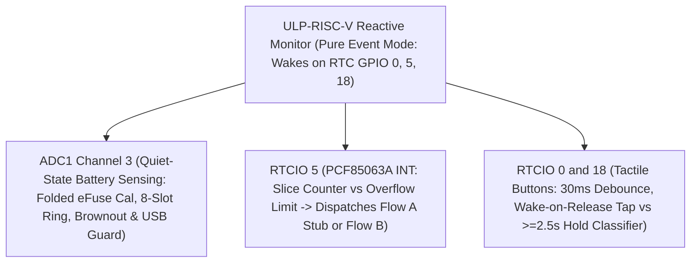

# Layer 3: ULP-RISC-V Coprocessor Hardware Monitor Specification

## 1. Overview
The ULP-RISC-V Coprocessor acts as the **Reactive Hardware Monitor** in the ESP32-S3 RTC domain. While the dual-core Xtensa LX7 processors are in deep sleep, the ULP coprocessor sleeps alongside them in RTC Slow Memory.

> **The Sleep-Gating Rule:** The ULP Coprocessor is gated strictly by the main application. It executes **only while the system is in deep sleep**. Once Flow B wakes, the dual-core Xtensa processor and LVGL take complete, exclusive control of the hardware. The ULP is completely idle and suppressed (`RTC_CNTL_ULP_CP_GPIO_WAKEUP_ENA = 0`) to ensure Flow B is never interrupted.

> **The Pure Event Mode Mandate (`ERR-001`):**
> Empirical silicon testing (`C2_lessons_learned.md` Section 4.7) demonstrated that enabling the internal PMU sleep timer (`RTC_CNTL_ULP_CP_SLP_TIMER_EN = 1`) masks RTC GPIO comparator wakeups on ESP32-S3. Therefore, the ULP operates **exclusively in Pure Event Mode (`ULP_RISCV_WAKEUP_SOURCE_GPIO`)** with `SLP_TIMER_EN = 0`. All periodic wake intervals are driven by the external PCF85063A hardware countdown timer pulsing `GPIO 5` (`RTC_INT`).

---

## 2. Core Responsibilities & Silicon Boundaries



---

## 3. Pure Event Mode Wake Arbitration

### 3.1 Quiet-State Battery ADC Sampling & Brownout Guard (`GPIO 4` / `ADC1_CH3`)
On every non-button wake event (`!is_btn_event`), before the main CPU or peripherals draw active load current, the ULP samples `ADC1_CHANNEL_3` (`ulp_read_vbat_adc_bounded()`) using the folded 2-point eFuse calibration parameters (`cal_scale`, `cal_offset`):

$$
V_{\text{bat(mV)}} = \left(\frac{\text{raw} \times \text{cal\_scale}}{4096}\right) + \text{cal\_offset}
$$

- **8-Entry Circular Ring Buffer:** Valid readings are pushed into `ulp_vbat_ring[8]` (`ulp_vbat_ring_head`, `ulp_vbat_ring_count`) and stored in `ulp_last_vbat_mv`.
- **Brownout Threshold ($V_{\text{bat}} < 3.25\text{V}$):**
  - If `!usb_connected` and $100\text{ mV} \le V_{\text{bat}} < 3250\text{ mV}$, sets `dispatch_reason = ULP_DISPATCH_CRITICAL_SHUTDOWN` (`last_wake_cause = 6`) and wakes the main CPU to execute an immediate orderly power cut.
- **Zero-Volt Cable Guard:**
  - If `usb_connected != 0` or $V_{\text{bat}} < 100\text{ mV}$, brownout shutdown is bypassed.

### 3.2 Tactile Button Evaluation (`GPIO 0` BOOT & `GPIO 18` POWER)
- **Glitch Rejection:** Initial press is debounced for `30 ms` (`BUTTON_DEBOUNCE_US = 30000`). Pulses shorter than `30 ms` are ignored.
- **Wake-on-Release Rule (Clean LVGL Input State):**
  - The ULP polls the depressed pin in `5 ms` increments up to `2,500 ms` (`BUTTON_HOLD_US = 2500000`).
  - For short taps (`30 ms <= hold_ms < 2500 ms`), the ULP waits for the button to release HIGH and settle for `30 ms` before waking the main processor (`ULP_DISPATCH_MAIN_WAKE`).
  - **Why Wake on Release:** Guarantees that when the dual-core Xtensa boots and LVGL initializes its keypad driver, the user's finger is already off the physical button, preventing spurious double-clicks or unintended page jumps on wake.
- **Long Hold on BOOT ($\ge 2.5\text{s}$):**
  - Sets `dispatch_reason = ULP_DISPATCH_BOOTLOADER_JUMP` (`last_wake_cause = 1`, `last_wake_btn = 1`) and wakes the main CPU to jump into the ROM Download Bootloader.
- **Long Hold on POWER ($\ge 2.5\text{s}$):**
  - Sets `dispatch_reason = ULP_DISPATCH_POWER_OFF` (`last_wake_cause = 2`, `last_wake_btn = 2`) and wakes the main CPU to execute an orderly shutdown and release the `GPIO 17` power latch.

### 3.3 External PCF85063A Countdown Slicing (`GPIO 5` `RTC_INT`)
- When the PCF85063A countdown timer expires and pulls `GPIO 5` LOW:
  - ULP increments `slice_counter++`.
  - **Intermediate Slice (`slice_counter < overflow_limit`):**
    - Sets `dispatch_reason = ULP_DISPATCH_SENSOR_SAMPLE` (`last_wake_cause = 4`) and wakes Core 0 into the bare-metal `bsp_wake_stub()`.
    - `bsp_wake_stub()` samples the SHTC3 and internal Die TSENS, acknowledges `TF` in PCF85063A `Control_2` (or rearms `remainder_sec` on the penultimate slice), waits for `GPIO 5` to release HIGH, re-arms ULP GPIO wakeup, and returns directly to deep sleep.
  - **Final Overflow Slice (`slice_counter >= overflow_limit`):**
    - Resets `slice_counter = 0` and `remainder_sec = 0`.
    - Sets `dispatch_reason = ULP_DISPATCH_MAIN_WAKE` (`last_wake_cause = 3`) and wakes the dual-core CPU into Flow B to refresh the E-Paper UI.

---

## 4. Shared RTC Memory Interface

The ULP program (`ulp/main.c`) exports its `volatile` symbols to the main application with the `ulp_` prefix (generated in `ulp_h1os.h`):

```c
#pragma once
#include <stdint.h>

typedef enum {
    ULP_DISPATCH_NONE = 0,
    ULP_DISPATCH_SENSOR_SAMPLE     = 1, // Flow A Wake Stub (<16ms)
    ULP_DISPATCH_MAIN_WAKE         = 2, // Flow B Interactive / UI Refresh Session
    ULP_DISPATCH_CRITICAL_SHUTDOWN = 3, // Battery brownout threshold (<3.25V)
    ULP_DISPATCH_BOOTLOADER_JUMP   = 4, // ROM Bootloader Jump primed by BOOT hold >= 2.5s
    ULP_DISPATCH_POWER_OFF         = 5  // Clean Power-Off primed by POWER hold >= 2.5s
} orch_ulp_dispatch_t;

/* Exported ULP variables accessible by the main Xtensa core via ulp_<var> */
extern uint32_t ulp_wake_counter;
extern uint32_t ulp_last_wake_cause;
extern uint32_t ulp_last_wake_btn;   /* 0: None/RTC, 1: BOOT (GPIO 0), 2: POWER (GPIO 18) */
extern uint32_t ulp_slice_counter;
extern uint32_t ulp_overflow_limit;
extern uint32_t ulp_remainder_sec;
extern uint32_t ulp_rtc_int_stuck;
extern uint32_t ulp_dispatch_reason;
extern uint32_t ulp_gpio_status_raw;

extern uint32_t ulp_cal_scale;
extern int32_t  ulp_cal_offset;
extern uint32_t ulp_last_vbat_mv;
extern uint32_t ulp_vbat_raw_adc;
extern uint32_t ulp_usb_connected;

extern uint32_t ulp_vbat_ring[8];
extern uint32_t ulp_vbat_ring_head;
extern uint32_t ulp_vbat_ring_count;
```

---

## 5. Silicon GPIO Wakeup Routing & Pad Hold Invariant

On ESP32-S3, waking the ULP-RISC-V coprocessor from deep sleep via RTC IO requires strict adherence to the **Pad Hold Invariant** (`A3_gpio_hold_and_sleep.md`):

1. **RTC IO Interrupt Arming (Hold MUST Be Disabled on Wake Inputs):**
   ```c
   const gpio_num_t wake_pins[] = {HAL_PIN_BUTTON_BOOT, HAL_PIN_BUTTON_POWER, HAL_PIN_RTC_INT};
   for (size_t i = 0; i < 3; i++) {
       gpio_num_t pin = wake_pins[i];
       rtc_gpio_init(pin);
       rtc_gpio_set_direction(pin, RTC_GPIO_MODE_INPUT_ONLY);
       rtc_gpio_hold_dis(pin); /* CRITICAL: Never hold RTC wake inputs or input buffer freezes! */
       rtc_gpio_pullup_en(pin);
       rtc_gpio_pulldown_dis(pin);
       rtc_gpio_wakeup_enable(pin, GPIO_INTR_LOW_LEVEL);
   }

   /* Clear latched status after input lines return HIGH and arm ULP GPIO wakeup in Pure Event Mode */
   REG_WRITE(RTC_GPIO_STATUS_W1TC_REG, RTC_GPIO_STATUS_INT_W1TC_M);
   SET_PERI_REG_MASK(RTC_CNTL_ULP_CP_TIMER_REG, RTC_CNTL_ULP_CP_GPIO_WAKEUP_CLR);
   esp_rom_delay_us(120);
   CLEAR_PERI_REG_MASK(RTC_CNTL_ULP_CP_TIMER_REG, RTC_CNTL_ULP_CP_GPIO_WAKEUP_CLR);
   SET_PERI_REG_MASK(RTC_CNTL_ULP_CP_TIMER_REG, RTC_CNTL_ULP_CP_GPIO_WAKEUP_ENA);
   ```

2. **Coprocessor vs. CPU Wake Separation:**
   - When a button transitions LOW or the PCF85063A pulls `/INT` LOW, the hardware wakes the **ULP-RISC-V core**.
   - The dual-core Xtensa CPU **remains powered down** in deep sleep (`esp_sleep_enable_ulp_wakeup()` is the sole wakeup trigger).
   - The ULP RISC-V program executes `main()`, evaluates battery voltage, button hold/release, or RTC slice progression, disarms `RTC_CNTL_ULP_CP_GPIO_WAKEUP_ENA` before waking the main processor, and halts via `ulp_riscv_halt()`.
