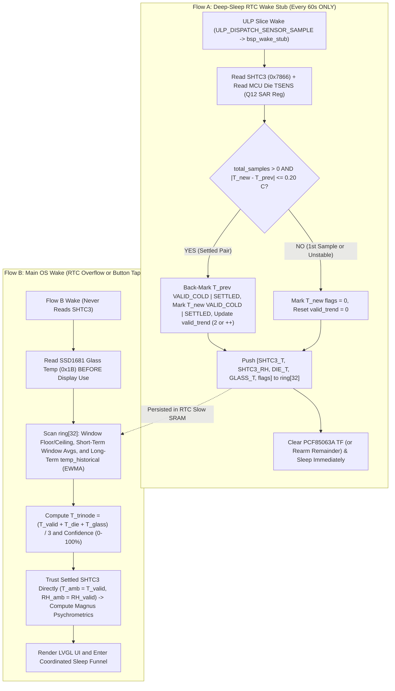

# Tri-Node Temperature & Psychrometric Sensor Operation Specification

## 1. Core Design Philosophy & Architectural Invariants

The Sensirion SHTC3 is factory-calibrated to $\pm 0.2^\circ\text{C}$ and $\pm 2.0\%\text{ RH}$ and requires **zero synthetic offsets, taring, or ambient RH reconstitutions** once the PCB enclosure is at thermal steady state. Meanwhile, the two auxiliary onboard sensors (`ESP32-S3 Internal Die TSENS` and `SSD1681 E-Paper Glass Thermistor`) obey a fundamental thermodynamic law: **when minimal heat is generated by the system, all three sensors converge to within a normal thermal envelope of one another.**

To enforce this **Zero-Calibration Steady-State SHTC3 Principle**, sensor operation obeys **six strict invariants**:

1. **SHTC3 Never Reads in Flow B:** The Sensirion SHTC3 (`0x70`) is **never** queried during Flow B (UI wakes or interactive user sessions).
2. **Flow A Runs Strictly in Deep Sleep (`60s` Default Period):** Flow A executes **exclusively** inside the bare-metal RTC Wake Stub (`bsp_wake_stub()`) on the developer-configured interval (`sample_interval_sec`, default `60s`) while Flow B is sleeping. Flow A **never** executes at OS runtime.
3. **Flow A Captures SHTC3 + MCU Die Temp Only (Zero Float Math):** During each low-power wake stub pulse (`ULP_DISPATCH_SENSOR_SAMPLE`), Flow A reads the SHTC3 (`T`, `RH` in normal mode `0x7866`) and the ESP32-S3 internal die temperature (`TSENS` via Q12 fixed-point SAR math), evaluates the **Successive-Sample Thermal Delta Gate** ($|\Delta T| \le 0.20^\circ\text{C}$), pushes the sample into the 32-sample RTC ring buffer, and immediately returns to sleep.
4. **Glass Temperature Is Read Strictly Before Display Activation in Flow B:** On Flow B wake, the SSD1681 glass thermistor (SPI command `0x1B`) is read **once at the very beginning of `sub_display_init()`** before any RAM write, LUT load, or high-voltage charge-pump refresh occurs, preventing display drive heat from offsetting the glass reading.
5. **Three-Tier Temporal Hierarchy on Flow B Time (Direct Factory-Calibrated SHTC3 Trust):**
   - **Current Sample ($T_{\text{valid}}, RH_{\text{valid}}$):** The newest valid settled sample (`SAMPLE_FLAG_VALID_COLD`) is trusted **directly** as the live ambient temperature ($T_{\text{amb}} = T_{\text{valid}}$) and relative humidity ($RH_{\text{amb}} = RH_{\text{valid}}$) with **zero synthetic offsets or reconstitutions**.
   - **Short-Term Runtime Average ($\overline{T}_{\text{shtc3}}, \overline{T}_{\text{die}}$):** Local valid window averages across the 32-sample ring buffer (`~32 min` span at `60s`), accompanied by `window_low` and `window_high`.
   - **Long-Term Runtime History (`temp_historical_c`, `rh_historical_pct`):** A persistent light EWMA ($\alpha = 0.25$) updated on Flow B only when `total_samples` advances (`total_samples != last_ewma_sample_seq`), preventing interactive UI redraws from skewing historical trends.
6. **Tri-Node Range Verification & Linear Confidence Score (0–100%):** Flow B averages the newest valid `SHTC3` ($T_{\text{valid}}$), newest `Die` ($T_{\text{die}}$), and newest `Glass` ($T_{\text{glass}}$) readings into a **Tri-Node Verification Mean ($T_{\text{trinode}}$)** and compares it against the settled SHTC3 reading ($\Delta T_{\text{trinode}} = T_{\text{valid}} - T_{\text{trinode}}$) across a $15.0^\circ\text{C}$ span to compute a continuous **0–100% Linear Confidence Score**. `Glass` and `Die` sensors serve strictly as cross-node verification references and never override or offset the factory-calibrated SHTC3 reading.

---

## 2. Tri-Node Sensor Topology & Confidence Scoring

### 2.1 Physical Sensor Roles

| Node | Hardware Device | Interface | Sampled When | Stored Where | Role |
| :--- | :--- | :--- | :--- | :--- | :--- |
| **Node 1 (Cavity)** | Sensirion **SHTC3** | Bit-Bang I2C (`0x70`) on `GPIO 47`/`48` | **Flow A Only** (`60s` RTC Wake Stub) | `ring[0..31].shtc3_temp_centi_c` & `shtc3_rh_centi_pct` | Authoritative factory-calibrated ambient temperature and relative humidity acquisition. |
| **Node 2 (Silicon Die)** | **ESP32-S3 TSENS** | RTC SAR register (`SENS_SAR_TSENS_CTRL_REG`) | **Flow A** (`60s` Stub) | `ring[0..31].mcu_tsens_centi_c` | Cross-node silicon thermal verification and window average tracking. |
| **Node 3 (Exterior Glass)** | **SSD1681 Thermistor** | SPI2 Command `0x1B` | **Flow B Only** (Pre-Refresh in `sub_display_init()`) | `st->last_glass_temp_centi_c` | Unheated exterior display surface verification read before charge-pump activation. |

### 2.2 Tri-Node Mean & Linear Confidence Score (0–100%)

Flow B combines the three nodes into a **Tri-Node Verification Mean ($T_{\text{trinode}}$)** and derives a continuous **0–100% Confidence Score**:

1. **Tri-Node Mean Temperature ($T_{\text{trinode}}$):**

$$
T_{\text{trinode}} = \frac{T_{\text{valid}} + T_{\text{die}} + T_{\text{glass}}}{3.0} \quad [^\circ\text{C}]
$$

2. **Tri-Node Delta ($\Delta T_{\text{trinode}}$):**

$$
\Delta T_{\text{trinode}} = T_{\text{valid}} - T_{\text{trinode}} \quad [^\circ\text{C}]
$$

3. **Linear Confidence Mapping ($0\% \to 100\%$ across `ORCH_TRINODE_SPAN_C = 15.0°C`):**

$$
\text{Confidence } [\%] = \text{clamp}\left(100.0 - \left(\frac{|\Delta T_{\text{trinode}}|}{15.0} \times 100.0\right),\; 0.0,\; 100.0\right)
$$

| Tri-Node Delta Magnitude ($|\Delta T_{\text{trinode}}|$) | Linear Confidence Score ($0\text{–}100\%$) | Physical Interpretation |
| :--- | :--- | :--- |
| **$|\Delta T_{\text{trinode}}| < 5.0^\circ\text{C}$** | **$67\% \text{ – } 100\%$** | All three nodes have converged within the local ballpark; minimal thermal gradient across cavity, die, and glass. |
| **$5.0^\circ\text{C} \le |\Delta T_{\text{trinode}}| < 10.0^\circ\text{C}$** | **$34\% \text{ – } 66\%$** | Moderate thermal gradient present across the enclosure (e.g., residual CPU warmth or mild external radiant warming). |
| **$|\Delta T_{\text{trinode}}| \ge 10.0^\circ\text{C}$** | **$0\% \text{ – } 33\%$** | Large thermal divergence across nodes (e.g., direct sunlight on glass or heavy sustained subsystem load). |

---

## 3. Flow A Specification: Bare-Metal Sensor Acquisition & Thermal Gating

Flow A runs **strictly** inside [`bsp_wake_stub()`](../../components/h1os/src/orch_wake_stub.c) in RTC Fast IRAM every `sample_interval_sec` (`60s` default) while Flow B is sleeping.

### 3.1 SHTC3 & Division-Free Q12 Die Temp Acquisition Sequence
1. **Wake Dispatch Check:**
   - Verify `ulp_dispatch_reason == ULP_DISPATCH_SENSOR_SAMPLE` (or `cause == TIMER_EXPIRE`). For all other wakeup causes (`ULP_DISPATCH_MAIN_WAKE`, button tap, critical shutdown, bootloader jump), immediately boot the main OS via `esp_default_wake_deep_sleep()`.
2. **SHTC3 Normal-Power Readout (`~15 ms`):**
   - Configure `IO_MUX_GPIO47_REG` (`SDA`) and `IO_MUX_GPIO48_REG` (`SCL`) with `PIN_FUNC_GPIO` and `PIN_INPUT_ENABLE`.
   - Transmit `0x3517` (Wakeup) $\rightarrow$ delay `250 µs`.
   - Transmit `0x7866` (Normal Mode, T-first, no clock stretching) $\rightarrow$ delay `14,500 µs`.
   - Read 6 bytes `[T_MSB, T_LSB, T_CRC, RH_MSB, RH_LSB, RH_CRC]`.
   - **Unconditionally transmit `0xB098` (Sleep)** with up to 3 retries so the SHTC3 never remains awake.
   - Verify both Sensirion CRC-8 checksums (polynomial `0x31`, init `0xFF`).
   - Convert raw 16-bit words ($S_T, S_{RH}$) to integer centi-units using 32-bit unsigned hardware division (`quou`):

$$
T_{\text{new(centi)}} = -4500 + \left\lfloor \frac{17500 \times S_T}{65535} \right\rfloor, \qquad RH_{\text{new(centi)}} = \left\lfloor \frac{10000 \times S_{RH}}{65535} \right\rfloor
$$

3. **Division-Free Q12 MCU Die TSENS Read (`~400 µs`):**
   - Enable the internal SAR temperature sensor via RTC/SAR registers (`SENS_TSENS_CLK_DIV = 6`, `SENS_TSENS_POWER_UP`), wait `400 µs`, read the 8-bit raw code `raw = SENS_TSENS_OUT`, power down, and convert to centi-°C using pre-computed eFuse intercept `tsens_offset_centi_c = 2052 + tsens_cal_centi_c`:

$$
T_{\text{die(centi)}} = \left(\frac{\text{raw} \times 179651}{4096}\right) - \text{tsens\_offset\_centi\_c} \quad [0.01^\circ\text{C}]
$$

### 3.2 Successive-Sample Thermal Delta Gate & Trend Back-Marking

Flow A compares the new sample $T_{\text{new(centi)}}$ against the immediately preceding sample $T_{\text{prev(centi)}}$ (`prev_idx = (st->ring_head == 0) ? 31 : (st->ring_head - 1)`):

$$
\Delta T_{\text{step}} = \left| T_{\text{new(centi)}} - T_{\text{prev(centi)}} \right|
$$

- **Gate Threshold (`SAMPLE_DELTA_GATE_CENTI_C`):** **`20` centi-°C ($0.20^\circ\text{C}$)** (`orch_math_is_plateau_settled()`).
- **Case 0 — Very First Sample After Boot (`st->total_samples == 0`):**
  - Mark `quality_flags = 0` and set `st->valid_trend = 0`.
- **Case 1 — Thermally Settled Pair (`st->total_samples > 0` AND $\Delta T_{\text{step}} \le 20$ centi-°C):**
  - **Back-mark the previous sample (`ring[prev_idx]`) as valid** (`SAMPLE_FLAG_VALID_COLD | SAMPLE_FLAG_THERMAL_SETTLED`) and **mark the new sample as valid**.
  - If `st->valid_trend < 2`, set **`st->valid_trend = 2`**; else increment **`st->valid_trend++`**.
- **Case 2 — Thermally Unstable (`st->total_samples > 0` AND $\Delta T_{\text{step}} > 20$ centi-°C):**
  - Mark the new sample `quality_flags = 0` and reset `st->valid_trend = 0`.

### 3.3 Ring Buffer Commit & PCF85063A Slice Acknowledgement
1. Push `{ shtc3_temp_centi_c, shtc3_rh_centi_pct, mcu_tsens_centi_c, epd_glass_centi_c, timestamp_sec, quality_flags }` into `st->ring[st->ring_head]`, advance `ring_head`, and increment `total_samples++` and `wake_count++`.
2. If `ulp_slice_counter == (ulp_overflow_limit - 1)` and `ulp_remainder_sec > 0`, re-arm PCF85063A countdown for `ulp_remainder_sec`; otherwise write `0x07` (`RTC_CTRL2_COF_OFF`) to PCF85063A `Control_2` (`0x01`) to clear `TF` while keeping the periodic countdown running.
3. Wait for `GPIO 5` (`HAL_PIN_RTC_INT`) open-drain line to release HIGH, clear RTC wakeup latches, re-arm `RTC_CNTL_ULP_CP_GPIO_WAKEUP_ENA`, tear down I2C pads, and re-enter deep sleep via `esp_wake_stub_sleep(&bsp_wake_stub)`.

---

## 4. Flow B Specification: Three-Tier Temporal Hierarchy & Direct Psychrometrics

Flow B executes on scheduled PCF85063A overflow wakes (`is_rtc_wake == true`) and user button wakes (`is_rtc_wake == false`). **Flow B never reads the SHTC3.**

### 4.1 Step 1: Pre-Display Glass Temperature Capture
Inside `sub_display_init()`, immediately after the SSD1681 hardware reset (`GPIO 9`) and software reset (`0x12`), and **before** any display RAM transfer or waveform refresh:
1. Issue SPI command `0x1B` to read the 9-bit signed glass thermistor.
2. Validate that `raw[0] != 0x00 && raw[0] != 0xFF` and $-40.0^\circ\text{C} \le T_{\text{glass}} \le +85.0^\circ\text{C}$.
3. Cache the validated reading in `s_last_glass_temp_centi_c` and latch into `st->last_glass_temp_centi_c`.

### 4.2 Step 2: Three-Tier Temporal Metrics
1. **Tier 1 — Current Settled Sample ($T_{\text{valid}}, RH_{\text{valid}}$):**
   Retrieved via `orch_state_get_latest_valid_sample()` (newest sample with `SAMPLE_FLAG_VALID_COLD`, or latest sample if still in initial settling). Trusted directly as $T_{\text{amb}} = T_{\text{valid}}$ and $RH_{\text{amb}} = RH_{\text{valid}}$.
2. **Tier 2 — Short-Term Valid Window Metrics (`orch_flow_scan_ring_metrics`):**
   Scans up to 32 samples in `ring[]` to compute `window_low_temp_centi_c`, `window_high_temp_centi_c`, `window_avg_shtc3_c`, and `window_avg_die_c`.
3. **Tier 3 — Long-Term Historical Baseline (`temp_historical_c`, `rh_historical_pct`):**
   Updated once per new Flow A sample (`st->total_samples != st->last_ewma_sample_seq`) with $\alpha = 0.25$ via `orch_math_update_ewma()`.

### 4.3 Step 3: Psychrometric Math (`orch_math_calc_psychrometrics`)
Executed directly from $(T_{\text{valid}}, RH_{\text{valid}})$:
- **Saturation Vapor Pressure ($e_s$):**

$$
e_s(T) = 6.112 \cdot \exp\left(\frac{17.625 \cdot T}{243.04 + T}\right) \quad [\text{hPa}]
$$

- **Actual Water Vapor Pressure ($e$):**

$$
e = \left(\frac{RH_{\text{valid}}}{100.0}\right) \cdot e_s(T_{\text{valid}}) \quad [\text{hPa}]
$$

- **Dew Point ($T_{\text{dew}}$):**

$$
\gamma = \ln\left(\frac{RH_{\text{valid}}}{100.0}\right) + \frac{17.625 \cdot T_{\text{valid}}}{243.04 + T_{\text{valid}}}, \qquad T_{\text{dew}} = \frac{243.04 \cdot \gamma}{17.625 - \gamma} \quad [^\circ\text{C}]
$$

- **Absolute Humidity ($d_v$):**

$$
d_v = 216.7 \times \frac{e}{273.15 + T_{\text{valid}}} \quad [\text{g/m}^3]
$$
