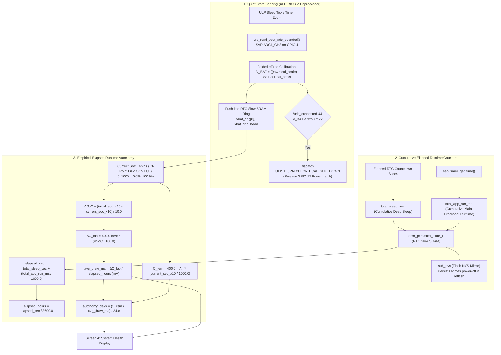

# Battery Metrology, Power Management & Autonomy Engine Specification

## 1. Core Architectural Philosophy & Invariants

Estimating battery State of Charge (SoC) and operating autonomy on an ultra-low-power, event-driven appliance is fundamentally challenged by the physical chemistry of Lithium-Polymer cells:
1. **Flat Discharge Plateau:** Between $3.85\text{V}$ and $3.70\text{V}$ (spanning ~60% down to ~25% SoC), cell voltage drops by only $\sim 2.8\text{ mV}$ per 1% of capacity. Deriving current draw from numerical voltage derivatives ($d V / d t$) over short intervals magnifies ADC noise and diurnal temperature swings, inducing mathematical singularities.
2. **Active Load Sag ($I \cdot R$ Drop):** Small LiPo cells ($400\text{ mAh}$) possess internal DC series resistance ($R_{\text{int}} \approx 150 - 350\text{ m}\Omega$). Main CPU execution ($80-240\text{ MHz}$ turbo, SPI bus transmission, e-paper charge pump activation) draws $30 - 100\text{ mA}$, causing an instantaneous $10 - 30\text{ mV}$ voltage drop. Sampling cell voltage during main CPU execution severely corrupts Open-Circuit Voltage (OCV) table lookups.

To achieve metrological reliability with minimal runtime overhead, H1OS enforces **six strict battery architecture invariants**:

1. **Exclusive ULP Resting Acquisition:** The main dual-core Xtensa CPU **never** triggers the battery SAR ADC while actively executing. The ULP-RISC-V coprocessor samples `ADC1_CHANNEL_3` **exclusively** during quiet deep sleep and commits samples into an 8-entry circular ring buffer in RTC Slow SRAM (`vbat_ring[8]`).
2. **Zero Hardcoded Current Constants:** The autonomy engine **never** guesses or hardcodes speculative current values ($0.045\text{ mA}$, $28\text{ mA}$, $36\text{ mA}$). Current draw is derived strictly from total elapsed runtime and measured capacity loss.
3. **Single-Level Elapsed Runtime Average Current Model (`avg_draw_ma`):** Total elapsed runtime ($T_{\text{elapsed}} = T_{\text{sleep}} + T_{\text{app}}$) anchors empirical capacity drop ($\Delta C_{\text{lap}}$) across the $400\text{ mAh}$ budget to compute average current draw (`avg_draw_ma`) and projected remaining days (`autonomy_days`), without redundant per-domain cycle counters or cross-cycle ratio math.
4. **Dynamic User-Configured Schedules:** The autonomy engine makes zero assumptions about fixed periods (e.g. 60s or 300s). It dynamically integrates elapsed user-configured Flow A (`sample_interval_sec`) and Flow B (`flow_b_period_sec`) sleep slices alongside active main processor runtime (`total_app_run_ms`).
5. **Cross-Session Persistence & Thermal Rebound Guard:** Cumulative hardware runtime counters reside in RTC Slow SRAM (`orch_persisted_state_t`) across sleep cycles and mirror into Flash NVS (`sub_nvs`) before sleep and on shutdown. Lap resets trigger strictly on real charger unplug transitions (`s_prev_bat_state` retained in `RTC_DATA_ATTR`) or $\ge 3.0\%$ jumps, preventing diurnal afternoon temperature rises from wiping accumulated timers.
6. **Tenths-of-a-Percent Precision & Singularity Guards:** State of Charge is tracked in tenths of a percent (`initial_soc_x10`, `current_soc_x10`, $0..1000 = 0.0\%..100.0\%$) for smooth convergence. If $\Delta\text{SoC} < 1.0\%$ or $T_{\text{elapsed}} < 60\text{s}$, autonomy displays `"CALIBRATING..."`, guaranteeing zero divide-by-zero singularities.

---

## 2. End-to-End Metrology & Execution Flow



---

## 3. Hardware Voltage Sensing & ADC Calibration

### 3.1 Voltage Divider Transfer Function

The LiPo cell terminal ($3.0\text{V} - 4.2\text{V}$) is attenuated through a symmetric precision divider:

* High-side resistor: $R_1 = 200\text{ k}\Omega$
* Low-side resistor: $R_2 = 200\text{ k}\Omega$
* Sense node: `GPIO 4` (`ADC1_CHANNEL_3`)

$$V_{\text{ADC}} = V_{\text{BAT}} \cdot \left(\frac{R_2}{R_1 + R_2}\right) = \frac{V_{\text{BAT}}}{2} \implies V_{\text{BAT}} = 2.0 \cdot V_{\text{ADC}}$$

* **Continuous Divider Bleed:** $I_{\text{bleed}} = \frac{4.2\text{ V}}{400\text{ k}\Omega} = 10.5\ \mu\text{A}$ (documented in `ERRATA.md` E5).
* **Thevenin Impedance:** $R_{\text{th}} = 200\text{ k}\Omega \parallel 200\text{ k}\Omega = 100\text{ k}\Omega$.

### 3.2 ULP Folded Calibration Handoff

On cold boot, `sub_power_get_ulp_cal_params()` evaluates the ESP32-S3 eFuse curve-fitting calibration scheme across two raw counts that tightly bracket the operating divider range ($1500\text{ mV} \le V_{\text{ADC}} \le 2100\text{ mV} \implies \text{raw}_1 = 2000, \text{raw}_2 = 3000$).

To prevent factor-of-2 offset errors and minimize coprocessor cycle execution, the $2\times$ voltage divider ratio is **folded directly** into the slope and offset on the main CPU:

$$m_{\text{vbat}} = \frac{2 \cdot (V_{3000} - V_{2000}) \cdot 4096}{1000}$$

$$b_{\text{vbat}} = 2 \cdot V_{2000} - \frac{m_{\text{vbat}} \cdot 2000}{4096}$$

During deep sleep, the ULP converts raw 12-bit ADC counts using a single shift and add:

$$V_{\text{BAT}} = \left(\frac{\text{raw} \cdot \text{cal\_scale}}{4096}\right) + \text{cal\_offset}$$

---

## 4. Single Authoritative 13-Point LiPo OCV Lookup Curve

Lithium-Polymer discharge chemistry is mapped through an authoritative 13-point Open-Circuit Voltage table located in `components/h1os/src/sub_power.c`. To avoid quantization error, SoC is interpolated in **Tenths of a Percent** ($0..1000 = 0.0\%..100.0\%$):

| Index | Terminal Voltage ($V_{\text{BAT}}$) | SoC (Tenths of a %) | SoC Percentage | Operating Region |
| --- | --- | --- | --- | --- |
| **0** | $\ge 4200\text{ mV}$ | 1000 | 100.0% | Full Charge Saturation Cutoff |
| **1** | $4120\text{ mV}$ | 950 | 95.0% | Upper Knee Transition |
| **2** | $4040\text{ mV}$ | 880 | 88.0% | Upper Plateau |
| **3** | $3960\text{ mV}$ | 800 | 80.0% | Upper Plateau |
| **4** | $3890\text{ mV}$ | 730 | 73.0% | Upper Plateau |
| **5** | $3820\text{ mV}$ | 600 | 60.0% | Flat Discharge Plateau |
| **6** | $3780\text{ mV}$ | 480 | 48.0% | Flat Discharge Plateau |
| **7** | $3750\text{ mV}$ | 360 | 36.0% | Flat Discharge Plateau |
| **8** | $3720\text{ mV}$ | 250 | 25.0% | Lower Plateau |
| **9** | $3680\text{ mV}$ | 150 | 15.0% | Knee Departure |
| **10** | $3600\text{ mV}$ | 80 | 8.0% | Low Battery Warning |
| **11** | $3450\text{ mV}$ | 30 | 3.0% | Critical Cutoff Imminent |
| **12** | $\le 3300\text{ mV}$ | 0 | 0.0% | Hardware Brownout Cutoff |

Between adjacent table entries $(V_k, \text{SoC}_k)$ and $(V_{k+1}, \text{SoC}_{k+1})$ where $V_{k+1} \le V_{\text{BAT}} \le V_k$:

$$\text{SoC}_{\text{x10}}(V_{\text{BAT}}) = \text{SoC}_{k+1} + \frac{(V_{\text{BAT}} - V_{k+1}) \cdot (\text{SoC}_k - \text{SoC}_{k+1})}{V_k - V_{k+1}}$$

---

## 5. Elapsed Runtime Empirical Autonomy Math (`sub_power_calc_autonomy`)

1. **Total Elapsed Runtime (`elapsed_sec`, `elapsed_hours`):**

$$T_{\text{elapsed\_sec}} = T_{\text{sleep\_sec}} + \frac{T_{\text{app\_run\_ms}}}{1000.0}, \qquad H_{\text{elapsed}} = \frac{T_{\text{elapsed\_sec}}}{3600.0}\quad [\text{hours}]$$

2. **Empirical Capacity Lost During Discharge Lap (Tenths of a % Resolution):**

$$\Delta\text{SoC} = \frac{\text{initial\_soc\_x10} - \text{current\_soc\_x10}}{10.0}\quad [\%], \qquad \Delta C_{\text{lap}} = 400.0\text{ mAh} \times \left(\frac{\Delta\text{SoC}}{100.0}\right)$$

3. **Average Current Draw Over Elapsed Runtime (`avg_draw_ma`):**

$$I_{\text{avg}} = \frac{\Delta C_{\text{lap}}}{H_{\text{elapsed}}}\quad [\text{mA}]$$

4. **Projected Operating Autonomy (`autonomy_days`):**

$$C_{\text{rem}} = 400.0\text{ mAh} \times \left(\frac{\text{current\_soc\_x10}}{1000.0}\right), \qquad H_{\text{rem}} = \frac{C_{\text{rem}}}{I_{\text{avg}}}, \qquad \text{Days}_{\text{rem}} = \frac{H_{\text{rem}}}{24.0}$$

---

## 6. Battery State Machine & Lap Lifecycle

### 6.1 State Machine Enumeration

```c
typedef enum {
    H1OS_BATTERY_DISCHARGING = 0, /**< Normal autonomous battery discharge.       */
    H1OS_BATTERY_CHARGING,        /**< Voltage rising over consecutive reads.      */
    H1OS_BATTERY_CHARGED,         /**< Saturated voltage (>=4180 mV) or USB host.  */
} h1os_battery_state_t;
```

State arbitration evaluates USB host presence and the 8-entry ULP ring buffer:

* **Zero-Volt Cable Guard:** If USB host is connected (`sub_power_connected_usb()`) and $V_{\text{BAT}} < 3300\text{ mV}$ (floating divider or no battery attached), $V_{\text{BAT}}$ is forced to $4200\text{ mV}$ (`100% CHARGED`).
* If USB host is detected via `sub_power_connected_usb()`:
  * If $V_{\text{BAT}} \ge 4180\text{ mV} \implies$ **`CHARGED`**.
  * Else $\implies$ **`CHARGING`**.
* If USB host is not detected (standalone battery or 5V wall adapter):
  * Compare newest sample $V_{\text{new}}$ with sample from 2 cycles prior $V_{\text{prev}}$ (`lookback = (count >= 3) ? 2 : 1`):
    * If $V_{\text{new}} \ge V_{\text{prev}} + 15\text{ mV} \implies$ **`CHARGING`**.
    * If $V_{\text{new}} \ge 4180\text{ mV}$ and $|V_{\text{new}} - V_{\text{prev}}| \le 5\text{ mV} \implies$ **`CHARGED`**.
    * Else $\implies$ **`DISCHARGING`**.

### 6.2 Lap Reset on Charger Unplug (Thermal Rebound Protection)

To prevent diurnal afternoon temperature rises ($+4^\circ\text{C} \implies +3\text{--}6\text{ mV}$ rebound on the flat plateau) from prematurely wiping accumulated timers, a discharge lap reset triggers **strictly** when:

1. `initial_soc_x10 == 0` (uninitialized cold boot), OR
2. The state machine explicitly transitions from `H1OS_BATTERY_CHARGING` or `H1OS_BATTERY_CHARGED` (`s_prev_bat_state` persisted in `RTC_DATA_ATTR`) to `H1OS_BATTERY_DISCHARGING`, OR
3. `current_soc_x10 >= initial_soc_x10 + 30` (a $\ge 3.0\%$ jump guarantees a real charge event occurred while powered off).

When triggered:

* `initial_soc_x10` latches `current_soc_x10`.
* Cumulative counters ($T_{\text{sleep\_sec}}, T_{\text{app\_run\_ms}}$) reset to $0$.
* The new lap baseline commits to Flash NVS via `orch_state_save_runtimes_to_nvs()`.

### 6.3 Singularity & Calibration Guard

If $\Delta\text{SoC} < 1.0\%$ (i.e. $\text{initial\_soc\_x10} - \text{current\_soc\_x10} < 10$) **OR** $T_{\text{elapsed\_sec}} < 60$:

* `autonomy_days = -1.0f`
* `avg_draw_ma = -1.0f`
* Screen 4 displays: `"Autonomy: CALIBRATE"` until $\ge 1.0\%$ SoC has been empirically discharged.

### 6.4 Flash Wear-Leveling & Non-Volatile Persistence Strategy

Mirroring battery telemetry and operational metrics into non-volatile storage (SPI NOR Flash via `sub_nvs`) ensures that cumulative autonomy calculations survive battery replacements, accidental power interruptions, and firmware reflashing. However, committing to Flash on every periodic wake cycle represents a serious hardware reliability hazard:

1. **Flash Endurance Limit:** Standard SPI NOR Flash (such as the Winbond W25Q series commonly paired with ESP32-S3 modules) is physically rated for approximately $100{,}000$ Program/Erase (P/E) cycles per sector.
2. **Headless Cadence Flash Churn:** In headless Flow A monitoring, the device awakens every $60\text{ s}$ to sample sensors:
   $$\text{Unthrottled Writes} = \frac{86{,}400\text{ s/day}}{60\text{ s/wake}} = 1{,}440\text{ commits/day} \implies 525{,}600\text{ commits/year}$$
   Unthrottled NVS commits would exhaust the Flash sector P/E endurance budget within approximately two to three months of continuous deployment.
3. **Power Budget Impact:** Initiating SPI Flash write operations draws $15\text{--}25\text{ mA}$ across several milliseconds, substantially degrading the battery energy profile of an otherwise $<10\text{ ms}$ headless wake pass.

To preserve Flash longevity and maintain the low-power envelope, H1OS implements a two-tier persistence architecture:

#### Dual-Storage Tiering
* **Fast In-Memory Layer (RTC Slow SRAM):** Runtime counters (`total_sleep_sec`, `total_app_run_ms`, `initial_soc_x10`) update continuously in `orch_persisted_state_t`. RTC Slow SRAM retains data across all deep sleep cycles at negligible leakage current ($\approx 0.8\ \mu\text{A}$) with zero silicon wear.
* **Non-Volatile Mirror (Flash NVS):** Synchronized on a strict throttling policy governed by `ORCH_NVS_AUTONOMY_COMMIT_INTERVAL_SEC` ($3600\text{ s}$ = 1 hour).

#### Commit Arbitration Rules (`sub_power_enter_deep_sleep_mode()`)
An NVS write occurs if and only if one of the following conditions is satisfied:
1. **Interactive Session Exit:** A user session (Flow B) was active (`h1os_is_session_active() == true`). Interactive sessions inherently warrant committing UI and power state changes immediately.
2. **Periodic Interval Expiration:** The elapsed sleep time since the last commit exceeds the throttle threshold:
   $$(T_{\text{sleep\_sec}} - T_{\text{last\_nvs\_commit\_sec}}) \ge 3600\text{ s}$$
   This caps headless unattended Flash commits to exactly 24 writes per day ($8{,}760\text{ commits/year}$), reducing Flash write churn by **98.3%** and extending SPI NOR Flash lifetime to $>11\text{ years}$.
3. **Deterministic System Shutdown:** Clean shutdown via `execute_system_shutdown()` performs an explicit flush before de-asserting the `BAT_CTRL` power latch (GPIO 17).
4. **Discharge Lap Reset:** Explicit charger unplug transitions (`orch_state_reset_discharge_lap()`) reset metrics and commit immediately.

#### Single-Transaction Atomic Binary Blob
Previously, runtime metrics were written as three independent 32-bit keys (`pwr_sleep_s`, `pwr_app_ms`, `pwr_init_s10`), incurring three separate open, search, page modify, and commit transactions. This multiplied Flash overhead by 3x and introduced vulnerability to torn records if power was severed between key writes.

H1OS consolidates these metrics into a single 12-byte packed struct (`orch_nvs_runtime_blob_t`) written under the key `"pwr_lap_st"`:

```c
typedef struct __attribute__((packed)) {
    uint32_t total_sleep_sec;   /**< Total elapsed deep sleep seconds since lap reset */
    uint32_t total_app_run_ms;  /**< Total active CPU run milliseconds since lap reset */
    uint16_t initial_soc_x10;   /**< Starting battery SoC x 10 (e.g. 1000 = 100.0%) */
    uint16_t reserved;          /**< 32-bit alignment padding */
} orch_nvs_runtime_blob_t;
```

A single atomic blob call guarantees:
* **All-or-Nothing Consistency:** Eliminates torn state desynchronization across brownouts.
* **Minimum Flash Wear:** Consumes a single NVS entry header and payload per commit pass.
* **Backward Compatibility:** `orch_state_load_runtimes_from_nvs()` seamlessly falls back to legacy individual keys if `"pwr_lap_st"` is not yet initialized.

---

## 7. Data Structures & Architectural Cross-Reference

| Header File | Source File | Structural Responsibility |
| --- | --- | --- |
| `sub_power.h` | `sub_power.c` | Single 13-point LiPo LUT (tenths of a % resolution), folded eFuse calibration, state machine, `sub_power_calc_autonomy()`. |
| `orch_state.h` | `orch_state.c` | Master persistent runtime tracking block (`total_sleep_sec`, `total_app_run_ms`, `initial_soc_x10`) in RTC Slow SRAM. |
| — | `ulp/main.c` | Autonomous quiet-state SAR ADC read and 8-entry circular ring buffer (`vbat_ring[8]`). |
| `orch_wake_stub.h` | `orch_wake_stub.c` | Increments `total_sleep_sec` on every headless Flow A sample burst. |
| `sub_nvs.h` | `sub_nvs.c` | Cross-session Flash NVS mirroring across deep sleep, battery swaps, and reflashes. |
| `h1os.h` | `h1os_lifecycle.c` | Telemetry public API binding (`h1os_telemetry_t.autonomy` and `battery_state`) and `RTC_DATA_ATTR` state transition tracking. |
| `screens.h` | `screen_system_health.c` | Screen 4 UI presentation of voltage, SoC %, operational state, and projected days. |
