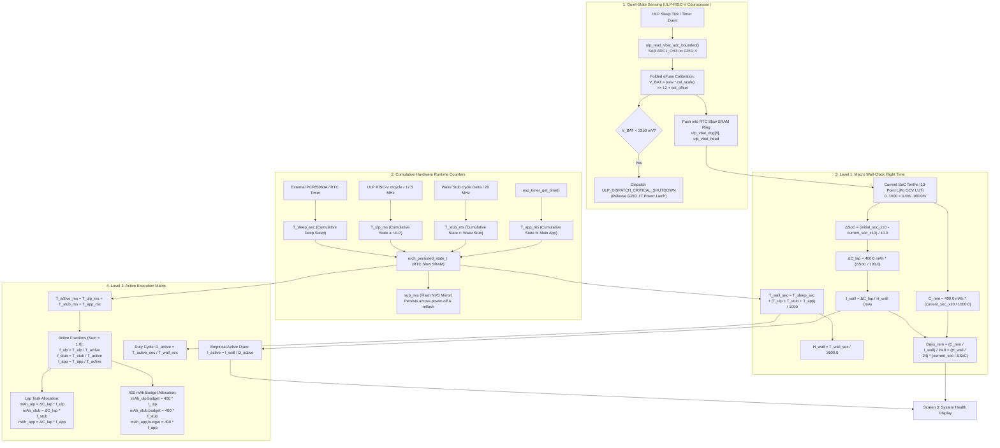

# Battery Metrology, Power Management & Autonomy Engine Specification

## 1. Core Architectural Philosophy & Invariants

Estimating battery State of Charge (SoC) and operating autonomy on an ultra-low-power, event-driven appliance is fundamentally challenged by the physical chemistry of Lithium-Polymer cells:
1. **Flat Discharge Plateau:** Between $3.85\text{V}$ and $3.70\text{V}$ (spanning ~60% down to ~25% SoC), cell voltage drops by only $\sim 2.8\text{ mV}$ per 1% of capacity. Deriving current draw from numerical voltage derivatives ($d V / d t$) over short intervals magnifies ADC noise and diurnal temperature swings, inducing massive mathematical singularities.
2. **Active Load Sag ($I \cdot R$ Drop):** Small LiPo cells ($400\text{ mAh}$) possess internal DC series resistance ($R_{\text{int}} \approx 150 - 350\text{ m}\Omega$). Main CPU execution ($80-240\text{ MHz}$ turbo, SPI bus transmission, e-paper charge pump activation) draws $30 - 100\text{ mA}$, causing an instantaneous $10 - 30\text{ mV}$ voltage drop. Sampling cell voltage during main CPU execution severely corrupts Open-Circuit Voltage (OCV) table lookups.

To achieve metrological reliability, H1OS enforces **six strict battery architecture invariants**:

1. **Exclusive ULP Resting Acquisition:** The main dual-core Xtensa CPU **never** triggers the battery SAR ADC while actively executing. The ULP-RISC-V coprocessor samples `ADC1_CHANNEL_3` **exclusively** during quiet deep sleep and commits samples into an 8-entry circular ring buffer in RTC Slow SRAM (`ulp_vbat_ring[8]`).
2. **Zero Hardcoded Current Constants:** The autonomy engine **never** guesses or hardcodes speculative current values ($0.045\text{ mA}$, $28\text{ mA}$, $36\text{ mA}$). Current draw is derived strictly from empirical runtime and measured capacity loss.
3. **Strict Two-Level Empirical Model:**
   - **Level 1 (Macro Wall-Clock Flight Time):** Total calendar/wall time ($T_{\text{wall}} = T_{\text{sleep}} + T_{\text{active}}$) anchors empirical capacity drop ($\Delta C_{\text{lap}}$) to compute real macro current draw ($I_{\text{wall}}$) and projected remaining days ($\text{Days}_{\text{rem}}$).
   - **Level 2 (Active Execution Matrix):** Active execution time ($T_{\text{active}} = T_{\text{ulp}} + T_{\text{stub}} + T_{\text{app}}$) is isolated as **The Active Whole ($1.0$)**, attributing consumed mAh across tasks proportional to active runtime fractions ($f_{\text{ulp}}, f_{\text{stub}}, f_{\text{app}}$).
4. **Dynamic User-Configured Schedules:** The autonomy engine makes zero assumptions about fixed periods (e.g. 60s or 300s). It dynamically reads user-configured Flow A (`sample_interval_sec`) and Flow B (`flow_b_period_sec`) intervals and integrates raw physical hardware durations.
5. **Cross-Session Persistence & Thermal Rebound Guard:** Cumulative hardware runtime counters reside in RTC Slow SRAM (`orch_persisted_state_t`) across sleep cycles and mirror into Flash NVS (`sub_nvs`) before sleep and on shutdown. Lap resets trigger strictly on real charger unplug transitions or $\ge 3.0\%$ jumps, preventing diurnal afternoon temperature rises from wiping accumulated timers.
6. **Tenths-of-a-Percent Precision & Singularity Guards:** State of Charge is tracked in tenths of a percent (`initial_soc_x10`, `current_soc_x10`, $0..1000 = 0.0\%..100.0\%$) for smooth convergence. If $\Delta\text{SoC} < 1.0\%$ or $T_{\text{wall}} < 60\text{s}$, autonomy displays `"CALIBRATING..."`, guaranteeing zero divide-by-zero singularities.

---

## 2. End-to-End Metrology & Execution Flow



---

## 3. Hardware Voltage Sensing & ADC Calibration

### 3.1 Voltage Divider Transfer Function
The LiPo cell terminal ($3.0\text{V} - 4.2\text{V}$) is attenuated through a symmetric precision divider:
- High-side resistor: $R_1 = 200\text{ k}\Omega$
- Low-side resistor: $R_2 = 200\text{ k}\Omega$
- Sense node: `GPIO 4` (`ADC1_CHANNEL_3`)

$$
V_{\text{ADC}} = V_{\text{BAT}} \cdot \left(\frac{R_2}{R_1 + R_2}\right) = \frac{V_{\text{BAT}}}{2} \implies V_{\text{BAT}} = 2.0 \cdot V_{\text{ADC}}
$$

- **Continuous Divider Bleed:** $I_{\text{bleed}} = \frac{4.2\text{ V}}{400\text{ k}\Omega} = 10.5\ \mu\text{A}$ (documented in `ERRATA.md` E5).
- **Thevenin Impedance:** $R_{\text{th}} = 200\text{ k}\Omega \parallel 200\text{ k}\Omega = 100\text{ k}\Omega$.

### 3.2 ULP Folded Calibration Handoff
On cold boot, `sub_power_get_ulp_cal_params()` evaluates the ESP32-S3 eFuse curve-fitting calibration scheme across two raw counts that tightly bracket the operating divider range ($1500\text{ mV} \le V_{\text{ADC}} \le 2100\text{ mV} \implies \text{raw}_1 = 2000, \text{raw}_2 = 3000$).

To prevent factor-of-2 offset errors and minimize coprocessor cycle execution, the $2\times$ voltage divider ratio is **folded directly** into the slope and offset on the main CPU:

$$
m_{\text{vbat}} = \frac{2 \cdot (V_{3000} - V_{2000}) \cdot 4096}{1000}
$$

$$
b_{\text{vbat}} = 2 \cdot V_{2000} - \frac{m_{\text{vbat}} \cdot 2000}{4096}
$$

During deep sleep, the ULP converts raw 12-bit ADC counts using a single shift and add:

$$
V_{\text{BAT}} = \left(\frac{\text{raw} \cdot \text{cal\_scale}}{4096}\right) + \text{cal\_offset}
$$

---

## 4. Single Authoritative 13-Point LiPo OCV Lookup Curve

Lithium-Polymer discharge chemistry is mapped through an authoritative 13-point Open-Circuit Voltage table located in [`components/h1os/src/sub_power.c`](file:///c:/Users/Matt/Documents/GitHub/H1OS/components/h1os/src/sub_power.c). To avoid quantization error, SoC is interpolated in **Tenths of a Percent** ($0..1000 = 0.0\%..100.0\%$):

| Index | Terminal Voltage ($V_{\text{BAT}}$) | SoC (Tenths of a %) | SoC Percentage | Operating Region |
| :---: | :---: | :---: | :---: | :--- |
| **0** | $\ge 4200\text{ mV}$ | 1000 | 100.0% | Full Charge Saturation Cutoff |
| **1** | $4120\text{ mV}$ | 950 | 95.0% | Upper Knee Transition |
| **2** | $4040\text{ mV}$ | 880 | 88.0% | Upper Plateau |
| **3** | $3960\text{ mV}$ | 800 | 80.0% | Upper Plateau |
| **4** | $3890\text{ mV}$ | 730 | 73.0% | Upper Plateau |
| **5** | $3820\text{ mV}$ | 600 | 60.0% | Flat Discharge Plateau |
| **6** | $3780\text{ mV}$ | 480 | 48.0% | Flat Discharge Plateau |
| **7** | $3750\text{ mV}$ | 360 | 36.0% | Flat Discharge Plateau |
| **8** | $3720\text{ mV}$ | 250 | 25.0% | Lower Plateau |
| **9** | $3680\text{ mV}$ | 150 | 15.0% | Knee Departure |
| **10**| $3600\text{ mV}$ | 80 | 8.0% | Low Battery Warning |
| **11**| $3450\text{ mV}$ | 30 | 3.0% | Critical Cutoff Imminent |
| **12**| $\le 3300\text{ mV}$ | 0 | 0.0% | Hardware Brownout Cutoff |

Between adjacent table entries $(V_k, \text{SoC}_k)$ and $(V_{k+1}, \text{SoC}_{k+1})$ where $V_{k+1} \le V_{\text{BAT}} \le V_k$:

$$
\text{SoC}_{\text{x10}}(V_{\text{BAT}}) = \text{SoC}_{k+1} + \frac{(V_{\text{BAT}} - V_{k+1}) \cdot (\text{SoC}_k - \text{SoC}_{k+1})}{V_k - V_{k+1}}
$$

---

## 5. Two-Level Empirical Autonomy Math

### 5.1 Level 1: Macro Wall-Clock Flight Time
1. **Aggregated Flight Time:**
   $$T_{\text{active\_ms}} = T_{\text{ulp\_ms}} + T_{\text{stub\_ms}} + T_{\text{app\_ms}}$$
   $$T_{\text{active\_sec}} = \frac{T_{\text{active\_ms}}}{1000.0}$$
   $$T_{\text{wall\_sec}} = T_{\text{sleep\_sec}} + T_{\text{active\_sec}}$$
   $$H_{\text{wall}} = \frac{T_{\text{wall\_sec}}}{3600.0}\quad [\text{hours}]$$

2. **Empirical Capacity Lost During Flight Lap (Tenths of a % Resolution):**
   $$\Delta\text{SoC} = \frac{\text{initial\_soc\_x10} - \text{current\_soc\_x10}}{10.0}\quad [\%]$$
   $$\Delta C_{\text{lap}} = 400.0\text{ mAh} \times \left(\frac{\Delta\text{SoC}}{100.0}\right)$$

3. **Macro Current Draw ($I_{\text{wall}}$):**
   $$I_{\text{wall}} = \frac{\Delta C_{\text{lap}}}{H_{\text{wall}}}\quad [\text{mA}]$$

4. **Projected Operating Autonomy:**
   $$C_{\text{rem}} = 400.0\text{ mAh} \times \left(\frac{\text{current\_soc\_x10}}{1000.0}\right)$$
   $$H_{\text{rem}} = \frac{C_{\text{rem}}}{I_{\text{wall}}} = H_{\text{wall}} \times \left(\frac{\text{current\_soc\_x10} / 10.0}{\Delta\text{SoC}}\right)$$
   $$\text{Days}_{\text{rem}} = \frac{H_{\text{rem}}}{24.0}$$

### 5.2 Level 2: Active Execution Matrix & Task Attribution
Silicon execution is partitioned into three active tasks:
- **State $a$ (`ulp`):** Periodic wake on user-configured Flow A period ($T_{\text{Flow A}} = \text{sample\_interval\_sec}$) or button event $\implies T_{\text{ulp\_ms}}$ (measured via ULP mcycle CSR divided by $17500\text{ cycles/ms}$).
- **State $b$ (`app`):** Periodic wake on user-configured Flow B period ($T_{\text{Flow B}} = \text{flow\_b\_period\_sec}$) for display refresh / flash sync, or 30-second downclocked carousel session $\implies T_{\text{app\_ms}}$ (measured via `esp_timer_get_time()`).
- **State $c$ (`stub`):** Periodic wake on user-configured Flow A period ($T_{\text{Flow A}}$) for bit-banged SHTC3 sensor acquisition and plateau verification $\implies T_{\text{stub\_ms}}$ (measured via Core 0 CCOUNT CSR).

**The Active Whole ($1.0$):**

$$
f_{\text{ulp}} = \frac{T_{\text{ulp\_ms}}}{T_{\text{active\_ms}}}, \quad f_{\text{stub}} = \frac{T_{\text{stub\_ms}}}{T_{\text{active\_ms}}}, \quad f_{\text{app}} = \frac{T_{\text{app\_ms}}}{T_{\text{active\_ms}}}
$$

$$
f_{\text{ulp}} + f_{\text{stub}} + f_{\text{app}} = 1.000
$$

**Duty Cycle & Active Silicon Current:**

$$
D_{\text{active}} = \frac{T_{\text{active\_sec}}}{T_{\text{wall\_sec}}}
$$

$$
I_{\text{active}} = \frac{I_{\text{wall}}}{D_{\text{active}}}\quad [\text{mA}]
$$

**Per-Task Capacity Attribution:**
- Consumed capacity per task during current lap: $\text{mAh}_{i,\text{lap}} = \Delta C_{\text{lap}} \times f_i$
- 400 mAh total budget allocation per task: $\text{mAh}_{i,\text{budget}} = 400.0\text{ mAh} \times f_i$

---

## 6. Battery State Machine & Lap Lifecycle

### 6.1 State Machine Enumeration
```c
typedef enum {
    H1OS_BATTERY_DISCHARGING = 0, /**< Normal autonomous battery discharge.       */
    H1OS_BATTERY_CHARGING,        /**< Voltage rising over consecutive reads.      */
    H1OS_BATTERY_CHARGED,         /**< Saturated voltage (>=4180 mV) or USB host.  */
} h1os_battery_state_t;
```

State arbitration evaluates the 8-entry ULP ring buffer:
- If USB host is detected via `sub_power_connected_usb()`:
  - If $V_{\text{BAT}} \ge 4180\text{ mV} \implies$ **`CHARGED`**.
  - Else $\implies$ **`CHARGING`**.
- If USB host is not detected (standalone battery or 5V wall adapter):
  - Compare newest sample $V_{\text{new}}$ with sample from 2 cycles prior $V_{\text{prev}}$:
    - If $V_{\text{new}} \ge V_{\text{prev}} + 15\text{ mV} \implies$ **`CHARGING`**.
    - If $V_{\text{new}} \ge 4180\text{ mV}$ and $|V_{\text{new}} - V_{\text{prev}}| \le 5\text{ mV} \implies$ **`CHARGED`**.
    - Else $\implies$ **`DISCHARGING`**.

### 6.2 Lap Reset on Charger Unplug (Thermal Rebound Protection)
To prevent diurnal afternoon temperature rises ($+4^\circ\text{C} \implies +3\text{--}6\text{ mV}$ rebound on the flat plateau) from prematurely wiping accumulated flight timers, a discharge lap reset triggers **strictly** when:
1. `initial_soc_x10 == 0` (uninitialized cold boot), OR
2. The state machine explicitly transitions from `H1OS_BATTERY_CHARGING` or `H1OS_BATTERY_CHARGED` to `H1OS_BATTERY_DISCHARGING`, OR
3. `current_soc_x10 >= initial_soc_x10 + 30` (a $\ge 3.0\%$ jump guarantees a real charge event occurred while powered off).

When triggered:
- `initial_soc_x10` latches `current_soc_x10`.
- Cumulative counters ($T_{\text{sleep\_sec}}, T_{\text{ulp\_ms}}, T_{\text{stub\_ms}}, T_{\text{app\_ms}}$) reset to $0$.
- The new lap baseline commits to Flash NVS via `orch_state_save_runtimes_to_nvs()`.

### 6.3 Singularity & Calibration Guard
If $\Delta\text{SoC} < 1.0\%$ (i.e. $\text{initial\_soc\_x10} - \text{current\_soc\_x10} < 10$) **OR** $T_{\text{wall\_sec}} < 60$ **OR** $T_{\text{active\_ms}} == 0$:
- `autonomy_days = -1.0f`
- `wall_draw_ma = -1.0f`
- `active_draw_ma = -1.0f`
- Screen 3 displays: `"Autonomy: ~CALIBRATING..."` until $\ge 1.0\%$ SoC has been empirically discharged.

---

## 7. Data Structures & Architectural Cross-Reference

| Header File | Source File | Structural Responsibility |
| :--- | :--- | :--- |
| [`sub_power.h`](file:///c:/Users/Matt/Documents/GitHub/H1OS/components/h1os/include/h1os/sub_power.h) | [`sub_power.c`](file:///c:/Users/Matt/Documents/GitHub/H1OS/components/h1os/src/sub_power.c) | Single 13-point LiPo LUT (tenths of a % resolution), folded eFuse calibration, state machine, `sub_power_calc_autonomy()`. |
| [`orch_state.h`](file:///c:/Users/Matt/Documents/GitHub/H1OS/components/h1os/include/h1os/orch_state.h) | [`orch_state.c`](file:///c:/Users/Matt/Documents/GitHub/H1OS/components/h1os/src/orch_state.c) | Master persistent runtime tracking block (`total_sleep_sec`, `total_ulp_ms`, `total_wake_stub_ms`, `total_app_run_ms`, `initial_soc_x10`) in RTC Slow SRAM. |
| — | [`ulp/main.c`](file:///c:/Users/Matt/Documents/GitHub/H1OS/components/h1os/ulp/main.c) | Autonomous quiet-state SAR ADC read and 8-entry circular ring buffer (`ulp_vbat_ring[8]`). |
| [`sub_nvs.h`](file:///c:/Users/Matt/Documents/GitHub/H1OS/components/h1os/include/h1os/sub_nvs.h) | [`sub_nvs.c`](file:///c:/Users/Matt/Documents/GitHub/H1OS/components/h1os/src/sub_nvs.c) | Cross-session Flash NVS mirroring across deep sleep, battery swaps, and reflashes. |
| [`h1os.h`](file:///c:/Users/Matt/Documents/GitHub/H1OS/components/h1os/include/h1os/h1os.h) | [`h1os_lifecycle.c`](file:///c:/Users/Matt/Documents/GitHub/H1OS/components/h1os/src/h1os_lifecycle.c) | Telemetry public API binding (`h1os_telemetry_t.autonomy` and `battery_state`). |
| [`screens.h`](file:///c:/Users/Matt/Documents/GitHub/H1OS/examples/H1OS/main/screens/screens.h) | [`screen_system_health.c`](file:///c:/Users/Matt/Documents/GitHub/H1OS/examples/H1OS/main/screens/screen_system_health.c) | Screen 3 UI presentation of voltage, SoC %, operational state, and projected days. |
