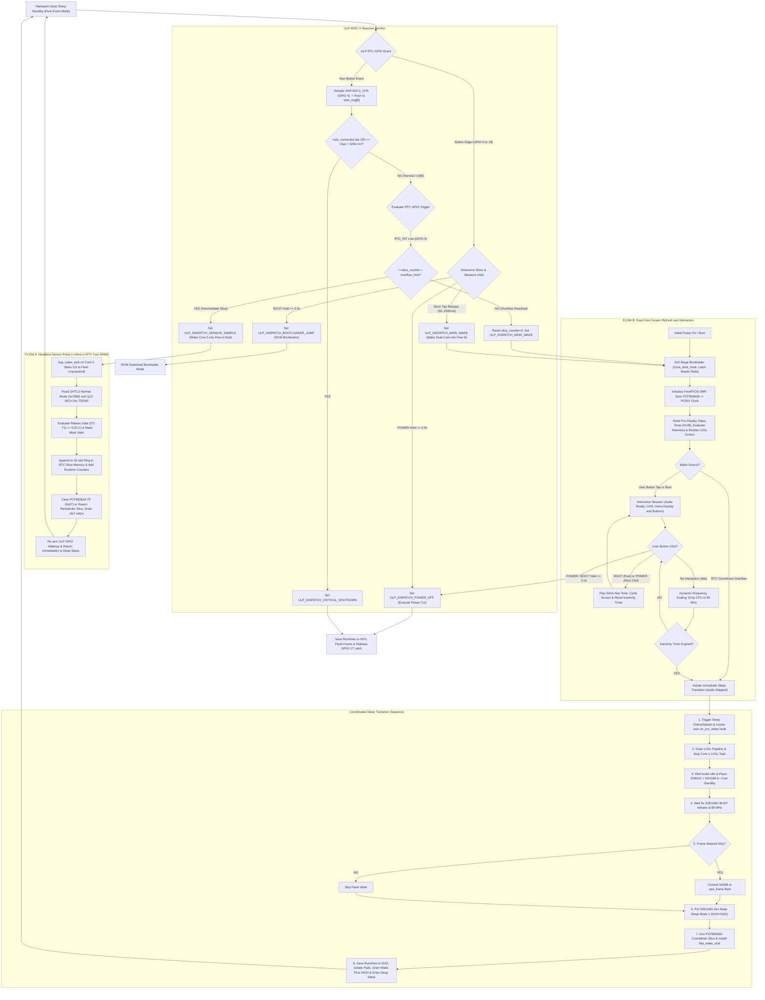
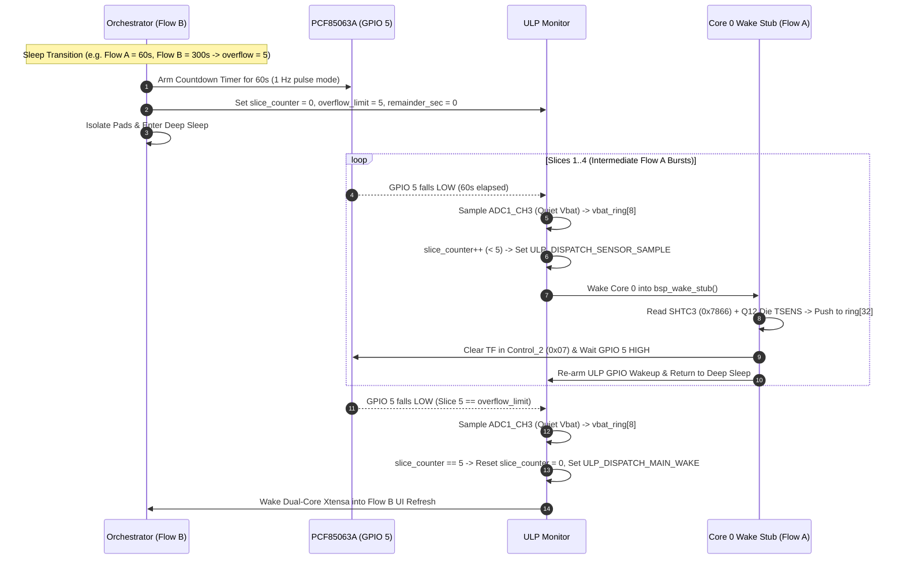

# Application Execution Flow & State Machine

This document models the end-to-end execution flow of **H1OS** across deep sleep, the Pure Event Mode ULP-RISC-V Monitor, isolated Flow A wake stub sensor pulses, and the Flow B interactive user session (with a developer-configurable inactivity timeout defaulting to 30 seconds).

---

## 1. Master System Flowchart

---

## 2. Event-Mode RTC Slicing & Zero-Hour Conflict Elimination

---

## 3. Human-Machine Interaction & Power Policies

### 3.1 Two-Stage Click Interaction
To prevent unintended audio chirps and spurious screen skipping while deep sleeping:
1. **First Click in Deep Sleep (Wake Interaction):**
   - Intercepted by the ULP-RISC-V coprocessor in RTC domain.
   - ULP debounces the press (`30 ms`), waits for release (`30..2500 ms`), records `ulp_last_wake_btn`, and wakes the main processor into Flow B.
   - Flow B boots, detects the user button wake, initializes LVGL and audio, and renders the screen with the **inverted awake badge**.
   - **No page advance or audio tick occurs on the wake click**, guaranteeing that waking the screen does not skip the user's current view.
2. **Second Click in Flow B (Active Navigation):**
   - The user is now looking at the awakened UI.
   - Subsequent clicks are received directly by the running LVGL keypad driver (`keypad_event_cb`): `BOOT` advances forward (`1046 Hz`, `50 ms` tone), `POWER` navigates backward (`880 Hz`, `50 ms` tone), and either button resets the 30-second inactivity session timer.

### 3.2 Audio Codec Standby Gating (<1 µA Invariant)
- **Unattended Wakes (RTC Countdown Timer):**
  - Environmental display refresh wakes bypass the ES8311 codec and NS4168 amplifier initialization entirely.
  - Furthermore, `sub_audio_standby()` tracks `s_rtc_codec_in_standby` in `RTC_DATA_ATTR` so unattended wakes skip redundant I2C deinit writes when the codec is already parked in `<1 µA` standby.
- **User Wakes (Cold Boot or Tactile Button):**
  - Audio subsystem initializes only when `is_user_wake` is true, setting volume strictly from `presentation.volume_pct`.

### 3.3 Strict Lifecycle Contract Validation & Timing Parameter Bounds
- **Single Variable Authority:** All time logic across all layers derives strictly from `st->sample_interval_sec` (Flow A) and `st->flow_b_period_sec` (Flow B) in RTC Slow Memory. Duplicate file-static variables and ternary fallbacks have been removed.
- **Timing Bounds Law:**
  - Flow A (`sample_interval_sec`): $60\text{s} \le A \le 14,400\text{s}$ ($4\text{ hours}$). Must be an exact multiple of $60\text{s}$ if $> 255\text{s}$.
  - Flow B (`flow_b_period_sec`): $300\text{s} \le B \le 86,400\text{s}$ ($24\text{ hours}$). Must be strictly greater than $A$.
  - Remainder Floor: If $\text{remainder} = B \bmod A > 0$, it must be $\ge 60\text{s}$ to justify the re-arm cycle.
- **Unified Setter Enforcement:** Both `h1os_start()` and `h1os_set_flow_periods()` funnel strictly through `h1os_set_flow_periods_internal()`. If parameters violate any bound or invariant, the call fails immediately with `ESP_ERR_INVALID_ARG`.
- Silent fallback magic numbers (`300s`, `120s`, `30s`) are strictly prohibited across the codebase.
