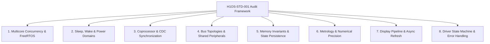
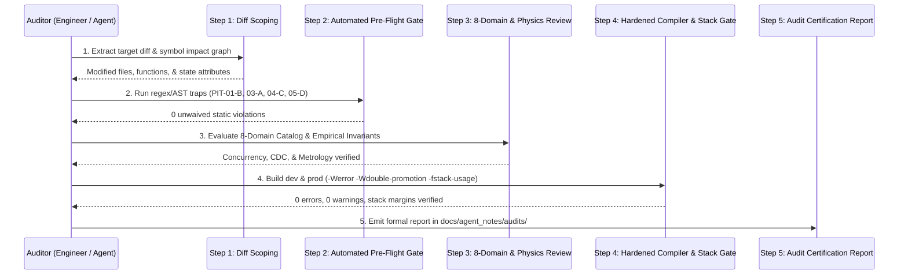

# H1OS-STD-001: Embedded Firmware Audit Framework & Pitfalls Catalog

* **Document ID:** `H1OS-STD-001` (Rev 2.0)

* **Target Platform:** ESP32-S3 Dual-Core Xtensa LX7 + ULP-RISC-V Coprocessor

* **Target Firmware:** H1OS (Layer 1 HAL, Layer 2 Subsystems, Layer 3 Orchestrator, Layer 4 Application/LVGL)

* **Normative References:** JPL Institutional Coding Standard (Power of Ten), MISRA C:2012/2023, SEI CERT C, BARR-C:2018

* **Compliance Mandate:** All code modifications, refactorings, and pull requests must be evaluated and certified against this framework prior to merge.

## 1. Executive Summary & Audit Philosophy

Vague directives such as *"perform an audit"* or *"check the code"* lead to superficial reviews that overlook critical race conditions, clock domain synchronization bugs, and low-power hardware traps.

This standard defines a **deterministic, reproducible auditing process** anchored to industry-grade safety-critical coding frameworks. It establishes concrete failure modes, severity classifications, register-level pitfalls, mechanized compiler/AST verification gates, and formal reporting procedures across **eight foundational embedded engineering domains**.

### 1.1 Core Engineering Invariants

1. **Invariant 1: Empirical Grounding ("Don't Spec Numbers Without Proof")**

   * *Standard Alignment:* DO-178C / IEEE 1012 (Physical Requirement Traceability).

   * Never assert voltages, currents, or timings in documentation or code comments unless verified on calibrated bench instrumentation (oscilloscope, logic analyzer, precision DMM).

   * Separate empirical observation (e.g., *"bus communication ceases when rail is cut"*) from speculative theoretical mechanisms (e.g., *"clamped via internal diodes"*).

2. **Invariant 2: Zero Synthetic Math Offsets**

   * *Standard Alignment:* MISRA C:2012 Dir 4.1 / IEEE 754 (Run-time numerical fidelity).

   * Ground metrology in thermodynamic laws (August-Roche-Magnus psychrometrics, LiPo OCV tables). Never apply synthetic tare offsets, mathematical curve-fitting, or heuristic scaling to mask hardware or firmware defects.

3. **Invariant 3: Deterministic Memory & Strict JPL Rule 3 Adherence**

   * *Standard Alignment:* JPL Rule 3 / MISRA C:2012 Dir 4.12 / CERT `MEM30-C`.

   * Zero runtime dynamic memory allocation (`malloc`, `calloc`, `realloc`, `free`, `strdup`, `new`, `delete`) after boot initialization. All device handles, buffers, and queues must be statically allocated or cached.

## 2. Defect Severity Taxonomy & Waiver Protocol

### 2.1 Severity Classifications

Every pitfall in the H1OS catalog is assigned a normative **Severity Class** (`S0` through `S2`) to eliminate ambiguity during audit disposition:

| Class | Designation | Physical / System Impact | Audit Disposition | 
| ----- | ----- | ----- | ----- | 
| **`S0`** | **Blocker / Silicon Hazard** | Causes brownout, PMU/CPU lockup, shoot-through CMOS leakage, flash wear-out, bus hang, or cross-core memory corruption. | **Immediate Hard Fail.** Cannot merge under any circumstance. | 
| **`S1`** | **Metrology / State Integrity** | Causes silent sensor/battery data corruption, reset of persistent counters, integer overflow, or premature unsettled sampling. | **Hard Fail.** Requires unit test or symbolic range proof of fix. | 
| **`S2`** | **Determinism / Performance** | Causes runtime heap churn, soft-float emulation latency, stack bloat, or visual EPD ghosting. | **Fail** unless accompanied by a bounded, approved inline waiver. | 

### 2.2 Formal Deviation & Waiver Protocol (MISRA Style)

When hardware constraints or third-party ESP-IDF internals necessitate a localized deviation from an `S1` or `S2` rule (`S0` rules cannot be waived), engineers must embed a machine-parsable **Deviation Permit** directly above the offending construct:

```
// [H1OS-WAIVER: PIT-08-B | Class: S1 | Reason: Hardware reset pulse guaranteed < 10us by silicon | Proof: Scope Capture 2026-10-22]
while (REG_GET_FIELD(RTC_CNTL_LOW_POWER_ST_REG, RTC_CNTL_RDY_FOR_WAKEUP) == 0) {
    // Tight poll permitted only with documented hardware guarantee
}

```

Unannotated violations or waivers lacking a concrete `Reason` and `Proof` artifact are rejected during Step 2 (Automated Pre-Flight Gate).

## 3. Normative Standards Cross-Reference Matrix

The H1OS 8-Domain Catalog maps directly to established safety-critical C/C++ coding standards:

| H1OS Domain | Normative External Standards | Primary Enforced Directives & Rules | 
| ----- | ----- | ----- | 
| **D1: Concurrency & FreeRTOS** | JPL Rule 2, CERT C (`CON`), MISRA Dir 4.10 | Fixed loop/wait upper bounds; prevention of data races, non-atomic RMW, and priority inversion. | 
| **D2: Sleep, Wake & Power** | BARR-C:2018 (Sec 7), Hardware Errata | Deterministic pin state isolation, pad hold enforcement, and physical debounce verification. | 
| **D3: Coprocessor & CDC** | CERT `DCL22-C`, MISRA Rule 12.2 | `volatile` hardware access, strict bitmask vs. shift macro typing, and slow-clock domain hold times. | 
| **D4: Bus Topologies** | JPL Rule 3, MISRA Dir 4.12 | Zero runtime heap allocation in bus drivers; shared-rail electrical isolation invariants. | 
| **D5: Memory & Persistence** | JPL Rule 1 & 3, MISRA Rule 17.2 | No recursion; static stack depth proofs (`.su`); explicit RTC Slow SRAM & NVS commit boundaries. | 
| **D6: Metrology & Precision** | CERT `INT32-C` / `FLP36-C`, IEEE 754 | Signed integer overflow prevention (`int64_t` promotion), single-precision `f` enforcement, zero fudge factors. | 
| **D7: Display Pipeline** | CERT `CON32-C`, Hardware Timing | Mutual exclusion (`lv_lock`) across cores; asynchronous high-voltage charge pump completion gates. | 
| **D8: Driver State & Errors** | JPL Rule 7, MISRA Rule 17.7, CERT `ERR33-C` | Mandatory checking of all non-void return values (`esp_err_t`); deterministic resource cleanup on error exits. | 

## 4. The 8-Domain Firmware Pitfalls Catalog



### Domain 1: Multicore Concurrency & FreeRTOS Synchronization

On the dual-core ESP32-S3, tasks execute simultaneously on Core 0 (PRO_CPU) and Core 1 (APP_CPU). Concurrency bugs manifest as intermittent timing-dependent freezes or memory corruptions.

| ID | Class | External Rule | Failure Mode & Root Cause | Audit Inspection & Verification Procedure | 
| ----- | ----- | ----- | ----- | ----- | 
| **PIT-01-A** | `S0` | CERT `CON32-C`  BARR-C `7.2` | **Cross-Core State Mutation without Barriers:** Core 0 writes a shared flag; Core 1 reads stale cached data or reordered stores. | Verify shared variables across cores are qualified with `volatile` and protected by mutexes, spinlocks (`portMUX_TYPE`), or explicit memory fences (`__sync_synchronize()`). | 
| **PIT-01-B** | `S0` | JPL Rule 2  MISRA `D4.1` | **Unbounded Mutex Blocking (`portMAX_DELAY`):** Low-priority task holding a peripheral mutex is starved, permanently deadlocking a supervisor task. | Search for `portMAX_DELAY` in `hal_*`, `sub_*`, and `orch_*`. Enforce explicit bounded timeouts (e.g., `pdMS_TO_TICKS(100)`) with explicit timeout recovery branches. | 
| **PIT-01-C** | `S0` | CERT `CON40-C` | **Non-Atomic Read-Modify-Write:** Two tasks concurrently update bitfields or integer flags (e.g., \`status | = FLAG_A\`), dropping one update. | 
| **PIT-01-D** | `S1` | CERT `CON35-C` | **Priority Inversion Hazards:** Low-priority worker task holds a shared bus lock needed by high-priority audio or UI tasks. | Verify all FreeRTOS locks protecting shared hardware resources utilize priority inheritance (`xSemaphoreCreateMutex()`), never binary semaphores. | 
| **PIT-01-E** | `S0` | CERT `CON39-C` | **Asynchronous Task Deletion Races:** Supervisor unmounts a peripheral (e.g. SDMMC) while a worker thread is still executing inside the driver. | Ensure completion handles (`TaskHandle_t`) are `volatile`, self-clear to `NULL` only on clean exit, and are joined via bounded wait loops prior to peripheral deinit. | 

### Domain 2: Sleep, Wake & Power Domain Lifecycle

Low-power battery endurance requires rigorous management of power rails, pad isolation states, and wake latches.

| ID | Class | External Rule | Failure Mode & Root Cause | Audit Inspection & Verification Procedure | 
| ----- | ----- | ----- | ----- | ----- | 
| **PIT-02-A** | `S0` | H1OS Hardware Invariant | **CMOS Floating Pad Shoot-Through:** Unused or input GPIO left floating during deep sleep drifts to mid-rail, causing continuous shoot-through current ($I_{\text{cross}}$). | Audit `hal_io_isolate_sleep_pads()`. Verify every digital and RTC pin is explicitly pulled up, pulled down, tri-stated, or isolated before sleep entry. | 
| **PIT-02-B** | `S0` | H1OS Hardware Invariant | **Missing Pad Hold on Active-Low Enables:** Active-low control lines (`PA_EN`, `EPD_3V3_EN`, `EPD_DC`) glitch or float HIGH during CPU power collapse. | Verify `gpio_hold_en()` is invoked on all critical enable lines, and that `gpio_deep_sleep_hold_en()` is asserted before entering sleep. | 
| **PIT-02-C** | `S1` | JPL Rule 2 | **Button Release Bounce & Sleep Re-Trigger:** User presses tactile button; device wakes, processes tap, and enters sleep while button is still held LOW, instantly re-waking. | Audit sleep entry in `sub_power.c`. Confirm bounded drain loops verify wake pins (`GPIO 0`, `GPIO 18`, `GPIO 5`) have returned HIGH before arming EXT1/ULP wakeup. | 
| **PIT-02-D** | `S0` | ESP32-S3 TRM | **Premature Main CPU Wake Trigger:** ULP asserts `ulp_riscv_wakeup_main_processor()` before PMU power domains stabilize, crashing the main boot sequence. | Check `ulp/main.c`. Verify `REG_GET_FIELD(RTC_CNTL_LOW_POWER_ST_REG, RTC_CNTL_RDY_FOR_WAKEUP)` is polled with a bounded timeout prior to issuing wake. | 

### Domain 3: Coprocessor & Clock Domain Crossing (CDC)

The ULP-RISC-V coprocessor runs on the RTC slow/fast clock domain, interacting with registers shared by the Xtensa high-speed APB domain.

| ID | Class | External Rule | Failure Mode & Root Cause | Audit Inspection & Verification Procedure | 
| ----- | ----- | ----- | ----- | ----- | 
| **PIT-03-A** | `S0` | MISRA `R12.2`  BARR-C `4.2` | **Bitmask vs. Field Shift Macro Confusion:** Passing a `_S` shift constant or multi-bit field to `REG_GET_BIT(reg, mask)`, reading the wrong bit position. | Grep low-level code for `REG_GET_BIT` and `REG_SET_BIT`. Verify arguments are unshifted single-bit masks (`BIT(n)` or `_M`). Enforce `REG_GET_FIELD` for multi-bit fields. | 
| **PIT-03-B** | `S0` | Hardware CDC Timing | **Slow-Clock Domain Crossing (CDC) Violations:** Pulsing a clear bit or latch on the $136\,\text{kHz}$ RTC slow clock for only one $240\,\text{MHz}$ CPU cycle ($\approx 4\,\text{ns}$), failing to latch. | Verify every pulse across the RTC slow clock domain maintains a hold delay $\ge 120\,\mu\text{s}$ ($>16$ cycles of $136\,\text{kHz}$ RC) via `esp_rom_delay_us()` before de-assertion. | 
| **PIT-03-C** | `S0` | CERT `DCL22-C` | **Write-Only Strobe vs. Synchronous R/W Registers:** Leaving a synchronous reset bit asserted (e.g. Bit 30 of `RTC_CNTL_ULP_CP_TIMER_REG`), holding the wake gate in reset. | Cross-check register descriptions in the ESP32-S3 TRM. Verify whether bits are `W1TC` (self-clearing), `WO` (write-only strobe), or `R/W` (requiring manual clearing). | 
| **PIT-03-D** | `S0` | H1OS Errata `ERR-S1` | **Timer Mode vs. Event Mode Contention:** Arming both the PMU sleep countdown timer and RTC GPIO wakeups simultaneously, triggering silicon arbitration lockup. | Verify ULP firmware strictly operates in Pure Event Mode (`ULP_RISCV_WAKEUP_SOURCE_GPIO`) and that `RTC_CNTL_ULP_CP_SLP_TIMER_EN = 0`. | 

### Domain 4: Bus Topologies & Shared Peripherals (I2C / SPI / SDMMC)

A shared physical bus creates inter-device dependencies where a failure or power-cut on one component can incapacitate all others.

| ID | Class | External Rule | Failure Mode & Root Cause | Audit Inspection & Verification Procedure | 
| ----- | ----- | ----- | ----- | ----- | 
| **PIT-04-A** | `S0` | H1OS Errata `ERR-E4` | **Unbuffered Power-Gating on Shared Buses:** Power is cut to an IC on a shared bus without hardware isolation switches, clamping shared SDA/SCL or SPI lines low. | Audit all power rails. If a peripheral shares I2C/SPI lines with other active devices, verify firmware keeps the rail powered and uses software standby commands. | 
| **PIT-04-B** | `S1` | DO-178C Traceability | **Unverified Vendor Datasheet Assumptions:** Assuming an IC provides internal pull-up resistors or ESD isolation diodes when omitted from vendor specs. | Audit driver electrical assumptions against vendor datasheets. Never assume internal pull-ups or fail-safe high-Z pads exist without explicit datasheet proof. | 
| **PIT-04-C** | `S2` | JPL Rule 3  MISRA `D4.12` | **Runtime Heap Churn in Bus Drivers:** Calling `i2c_master_bus_add_device()` on every transaction, allocating and freeing heap memory on each wake cycle. | Check `hal_i2c.c` and `hal_spi.c`. Confirm device handles for onboard peripherals (`ES8311`, `PCF85063`, `SHTC3`) are statically initialized once and cached. | 
| **PIT-04-D** | `S1` | JPL Rule 2 | **Under-Allocated Bus Timeouts:** Setting SDMMC or I2C command timeouts too tight (e.g., $3\,\text{ms}$), causing intermittent failures on cold or aging flash media. | Verify bus transaction timeouts provide adequate margin ($\ge 20\,\text{ms}$ for I2C, $\ge 100\,\text{ms}$ for SDMMC block operations) and log explicit timeout telemetry. | 

### Domain 5: Memory Invariants, Stack Depths & State Persistence

Deep-sleep power cycles reset general-purpose SRAM, while non-volatile storage (NVS) requires explicit transaction management.

| ID | Class | External Rule | Failure Mode & Root Cause | Audit Inspection & Verification Procedure | 
| ----- | ----- | ----- | ----- | ----- | 
| **PIT-05-A** | `S1` | H1OS Lifecycle Invariant | **BSS Memory Reset Traps Across Deep Sleep:** Placing state variables intended to survive deep sleep into standard `.bss` or `.data` RAM, resetting them to zero on wake. | Audit variables tracking cross-wake telemetry, rolling buffers, or debounce counters. Verify explicit decoration with `RTC_DATA_ATTR` or `RTC_NOINIT_ATTR`. | 
| **PIT-05-B** | `S1` | MISRA `R9.1` | **Cold-Boot NVS Lifecycle Inversion:** Restoring state from NVS before boot-flow determination, followed by an unconditional state init that wipes restored metrics. | Audit `h1os_lifecycle.c`. Confirm `orch_state_load_runtimes_from_nvs()` executes *after* cold-boot initialization, and that graceful shutdown flushes state to NVS. | 
| **PIT-05-C** | `S0` | JPL Rule 1  MISRA `R17.2` | **Task Stack Overflow under Deep Call Chains:** Formatting strings (`snprintf`) or executing VFS/FATFS calls in small-stack tasks, corrupting adjacent heap/TCB memory. | Inspect compiler `.su` (stack usage) output. Enforce minimum stack depths: $\ge 2048\,\text{B}$ for simple tasks; $\ge 4096\,\text{B}$ for tasks performing VFS, NVS, or formatted logging. | 
| **PIT-05-D** | `S1` | CERT `FIO42-C` | **Uncommitted NVS Transactions:** Writing keys via `nvs_set_*()` but failing to invoke `nvs_commit()` before entering deep sleep or cutting power. | Audit all NVS write paths. Ensure every `nvs_set_*` sequence is dominated by an explicit, error-checked `nvs_commit()` prior to handle closure or sleep entry. | 

### Domain 6: Metrology, Floating Point & Numerical Precision

Sensors produce real-world physical data that must be processed without precision degradation, integer wrap-around, or artificial distortion.

| ID | Class | External Rule | Failure Mode & Root Cause | Audit Inspection & Verification Procedure | 
| ----- | ----- | ----- | ----- | ----- | 
| **PIT-06-A** | `S1` | H1OS Invariant 2 | **Synthetic Heuristic Compensation (Fudge Factors):** Adding software tares, linear offsets, or magic multipliers to mask self-heating or ADC drift. | Review all mathematical routines in `orch_math.c` and `sub_power.c`. Reject arbitrary constants; enforce pure physics models (August-Roche-Magnus, LiPo OCV tables). | 
| **PIT-06-B** | `S2` | MISRA `D4.1`  CERT `FLP36-C` | **Implicit Double-Precision Promotion:** Writing floating-point literals without an `f` suffix (e.g., `100.0` vs `100.0f`), trapping into slow software `double` emulation on Xtensa single-precision FPU. | Enforce `-Wdouble-promotion` and `-Werror` in `CMakeLists.txt`. Verify all math functions use `<math.h>` single-precision variants (`expf`, `logf`, `fabsf`). | 
| **PIT-06-C** | `S1` | CERT `INT32-C`  MISRA `D4.1` | **32-Bit Fixed-Point Integer Arithmetic Overflow:** Multiplying centi-degree or microvolt intermediates (e.g., `raw * scale`) exceeding $2^{31}-1$ ($2.14 \times 10^9$). | Audit fixed-point math in ULP and host code. Cast operands to `int64_t` prior to multiplication or prove bounds symbolically across full sensor range ($[-40^\circ\text{C}, +125^\circ\text{C}]$). | 
| **PIT-06-D** | `S1` | Metrology Invariant | **Unverified Sensor Settling (Thermal Drift):** Sampling environmental sensors immediately upon CPU wake before thermal equilibrium is established. | Verify sensor data is flagged `SAMPLE_FLAG_THERMAL_SETTLED` only when consecutive cold-wake samples satisfy $\vert{}\Delta T\vert{} \le 0.20^\circ\text{C}$. | 

### Domain 7: Display Pipeline & Async Refresh Conflicts

Electrophoretic displays (e-Paper) require multi-second physical refresh sequences driven by internal high-voltage charge pumps.

| ID | Class | External Rule | Failure Mode & Root Cause | Audit Inspection & Verification Procedure | 
| ----- | ----- | ----- | ----- | ----- | 
| **PIT-07-A** | `S0` | Hardware Sequencing | **Deep Sleep Entry During Active EPD Refresh:** Cutting `EPD_3V3_EN` or isolating SPI pads while the SSD1681 charge pump is actively driving the panel, damaging the display or corrupting bistable state. | Audit `orch_flow.c` and `h1os_lifecycle.c`. Confirm `sub_display_wait_busy()` verifies physical panel completion (`BUSY` pin LOW) before power-down or sleep. | 
| **PIT-07-B** | `S0` | CERT `CON32-C` | **Unguarded LVGL Internal Tree Access:** Reading display invalidation flags (`inv_p`) or mutating widgets from Core 0 while Core 1 executes `lv_timer_handler()`. | Audit `h1os_lvgl.cpp` and UI controllers. Verify all cross-task interactions with LVGL structures strictly acquire `lv_lock()` and release via `lv_unlock()`. | 
| **PIT-07-C** | `S2` | Panel Physics | **Partial Refresh Waveform Degradation (Ghosting):** Executing unbounded consecutive partial refreshes without a periodic full waveform scrub, causing ionic charge polarization. | Confirm display orchestrators track consecutive partial refresh counts in `RTC_DATA_ATTR` and force a full refresh scrub every $N$ cycles or upon mode transitions. | 

### Domain 8: Driver State Machine & Error Recovery

Firmware must fail safely and deterministically without leaving peripherals in half-initialized, locked, or high-current states.

| ID | Class | External Rule | Failure Mode & Root Cause | Audit Inspection & Verification Procedure | 
| ----- | ----- | ----- | ----- | ----- | 
| **PIT-08-A** | `S1` | JPL Rule 7  MISRA `R17.7` | **Silent Error Masking:** Ignoring an `esp_err_t` return value or catching a failure and returning `ESP_OK` without logging or transitioning to a safe degraded state. | Prohibit unchecked calls to non-void functions. Use `ESP_RETURN_ON_ERROR`, `ESP_ERROR_CHECK_WITHOUT_ABORT`, or explicit error state propagation. | 
| **PIT-08-B** | `S0` | JPL Rule 2 | **Unbounded Hardware Status Polling:** Polling a hardware pin or status register (`while (gpio_get_level(BUSY))`) without a timeout counter, bricking the system if a trace fails. | Inspect all `while` and `for` loops waiting on hardware state. Every loop must terminate on an explicit cycle/tick bound and return `ESP_ERR_TIMEOUT`. | 
| **PIT-08-C** | `S0` | CERT `MEM31-C`  MISRA `R15.5` | **Early Exit Resource Leakage:** Returning early from a function on an error condition without releasing acquired FreeRTOS mutexes, PM locks, or SPI bus locks. | Audit all error return paths in drivers. Enforce structured `goto cleanup;` patterns or RAII wrappers to guarantee mutexes (`xSemaphoreGive`) and PM locks are released. | 

## 5. Standard Operating Procedure (SOP) & Mechanized Gates

Auditors (human engineers or automated verification agents) must execute the following five-stage verification pipeline in strict sequential order:



### Step 1: Diff Scoping & Impact Graph

Generate the exact commit range (`git diff <base>..<head>`). Identify all modified translation units, shared globals, FreeRTOS tasks, hardware registers, and NVS keys.

### Step 2: Automated Static Pre-Flight Gate

Execute deterministic pattern and AST checks across all modified files before beginning manual review:

1. **Dynamic Memory Trap (`PIT-04-C` / JPL Rule 3):**

   ```
   rg "\b(malloc|calloc|realloc|free|strdup|heap_caps_malloc)\s*\(" components/ main/
   
   ```

   *Pass Criteria:* Zero matches outside one-time boot initialization routines.

2. **Unbounded Wait Trap (`PIT-01-B` / JPL Rule 2):**

   ```
   rg "portMAX_DELAY" components/h1os/src/
   
   ```

   *Pass Criteria:* Zero matches in peripheral drivers or orchestrator locks.

3. **Register Macro Misuse Trap (`PIT-03-A`):**

   ```
   rg "REG_(GET|SET)_BIT\s*\([^,]+,\s*[^)]*(_S|_V)\b" components/ ulp/
   
   ```

   *Pass Criteria:* Zero matches (shift `_S` or unshifted value `_V` masks must never be passed to `REG_GET_BIT`).

4. **Double Promotion Literal Trap (`PIT-06-B`):**

   ```
   rg "\b[0-9]+\.[0-9]+(?!f|F)\b" components/ main/
   
   ```

   *Pass Criteria:* Zero unsuffixed floating-point literals in executable code.

### Step 3: 8-Domain Semantic & Physical Grounding Evaluation

Walk each modified function against Section 4 (Domains 1–8) and Section 1.1 (Core Invariants):

* Verify cross-core lock symmetry and `goto cleanup;` error paths (`PIT-01`, `PIT-08`).

* Verify RTC Slow SRAM persistence attributes (`RTC_DATA_ATTR`) and `nvs_commit()` pairing (`PIT-05`).

* Verify fixed-point intermediate casts (`int64_t`) across worst-case physical bounds (`PIT-06-C`).

* Verify zero unmeasured hardware claims in comments or commit messages (Invariant 1).

### Step 4: Hardened Compiler & Stack Usage Gate

All H1OS components must compile cleanly under strict diagnostic enforcement:

```
# Required H1OS Component Compiler Flags
target_compile_options(${COMPONENT_LIB} PRIVATE
    -Wall -Wextra -Werror
    -Wdouble-promotion          # Enforces PIT-06-B (No soft-float double promotion)
    -Wconversion                # Enforces PIT-06-C (Catches silent integer narrowing)
    -Wsign-conversion           # Enforces PIT-03-A / PIT-06-C (Signed/unsigned bitmask traps)
    -Wshadow                    # Prevents variable shadowing in state machines
    -Wunused-result             # Enforces PIT-08-A / JPL Rule 7
    -fstack-usage               # Generates .su stack frames for PIT-05-C verification
)

```

Execute clean builds for both development and production targets:

```
idf.py -B build_dev build
idf.py -B build_prod build

```

Both builds must terminate with **0 errors and 0 warnings**, and `.su` frame deltas must remain within allocated FreeRTOS task stack margins.

### Step 5: Formal Audit Certification Report

Every completed audit must generate an immutable verification artifact in `docs/audits/` adhering strictly to the schema in Section 6.

## 6. Standardized Audit Report Template

Copy and populate the following template for all formal audit certifications:

```
# H1OS Audit Certification Report: [YYYY-MM-DD]-[SHORT_SLUG]

* **Audit Standard:** `H1OS-STD-001 (Rev 2.0)`
* **Target Commit / Range:** `<base-sha>..<head-sha>`
* **Audited Modules:** `[List modified files, e.g., sub_power.c, ulp/main.c]`
* **Auditor:** `[Engineer / Agent Identifier]`
* **Final Disposition:** `[PASS | PASS WITH WAIVERS | FAIL]`

---

## 1. Automated Gate Telemetry (Steps 2 & 4)
* **Build `build_dev`:** `[PASS - 0 Errors, 0 Warnings]`
* **Build `build_prod`:** `[PASS - 0 Errors, 0 Warnings]`
* **JPL Rule 3 Heap Scan:** `[0 dynamic allocations detected]`
* **Worst-Case Stack Frame (`.su`):** `[function_name: X bytes | Task Stack Margin: +Y bytes]`
* **RTC Slow SRAM Delta:** `[+X bytes (Total: Y / 8192 bytes)]`

## 2. 8-Domain Compliance Matrix (Step 3)

| Domain | Applicable | Pitfalls Evaluated | Evidence & File:Line References | Verdict |
| :--- | :---: | :--- | :--- | :---: |
| **D1: Concurrency & FreeRTOS** | `[Yes/No]` | `PIT-01-A..E` | `[e.g., sub_power.c:142 mutex bounded to 50ms]` | `[PASS/FAIL/N/A]` |
| **D2: Sleep, Wake & Power** | `[Yes/No]` | `PIT-02-A..D` | `[e.g., hal_io.c:88 pad hold verified before sleep]` | `[PASS/FAIL/N/A]` |
| **D3: Coprocessor & CDC** | `[Yes/No]` | `PIT-03-A..D` | `[e.g., ulp/main.c:64 150us CDC hold verified]` | `[PASS/FAIL/N/A]` |
| **D4: Bus Topologies** | `[Yes/No]` | `PIT-04-A..D` | `[e.g., hal_i2c.c:51 static device handle cached]` | `[PASS/FAIL/N/A]` |
| **D5: Memory & Persistence** | `[Yes/No]` | `PIT-05-A..D` | `[e.g., orch_state.c:210 nvs_commit() verified]` | `[PASS/FAIL/N/A]` |
| **D6: Metrology & Precision** | `[Yes/No]` | `PIT-06-A..D` | `[e.g., orch_math.c:95 int64_t promotion verified]` | `[PASS/FAIL/N/A]` |
| **D7: Display Pipeline** | `[Yes/No]` | `PIT-07-A..C` | `[e.g., h1os_lvgl.cpp:118 lv_lock() symmetry]` | `[PASS/FAIL/N/A]` |
| **D8: Driver State & Errors** | `[Yes/No]` | `PIT-08-A..C` | `[e.g., sub_sd.c:180 goto cleanup releases mutex]` | `[PASS/FAIL/N/A]` |

## 3. Empirical Grounding & Metrology Audit (Invariants 1 & 2)
* **Physical Claims / Timings Added:** `[None | List claims & cite bench instrument log]`
* **Numerical Range Proof:** `[N/A | Verified no overflow across [-40C, +85C] and [2.50V, 4.35V]]`

## 4. Defect Log, Remediations & Active Waivers
* **[Defect / Waiver ID | Pitfall | Class S0-S2]:** `[Description, root cause, proof artifact, and fix commit SHA]`

```