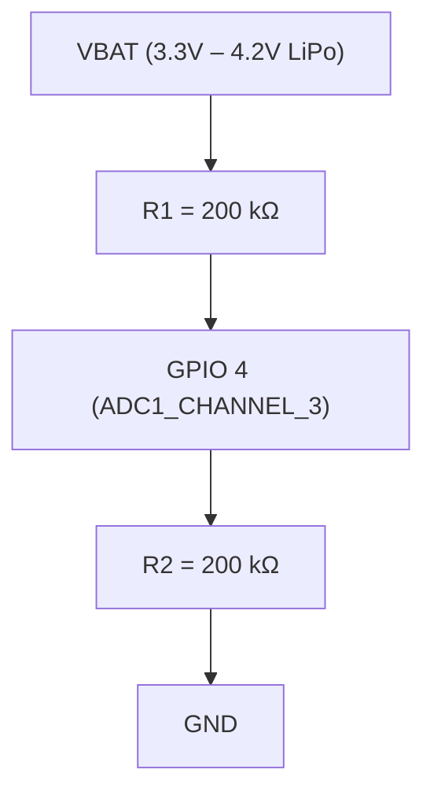

# Power Latch, Battery ADC Sensing & Sleep Retention

## 1. Power Latch Circuitry (BAT_CTRL / GPIO 17)

### Hardware Architecture
The Waveshare ESP32-S3 board features a hardware power latch circuit controlling the main 3.3V battery LDO regulator:
- **Control Line:** `BAT_CTRL` on `GPIO 17` (RTC GPIO 17).
- **Polarity:** Active HIGH (`1 = Regulator ON / Latched`, `0 = Regulator Cut / Off`).
- **Boot Trigger:** Pressing the POWER button physically bridges the gate, powering the MCU. The 2nd-stage bootloader (`h1os_boot_hook`) immediately drives `GPIO 17` HIGH and locks the RTC IO pad hold before the user releases the button.

### Lifecycle Sequencing
1. **2nd-Stage Bootloader (`h1os_boot_hook`):**
   - Configured as output, driven HIGH (`1`), and locked via RTC IO pad hold (`rtc_gpio_hold_en(GPIO_NUM_17)`).
2. **Deep Sleep Entry:**
   - RTC IO pad hold remains asserted: `rtc_gpio_hold_en(GPIO_NUM_17);`
   - Global deep sleep pad hold enabled: `gpio_deep_sleep_hold_en();`
   - RTC peripheral power domain kept ON: `esp_sleep_pd_config(ESP_PD_DOMAIN_RTC_PERIPH, ESP_PD_OPTION_ON);`
3. **System Shutdown (`hal_io_release_power_latch()`):**
   - Release pad holds: `gpio_deep_sleep_hold_dis(); rtc_gpio_hold_dis(GPIO_NUM_17);`
   - Drive `GPIO 17` LOW (`0`).
   - If operating on battery, the LDO gate opens immediately and power is completely severed.

---

## 2. Battery Voltage Divider & ADC Sensing

### Hardware Circuit

- **Divider Transfer Function:**

$$
V_{\text{ADC}} = V_{\text{BAT}} \times \left(\frac{R_2}{R_1 + R_2}\right) = \frac{V_{\text{BAT}}}{2}
$$

$$
V_{\text{BAT}} = 2.0 \times V_{\text{ADC}}
$$

### ADC Configuration Parameters
- **ADC Unit:** `ADC_UNIT_1`
- **Channel:** `ADC_CHANNEL_3` (`GPIO 4`)
- **Attenuation:** `ADC_ATTEN_DB_12` (Full-scale range 0 to 3.1V, perfectly matching the 1.6V to 2.1V divider output)
- **Bit Width:** 12-bit (`ADC_BITWIDTH_DEFAULT`, 0 to 4095 counts)
- **Factory Calibration Scheme:** ESP32-S3 Curve Fitting (`adc_cali_create_scheme_curve_fitting()`) utilizing factory eFuse ADC calibration curves.

### 16-Sample Trimmed Mean Filter
To eliminate ADC thermal noise and supply switching ripple:
1. Capture 16 raw ADC samples: `int samples[16]`.
2. Sort ascending via `qsort()`.
3. Discard lowest 4 samples and highest 4 samples.
4. Average the 8 middle samples:

$$
\bar{S} = \frac{1}{8} \sum_{i=4}^{11} \text{samples}[i]
$$

5. Convert $\bar{S}$ to calibrated millivolts through `adc_cali_raw_to_voltage()`.
6. Multiply by 2.0 to calculate $V_{\text{BAT}}$.

---

## 3. LiPo Open-Circuit Voltage (OCV) Lookup Table

Lithium-Polymer discharge chemistry is non-linear. The BSP translates resting battery voltage into percentage using a 13-point calibrated OCV piecewise lookup table:

| Cell Voltage ($V_{\text{BAT}}$) | State of Charge (SoC %) | Operating Region |
|---|---|---|
| **≥ 4200 mV** | 100% | Full Charge Cutoff |
| **4060 mV** | 92% | Near Full |
| **3980 mV** | 85% | Upper Plateau |
| **3920 mV** | 75% | Upper Plateau |
| **3870 mV** | 65% | Nominal Plateau |
| **3820 mV** | 55% | Nominal Plateau |
| **3780 mV** | 45% | Nominal Plateau |
| **3750 mV** | 35% | Nominal Plateau |
| **3720 mV** | 25% | Lower Plateau |
| **3680 mV** | 15% | Knee Region |
| **3600 mV** | 8% | Low Battery Warning |
| **3450 mV** | 3% | Critical Cutoff Imminent |
| **≤ 3300 mV** | 0% | Absolute Discharge Cutoff |

Piecewise linear interpolation is evaluated between points for continuous 1% percentage resolution.

---

## 4. Deep Sleep Pad Isolation Matrix

When the system enters deep sleep, all digital pins connected to external peripherals must be latched to stable states using RTC GPIO pad holds to prevent leakage currents and floating gate oscillations:

| Pin | Functional Name | Sleep Direction | Sleep State | Hold Mechanism | Leakage Prevention Purpose |
|---|---|---|---|---|---|
| `GPIO 17` | `BAT_CTRL` | Output | **HIGH (1)** | `rtc_gpio_hold_en` | Keeps battery LDO gate energized |
| `GPIO 6` | `EPD_3V3_EN` | Output | **LOW (0)** | `rtc_gpio_hold_en` | Keeps display & sensors powered in deep sleep |
| `GPIO 11` | `EPD_CS` | Output | **HIGH (1)** | `rtc_gpio_hold_en` | Deselects SSD1681 SPI interface |
| `GPIO 9` | `EPD_RST` | Output | **HIGH (1)** | `rtc_gpio_hold_en` | Prevents display controller hardware reset |
| `GPIO 10` | `EPD_DC` | Output | **HIGH (1)** | `rtc_gpio_hold_en` | Prevents floating D/C line oscillation |
| `GPIO 42` | `PA_EN` | Output | **LOW (0)** | `gpio_hold_en` | Keeps ES8311 powered to prevent I2C clamping |
| `GPIO 46` | `PA_CTRL` | Output | **LOW (0)** | `gpio_hold_en` | Keeps NS4168 amplifier in zero-power mute |
| `GPIO 3` | `LED_STATUS` | Output (OD) | **HIGH (1)** | Tristate / Pullup | Turns status LED OFF |
| `GPIO 0` | `BUTTON_BOOT` | Input | **Pullup EN** | RTC Pullup | EXT1 Wakeup Trigger (Low level) |
| `GPIO 18` | `BUTTON_POWER`| Input | **Pullup EN** | RTC Pullup | EXT1 Wakeup Trigger (Low level) |
| `GPIO 5` | `RTC_INT` | Input | **Pullup EN** | RTC Pullup | EXT1 Wakeup Trigger (Low level) |
