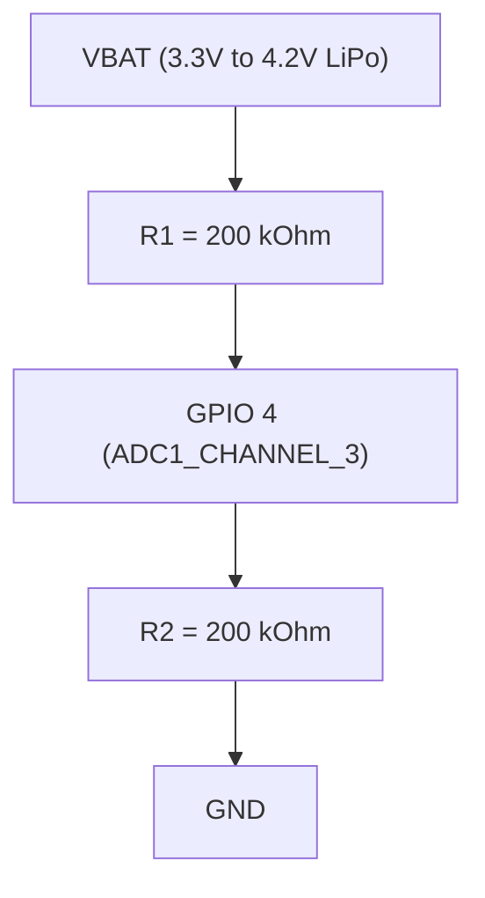

# Power Latch, Battery ADC Sensing & Sleep Retention

## 1. Power Latch Circuitry (BAT_CTRL / GPIO 17)

### Hardware Architecture
The Waveshare ESP32-S3 board features a hardware power latch circuit controlling the main 3.3V battery LDO regulator:
- **Control Line:** `BAT_CTRL` on `GPIO 17` (RTC GPIO 17).
- **Polarity:** Active HIGH (`1 = Regulator ON / Latched`, `0 = Regulator Cut / Off`).
- **Boot Trigger:** Pressing the POWER button physically bridges the gate, powering the MCU. The 2nd-stage bootloader (`h1os_boot_hook`) immediately drives `GPIO 17` HIGH and locks the RTC IO pad hold before the user releases the button.

### Lifecycle Sequencing
1. **2nd-Stage Bootloader (`h1os_boot_hook`):**
   - Configured as output, driven HIGH (`1`), and locked via RTC IO pad hold (`RTC_CNTL_PAD_HOLD_REG` bit 17).
2. **Deep Sleep Entry:**
   - RTC IO pad hold remains untouched and asserted (`RTC_CNTL_PAD_HOLD_REG` bit 17 = 1).
   - Global deep sleep pad hold enabled: `gpio_deep_sleep_hold_en();`
   - RTC peripheral power domain kept ON: `esp_sleep_pd_config(ESP_PD_DOMAIN_RTC_PERIPH, ESP_PD_OPTION_ON);`
3. **System Shutdown (`hal_io_release_power_latch()`):**
   - Release pad holds: `gpio_deep_sleep_hold_dis(); gpio_hold_dis(HAL_PIN_POWER_HOLD);`
   - Drive `GPIO 17` LOW (`0`).
   - If operating on battery, the LDO gate opens immediately and power is completely severed.

---

## 2. Battery Voltage Divider & Exclusive ULP Quiet-State ADC Sensing

### Hardware Circuit

- **Divider Transfer Function:**

$$
V_{\text{ADC}} = V_{\text{BAT}} \times \left(\frac{R_2}{R_1 + R_2}\right) = \frac{V_{\text{BAT}}}{2} \implies V_{\text{BAT}} = 2.0 \times V_{\text{ADC}}
$$

### ADC Configuration & Folded eFuse Calibration
- **ADC Unit & Mode:** `ADC_UNIT_1`, `ADC_ULP_MODE_RISCV`
- **Channel:** `ADC_CHANNEL_3` (`GPIO 4`)
- **Attenuation:** `ADC_ATTEN_DB_12` (Full-scale range 0 to 3.1V, matching the 1.6V to 2.1V divider output)
- **Bit Width:** 12-bit (`ADC_BITWIDTH_DEFAULT`, 0 to 4095 counts)
- **Folded 2-Point Calibration (`sub_power_get_ulp_cal_params`):**
  On cold boot, the main CPU evaluates the ESP32-S3 eFuse Curve Fitting calibration (`adc_cali_create_scheme_curve_fitting()`) at raw counts `2000` and `3000` and folds the $2\times$ voltage divider ratio directly into fixed-point Q12 slope (`ulp_cal_scale`) and offset (`ulp_cal_offset`):

$$
m_{\text{scale}} = \frac{2 \cdot (V_{3000} - V_{2000}) \cdot 4096}{1000}, \qquad b_{\text{offset}} = 2 \cdot V_{2000} - \frac{m_{\text{scale}} \cdot 2000}{4096}
$$

- **Exclusive ULP Resting Acquisition (`ulp/main.c`):**
  To eliminate active $I \cdot R$ load sag ($10 - 30\text{ mV}$ drop during main CPU/SPI/EPD activity), the main CPU **never** triggers ADC reads at runtime. Instead, the ULP-RISC-V coprocessor samples `ADC1_CHANNEL_3` during quiet deep sleep (`ulp_read_vbat_adc_bounded()`), converts to millivolts via `((raw * cal_scale) >> 12) + cal_offset`, and pushes the resting terminal voltage into an 8-entry circular ring buffer (`ulp_vbat_ring[8]`).

---

## 3. LiPo Open-Circuit Voltage (OCV) Lookup Table & Metrology

Lithium-Polymer discharge chemistry is non-linear. `sub_power` translates resting battery voltage from `ulp_vbat_ring[8]` into tenths of a percent (`0..1000` via `sub_power_mv_to_soc_tenths()`) and rounded percentage (`0..100%`) using the unified 13-point calibrated OCV piecewise lookup table (see [A8 Battery Metrology & Autonomy Engine](../architecture/A8_battery_and_power_management.md)):

| Cell Voltage ($V_{\text{BAT}}$) | SoC (Tenths of %) | State of Charge (SoC %) | Operating Region |
|---|---|---|---|
| **≥ 4200 mV** | 1000 | 100% | Full Charge Cutoff |
| **4120 mV** | 950 | 95% | Upper Knee Transition |
| **4040 mV** | 880 | 88% | Upper Plateau |
| **3960 mV** | 800 | 80% | Upper Plateau |
| **3890 mV** | 730 | 73% | Upper Plateau |
| **3820 mV** | 600 | 60% | Flat Discharge Plateau |
| **3780 mV** | 480 | 48% | Flat Discharge Plateau |
| **3750 mV** | 360 | 36% | Flat Discharge Plateau |
| **3720 mV** | 250 | 25% | Lower Plateau |
| **3680 mV** | 150 | 15% | Knee Departure |
| **3600 mV** | 80 | 8% | Low Battery Warning |
| **3450 mV** | 30 | 3% | Critical Cutoff Imminent |
| **≤ 3300 mV** | 0 | 0% | Absolute Discharge Cutoff |

Remaining operating autonomy (`autonomy_days`, `avg_draw_ma`, and `mah_spent_lap`) is calculated via `sub_power_calc_autonomy()` over total elapsed runtime (`total_sleep_sec` + `total_app_run_ms`) without hardcoded current constants.

---

## 4. Deep Sleep Pad Isolation Matrix

When the system enters deep sleep (`hal_io_isolate_sleep_pads()` and `sub_power_enter_deep_sleep_mode()`), all digital outputs connected to external peripherals are latched to stable states while RTC wake inputs are explicitly unheld (`rtc_gpio_hold_dis`):

| Pin | Functional Name | Sleep Direction | Sleep State | Hold Mechanism | Purpose |
|---|---|---|---|---|---|
| `GPIO 17` | `BAT_CTRL` | Output | **HIGH (1)** | `RTC_CNTL_PAD_HOLD_REG` (Bootloader) | Keeps battery LDO gate energized |
| `GPIO 6` | `EPD_3V3_EN` | Output | **LOW (0)** | `RTC_CNTL_PAD_HOLD_REG` (Bootloader) | Keeps display & sensors powered in deep sleep |
| `GPIO 42` | `PA_EN` | Output | **LOW (0)** | `gpio_hold_en` (Bootloader) | Keeps ES8311 powered to prevent I2C ESD clamping |
| `GPIO 11` | `EPD_CS` | Output | **HIGH (1)** | `gpio_hold_en` | Deselects SSD1681 SPI interface |
| `GPIO 9` | `EPD_RST` | Output | **HIGH (1)** | `gpio_hold_en` | Prevents display controller hardware reset |
| `GPIO 10` | `EPD_DC` | Output | **HIGH (1)** | `gpio_hold_en` | Prevents floating D/C line oscillation |
| `GPIO 46` | `PA_CTRL` | Output | **LOW (0)** | `gpio_hold_en` | Keeps NS4168 amplifier in zero-power mute |
| `GPIO 14,15,16,38,45` | `I2S_*` | Output | **LOW (0)** | `gpio_hold_en` | Prevents floating I2S clock/data line leakage |
| `GPIO 3` | `STATUS_LED` | Output (OD) | **HIGH (1)** | `gpio_hold_en` | Turns status LED OFF |
| `GPIO 0` | `BUTTON_BOOT` | RTC Input | **Pullup EN** | **Hold Disabled (`rtc_gpio_hold_dis`)** | Live ULP GPIO Wakeup Trigger (Low level) |
| `GPIO 18` | `BUTTON_POWER`| RTC Input | **Pullup EN** | **Hold Disabled (`rtc_gpio_hold_dis`)** | Live ULP GPIO Wakeup Trigger (Low level) |
| `GPIO 5` | `RTC_INT` | RTC Input | **Pullup EN** | **Hold Disabled (`rtc_gpio_hold_dis`)** | Live ULP GPIO Wakeup Trigger (Low level) |
| `GPIO 4` | `BATTERY_ADC` | RTC Disabled | **Hi-Z** | **Hold Disabled (`rtc_gpio_hold_dis`)** | Isolated for ULP SAR ADC1_CH3 sampling |
