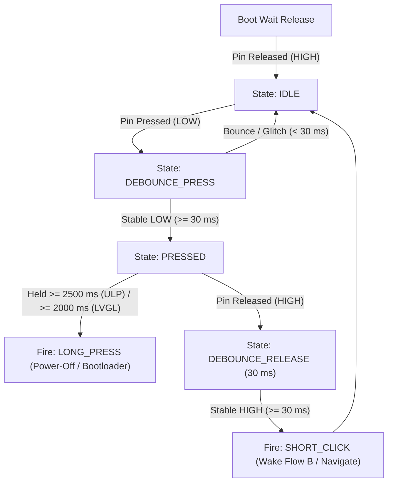

# Tactile Buttons, Status LED & User Interaction

## 1. Physical Specifications & Circuit Topologies

### Tactile Buttons (BOOT & POWER)
- **BOOT Button:** `GPIO 0` (`HAL_PIN_BUTTON_BOOT`)
- **POWER Button:** `GPIO 18` (`HAL_PIN_BUTTON_POWER`)
- **Circuit Architecture:**
  - Active LOW pushbuttons: Pin connects directly to GND when physically depressed.
  - **External $10\,\text{k}\Omega$ pull-up resistors to 3.3V** are physically present on the PCB for both lines, ensuring a stable HIGH state when unpressed ($330\,\mu\text{A}$ current sink when depressed).
  - Internal pull-up resistors ($\sim 45\,\text{k}\Omega$) are enabled in the RTC domain during deep sleep ($R_{\text{eff}} = 10\,\text{k}\Omega \parallel 45\,\text{k}\Omega \approx 8.2\,\text{k}\Omega$) for enhanced EMI/noise immunity.
  - Both pins reside in the **RTC IO Domain** and wake the ULP-RISC-V coprocessor in Pure Event Mode (`ULP_RISCV_WAKEUP_SOURCE_GPIO`).

### Status LED
- **LED Pin:** `GPIO 3` (`HAL_PIN_STATUS_LED`)
- **Circuit Architecture:**
  - Cathode is connected directly to `GPIO 3`.
  - Anode is tied through a current-limiting resistor to the 3.3V rail.
  - **Open-Drain Active LOW:**
    - `0` (Low level / Sink): **LED ON**
    - `1` (High level / High-Z): **LED OFF**
  - Driven via 10-bit hardware LEDC PWM (`hal_led_pwm_init()`, `hal_led_start_breathing()`) during active user sessions and isolated HIGH (`gpio_hold_en`) during deep sleep.

---

## 2. Button State Machine & Timing Parameters

During deep sleep, the reactive ULP-RISC-V monitor classifies button edges (Wake-on-Release tap vs. $\ge 2.5\text{s}$ hold). During active Flow B sessions, LVGL v9 manages button input directly via `LV_INDEV_TYPE_KEYPAD`:



### Timing Thresholds
- **ULP Deep-Sleep Debounce Window:** 30 ms (`BUTTON_DEBOUNCE_US = 30000`)
- **ULP Deep-Sleep Tap Window:** 30 ms to 2,500 ms (`BUTTON_TAP_MIN_MS = 30`, `BUTTON_TAP_MAX_MS = 2500`, Wake-on-Release)
- **ULP Deep-Sleep Long-Press Window:** 2,500 ms (`BUTTON_HOLD_US = 2500000`)
- **LVGL Active-Session Long-Press Window:** 2,000 ms (`lv_indev_set_long_press_time(indev, 2000)`)

### Built-in Long-Press Actions
- **Deep Sleep (`ulp/main.c`):**
  - `BOOT` (`GPIO 0`) held $\ge 2.5\text{s}$ $\to$ `ULP_DISPATCH_BOOTLOADER_JUMP` (reboots into ROM USB/UART Download Bootloader).
  - `POWER` (`GPIO 18`) held $\ge 2.5\text{s}$ $\to$ `ULP_DISPATCH_POWER_OFF` (executes `h1os_shutdown()`).
- **Active Session (`main.c` / LVGL Keypad):**
  - `LV_EVENT_LONG_PRESSED` ($\ge 2.0\text{s}$) $\to$ invokes `h1os_shutdown()`.

---

## 3. Deep Sleep ULP GPIO Wakeup Configuration

To allow the user to wake the device from deep sleep by pressing either button (or on PCF85063A RTC countdown expiration on `GPIO 5`), `sub_power_enter_deep_sleep_mode()` configures the RTC IO wake pins in Pure Event Mode with pad holds explicitly disabled:

```c
const gpio_num_t wake_pins[] = {HAL_PIN_BUTTON_BOOT, HAL_PIN_BUTTON_POWER, HAL_PIN_RTC_INT};
for (size_t i = 0; i < sizeof(wake_pins) / sizeof(wake_pins[0]); i++) {
    gpio_num_t pin = wake_pins[i];

    rtc_gpio_init(pin);
    rtc_gpio_set_direction(pin, RTC_GPIO_MODE_INPUT_ONLY);

    /* CRITICAL: Pad hold MUST be disabled on wake inputs so input buffers never freeze! */
    rtc_gpio_hold_dis(pin);

    rtc_gpio_pullup_en(pin);
    rtc_gpio_pulldown_dis(pin);
    rtc_gpio_wakeup_enable(pin, GPIO_INTR_LOW_LEVEL);
}

esp_sleep_enable_ulp_wakeup();
```

### Button Release Gating Before Sleep Entry
Before arming `RTC_CNTL_ULP_CP_GPIO_WAKEUP_ENA` and calling `esp_deep_sleep_start()`, `sub_power_enter_deep_sleep_mode()` waits for both `BOOT` (`GPIO 0`) and `POWER` (`GPIO 18`) (as well as `RTC_INT` `GPIO 5`) to release HIGH so a lingering physical press never triggers an immediate spurious wakeup.
