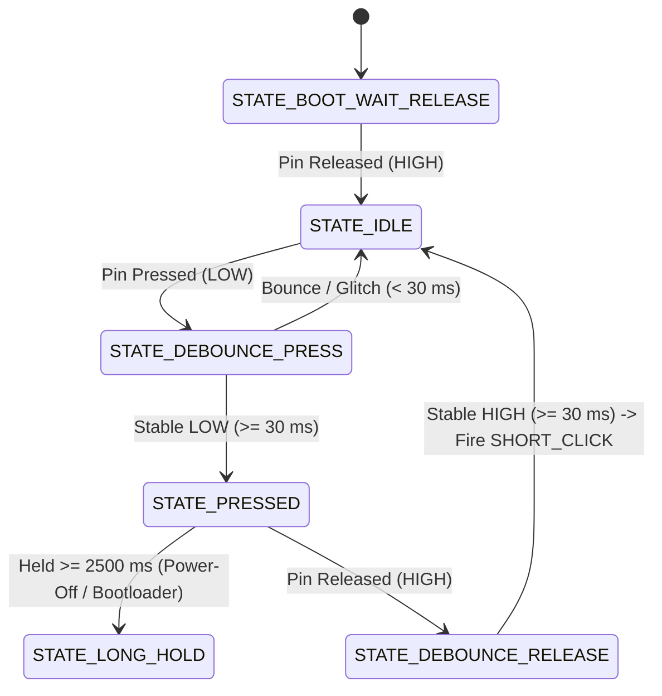

# Tactile Buttons, Status LED & User Interaction

## 1. Physical Specifications & Circuit Topologies

### Tactile Buttons (BOOT & POWER)
- **BOOT Button:** `GPIO 0` (`HAL_PIN_BUTTON_BOOT` / `BSP_PIN_BUTTON_BOOT`)
- **POWER Button:** `GPIO 18` (`HAL_PIN_BUTTON_POWER` / `BSP_PIN_BUTTON_POWER`)
- **Circuit Architecture:**
  - Active LOW pushbuttons: Pin connects directly to GND when physically depressed.
  - **External $10\,\text{k}\Omega$ pull-up resistors to 3.3V** are physically present on the PCB for both lines, ensuring a stable HIGH state when unpressed ($330\,\mu\text{A}$ current sink when depressed).
  - Internal pull-up resistors ($\sim 45\,\text{k}\Omega$) may be optionally enabled in parallel ($R_{\text{eff}} = 10\,\text{k}\Omega \parallel 45\,\text{k}\Omega \approx 8.2\,\text{k}\Omega$) for enhanced EMI/noise immunity in noisy RF environments.
  - Both pins reside in the **RTC IO Domain** and can wake the processor from deep sleep via `EXT1`.

### Status LED
- **LED Pin:** `GPIO 3` (`HAL_PIN_STATUS_LED` / `BSP_PIN_LED_STATUS`)
- **Circuit Architecture:**
  - Cathode is connected directly to `GPIO 3`.
  - Anode is tied through a current-limiting resistor to the 3.3V rail.
  - **Open-Drain Active LOW:**
    - `0` (Low level / Sink): **LED ON**
    - `1` (High level / High-Z): **LED OFF**

---

## 2. Button State Machine & Timing Parameters

During deep sleep, the reactive ULP-RISC-V monitor classifies button edges (tap on release vs. $>2.5\text{s}$ hold). During active Flow B sessions, LVGL v9 manages button input directly via `LV_INDEV_TYPE_KEYPAD`:



### Timing Thresholds
- **Debounce Window:** 30 ms (`debounce_ms`)
- **Long Press Window:** 2,500 ms (`long_press_ms`)

### Built-in Power Button Long-Press Action
If `auto_power_off_on_hold` is enabled (default `true`):
```c
if (btn == BSP_BUTTON_POWER && event == BSP_BUTTON_EVENT_LONG_PRESS) {
    ESP_LOGW(TAG, "Power button long-press detected! Initiating power off...");
    bsp_power_off();
}
```

---

## 3. Deep Sleep EXT1 Wakeup Configuration

To allow the user to wake the device from deep sleep by pressing either button:
```c
uint64_t ext1_pin_mask = (1ULL << GPIO_NUM_0) | (1ULL << GPIO_NUM_18);

// Ensure RTC IO pull-ups are enabled
rtc_gpio_init(GPIO_NUM_0);
rtc_gpio_set_direction(GPIO_NUM_0, RTC_GPIO_MODE_INPUT_ONLY);
rtc_gpio_pullup_en(GPIO_NUM_0);
rtc_gpio_pulldown_dis(GPIO_NUM_0);

rtc_gpio_init(GPIO_NUM_18);
rtc_gpio_set_direction(GPIO_NUM_18, RTC_GPIO_MODE_INPUT_ONLY);
rtc_gpio_pullup_en(GPIO_NUM_18);
rtc_gpio_pulldown_dis(GPIO_NUM_18);

// Arm EXT1 low-level wake trigger
esp_sleep_enable_ext1_wakeup_io(ext1_pin_mask, ESP_EXT1_WAKEUP_ANY_LOW);
```

### Button Release Gating Before Sleep Entry
Before calling `esp_deep_sleep_start()`, software must poll until both buttons are stable HIGH for at least 100 ms. Otherwise, the physical press that triggered the sleep command would immediately wake the device!
