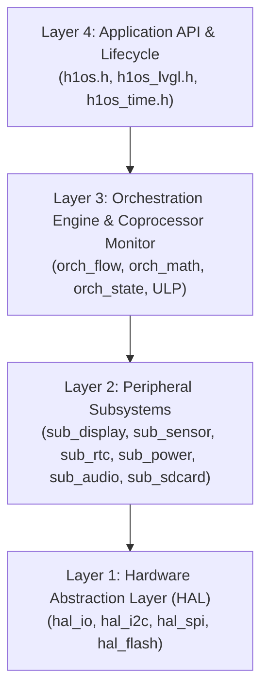

# 📖 H1OS Developer Guide & Reference Manual

**Target Hardware:** Waveshare ESP32-S3 ePaper 1.54" V2 (`ESP32-S3-PICO-1-N8R8`, Non-Touch)  
**Operating System:** H1OS (E-Class Environmental Telemetry Operating System)  
**Supported Frameworks:** ESP-IDF `v6.1` | LVGL `v9.6.0`  
**License:** MIT  

---

## 📑 Table of Contents

1. [Architectural Overview & Philosophy](#1-architectural-overview--philosophy)
2. [Lifecycle Engine & Application Entry](#2-lifecycle-engine--application-entry)
3. [Flow A: Headless Sensor Sample Burst](#3-flow-a-headless-sensor-sample-burst)
4. [Flow B: Interactive UI Session (Configurable Inactivity Sleep)](#4-flow-b-interactive-ui-session-configurable-inactivity-sleep)
5. [E-Class Psychrometric Invariant Engine](#5-e-class-psychrometric-invariant-engine)
6. [Display Architecture & Refresh Policy](#6-display-architecture--refresh-policy)
7. [Persistent State & Flash Frame Synchronization](#7-persistent-state--flash-frame-synchronization)
8. [ULP-RISC-V Coprocessor Monitor](#8-ulp-risc-v-coprocessor-monitor)
9. [Complete Application Template](#9-complete-application-template)

---

## 1. Architectural Overview & Philosophy

H1OS is an instrument-grade operating system designed specifically for low-power environmental telemetry on a non-touch monochrome e-Paper display. It solves the critical flaw in conventional battery instruments: **sensor self-heating bias**.



### Core Invariants
1. **Zero-Heat Sensing:** Periodic environmental sampling executes in isolated headless sample bursts before internal silicon heat can conduct across the PCB into the sensor cavity.
2. **Keep All Gates Open:** Critical power rails (`BAT_CTRL` GPIO 17, `EPD_3V3_EN` GPIO 6, `PA_EN` GPIO 42) remain latched and frozen via bootloader and RTC pad holds during sleep to eliminate capacitor inrush spikes and I2C bus clamping.
3. **No Polling in Deep Sleep:** The ULP-RISC-V coprocessor is event-driven; when the main Xtensa cores are awake, the ULP is completely gated off.
4. **Midnight-Agnostic Timing:** Wakes are governed strictly by the PCF85063A hardware countdown timer rather than calendar alarms to prevent day-rollover lockups.

---

## 2. Lifecycle Engine & Application Entry

Applications interface with H1OS through declarative lifecycle hooks defined in [`<h1os/h1os.h>`](../components/h1os/include/h1os/h1os.h):

```c
#include "h1os/h1os.h"

static void app_on_boot(void *user_data)
{
    ESP_LOGI("APP", "Boot initialized");
}

static void app_on_wake(const h1os_wake_context_t *ctx, void *user_data)
{
    ESP_LOGI("APP", "Woke from sleep (Causes bitmask: 0x%08lX)", (unsigned long)ctx->wakeup_causes);
}

static void app_on_pre_sleep(uint32_t sleep_sec, void *user_data)
{
    ESP_LOGI("APP", "Entering sleep for %lu seconds", (unsigned long)sleep_sec);
}

void app_main(void)
{
    h1os_lifecycle_t lifecycle = {
        .on_boot = app_on_boot,
        .on_wake = app_on_wake,
        .on_pre_sleep = app_on_pre_sleep,
        .on_shutdown = NULL,
        .session = {
            .inactivity_timeout_sec = 30, // Developer-configured inactivity sleep timeout
            .enable_dfs_80mhz       = true,
            .flow_a_period_sec      = 60, // Developer-configured sensor sample burst interval
            .flow_b_period_sec      = 120,// Developer-configured display refresh interval
        },
    };

    h1os_start(&lifecycle);
}
```

---

## 3. Flow A: Headless Sensor Sample Burst

When internal timer wakeup occurs (governed by `flow_a_period_sec`), H1OS executes Flow A without booting the secondary core, Wi-Fi stacks, or display drivers:
1. SHTC3 sensor wakes via I2C (`0x3517`).
2. Reads 16-bit raw temperature and relative humidity in **Normal Power Mode** (`0x7866`) to preserve full ADC resolution and measurement accuracy.
3. Updates the Tri-Node ring buffer and recalculates the vapor pressure invariant.
4. Returns directly to deep sleep immediately upon measurement completion.

---

## 4. Flow B: Interactive UI Session (Configurable Inactivity Sleep)

When the user taps `BOOT` (GPIO 0) or `POWER` (GPIO 18), H1OS initiates Flow B:
- Spawns the LVGL v9 runtime task and renders the interactive screen (displaying an inverted page indicator badge in the top-right header to show the active awake state).
- Starts the **configurable inactivity countdown** (`session.inactivity_timeout_sec`, default 30s).
- Any button press resets the inactivity countdown back to the configured `inactivity_timeout_sec` duration.
- When the inactivity timeout elapses, the system clears the inverted awake badge and executes the coordinated 8-step sleep transition sequence:
  1. Drain LVGL render and flush pipeline completely (`h1os_lvgl_has_pending_tasks()`).
  2. Wait for audio playback idle and hardware soft-mute zero-cross ramp (`sub_audio_wait_idle()`).
  3. Wait for physical EPD BUSY falling edge on `GPIO 8` (`sub_display_wait_busy()`).
  4. Post-busy microcapsule voltage settling guard ($250\text{ ms}$).
  5. Commit dirty framebuffer to raw SPI flash partition `epd_frame` if modified (`orch_display_sync_save_if_dirty()`).
  6. Command SSD1681 display controller into Deep Sleep Mode 1 (`sub_display_enter_deep_sleep()`).
  7. Arm external PCF85063A countdown timer (`sub_rtc_arm_countdown()`).
  8. Zero-Hour conflict avoidance & hardware deep sleep entry (`sub_power_enter_deep_sleep()`).

> **Note on RTC Countdown Wake:** If the system is woken by the external PCF85063A countdown timer purely to update the e-paper display, it renders the frame (with the standard non-inverted sleep badge), flushes to the screen, and **immediately returns to deep sleep** without entering an interactive countdown session.

---

## 5. E-Class Psychrometric Invariant Engine

H1OS avoids synthetic curve fitting by tracking physical thermodynamic invariants:
- **Saturation Vapor Pressure ($e_s$):**

  $$
  e_s(T) = 6.112 \cdot \exp\left(\frac{17.625 \cdot T}{243.04 + T}\right) \quad [\text{hPa}]
  $$

- **Vapor Pressure ($e$):**

  $$
  e = \frac{RH}{100} \cdot e_s(T) \quad [\text{hPa}]
  $$

- **True Dew Point ($T_{\text{dew}}$):**

  $$
  T_{\text{dew}} = \frac{243.04 \cdot \ln(e / 6.112)}{17.625 - \ln(e / 6.112)} \quad [^\circ\text{C}]
  $$

- **Ambient RH Reconstruction:**

  $$
  RH_{\text{ambient}} = 100 \cdot \frac{e}{e_s(T_{\text{ambient\_floor}})}
  $$

---

## 6. Display Architecture & Refresh Policy

- **Resolution:** 200×200 pixels monochrome, non-touch (5000 bytes working RAM).
- **Format:** `LV_COLOR_FORMAT_I1` with 1-bit packed binary typography (`H1OS_FONT_14`, `H1OS_FONT_20`, `H1OS_FONT_32`).
- **Full-Suite Bold Typography:** Build-time synthesized `Montserrat-Bold` with `--autohint-strong` bilevel rasterization, ensuring 2-to-3-pixel solid stems that eliminate hairline stroke erosion on 188 DPI glass.
- **Keypad Indev:** Hardware tactile buttons are exposed as `LV_INDEV_TYPE_KEYPAD`:
  - `BOOT` (GPIO 0): `LV_KEY_NEXT` (toggles screens / focuses objects).
  - `POWER` (GPIO 18): `LV_KEY_ENTER`.
- **Differential Partial Refresh:** Custom 159-byte partial LUT performs differential screen updates without full-screen flashing.
- **Anti-Ghosting Threshold (6-Cycle Quota):** Automatically triggers a full OTP refresh after every 6 partial updates (`CONFIG_H1OS_EPD_PARTIAL_REFRESH_LIMIT`, default 6) to reset residual DC bias and restore peak pigment contrast.
- **Power-Off & Long-Term Storage Reset:** `h1os_shutdown()` (when `CONFIG_H1OS_EPD_CLEAN_WHITE_ON_SHUTDOWN=y`, default) and `h1os_shutdown_for_storage()` drive all microcapsules to clean white (`0xFF`) via a full OTP refresh before cutting battery power, preventing dye migration, charge accumulation, and permanent burn-in.

---

## 7. Persistent State & Flash Frame Synchronization

- **RTC Slow Memory:** State is preserved across deep sleep in `< 512 bytes` (`orch_persisted_state_t`), leaving 7.5 KB free for the ULP coprocessor.
- **Flash Frame Sync:** When the display is marked dirty, `orch_display_sync_save_if_dirty()` writes the 5000-byte frame to the raw `epd_frame` partition. On wake, `orch_display_sync_restore_to_framebuffer()` restores the prior frame for differential updates.

---

## 8. ULP-RISC-V Coprocessor Monitor

While the main cores are in deep sleep, the ULP coprocessor runs autonomously in RTC Slow SRAM:
- **Brownout Threshold Detection:** Monitors battery voltage via ADC1 CH3 (GPIO 4); wakes the main CPU for emergency shutdown if $V_{\text{bat}} < 3.25\text{V}$.
- **Zero-Volt Cable Guard:** Ignores the brownout threshold if $V_{\text{bat}} < 100\text{mV}$ (indicates USB cable power with no battery connected).
- **Wake-on-Release Rule:** Waits for button release before waking the main Xtensa core, ensuring the main application starts with clean released input state.
- **Long-Press Classifier:** Classifies button holds $> 2.5\text{s}$ into bootloader mode (`BOOT`) or power cut (`POWER`).

---

## 9. Complete Application Template

See [`examples/H1OS/main/main.c`](../examples/H1OS/main/main.c) for a complete working reference application featuring modular screen navigation, Montserrat bold typography, and multi-node telemetry.
