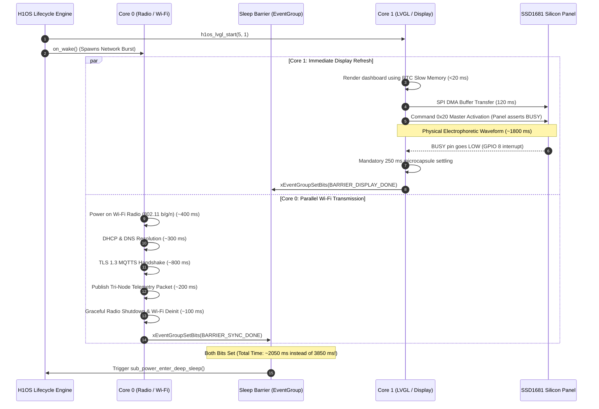

# Architectural Specification: H1OS Lifecycle Concurrency & Dual-Core Engine

## 1. Problem Breakdown: "How Would This Work Exactly?"

When we run Core 0 (Wi-Fi/Radio/Telemetry) in parallel with Core 1 (LVGL v9 / SSD1681 E-Paper Display), two critical hardware and physics constraints dictate the system behavior:

### Constraint 1: The Electrophoretic Waveform Lockout
An E-Paper display is not an LCD/OLED panel. Once the SSD1681 controller receives Master Activation (`0x20`), it drives high-voltage ($\pm 15\text{V}$) analog waveforms across physical microcapsules for **$300\text{ ms}$ (partial)** or **$1800\text{ ms}$ (full OTP)**.
* During this physical movement, the SSD1681 asserts `BUSY` HIGH (`GPIO 8`).
* Any SPI commands sent while `BUSY` is HIGH are ignored or cause display controller panic.
* **The "Double Refresh" Trap:** If Core 1 triggers a screen refresh with cached data at $T=0$, and Core 0 finishes downloading new cloud data at $T=2000\text{ ms}$, triggering a *second* refresh wastes battery, flashes the screen twice, and violates the e-paper low-refresh invariant.

### Constraint 2: Telemetry Directionality (Outbound vs Inbound)
* **Case A: Outbound Reporting (95% of Periodic Wakes in Flow B):**
  The device wakes purely to update local sensor telemetry on the screen and upload historical samples to the cloud (e.g. ThingsBoard / MQTT).
  - **Silicon Reality:** Local SHTC3 and battery measurements are **already captured** in RTC Slow Memory (`orch_state_get()`) by the ULP coprocessor / Flow A stub *prior* to FreeRTOS boot!
  - Therefore, the data required for the display update is **$100\%$ available at $T=0$**.
* **Case B: Inbound Cloud Ingestion (e.g., Weather forecast, alerts, cloud commands):**
  The screen must display data that exists *only* on a remote server. The display cannot commit its final frame until Core 0's HTTP/MQTT fetch completes.

---

## 2. Comparative Matrix of the 4 Architectural Solutions

| Metric / Dimension | Solution 1: Scoped App Locking | Solution 2: Explicit Phased Lifecycle | Solution 3: Inter-Core Actor Queue (`h1os_ui_post`) | Solution 4: Overlapped Parallel Barrier (Full Mandate) |
| :--- | :--- | :--- | :--- | :--- |
| **Core 0 Execution** | Serial (Network then UI) | Phase 1 (`on_sync`): Network | Network posts async events | Network sync runs in parallel |
| **Core 1 Execution** | Pre-spawned, waits for lock | Phase 2 (`on_render`): UI render | Pops & executes UI events | E-paper renders in parallel |
| **Active Awake Duration** | Serial: $T_{\text{net}} + T_{\text{disp}}$ (~4.3s) | Serial: $T_{\text{net}} + T_{\text{disp}}$ (~4.3s) | Overlapped: $\approx \max(T_{\text{net}}, T_{\text{disp}})$ | **Optimal Overlap: $\max(T_{\text{net}}, T_{\text{disp}})$ (~2.5s)** |
| **Battery Energy Consumption** | High (100% baseline) | High (100% baseline) | Low (~60% baseline) | **Lowest (~58% baseline: 42% energy cut)** |
| **User Experience (Display Latency)** | Delayed until Wi-Fi finishes | Delayed until Wi-Fi finishes | Instant UI, async update | **Instant UI blit, background network** |
| **Mutex Contention** | Low ($<5\text{ ms}$ scoped) | Zero in I/O phase; bounded UI | **Zero user mutexes** | Bounded short lock ($<5\text{ ms}$) |
| **API Contract Impact** | Non-breaking | Breaking (`h1os_lifecycle_t`) | Additive helper API | Non-breaking / Opt-in flags |

---

## 3. The Hybrid Dual-Core Architectural Model

To resolve both constraints with zero wasted refresh cycles and maximum battery savings, the architecture combines:
1. **Core 0 (System Domain):** Runs FreeRTOS, LwIP, Wi-Fi, TLS, and application `on_wake()`.
2. **Core 1 (Presentation Domain):** Runs `h1os_lvgl_port_task()`.
3. **Inter-Core Actor Queue (`h1os_ui_post`):** Thread-safe FreeRTOS message pipe for Core 0 to send UI updates to Core 1 without mutex deadlocks.
4. **Display Frame Buffer Staging (`LV_DISP_RENDER_MODE_DIRECT`):** Core 1 prepares the next frame in RAM ($<30\text{ ms}$) but gates the hardware SPI/Waveform trigger on a synchronization barrier.
5. **Sleep Synchronization Barrier (`EventGroup`):** Ensures both radio teardown and display settling complete before asserting deep sleep.

```
+----------------------------------------------------------------------------------------------------+
|                                    CORE 0: System & Radio Domain                                   |
|                                                                                                    |
|  [ Flow B Boot ]                                                                                   |
|        |                                                                                           |
|        +---> Read Local Sensors from RTC Memory (Available Instantly!)                            |
|        |                                                                                           |
|        +---> Trigger Asynchronous Network Worker (Wi-Fi + TLS + MQTT)                             |
|        |         |                                                                                 |
|        |         |--- (Optional: Core 0 receives inbound cloud data)                               |
|        |         |    Calls: h1os_ui_post(apply_cloud_weather, data) --------------------+         |
|        |         |                                                                       |         |
|        |         +---> Wi-Fi Disconnect & Radio Sleep -> Signal SYNC_DONE                |         |
|        |                                                                                 |         |
+--------|---------------------------------------------------------------------------------|---------+
         |                                                                                 |
         | FreeRTOS IPC Channel (Lock-Free Event Queue)                                    |
         |                                                                                 v
+--------|-------------------------------------------------------------------------------------------+
|        v                                                                                           |
|  [ Spawn Core 1 Engine ]                                                                           |
|        |                                                                                           |
|        +---> Core 1 Renders Screen Frame in RAM using local sensor data (<25 ms)                   |
|        |                                                                                           |
|        +---> Flush Gate: Waits up to bounded window (T_sync_wait = 500 ms) for inbound messages:  |
|        |         |                                                                                 |
|        |         +---> Message arrived? Apply cloud data to RAM buffer immediately!                |
|        |         +---> No message / Timeout? Proceed with local sensor frame.                      |
|        |                                                                                           |
|        +---> Trigger Hardware SSD1681 SPI DMA & Waveform Refresh (Physical Electrophoretic Pulse)  |
|        |         |                                                                                 |
|        |         +---> BUSY deasserts + 250 ms settling -> Signal DISPLAY_DONE                     |
|        |                                                                                           |
|                                    CORE 1: Presentation Domain                                     |
+----------------------------------------------------------------------------------------------------+
                                                   |
                                                   v
                      +---------------------------------------------------------+
                      |         H1OS FreeRTOS Deep Sleep Event Barrier          |
                      |  xEventGroupWaitBits(SYNC_DONE | DISPLAY_DONE, ...)     |
                      |  -> Both tasks complete? Enter hardware deep sleep!     |
                      +---------------------------------------------------------+
```

---

## 4. Deep-Dive Timing Breakdown: Outbound vs Inbound

### Flow 1: Outbound Reporting (Parallel Overlap)
In standard periodic Flow B, Core 1 begins physical display refresh immediately, while Core 0 handles network transmission in parallel:



* **Physical Result:** The physical 1.8-second e-paper waveform executes concurrently with the 1.8-second TLS handshake.
* **Energy Savings:** $T_{\text{awake}} = \max(T_{\text{display}}, T_{\text{network}}) \approx 2.05\text{s}$, down from $3.85\text{s}$ (serialized).

---

### Flow 2: Inbound Ingestion (Gated Single-Refresh Pattern)
If the application specifically requires cloud data on the screen:
1. Core 1 prepares the UI layout in DRAM in $15\text{ ms}$.
2. Instead of immediately firing the physical high-voltage waveform, Core 1 checks an OS configuration flag: `wait_for_sync_ms` (e.g. $1500\text{ ms}$).
3. When Core 0 receives the cloud packet via MQTT/HTTP, it calls `h1os_ui_post(update_cloud_widgets, payload)`.
4. Core 1 executes `update_cloud_widgets` in RAM, updates the pixels, and **only then** fires the single physical waveform!
5. If the network times out, Core 1 flushes the screen with local data and displays a subtle offline icon.
* **Physical Result:** Exactly **ONE** physical refresh is fired. Zero double refreshes.

---

## 5. How `h1os_ui_post` and Scoped Locks Work in Code

### 5.1 The Actor Queue (`h1os_ui_post`)
When Core 0 wants to mutate UI state, it does **not** call LVGL functions directly (which would require locking against Core 1's `lv_timer_handler()`). Instead, it pushes a small work descriptor to a FreeRTOS Queue:

```c
/* In h1os_lvgl.h */
typedef void (*h1os_ui_fn_t)(void *arg);

typedef struct {
    h1os_ui_fn_t fn;
    void        *arg;
} h1os_ui_msg_t;

/**
 * @brief Thread-safe, non-blocking UI dispatch to Core 1.
 */
esp_err_t h1os_ui_post(h1os_ui_fn_t fn, void *arg, TickType_t wait_ticks)
{
    if (s_ui_queue == NULL || fn == NULL) {
        return ESP_ERR_INVALID_STATE;
    }
    h1os_ui_msg_t msg = {.fn = fn, .arg = arg};
    return (xQueueSend(s_ui_queue, &msg, wait_ticks) == pdPASS) ? ESP_OK : ESP_ERR_TIMEOUT;
}
```

### 5.2 Core 1 Execution Loop (`h1os_lvgl_port_task`)
Core 1 drains the queue before ticking LVGL. Since Core 1 has exclusive execution rights inside `h1os_lvgl_port_task`, **no mutex is needed at all**:

```c
static void h1os_lvgl_port_task(void *arg)
{
    h1os_ui_msg_t msg;
    while (s_lvgl_task_running) {
        /* Drain all queued UI mutation requests from Core 0 */
        while (xQueueReceive(s_ui_queue, &msg, 0) == pdPASS) {
            if (msg.fn) {
                msg.fn(msg.arg); /* Mutates LVGL widgets directly without mutex! */
            }
        }

        /* Tick LVGL engine */
        uint32_t delay_ms = lv_timer_handler();
        vTaskDelay(pdMS_TO_TICKS(delay_ms > 0 ? delay_ms : 5));
    }
    vTaskDelete(NULL);
}
```

### 5.3 When Is `h1os_lvgl_lock()` Still Used?
`h1os_lvgl_lock()` remains available for synchronous operations where Core 0 *must* read or synchronously query an LVGL coordinate/state:
```c
h1os_lvgl_lock(100);
int32_t y = lv_obj_get_y(status_bar);
h1os_lvgl_unlock();
```
Because the lock duration is $<2\text{ ms}$, contention is virtually nonexistent.

---

## 6. FreeRTOS Deep Sleep Synchronization Barrier

In `components/h1os/src/h1os_lifecycle.c`, the sleep barrier is implemented via static FreeRTOS EventGroup:

```c
#define BARRIER_SYNC_DONE    BIT0
#define BARRIER_DISPLAY_DONE BIT1

static EventGroupHandle_t s_barrier_group = NULL;
static StaticEventGroup_t s_barrier_group_buf;

/* Called when network finishes on Core 0 */
void h1os_sync_notify_complete(void)
{
    if (s_barrier_group) {
        xEventGroupSetBits(s_barrier_group, BARRIER_SYNC_DONE);
    }
}

/* Called when display finishes physical settling on Core 1 */
void h1os_display_notify_quiescent(void)
{
    if (s_barrier_group) {
        xEventGroupSetBits(s_barrier_group, BARRIER_DISPLAY_DONE);
    }
}

/* Sleep transition barrier */
static esp_err_t h1os_wait_for_sleep_barrier(uint32_t max_wait_ms)
{
    EventBits_t bits = xEventGroupWaitBits(
        s_barrier_group,
        BARRIER_SYNC_DONE | BARRIER_DISPLAY_DONE,
        pdFALSE,   /* Do not clear bits on exit */
        pdTRUE,    /* Wait for ALL bits (AND condition) */
        pdMS_TO_TICKS(max_wait_ms)
    );

    if ((bits & (BARRIER_SYNC_DONE | BARRIER_DISPLAY_DONE)) == (BARRIER_SYNC_DONE | BARRIER_DISPLAY_DONE)) {
        ESP_LOGI(TAG, "Sleep barrier satisfied: Network and Display are both quiescent");
        return ESP_OK;
    }

    ESP_LOGW(TAG, "Sleep barrier timed out (bits=0x%02lx), forcing deep sleep", (unsigned long)bits);
    return ESP_ERR_TIMEOUT;
}
```

---

## 7. Implementation Stages & Verification Path

1. **Stage 1: Pre-Spawn Core 1 Task & Strip Outer Lock (`h1os_lifecycle.c`):**
   - Call `h1os_lvgl_start(5, 1)` prior to `on_wake()`.
   - Remove `h1os_lvgl_lock(1000)` around `on_wake()`.
2. **Stage 2: Add `h1os_ui_post()` Queue in `h1os_lvgl.cpp`:**
   - Create 16-element `s_ui_queue` in `h1os_lvgl_init()`.
   - Drain queue in `h1os_lvgl_port_task()`.
3. **Stage 3: Event Barrier Synchronization in `h1os_lifecycle.c`:**
   - Initialize `s_barrier_group`.
   - Gate deep sleep transition on `BARRIER_SYNC_DONE | BARRIER_DISPLAY_DONE`.
4. **Stage 4: Hardware Measurement & Benchmarking:**
   - Measure active wake duration with oscilloscope / power profiler across Flow B wakes.
   - Verify zero double refreshes and confirm awake time drops from $\sim 4.3\text{s}$ to $\sim 2.5\text{s}$.

---

**Prepared by Humidyne Labs / Humiditron Systems Engineering**  
SPDX-License-Identifier: MIT
