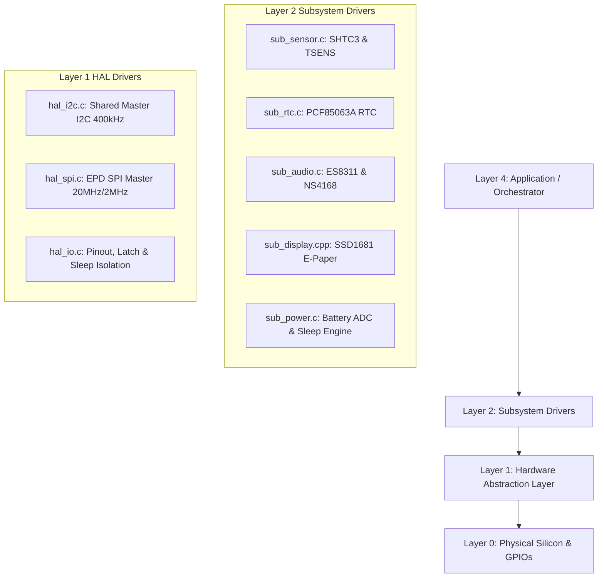

# Peripheral & Driver Verification: Hardware Matrix & Bus Architecture

## 1. System Overview & Bus Topology
The Waveshare ESP32-S3 e-Paper 1.54" V2 development board incorporates multiple ICs spanning high-speed SPI, standard I2C, I2S digital audio, 1-bit SDMMC, and analog sensing.

The table below defines the exact hardware assignment, physical pins, electrical characteristics, operating modes, and bus speeds.

| Subsystem / IC | Bus / Interface | Physical Pins (ESP32-S3) | Operating Parameters | Standby / Sleep Power | Verified Hardware Truth File |
|---|---|---|---|---|---|
| **Sensirion SHTC3** | Shared I2C (0x70) | SDA: `GPIO 47` SCL: `GPIO 48` | 400 kHz Fast-Mode External 4.7 kΩ Pull-ups to 3.3V Normal: 15ms @ ~800 µA Low-Power: 1ms @ ~300 µA | Sleep cmd: `0xB098` Iq < 0.2 µA | `legacy_reference/.../bsp_sensors.c` |
| **NXP PCF85063A** | Shared I2C (0x51) INT: Open-Drain | SDA: `GPIO 47` SCL: `GPIO 48` INT: `GPIO 5` | 400 kHz Fast-Mode External 4.7 kΩ Pull-ups to 3.3V 32.768 kHz Quartz (12.5pF) CLKOUT Disabled (`COF=0x07`) | Countdown Timer active Iq < 0.22 µA | `legacy_reference/.../bsp_rtc.c` |
| **Everest Semi ES8311** | Shared I2C (0x18) I2S Master | SDA: `GPIO 47`, SCL: `GPIO 48` MCLK: Internal/Unused BCLK: `GPIO 21`, WS: `GPIO 45` DOUT: `GPIO 40` (I2S DSDIN) | 16 kHz 16-bit Standard Philips Mono Root Clock: `PLL_160M` with DFS Lock 22-Register clock tree PA Rail: `GPIO 42` (Active LOW) | Standby cmd: `0x0D=0x00, 0x12=0x03` Rail kept ON (0) to avoid I2C clamping Iq < 1.0 µA | `legacy_reference/.../bsp_audio.c` |
| **NS4168 Class-D Amp** | Audio Power Amp | Enable/Mute: `GPIO 46` Power Rail: `GPIO 42` | Analog differential drive from ES8311 CTRL: 1 = Active, 0 = Muted | Muted: `GPIO 46 = 0` Iq < 1.0 µA | `legacy_reference/.../bsp_audio.c` |
| **Solomon Systech SSD1681** | SPI2 Master (Mode 0, 4-Wire) | MOSI: `GPIO 13`, SCK: `GPIO 12` CS: `GPIO 11`, DC: `GPIO 10` RST: `GPIO 9`, BUSY: `GPIO 8` 3V3 Rail: `GPIO 6` (Active LOW) | Write: 20 MHz SPI DMA Read (Temp): 2 MHz 3-Wire Half-Duplex Ping-Pong RAM `0x24` / `0x26` Partial LUT: 159 Bytes | Deep Sleep Mode 1 (`0x10=0x01`) RAM Retained Iq < 1.0 µA | `legacy_reference/.../bsp_display.cpp` |
| **Battery Sensing & Latch** | ADC1_CH3 RTC GPIO 17 | ADC: `GPIO 4` BAT_CTRL: `GPIO 17` | ADC 12 dB attenuation (0–3.1V) 1:2 Resistive Divider (100kΩ/100kΩ) BAT_CTRL: 1 = LDO Enabled | Deep Sleep Pad Hold: `GPIO 17 = 1` Shutdown: `GPIO 17 = 0` | `legacy_reference/.../bsp_power.c` |
| **MicroSD Card** | SDMMC 1-Bit Slot | CLK: `GPIO 39` CMD: `GPIO 41` D0: `GPIO 40` | SDMMC Default Speed (20 MHz) FATFS 16KB allocation unit | VFS unmount Pins tristate | `legacy_reference/.../bsp_sdcard.c` |
| **Tactile Buttons & LED** | GPIO Digital I/O | BOOT: `GPIO 0` POWER: `GPIO 18` LED: `GPIO 3` (Open-Drain) | External 100 kΩ Pull-ups to 3.3V Internal Pull-ups in parallel (45kΩ) LED: 0 = ON, 1 = OFF Debounce: 30ms, Hold: 2000ms | EXT1 Wakeup: ANY_LOW on 0 & 18 | `legacy_reference/.../bsp_button.c` |

---

## 2. Power Rails & Critical Sequencing Rules

### Rule 1: BAT_CTRL (GPIO 17) Power Latch
- **Hardware Circuit:** The battery power gate requires `GPIO 17` held HIGH to keep the main system LDO regulator enabled.
- **Boot Requirement:** Must be asserted HIGH in early boot (ROM stub / `hal_io_early_init()`) before software releases the button press.
- **Deep Sleep:** Must be locked using RTC IO domain hold (`rtc_gpio_hold_en(GPIO_NUM_17)`) and `esp_sleep_pd_config(ESP_PD_DOMAIN_RTC_PERIPH, ESP_PD_OPTION_ON)`.
- **System Off:** Disables RTC pad hold and drives `GPIO 17 = 0` to drop the regulator gate.

### Rule 2: EPD_3V3_EN (GPIO 6) Peripheral & E-Paper Rail
- **Active Level:** Active LOW (`0 = Power ON`, `1 = Power OFF`).
- **Deep Sleep:** Held LOW (`0`) in RTC IO domain to keep the SSD1681 and SHTC3 powered in deep sleep so they maintain RAM and calibration.

### Rule 3: PA_EN (GPIO 42) & ESD Diode Clamping Hazard
- **Active Level:** Active LOW (`0 = Power ON`, `1 = Power OFF`).
- **Critical Hardware Quirk:** The ES8311 I2C bus lines have internal ESD clamp diodes connected to its VDD rail. If `PA_EN` is set to HIGH (`1`, cutting power) while the shared I2C bus (GPIO 47/48) is pulled up to 3.3V, current flows through the ESD diodes into the unpowered rail, clamping the I2C bus voltage down to **~0.7V** and freezing communication with the PCF85063A RTC and SHTC3 sensor!
- **Mandate:** `PA_EN` **MUST REMAIN ENERGIZED (LOW / 0)** during all normal and sleep operations. Audio power saving is achieved strictly via ES8311 software standby (`0x0D=0x00, 0x12=0x03`) and NS4168 mute (`PA_CTRL GPIO 46 = 0`), which draws `< 1.0 µA`.

### Rule 4: I2S Clock Stability & Dynamic Frequency Scaling (DFS)
- **Clock Tree Source:** ESP32-S3 I2S generates BCLK and WS via fractional division ($N + b/a$) from `PLL_160M` (`I2S_CLK_SRC_DEFAULT`).
- **Frequency Scaling Risk:** If Dynamic Frequency Scaling (DFS) or CPU throttling occurs during audio playback without holding an `ESP_PM_APB_FREQ_MAX` lock, the root PLL frequency drops, causing audio playback speed and pitch to drop proportionally.
- **Mandate:** The I2S channel holds the APB/PLL max frequency lock during playback and releases it upon entering standby.

---

## 3. Four-Layer Clean-Slate Mapping

Every peripheral has a single Layer 1 HAL gateway and an isolated Layer 2 Subsystem controller. Higher layers NEVER talk to GPIO or bus handles directly.

---

## 4. Documentation Directory & Reference Index

| Spec # | Document | Scope & Physical Subsystem |
|---|---|---|
| `00` | [`00_overview_and_hardware_matrix.md`](00_overview_and_hardware_matrix.md) | Master pinout, bus topology, power sequencing, and architecture map. |
| `01` | [`01_shtc3_temp_humidity.md`](01_shtc3_temp_humidity.md) | Sensirion SHTC3 Relative Humidity & Temperature Sensor. |
| `02` | [`02_pcf85063a_rtc.md`](02_pcf85063a_rtc.md) | NXP PCF85063A Ultra-Low Power Calendar RTC & Countdown Timer. |
| `03` | [`03_es8311_ns4168_audio.md`](03_es8311_ns4168_audio.md) | Everest Semi ES8311 Codec & NS4168 Class-D Mono Power Amplifier. |
| `04` | [`04_ssd1681_epaper_display.md`](04_ssd1681_epaper_display.md) | Solomon Systech SSD1681 1.54" 200×200 E-Paper Display Controller. |
| `05` | [`05_power_latch_and_battery_adc.md`](05_power_latch_and_battery_adc.md) | Power Latch (`BAT_CTRL`), 12 dB Battery ADC & LiPo OCV Curve. |
| `06` | [`06_microsd_fatfs.md`](06_microsd_fatfs.md) | MicroSD Storage Slot & 1-Bit SDMMC Mode FATFS File System. |
| `07` | [`07_tactile_buttons_and_led.md`](07_tactile_buttons_and_led.md) | Tactile Pushbuttons (`BOOT`, `POWER`), 100k Pull-ups & Status LED. |
| `08` | [`08_hardware_errata_and_pcb_rev_guide.md`](08_hardware_errata_and_pcb_rev_guide.md) | Hardware Errata, Silicon Nuances & PCB Rev B Redesign Guidelines. |
